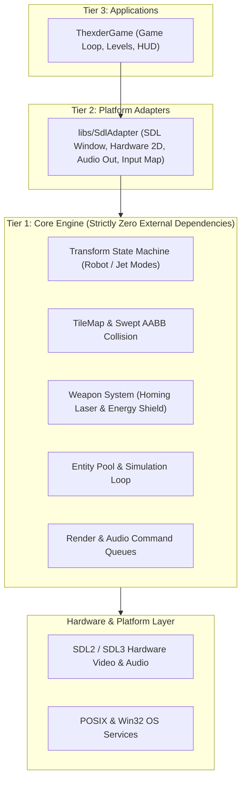

# Architecture & Layer Boundaries

## 1. Multi-Subsystem Tiered Architecture

The repository enforces a strict, modular tiered architecture across all current (`ShooterCore`, `SdlAdapter`) and **any future libraries** added to the codebase:

```
+-------------------------------------------------------------------------------+
|                       REPOSITORY LAYER BOUNDARIES                             |
|                                                                               |
|   [Tier 3: Presentation / Applications] (apps/ThexderGame, apps/*)             |
|         │                                                                     |
|         ▼                                                                     |
|   [Tier 2: Platform Adapters] (libs/SdlAdapter: SDL2/3 Renderer, Audio, Input)|
|         │                                                                     |
|         ▼                                                                     |
|   [Tier 1: Core / Domain Engine] (libs/ShooterCore)                           |
|         │  • Pure C++17                                                       |
|         │  • ZERO External Dependencies (NO SDL, NO OpenGL, NO OS headers)    |
|         │  • Zero-heap fast paths (CERT ERR55-CPP)                            |
|         │  • Decoupled Render & Audio Command Queues                          |
|         ▼                                                                     |
|   [Hardware / OS Layer] (SDL2 / SDL3, POSIX, Win32)                          |
+-------------------------------------------------------------------------------+
```



---

## 2. Universal Governance for Current & Future Libraries

1. **Automatic Classification Rule:**
   - Any library created under `libs/` that does **not** end in `Adapter` or `Platform` is automatically classified as a **Core Library** (e.g. `libs/ShooterCore`).
   - **Zero External Dependency Policy:** Core engine libraries must **never** include SDL headers (`#include <SDL...>`), OpenGL, Qt, or OS-specific headers (`<windows.h>`, `<unistd.h>`). They must be pure C++17, consumable by any client (SDL, Raylib, Headless Test Runner, WebAssembly).
   - Any platform or rendering integration must be isolated in a companion adapter module (e.g. `libs/SdlAdapter`).
2. **Co-located File Organization:**
   - Headers (`.h`) and implementations (`.cpp`) must reside in the same directory. Never create split `include/` and `src/` subdirectories.
3. **Modular CMake & Security Hardening:**
   - Every library has its own `CMakeLists.txt` and must apply `apply_compiler_flags` from `cmake/CompilerFlags.cmake` (`-Wall -Wextra -pedantic -Werror`, `/W4`, `-Wconversion`, `-fstack-protector-strong`, and sanitizers).
4. **Header Guards:**
   - Always use `#pragma once` as the first non-comment line. Never use legacy `#ifndef / #define` guards.
5. **Cross-Platform Portability:**
   - All code must compile and run cleanly on both **Linux** (GCC, Clang) and **Windows** (MSVC, Clang-CL).

---

## 3. Concurrency, Streaming & Real-Time Invariants

1. **Command Queues (Render & Audio Seams):**
   - The engine produces rendering and audio output through bounded, zero-heap command queues (`RenderCommandQueue`, `AudioCommandQueue`). The platform adapter drains these queues each frame.
2. **Fixed-Step Simulation Timestep:**
   - Physics and state updates operate on a deterministic, fixed delta time (e.g., 60 Hz = 16.666 ms).
3. **Zero Dynamic Allocation on Fast Paths (CERT ERR55-CPP):**
   - High-frequency simulation paths (collision queries, homing laser raycasts, particle pool ticks, entity updates) marked `noexcept` must not perform dynamic heap allocations (`std::string`, `std::vector`, `new`, `std::make_unique`). Operate strictly on pre-allocated pools, stack buffers, or `std::string_view`.

---

## 4. Abstraction & Layer Boundaries

1. **Program to Abstractions:**
   - Encapsulate rendering and audio backends behind command queues and abstract interfaces.
   - Expose clean domain entities and strongly-typed value objects (`TransformMode`, `EnergyPoints`, `ShieldGauge`, `WorldPos`, `TileCoord`, `Hitbox`).
2. **Strict Layer Boundary Hierarchy:**
   - Each layer may only communicate with its immediate neighbor directly below it. UI/Renderer components must interact through adapter objects, never modifying raw engine internals directly.
3. **Member Visibility:**
   - Keep all fields and helper functions private unless external exposure is explicitly required by interface contracts. Treat visibility changes as breaking design modifications.

---

## 5. Error Handling & Language Restrictions

1. **No Exceptions in Critical Paths:**
   - Core engine operations, collision resolvers, and simulation loops must not throw exceptions. Report errors via `bool`, `std::optional`, or error status codes.
2. **`noexcept` Specification:**
   - Mark all non-throwing operations as `noexcept` (especially destructors, move operations, and invariant-checked accessors).
3. **No C-Style Casts:**
   - Always use explicit C++ casts (`static_cast`, `const_cast`). C-style casts `(Type)val` are strictly banned.
4. **Atomic Expressions:**
   - Avoid compound expressions with side effects (e.g. `arr[i++] = ++j;`). Keep expressions simple and atomic.
