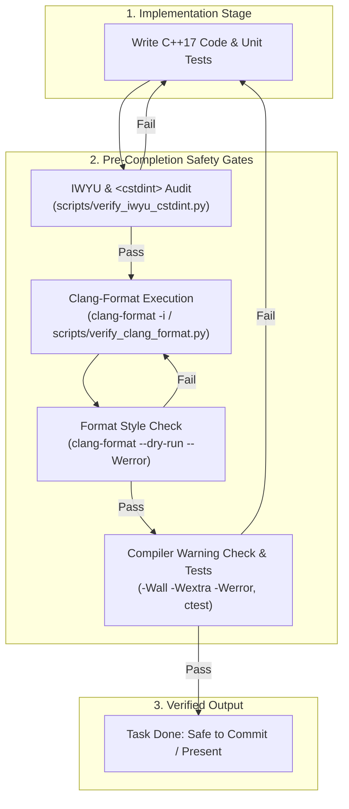

# Code Formatting & `clang-format` Policy

## Overview

Every C++ source file (`.cpp`) and header file (`.h`, `.hpp`) across all libraries and applications (`libs/ShooterCore`, `libs/SdlAdapter`, `apps/ThexderGame`, `tests/*`) must strictly adhere to the repository code style defined in [`.clang-format`](../../.clang-format).

Formatting is mandatory: whenever finishing any feature implementation, bug fix, or refactoring—and before committing or presenting code—`clang-format` must be run to format modified files in-place and verify zero style violations.

---

## 1. Style Rules & Configuration

The repository style is defined in [`.clang-format`](../../.clang-format) based on WebKit standards with project-specific settings:

- **Indentation & Spacing:** 4 spaces, never tabs (`UseTab: Never`, `IndentWidth: 4`).
- **Column Limit:** 120 characters (`ColumnLimit: 120`).
- **Pointer Alignment:** Left-aligned (`PointerAlignment: Left`, e.g. `Type* ptr`).
- **Brace Placement:** WebKit style (`BreakBeforeBraces: WebKit`).
- **One-Liners:** Never allow short functions, if-statements, or loops on a single line (`AllowShortFunctionsOnASingleLine: None`, `AllowShortIfStatementsOnASingleLine: Never`, `AllowShortLoopsOnASingleLine: false`).
- **Include Sorting:** Automatic alphabetical sorting within preserved include blocks (`SortIncludes: true`, `IncludeBlocks: Preserve`).

---

## 2. Implementation Completion Protocol

Whenever finishing an implementation task:
1. **Apply Formatting In-Place:** Format all authored or edited files before finalizing diffs or tests.
2. **Verify Cleanliness:** Run dry-run style checks with `-Werror` to verify zero formatting discrepancies remain.
3. **Prevent Unrelated Churn:** Format the target modified files specifically to avoid formatting unrelated legacy code in dirty working trees.

---

## 3. Tooling & Verification Commands

### In-Place Formatting on Modified Files:
```bash
clang-format -i <path/to/file.h> <path/to/file.cpp>
```
Or using the repository helper script:
```bash
python3 scripts/verify_clang_format.py --fix --files <path/to/file.h> <path/to/file.cpp>
```

### Verification (Dry-Run / CI Mode):
```bash
clang-format --dry-run --Werror <path/to/file.h> <path/to/file.cpp>
```
Or using the repository helper script:
```bash
python3 scripts/verify_clang_format.py --files <path/to/file.h> <path/to/file.cpp>
```

### Repository-Wide CMake Formatting Targets:
```bash
# Format entire repository in-place
cmake --build build --target format

# Check formatting across repository without modifying
cmake --build build --target check-format
```

---

## 4. Architectural Formatting & Verification Flow

### ASCII Diagram: Implementation to Format-Gate Pipeline

```
+-------------------------------------------------------------------------------+
|                    IMPLEMENTATION COMPLETION PIPELINE                         |
|                                                                               |
|   1. Code Implementation & Unit Tests                                         |
|         │                                                                     |
|         ▼                                                                     |
|   2. IWYU & <cstdint> Verification                                            |
|      python3 scripts/verify_iwyu_cstdint.py --files <modified_files>          |
|         │                                                                     |
|         ▼                                                                     |
|   3. Clang-Format In-Place & Style Gate                                       |
|      clang-format -i <modified_files>                                         |
|      python3 scripts/verify_clang_format.py --files <modified_files>          |
|         │                                                                     |
|         ▼                                                                     |
|   4. Zero Warnings Compilation & Test Suite Pass                              |
|      ctest --output-on-failure                                                |
|         │                                                                     |
|         ▼                                                                     |
|   Implementation Complete & Verified for Review / Commit                      |
+-------------------------------------------------------------------------------+
```

### Mermaid Diagram: Implementation Completion Verification



---

## 5. Verification Checklist

Before completing any implementation or submitting code changes:
- [ ] Modified C++ headers and source files have been formatted in-place using `clang-format -i`.
- [ ] Formatting verification passes cleanly with zero warnings: `python3 scripts/verify_clang_format.py --files <modified_files>`.
- [ ] No manual formatting regressions or unformatted diff chunks exist.
- [ ] Both IWYU and `clang-format` gates pass concurrently before staging or committing.

