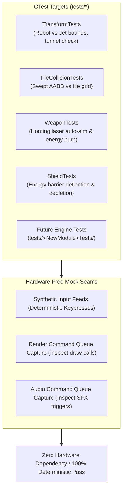

# Testing & Verification Standards

This rule governs automated testing, hardware-free simulation, and regression testing across the **entire codebase**—encompassing all current test targets and **any newly added libraries** in this repository.

---

## 1. Testing Architecture & Mock Seams

```
+-------------------------------------------------------------------------------+
|                       AUTOMATED TESTING & SEAM ARCHITECTURE                   |
|                                                                               |
|   tests/ (Unit, Regression & Physics Simulation Suites)                       |
|         │                                                                     |
|         ├── [Transform Tests]: Robot <-> Jet mode transitions, hitbox checks  |
|         ├── [Physics & Tile Collision]: Swept AABB, solid & breakable tiles   |
|         ├── [Weapon System Tests]: Homing laser targeting & energy drain      |
|         ├── [Shield Tests]: Barrier activation, projectile deflection         |
|         └── [Entity Tests]: Zero-heap entity pool reuse & lifecycle           |
|         │                                                                     |
|         ▼                                                                     |
|   Deterministic CTest Execution (`ctest --output-on-failure` -> 100% Pass)    |
+-------------------------------------------------------------------------------+
```



---

## 2. Test-Driven Bug Fixing (TDD)

When fixing any defect or regression in any module:
1. **Never write the fix first.**
2. **Step 1 (RED):** Write a targeted test that exposes and reproduces the bug. Confirm failure under `ctest`.
3. **Step 2 (GREEN):** Implement the minimal, MISRA/CERT-compliant fix.
4. **Step 3 (REFACTOR):** Confirm all tests pass with zero compiler warnings and zero compliance errors.

---

## 3. Repository Testing Conventions

1. **Automated CTest Suite:**
   - Execute all test suites via:
     ```bash
     ctest --test-dir build --output-on-failure
     ```
   - 100% of tests must pass with zero failures.
2. **Hardware-Free Simulation Requirement:**
   - Unit tests must **never** require an actual GPU, graphics context, SDL window, or audio device.
   - Use command queue inspections (`RenderCommandQueue`, `AudioCommandQueue`) and synthetic input feeds for deterministic headless verification.
3. **Game Mechanics Conformance:**
   - Verify transformation mechanics, laser auto-targeting formulas, energy pool drain rates, and tile collisions against specified game rules.
4. **Zero Dynamic Allocation Invariant Tests:**
   - Fast paths must be verified to operate without heap allocation during active gameplay frames.
5. **Universal Seam Rule for Any Future Library:**
   - Any new library added under `libs/<NewModule>` must include a companion test directory under `tests/<NewModule>Tests/` with hardware-decoupled mock seams.
