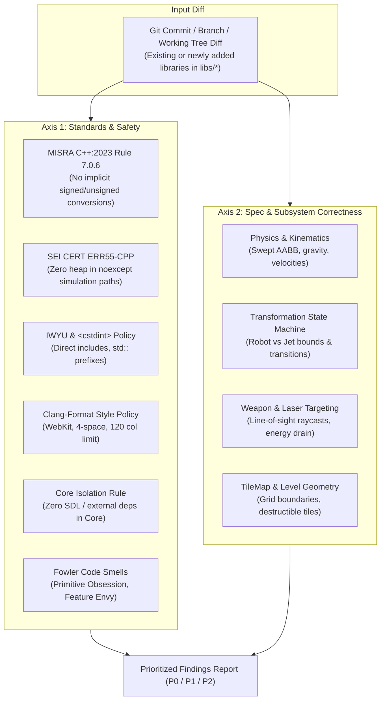

# Dual-Axis Code Review Workflow

This skill executes a systematic, dual-axis code review on any patch, commit range, pull request, or local working tree across all current and future modules in the repository.

---

## 1. Dual-Axis Review Model

```
+-------------------------------------------------------------------------------+
|                         DUAL-AXIS CODE REVIEW MODEL                           |
|                                                                               |
|   Diff / Working Tree (Any Current or Future Library in libs/*)              |
|         │                                                                     |
|         ├───► [Axis 1: Standards & Safety] ─────────────────────────┐         |
|         │       • MISRA C++:2023 & SEI CERT C++                     │         |
|         │       • IWYU & std:: fixed-width integer compliance       │         |
|         │       • Code Formatting (clang-format -i / check-format)  │         |
|         │       • Core Isolation (Zero SDL/external deps in Core)   ▼         |
|         │       • Fowler Code Smells (Primitive Obsession, etc.)[Prioritized] |
|         │                                                       [ Findings  ] |
|         └───► [Axis 2: Spec & Subsystem Integrity] ────────────►[ Report    ] |
|                 • Subsystem specification & mechanics integrity     ▲         |
|                 • Collision & kinematics stability (Swept AABB)     │         |
|                 • Real-time & frame path safety (0-heap noexcept)   │         |
|                 • Cross-platform portability (Linux & Win32)        ┘         |
+-------------------------------------------------------------------------------+
```



---

## 2. Review Axis 1: Standards, Compliance & Safety

1. **MISRA C++:2023 & SEI CERT C++ Rules:**
   - Are signed/unsigned conversions explicit via `static_cast`?
   - Do callables passed to algorithms take exact `value_type`?
   - Are `noexcept` functions on fast paths (frame loops, collision, targeting) free of heap allocation (`std::string`, `std::vector`, `new`, `std::make_unique`)?
2. **Include-What-You-Use (IWYU):**
   - Are all standard templates and symbols directly included?
   - Does every file using fixed-width integers include `<cstdint>` and use `std::` qualification?
3. **Code Formatting & Style:**
   - Has all code been formatted with `clang-format -i` per [`.clang-format`](../../../.clang-format)?
   - Does `python3 scripts/verify_clang_format.py` report zero violations?
4. **Architectural Isolation:**
   - Does `libs/ShooterCore` remain 100% free of external GUI, audio, or platform headers (`SDL`, `GL`, `Qt`, `windows.h`)?
5. **Code Smells & Domain Modeling:**
   - Is Primitive Obsession avoided by using strongly typed value objects?
   - Are illegal states unrepresentable?

---

## 3. Review Axis 2: Functional Specification & Subsystem Correctness

1. **Subsystem Logic:**
   - Are transformations, energy constraints, and hitbox transitions preserved?
2. **Physics & Kinematics:**
   - Are Swept AABB checks and velocities clamped to prevent tunneling?
3. **Collision Detection:**
   - Are TileMap boundaries correctly mapped and queried?
4. **Command Queues & Hardware Abstraction:**
   - Does the core engine emit commands to `RenderCommandQueue` and `AudioCommandQueue` without direct hardware interaction?
5. **Cross-Platform Portability:**
   - Does code build cleanly on GCC, Clang, and MSVC?

---

## 4. Step-by-Step Review Procedure

1. **Pin the Baseline:**
   ```bash
   git diff main...HEAD
   ```
2. **Run IWYU Verification:**
   ```bash
   python scripts/verify_iwyu_cstdint.py --strict
   ```
3. **Run Clang-Format Verification:**
   ```bash
   python scripts/verify_clang_format.py
   ```
4. **Execute CTest Suite:**
   ```bash
   ctest --test-dir build --output-on-failure
   ```
