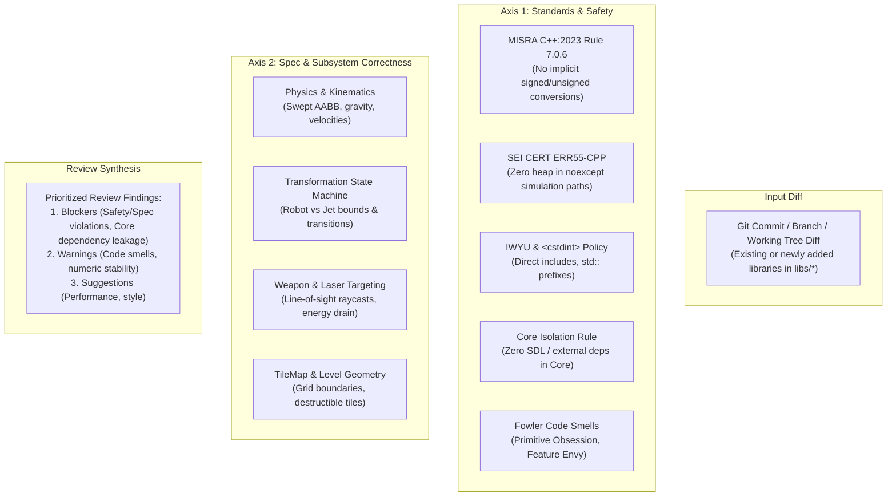

# Dual-Axis Code Review

This skill performs a rigorous, multi-perspective code review across the **entire codebase**—enforcing standards on all existing libraries (`libs/ShooterCore`, `libs/SdlAdapter`) as well as **any newly added or future libraries** in this repository.

It separates evaluation into two independent axes: **Standards & Safety** (MISRA/CERT compliance, architectural decoupling, code smells) and **Specification & Correctness** (subsystem requirements, physics/collision rules, mathematical correctness).

---

## 1. Review Architecture

```
+-------------------------------------------------------------------------------+
|                       DUAL-AXIS CODE REVIEW ARCHITECTURE                      |
|                                                                               |
|   Diff / Working Tree (Any Current or Future Library in libs/*)              |
|         │                                                                     |
|         ├───► [Axis 1: Standards & Safety] ─────────────────────────┐         |
|         │       • MISRA C++:2023 & SEI CERT C++                     │         |
|         │       • IWYU & std:: fixed-width integer compliance       │         |
|         │       • Core Isolation (Zero SDL/external deps in Core)   ▼         |
|         │       • Fowler Code Smells (Primitive Obsession, etc.)[Prioritized] |
|         │                                                       [ Findings  ] |
|         └───► [Axis 2: Spec & Subsystem Integrity] ────────────►[ Report    ] |
|                 • Subsystem specification & mechanics integrity     ▲         |
|                 • Collision & kinematics stability (Swept AABB)     │         |
|                 • Real-time & frame path safety (0-heap noexcept)   │         |
|                 • Cross-platform portability (Linux & Win32)        ┘         |
+-------------------------------------------------------------------------------+
```



---

## 2. Axis 1: Standards & Safety Checklist

1. **Fixed-Width Integers & `<cstdint>`:**
   - Are all fixed-width integer types (`int32_t`, `uint8_t`, etc.) scoped under `std::`?
   - Does every file using them explicitly `#include <cstdint>`?
2. **Include-What-You-Use (IWYU):**
   - Are all standard templates and symbols directly included?
   - Are forward declarations used in headers where pointers or references suffice?
3. **Core Decoupling:**
   - Does `libs/ShooterCore` have zero includes of SDL (`<SDL...>` or `<SDL2/...>`), OpenGL, or Qt?
4. **Exception Safety & `noexcept`:**
   - Are all methods on high-frequency simulation loops marked `noexcept` completely free of dynamic memory allocation?
5. **Type Safety & Primitive Obsession:**
   - Are physical quantities (coordinates, velocities, energy units, transform modes) wrapped into strong C++17 value objects?

---

## 3. Axis 2: Subsystem Integrity Checklist

1. **Physics & Collision:**
   - Are bounding box coordinates protected against inversions ($x_2 < x_1$ or $y_2 < y_1$)?
   - Are division-by-zero checks present in raycast slopes and velocity normalizations?
   - Does swept AABB collision prevent tunneling through thin tile walls?
2. **Transformation State Machine:**
   - Are height and width boundary transitions verified before changing mode (e.g., Jet cannot transform into Robot in a 1-tile high tunnel)?
   - Is transformation animation and delay deterministic?
3. **Weapons & Energy Management:**
   - Does homing laser auto-targeting pick the nearest valid entity within line of sight?
   - Does firing laser or raising shield deplete energy points deterministically?
   - Does energy zeroing immediately disengage active shield and laser?
4. **Command Queues & Hardware Abstraction:**
   - Does the core engine emit commands to `RenderCommandQueue` and `AudioCommandQueue` without direct hardware interaction?
5. **Cross-Platform Portability:**
   - Does code build cleanly on GCC, Clang, and MSVC?

---

## 4. Step-by-Step Review Procedure

1. **Pin the Baseline:**
   ```bash
   git diff main...HEAD
   ```
2. **Run IWYU Verification:**
   ```bash
   python scripts/verify_iwyu_cstdint.py --strict
   ```
3. **Execute CTest Suite:**
   ```bash
   ctest --test-dir build --output-on-failure
   ```
