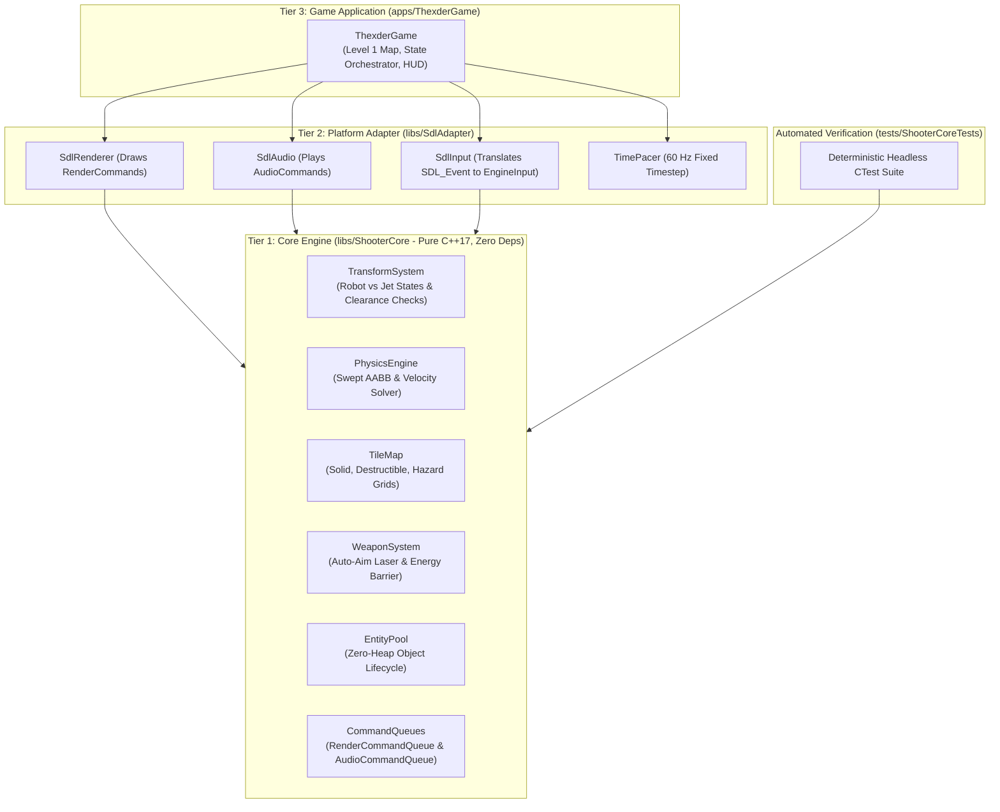
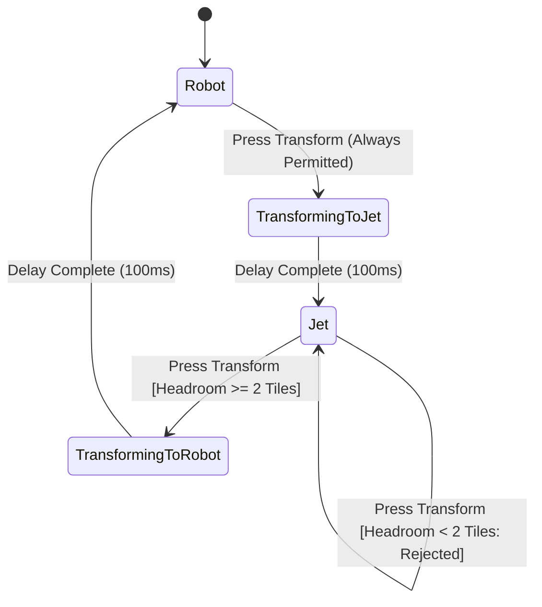
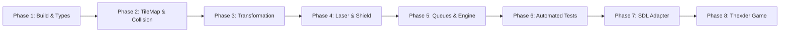

# Shoot'Em-Up Game Engine & Thexder Game Implementation Plan

## 1. Executive Summary

This project implements a high-performance, deterministic 2D Shoot'Em-Up Game Engine in **C++17** and a companion game inspired by Game Arts' classic **Thexder** (1985) and **Fire Hawk: Thexder - The Second Contact** (1989).

### Core Project Requirements & Boundaries
1. **Core Engine as Pure C++17 Library (`libs/ShooterCore`)**:
   - Strictly **zero external dependencies** (no SDL, no OpenGL, no Qt, no OS-specific API headers).
   - Zero-heap allocation during active frame updates (`CERT ERR55-CPP`).
   - Strongly-typed domain modeling eliminating primitive obsession (`MISRA C++:2023`, `SEI CERT INT31-C`).
   - Hardware-decoupled command queues for rendering and audio output.
2. **Platform & Presentation Adapter (`libs/SdlAdapter`)**:
   - SDL2-based presentation layer (windowing, hardware-accelerated 2D renderer, audio playback, input event translation).
   - Consumes abstract `RenderCommandQueue` and `AudioCommandQueue` emitted by the engine core.
3. **Thexder Game Application (`apps/ThexderGame`)**:
   - Robot $\leftrightarrow$ Jet dual-mode transformation.
   - Continuous auto-locking homing laser and energy shield barrier.
   - Single-pool energy management (energy drains for weapons/shields/damage and replenishes by destroying enemies).
   - Labyrinthine tilemap levels with destructible blocks, hazards, and tight 1-tile tunnels.
4. **Deterministic Automated Tests (`tests/ShooterCoreTests`)**:
   - 100% hardware-free, headless test suite running under CTest.

---

## 2. Architecture & Layer Boundaries

### ASCII Architectural Diagram
```
+-------------------------------------------------------------------------------+
|                       REPOSITORY LAYER BOUNDARIES                             |
|                                                                               |
|   [Tier 3: Game Application] (apps/ThexderGame)                               |
|         • Main Game Loop & Level Progression                                  |
|         • Level Maps & Asset Bindings                                         |
|         • HUD & Game State Flow                                               |
|         │                                                                     |
|         ▼                                                                     |
|   [Tier 2: Platform Adapters] (libs/SdlAdapter)                               |
|         • SDL2 Window & Hardware 2D Renderer                                  |
|         • Audio Device & Procedural SFX Synthesizer                           |
|         • Input Event Polling & Mapping                                       |
|         • Frame Pacer (Fixed-Step Timestep Accumulator)                       |
|         │                                                                     |
|         ▼                                                                     |
|   [Tier 1: Core Engine Library] (libs/ShooterCore)                            |
|         • Pure C++17, ZERO External Dependencies                              |
|         • Robot <-> Jet Transformation State Machine                          |
|         • Swept AABB Physics & TileMap Grid Collision                         |
|         • Auto-Targeting Homing Laser & Energy Shield System                   |
|         • Bounded Entity Pool (Zero-Heap Simulation)                          |
|         • RenderCommandQueue & AudioCommandQueue Emitted Each Tick            |
|         ▼                                                                     |
|   [Platform / OS Layer] (SDL2, Win32 / POSIX)                                 |
+-------------------------------------------------------------------------------+
```

### Mermaid Architectural Diagram


---

## 3. Thexder Game Mechanics Specification

### 3.1 Dual-Mode Transformation State Machine
- **Robot Mode**:
  - Dimensions: Width = 16 px (1 tile), Height = 32 px (2 tiles).
  - Movement: Ground walking with friction, jumping with gravity ($g \approx 980\text{ px/s}^2$).
  - Weapon: Aims homing laser in forward, diagonal, and upward arcs.
- **Jet Mode**:
  - Dimensions: Width = 32 px (2 tiles), Height = 16 px (1 tile).
  - Movement: Free omnidirectional flight, zero gravity, sustained thrust.
  - Tunnel Traversal: Fits through 1-tile-high passages that the Robot cannot enter.
  - **Invariant Check**: Transforming from Jet to Robot requires at least 2 clear vertical tiles; if ceiling clearance is obstructed, transformation is rejected to prevent wall clipping.

### ASCII Transformation Clearance Diagram
```
+-------------------------------------------------------------------------------+
|                       TRANSFORMATION CLEARANCE CHECK                          |
|                                                                               |
|   1-Tile Tunnel (Height = 1 Tile):                                            |
|   ##########################################                                  |
|   ===> [ Jet: 2x1 Tiles ] ===> Legal Traversal                               |
|   ##########################################                                  |
|                                                                               |
|   Attempting Transform to Robot inside 1-Tile Tunnel:                          |
|   ##########################################                                  |
|        [ Jet ] -> Attempt Transform -> BLOCKED: Insufficient Headroom!        |
|   ##########################################                                  |
+-------------------------------------------------------------------------------+
```

### Mermaid Transformation State Diagram


---

## 4. Subsystem Breakdown & Component Design

### 4.1 `libs/ShooterCore` (Pure C++17 Core Engine)
| File | Responsibility |
| :--- | :--- |
| `Types.h` | Strongly-typed value objects (`WorldPos`, `TileCoord`, `Velocity`, `Hitbox`, `EnergyPoints`, `DamageValue`, `TransformMode`). |
| `TileMap.h` / `.cpp` | 2D tile grid storage, query functions (`isSolid`, `isDestructible`), tile destruction. |
| `Hitbox.h` / `.cpp` | Axis-Aligned Bounding Box (AABB) intersection and swept continuous collision calculations. |
| `TransformSystem.h` / `.cpp` | Dual-mode transformation state machine with clearance checks and animation timers. |
| `WeaponSystem.h` / `.cpp` | Homing laser line-of-sight auto-targeting, energy drain pacing, shield barrier logic. |
| `EntityPool.h` | Zero-heap, bounded array object pool for players, enemies, and particles. |
| `RenderCommandQueue.h` | Decoupled render commands (`DrawSprite`, `DrawTile`, `DrawBeam`, `DrawBar`). |
| `AudioCommandQueue.h` | Decoupled audio trigger commands (`SoundEffectId`, `MusicTrackId`). |
| `EngineInput.h` | Normalized input bitmask (`Up`, `Down`, `Left`, `Right`, `Transform`, `Fire`, `Shield`). |
| `GameEngine.h` / `.cpp` | High-level simulation engine coordinating physics, weapons, enemies, and command emission. |

### 4.2 `libs/SdlAdapter` (Platform & Presentation Layer)
| File | Responsibility |
| :--- | :--- |
| `SdlWindow.h` / `.cpp` | RAII wrapper around `SDL_Window` and `SDL_Renderer`. |
| `SdlInput.h` / `.cpp` | Polls `SDL_Event` queue and translates keyboard/gamepad states to `EngineInputState`. |
| `SdlRenderer.h` / `.cpp` | Consumes `RenderCommandQueue` and executes 2D draw calls, sprites, and vector beams. |
| `SdlAudio.h` / `.cpp` | Low-latency audio stream player with procedural chiptune synth for retro laser & explosion SFX. |
| `TimePacer.h` / `.cpp` | Fixed 60 Hz simulation time accumulator with high-resolution frame pacing. |

### 4.3 `apps/ThexderGame` (Game Application)
| File | Responsibility |
| :--- | :--- |
| `Main.cpp` | Application entry point, initializes SDL, configures subsystems, runs main loop. |
| `Level1Map.h` / `.cpp` | Procedural or matrix definition of Thexder's cavernous Level 1 labyrinth. |
| `HudOverlay.h` / `.cpp` | Translates player energy, score, and weapon status into HUD render commands. |
| `ProceduralSprites.h` / `.cpp` | Vector/pixel sprite generation so the game runs cleanly out-of-the-box without missing asset files. |

### 4.4 `tests/ShooterCoreTests` (Automated Headless Verification)
| Target | Test Focus |
| :--- | :--- |
| `TestTransformSystem` | Robot $\leftrightarrow$ Jet mode transitions, 1-tile tunnel clearance enforcement. |
| `TestTileMapCollision` | Swept AABB against walls, corner sliding, destructible block destruction. |
| `TestWeaponSystem` | Laser line-of-sight raycasts, auto-targeting prioritization, energy consumption rates. |
| `TestShieldSystem` | Barrier invulnerability, projectile reflection, energy drain on collision. |
| `TestEntityPool` | Bounded capacity invariants, zero dynamic allocation on spawn/despawn. |

---

## 5. Implementation Roadmap (Step-by-Step)

### ASCII Implementation Flow
```
+-------------------------------------------------------------------------------+
|                       PHASED IMPLEMENTATION TIMELINE                          |
|                                                                               |
|   Phase 1: Build Structure & Root CMakeLists.txt (Compiler Flags, Types.h)    |
|         │                                                                     |
|         ▼                                                                     |
|   Phase 2: TileMap & Collision Solver (TileMap.h, Swept AABB Physics)         |
|         │                                                                     |
|         ▼                                                                     |
|   Phase 3: Transformation State Machine (Robot <-> Jet Clearance Logic)       |
|         │                                                                     |
|         ▼                                                                     |
|   Phase 4: Weapons & Energy System (Auto-Aim Laser & Shield Barrier)          |
|         │                                                                     |
|         ▼                                                                     |
|   Phase 5: Command Queues & GameEngine Core Simulation                        |
|         │                                                                     |
|         ▼                                                                     |
|   Phase 6: Automated Headless CTest Suite (tests/ShooterCoreTests)            |
|         │                                                                     |
|         ▼                                                                     |
|   Phase 7: SDL Presentation Adapter (Window, Renderer, Audio, Input)          |
|         │                                                                     |
|         ▼                                                                     |
|   Phase 8: Thexder Game Executable (Level 1 Map, HUD, Entity Spawners)        |
+-------------------------------------------------------------------------------+
```

### Mermaid Phase Breakdown


