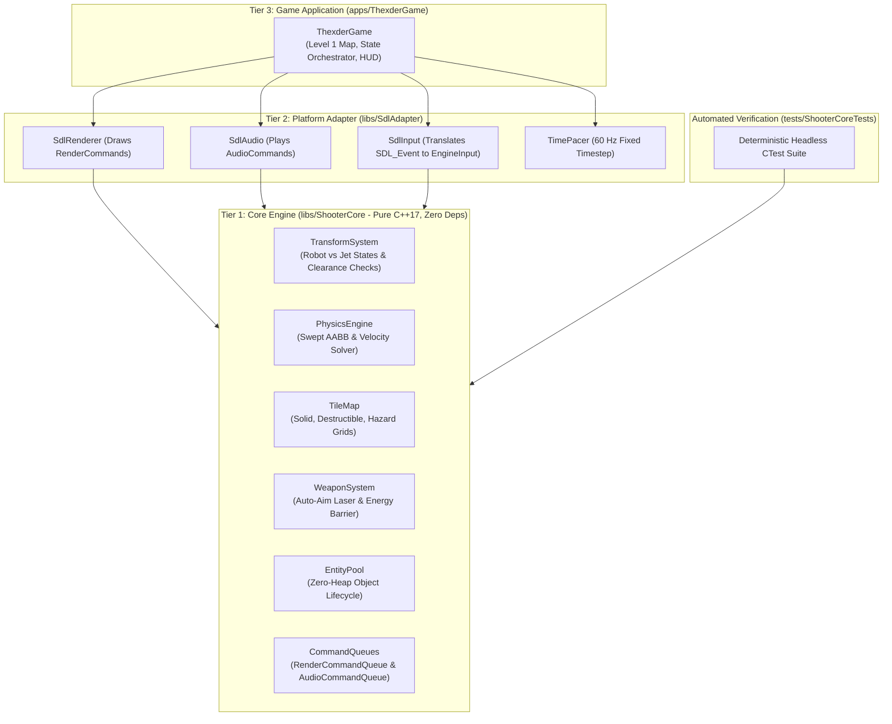
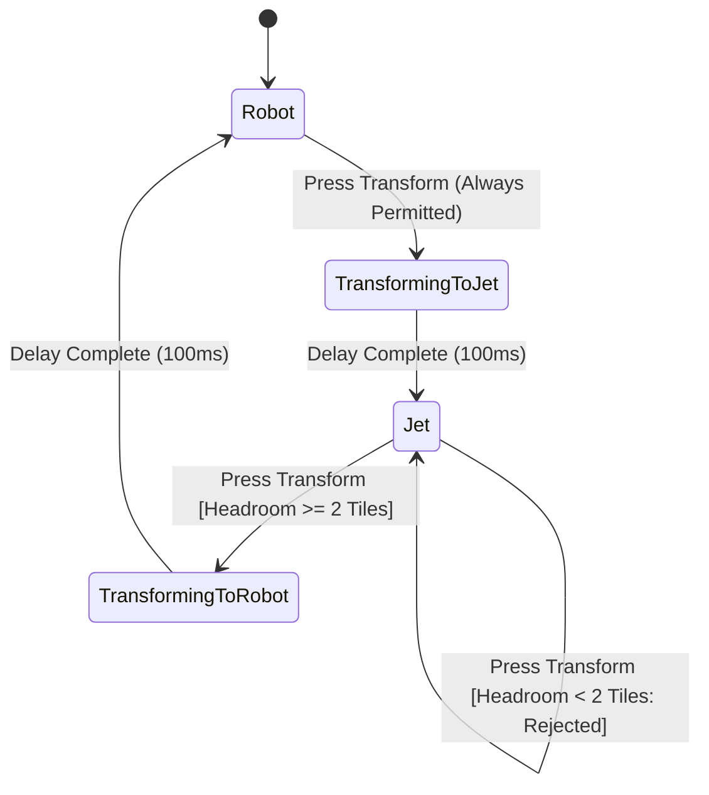
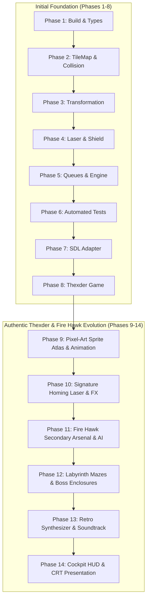
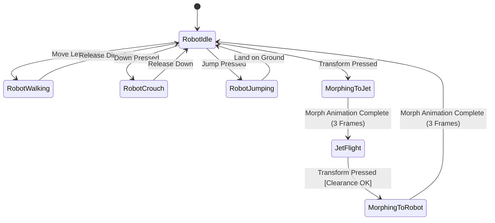
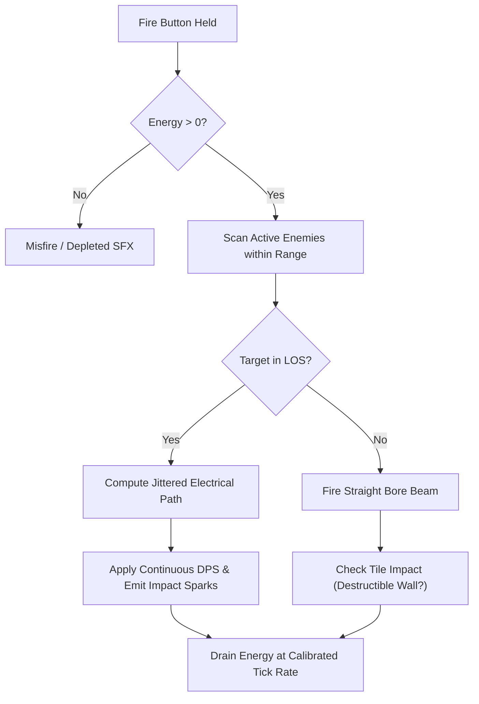

# Shoot'Em-Up Game Engine & Thexder Game Implementation Plan

## 1. Executive Summary

This project implements a high-performance, deterministic 2D Shoot'Em-Up Game Engine in **C++17** and a companion game inspired by Game Arts' classic **Thexder** (1985) and **Fire Hawk: Thexder - The Second Contact** (1989).

### Core Project Requirements & Boundaries
1. **Core Engine as Pure C++17 Library (`libs/ShooterCore`)**:
   - Strictly **zero external dependencies** (no SDL, no OpenGL, no Qt, no OS-specific API headers).
   - Zero-heap allocation during active frame updates (`CERT ERR55-CPP`).
   - Strongly-typed domain modeling eliminating primitive obsession (`MISRA C++:2023`, `SEI CERT INT31-C`).
   - Hardware-decoupled command queues for rendering and audio output.
2. **Platform & Presentation Adapter (`libs/SdlAdapter`)**:
   - SDL2-based presentation layer (windowing, hardware-accelerated 2D renderer, audio playback, input event translation).
   - Consumes abstract `RenderCommandQueue` and `AudioCommandQueue` emitted by the engine core.
3. **Thexder Game Application (`apps/ThexderGame`)**:
   - Robot $\leftrightarrow$ Jet dual-mode transformation.
   - Continuous auto-locking homing laser and energy shield barrier.
   - Single-pool energy management (energy drains for weapons/shields/damage and replenishes by destroying enemies).
   - Labyrinthine tilemap levels with destructible blocks, hazards, and tight 1-tile tunnels.
4. **Deterministic Automated Tests (`tests/ShooterCoreTests`)**:
   - 100% hardware-free, headless test suite running under CTest.

---

## 2. Architecture & Layer Boundaries

### ASCII Architectural Diagram
```
+-------------------------------------------------------------------------------+
|                       REPOSITORY LAYER BOUNDARIES                             |
|                                                                               |
|   [Tier 3: Game Application] (apps/ThexderGame)                               |
|         • Main Game Loop & Level Progression                                  |
|         • Level Maps & Asset Bindings                                         |
|         • HUD & Game State Flow                                               |
|         │                                                                     |
|         ▼                                                                     |
|   [Tier 2: Platform Adapters] (libs/SdlAdapter)                               |
|         • SDL2 Window & Hardware 2D Renderer                                  |
|         • Audio Device & Procedural SFX Synthesizer                           |
|         • Input Event Polling & Mapping                                       |
|         • Frame Pacer (Fixed-Step Timestep Accumulator)                       |
|         │                                                                     |
|         ▼                                                                     |
|   [Tier 1: Core Engine Library] (libs/ShooterCore)                            |
|         • Pure C++17, ZERO External Dependencies                              |
|         • Robot <-> Jet Transformation State Machine                          |
|         • Swept AABB Physics & TileMap Grid Collision                         |
|         • Auto-Targeting Homing Laser & Energy Shield System                   |
|         • Bounded Entity Pool (Zero-Heap Simulation)                          |
|         • RenderCommandQueue & AudioCommandQueue Emitted Each Tick            |
|         ▼                                                                     |
|   [Platform / OS Layer] (SDL2, Win32 / POSIX)                                 |
+-------------------------------------------------------------------------------+
```

### Mermaid Architectural Diagram


---

## 3. Thexder Game Mechanics Specification

### 3.1 Dual-Mode Transformation State Machine
- **Robot Mode**:
  - Dimensions: Width = 16 px (1 tile), Height = 32 px (2 tiles).
  - Movement: Ground walking with friction, jumping with gravity ($g \approx 980\text{ px/s}^2$).
  - Weapon: Aims homing laser in forward, diagonal, and upward arcs.
- **Jet Mode**:
  - Dimensions: Width = 32 px (2 tiles), Height = 16 px (1 tile).
  - Movement: Free omnidirectional flight, zero gravity, sustained thrust.
  - Tunnel Traversal: Fits through 1-tile-high passages that the Robot cannot enter.
  - **Invariant Check**: Transforming from Jet to Robot requires at least 2 clear vertical tiles; if ceiling clearance is obstructed, transformation is rejected to prevent wall clipping.

### ASCII Transformation Clearance Diagram
```
+-------------------------------------------------------------------------------+
|                       TRANSFORMATION CLEARANCE CHECK                          |
|                                                                               |
|   1-Tile Tunnel (Height = 1 Tile):                                            |
|   ##########################################                                  |
|   ===> [ Jet: 2x1 Tiles ] ===> Legal Traversal                               |
|   ##########################################                                  |
|                                                                               |
|   Attempting Transform to Robot inside 1-Tile Tunnel:                          |
|   ##########################################                                  |
|        [ Jet ] -> Attempt Transform -> BLOCKED: Insufficient Headroom!        |
|   ##########################################                                  |
+-------------------------------------------------------------------------------+
```

### Mermaid Transformation State Diagram


---

## 4. Subsystem Breakdown & Component Design

### 4.1 `libs/ShooterCore` (Pure C++17 Core Engine)
| File | Responsibility |
| :--- | :--- |
| `Types.h` | Strongly-typed value objects (`WorldPos`, `TileCoord`, `Velocity`, `Hitbox`, `EnergyPoints`, `DamageValue`, `TransformMode`). |
| `TileMap.h` / `.cpp` | 2D tile grid storage, query functions (`isSolid`, `isDestructible`), tile destruction. |
| `Hitbox.h` / `.cpp` | Axis-Aligned Bounding Box (AABB) intersection and swept continuous collision calculations. |
| `TransformSystem.h` / `.cpp` | Dual-mode transformation state machine with clearance checks and animation timers. |
| `WeaponSystem.h` / `.cpp` | Homing laser line-of-sight auto-targeting, energy drain pacing, shield barrier logic. |
| `EntityPool.h` | Zero-heap, bounded array object pool for players, enemies, and particles. |
| `RenderCommandQueue.h` | Decoupled render commands (`DrawSprite`, `DrawTile`, `DrawBeam`, `DrawBar`). |
| `AudioCommandQueue.h` | Decoupled audio trigger commands (`SoundEffectId`, `MusicTrackId`). |
| `EngineInput.h` | Normalized input bitmask (`Up`, `Down`, `Left`, `Right`, `Transform`, `Fire`, `Shield`). |
| `GameEngine.h` / `.cpp` | High-level simulation engine coordinating physics, weapons, enemies, and command emission. |

### 4.2 `libs/SdlAdapter` (Platform & Presentation Layer)
| File | Responsibility |
| :--- | :--- |
| `SdlWindow.h` / `.cpp` | RAII wrapper around `SDL_Window` and `SDL_Renderer`. |
| `SdlInput.h` / `.cpp` | Polls `SDL_Event` queue and translates keyboard/gamepad states to `EngineInputState`. |
| `SdlRenderer.h` / `.cpp` | Consumes `RenderCommandQueue` and executes 2D draw calls, sprites, and vector beams. |
| `SdlAudio.h` / `.cpp` | Low-latency audio stream player with procedural chiptune synth for retro laser & explosion SFX. |
| `TimePacer.h` / `.cpp` | Fixed 60 Hz simulation time accumulator with high-resolution frame pacing. |

### 4.3 `apps/ThexderGame` (Game Application)
| File | Responsibility |
| :--- | :--- |
| `Main.cpp` | Application entry point, initializes SDL, configures subsystems, runs main loop. |
| `Level1Map.h` / `.cpp` | Procedural or matrix definition of Thexder's cavernous Level 1 labyrinth. |
| `HudOverlay.h` / `.cpp` | Translates player energy, score, and weapon status into HUD render commands. |
| `ProceduralSprites.h` / `.cpp` | Vector/pixel sprite generation so the game runs cleanly out-of-the-box without missing asset files. |

### 4.4 `tests/ShooterCoreTests` (Automated Headless Verification)
| Target | Test Focus |
| :--- | :--- |
| `TestTransformSystem` | Robot $\leftrightarrow$ Jet mode transitions, 1-tile tunnel clearance enforcement. |
| `TestTileMapCollision` | Swept AABB against walls, corner sliding, destructible block destruction. |
| `TestWeaponSystem` | Laser line-of-sight raycasts, auto-targeting prioritization, energy consumption rates. |
| `TestShieldSystem` | Barrier invulnerability, projectile reflection, energy drain on collision. |
| `TestEntityPool` | Bounded capacity invariants, zero dynamic allocation on spawn/despawn. |

---

## 5. Implementation Roadmap (Step-by-Step)

### ASCII Implementation Flow
```
+---------------------------------------------------------------------------------------+
|                             PHASED IMPLEMENTATION TIMELINE                            |
|                                                                                       |
|   Phase 1: Build Structure & Root CMakeLists.txt (Compiler Flags, Types.h)            |
|         │                                                                             |
|         ▼                                                                             |
|   Phase 2: TileMap & Collision Solver (TileMap.h, Swept AABB Physics)                 |
|         │                                                                             |
|         ▼                                                                             |
|   Phase 3: Transformation State Machine (Robot <-> Jet Clearance Logic)               |
|         │                                                                             |
|         ▼                                                                             |
|   Phase 4: Weapons & Energy System (Auto-Aim Laser & Shield Barrier)                  |
|         │                                                                             |
|         ▼                                                                             |
|   Phase 5: Command Queues & GameEngine Core Simulation                                |
|         │                                                                             |
|         ▼                                                                             |
|   Phase 6: Automated Headless CTest Suite (tests/ShooterCoreTests)                    |
|         │                                                                             |
|         ▼                                                                             |
|   Phase 7: SDL Presentation Adapter (Window, Renderer, Audio, Input)                  |
|         │                                                                             |
|         ▼                                                                             |
|   Phase 8: Thexder Game Executable (Level 1 Map, HUD, Entity Spawners)                |
|         │                                                                             |
|         ▼ [AUTHENTIC THEXDER & FIRE HAWK FIDELITY ROADMAP]                            |
|   Phase 9: Authentic Pixel-Art Sprite Sheet & Animation Engine (EGA/VGA Atlas)        |
|         │                                                                             |
|         ▼                                                                             |
|   Phase 10: Signature Omni-Directional Homing Laser & Visual FX System                |
|         │                                                                             |
|         ▼                                                                             |
|   Phase 11: Fire Hawk (Thexder 2) Secondary Arsenal & Advanced Enemy AI               |
|         │                                                                             |
|         ▼                                                                             |
|   Phase 12: Sprawling Labyrinth Architecture, Secret Passages & Boss Enclosure        |
|         │                                                                             |
|         ▼                                                                             |
|   Phase 13: Multi-Channel Retro Synthesizer & Authentic Music Soundtrack              |
|         │                                                                             |
|         ▼                                                                             |
|   Phase 14: Cockpit HUD Dashboard, CRT Presentation & Polish                          |
+---------------------------------------------------------------------------------------+
```

### Mermaid Phase Breakdown


---

## 6. Authentic Thexder & Fire Hawk Evolution (Phases 9–14)

### Phase 9: Authentic Pixel-Art Sprite Sheet & Animation Engine
- **Objective**: Replace procedural geometric boxes (`SDL_RenderFillRect`) with authentic 16-color EGA / 256-color VGA sprite sheets and tilesets rendered through hardware-accelerated `SDL_Texture` and `SDL_RenderCopyEx`.
- **Key Deliverables**:
  - `SpriteAtlas`: Pre-baked or embedded pixel-matrix texture generator creating authentic Thexder sprites:
    - **Robot State**: Walking cycle (3 frames), crouch frame, jump/thruster frame, idle stance.
    - **Jet State**: Streamlined interceptor chassis, banking pitch angles, animated 2-frame exhaust afterburner flames.
    - **Transformation**: 3 intermediate morphing frames between Robot and Jet.
    - **Enemies**: Mechanical buzzers, flying manta scouts, crawling trilobites, and pulsing bio-nests.
  - **Tile Textures**: Metallic industrial panels, computer banks, power conduits, hazard lava, and destructible crystal barrier tiles.
- **Verification**: Visual sprite inspection in `apps/ThexderGame` and automated verification of sprite frame UV mapping and boundaries in `tests/SdlAdapterTests`.

### ASCII Sprite Sheet Organization Diagram
```
+-------------------------------------------------------------------------------+
|                       AUTHENTIC SPRITE ATLAS LAYOUT                           |
|                                                                               |
|   [Robot Walk 1]  [Robot Walk 2]  [Robot Jump]    [Robot Crouch]              |
|   (16x32 px)      (16x32 px)      (16x32 px)      (16x16 px)                  |
|                                                                               |
|   [Morph 1]       [Morph 2]       [Morph 3]       [Jet Flying]  [Jet Flame]   |
|   (24x24 px)      (28x20 px)      (32x16 px)      (32x16 px)    (8x16 px)     |
|                                                                               |
|   [Buzzer 1-2]    [Crawler 1-2]   [Manta Fly 1-2] [Bio-Nest Core]             |
|   (16x16 px)      (16x16 px)      (24x16 px)      (32x32 px)                  |
|                                                                               |
|   [Wall Metal]    [Tech Conduit]  [Breakable]     [Hazard Lava]               |
|   (16x16 px)      (16x16 px)      (16x16 px)      (16x16 px)                  |
+-------------------------------------------------------------------------------+
```

### Mermaid Sprite State Flow


---

### Phase 10: Signature Omni-Directional Homing Laser & Visual FX System
- **Objective**: Implement Thexder's iconic auto-locking lightning beam weapon and barrier shield effects.
- **Key Deliverables**:
  - **Homing Laser Trajectory Solver (`libs/ShooterCore/WeaponSystem.h`)**:
    - Scans an angular forward cone ($\pm 60^\circ$ or full $360^\circ$ tracking depending on mode).
    - Raycasts against line-of-sight obstacles in `TileMap` to prevent shooting through solid rock.
    - Selects the optimal target (closest high-threat enemy within range).
  - **Dynamic Lightning Beam Rendering (`libs/SdlAdapter/SdlRenderer.h`)**:
    - Displaces intermediate beam vertices with deterministic pseudo-random jitter for an authentic electric arc.
    - Dual-layer rendering: Thick luminous core surrounded by an additive blend outer glow (`SDL_BLENDMODE_ADD`).
    - Impact sparks and target recoil flashing.
  - **Energy Barrier Shield FX**:
    - Expanding/contracting translucent plasma bubble centered on the player craft.
    - Dynamic shield hit deflection ripples and audio hum feedback.

### ASCII Homing Laser Geometry
```
+-------------------------------------------------------------------------------+
|                       HOMING LASER ARCING SOLVER                              |
|                                                                               |
|                   [Tile Wall: Obstructed]                                     |
|                   #######################                                     |
|                                                                               |
|   [Thexder] ~~~~~/\~~~~~/\~~~~> [Enemy 1: Target Locked!]                     |
|         \                                                                     |
|          \ (Out of line-of-sight / Occluded)                                  |
|           \                                                                   |
|            x (Blocked) --> [Enemy 2 behind wall]                              |
+-------------------------------------------------------------------------------+
```

### Mermaid Laser Targeting Flow


---

### Phase 11: Fire Hawk (Thexder 2) Secondary Arsenal & Advanced Enemy AI
- **Objective**: Recreate the expanded tactical arsenal and combat depth introduced in *Fire Hawk: Thexder - The Second Contact*.
- **Key Deliverables**:
  - **Fire Hawk Secondary Arsenal**:
    - **Homing Micro-Missiles**: Self-propelled projectiles that accelerate and steer toward airborne enemies, leaving smoke particle trails.
    - **Screen-Clearing Flash Bomb**: Detonates a high-yield energy wave destroying all minor drones on screen.
    - **Weapon Selector Subsystem**: Cycle through available ordnance with dedicated HUD indicators.
    - **Cargo Canisters**: Periodic supply drops granting weapon recharges and temporary power upgrades.
  - **Advanced Enemy Behaviors**:
    - **Bio-Nest Generators**: Spawn escalating waves of insectoid/drone enemies until destroyed.
    - **Diving Interceptors**: High-speed suicide flight paths that force defensive jet maneuvers.
    - **Wall Crawlers & Ceiling Turrets**: Patrol labyrinth perimeters and fire aimed energy bolts.
- **Verification**: Deterministic headless simulation tests in `tests/ShooterCoreTests/TestWeaponSystem.cpp` and `TestEntitySpawner.cpp`.

---

### Phase 12: Sprawling Labyrinth Architecture, Secret Passages & Boss Enclosures
- **Objective**: Transition from a single-corridor test level into authentic sprawling, non-linear maze stages.
- **Key Deliverables**:
  - **Level Map Architecture**:
    - Multi-room layout with vertical shafts, 1-tile crawling tunnels requiring Jet mode, and security forcefields.
    - Keycard doors and security generators that must be destroyed to unlock boss chambers.
    - Hidden passages behind destructible masonry containing energy tanks.
  - **Camera & Room Navigation**:
    - Smooth deadzone scrolling with viewport boundary clamping.
    - Minimap / radar display showing player position relative to active sectors.
  - **Stage Boss Encounters**:
    - Multi-segment mechanical guardians with vulnerable core plates and attack pattern phases.

---

### Phase 13: Multi-Channel Retro Synthesizer & Authentic Music Soundtrack
- **Objective**: Deliver authentic 1980s chiptune and FM synthesizer audio utilizing SDL2's streaming audio callback.
- **Key Deliverables**:
  - **Multi-Channel Software Synthesizer (`libs/SdlAdapter/SdlAudio.h`)**:
    - Channels: 2 Square waves (lead & harmony), 1 Triangle wave (bass line), 1 White Noise generator (percussion & explosions).
    - ADSR envelope generator (Attack, Decay, Sustain, Release) for crisp laser zaps and resonant shield drones.
  - **Iconic Music Tracks**:
    - *Thexder* Signature: Chiptune arrangement of Beethoven's *Moonlight Sonata* (3rd Movement).
    - *Fire Hawk* Energetic Themes: Driving sci-fi synth-rock tracks composed for action gameplay.
  - **Sound Effect Suite**:
    - Signature homing laser hum, shield barrier activation drone, transformation mechanical servo sound, crystal pickup chime, and explosion crunch.

---

### Phase 14: Cockpit HUD Dashboard, CRT Presentation & Polish
- **Objective**: Elevate the visual presentation into an authentic retro arcade cockpit experience.
- **Key Deliverables**:
  - **Cockpit Dashboard Overlay**:
    - Molded cockpit frame surrounding the playfield.
    - Dual segmented LED/LCD bars for Energy Points and Shield Gauge.
    - Numeric LED score counters, secondary missile ammo count, and active transformation mode indicator.
  - **Retro Display Options**:
    - Pixel-perfect integer aspect ratio scaling ($320 \times 240$ native canvas upscaled cleanly to physical window dimensions).
    - Optional scanline and subtle CRT curvature shader effect.
    - Screen shake on heavy explosions and critical structural collapses.

