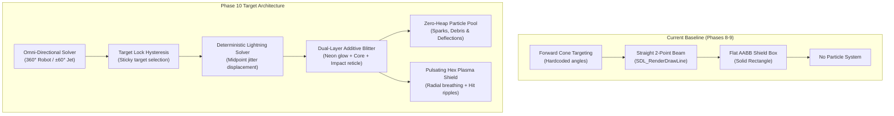
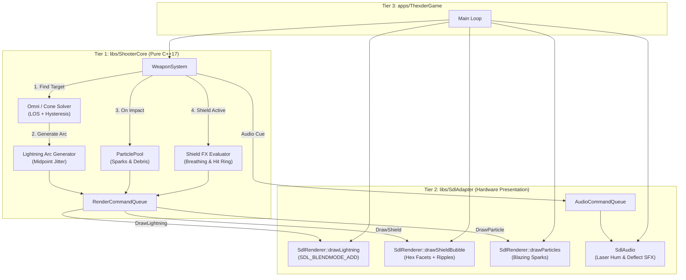
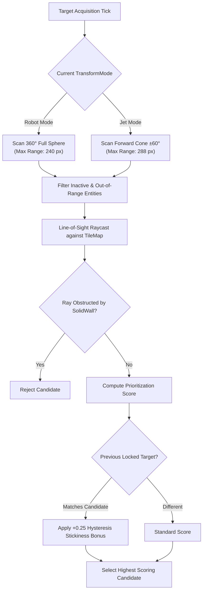
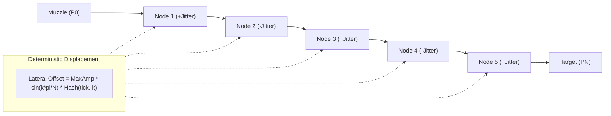
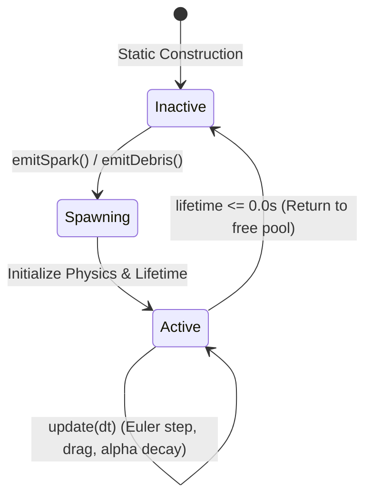
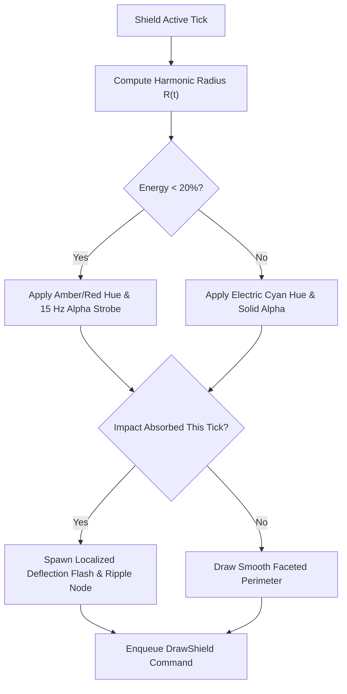
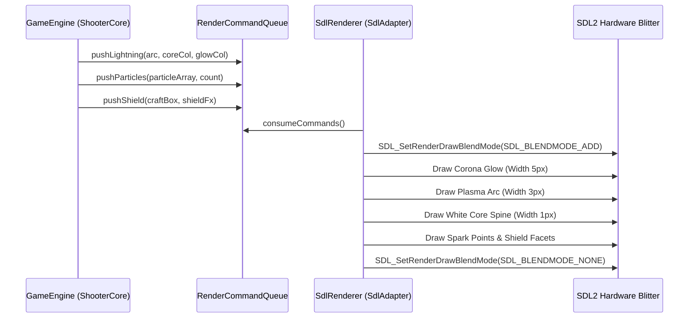

# Phase 10: Signature Omni-Directional Homing Laser & Visual FX System Implementation Plan

## 1. Executive Summary & Scope

Phase 10 implements the defining audiovisual hallmark of Game Arts' classic shooter: Thexder's **Signature Omni-Directional Auto-Aiming Homing Laser** and **Dynamic Energy Barrier Shield FX**.

In classic *Thexder* (1985) and *Fire Hawk: Thexder - The Second Contact* (1989), the combat gameplay is anchored by the auto-tracking lightning laser:
1. In **Robot Mode**, the pilot commands an omni-directional $360^\circ$ tracking envelope capable of automatically locking onto crawling bio-drones, ceiling turrets, and flying mantas regardless of heading.
2. In **Jet Mode**, the laser concentrates into a high-speed forward strafing arc ($\pm 60^\circ$) to support aerodynamic intercept runs.
3. The beam itself is not a static straight line; it is a **crackling, high-frequency, multi-segmented electric arc** that continuously seeks its locked target, accompanied by incandescent impact sparks and target recoil flashing.
4. The **Defensive Shield Barrier** manifests as a shimmering, pulsating plasma bubble with dynamic contact deflection ripples and low-power warning states.

This plan details the full implementation across Tier 1 ([`libs/ShooterCore`](../libs/ShooterCore)), Tier 2 ([`libs/SdlAdapter`](../libs/SdlAdapter)), Tier 3 ([`apps/ThexderGame`](../apps/ThexderGame)), and the automated test suites in [tests/ShooterCoreTests](../tests/ShooterCoreTests) and [tests/SdlAdapterTests](../tests/SdlAdapterTests).

---

### ASCII Baseline vs Phase 10 Visual FX Evolution

```
+---------------------------------------------------------------------------------------+
|                       PHASE 10 WEAPONS & VISUAL FX UPGRADE                            |
|                                                                                       |
|   CURRENT BASELINE (PHASE 8-9)                PHASE 10 AUTHENTIC HIGH FIDELITY        |
|                                                                                       |
|   1. Laser Targeting:                         1. Omni-Directional Targeting:          |
|      • Forward cone only (+-75 deg)              • Full 360-degree lock in Robot Mode |
|      • Rapid 1-frame target flickering           • Forward +-60 deg cone in Jet Mode  |
|                                                  • Target lock hysteresis (stickiness)|
|                                                                                       |
|   2. Laser Visuals:                           2. Crackling Lightning Arc:             |
|      • Flat single 2-point line                  • Multi-segment midpoint jitter arc  |
|      • Monochromatic red/cyan                    • Dual-layer additive neon glow      |
|                                                  • Pure white blazing plasma core     |
|                                                                                       |
|   3. Impact FX:                               3. Rich Particle FX System:             |
|      • Static 4-point yellow diamond             • Bounded zero-heap particle pool    |
|      • No sparks or wall debris                  • Ricochet impact sparks & debris    |
|                                                  • Entity hit recoil flash state      |
|                                                                                       |
|   4. Shield Barrier:                          4. Pulsating Plasma Forcefield:         |
|      • Flat blue translucent AABB box            • Hexagonal faceted plasma bubble    |
|      • No animation or hit ripples               • Radial breathing & hit ripples     |
|                                                  • Low-energy warning color shifts    |
+---------------------------------------------------------------------------------------+
```

### Mermaid Baseline vs Phase 10 Architecture Flow



---

### Core Objectives & Deliverables

1. **True $360^\circ$ Omni-Directional Auto-Targeting Solver ([`WeaponSystem`](../libs/ShooterCore/WeaponSystem.h))**:
   - Provide full $360^\circ$ spherical target acquisition for Robot mode while enforcing aerodynamic $\pm 60^\circ$ forward cone acquisition in Jet mode.
   - Enforce rigorous line-of-sight (LOS) raycasts through [`CollisionSolver`](../libs/ShooterCore/CollisionSolver.h) and [`TileMap`](../libs/ShooterCore/TileMap.h) so that laser energy never passes through solid subterranean bulkheads.
   - Implement **Target Lock Hysteresis** to prevent high-frequency jitter when multiple hostiles share near-identical distances.
2. **Deterministic Multi-Segment Lightning Arc Generator ([`WeaponSystem`](../libs/ShooterCore/WeaponSystem.h))**:
   - Decompose the continuous line between muzzle and locked target into an 8-to-12 segment electrical arc using deterministic pseudo-random midpoint displacement.
   - Execute with zero heap allocation (`CERT ERR55-CPP`) using a fixed-capacity node buffer ([`LightningArc`](../libs/ShooterCore/Types.h)).
3. **Zero-Heap Visual FX Particle Subsystem ([`ParticlePool`](../libs/ShooterCore/ParticlePool.h))**:
   - Implement a high-performance, bounded 128-slot particle pool in [`libs/ShooterCore`](../libs/ShooterCore) managing ricochet sparks, masonry crumble fragments, and barrier dissipation waves.
   - Deterministic physics integration (velocity, gravity, drag, lifetime alpha decay) without dynamic memory allocation.
4. **Dual-Layer Additive Neon Blitting Engine ([`SdlRenderer`](../libs/SdlAdapter/SdlRenderer.h))**:
   - Leverage `SDL_BLENDMODE_ADD` to render multi-pass incandescent beams: broad outer corona glow, electric cyan mid-layer, and high-intensity white core.
   - Render directional impact spark particles and target hit recoil silhouette flashing.
5. **Authentic Pulsating Hexagonal Plasma Shield Bubble ([`SdlRenderer`](../libs/SdlAdapter/SdlRenderer.h))**:
   - Render a faceted, translucent plasma bubble centered on the craft with harmonic radial breathing ($r(t) = r_0 + \Delta r \sin(\omega t)$).
   - Render dynamic deflection wave ripples and flash arcs at the collision contact point.
   - Provide low-energy visual warning shifts (pulsing red-amber when Energy $< 20\%$).
6. **Multi-Channel Audio/Visual Synchronization**:
   - Tightly couple laser arc jitter and barrier impacts to the audio synthesizer queue ([`AudioCommandQueue`](../libs/ShooterCore/AudioCommandQueue.h)), delivering crisp buzzing hums and resonant deflection transients.
7. **Comprehensive Automated Verification**:
   - Expand [tests/ShooterCoreTests](../tests/ShooterCoreTests) and [tests/SdlAdapterTests](../tests/SdlAdapterTests) covering $360^\circ$ coverage, LOS occlusion, particle pool saturation, and deterministic jitter.

---

## 2. Architecture & Subsystem Integration

The Phase 10 architecture strictly honors the three-tier architectural boundary:
- **Tier 1: Core Simulation Engine ([`libs/ShooterCore`](../libs/ShooterCore))**: Pure C++17, deterministic, zero dynamic allocation on fast paths (`CERT ERR55-CPP`), strictly zero external multimedia dependencies.
- **Tier 2: Presentation Adapter ([`libs/SdlAdapter`](../libs/SdlAdapter))**: Consumes hardware-independent render commands and outputs SDL2 accelerated graphics and streaming audio.
- **Tier 3: Game Application ([`apps/ThexderGame`](../apps/ThexderGame))**: Wires level maps, entity spawners, and player input into the engine loop.

### 2.1 ASCII Architectural Integration

```
+---------------------------------------------------------------------------------------+
|                               PHASE 10 ARCHITECTURAL FLOW                             |
|                                                                                       |
|   [Tier 1: libs/ShooterCore]                                                          |
|   ┌───────────────────────────────────────────────────────────────────────────────┐   |
|   │  WeaponSystem                                                                 │   |
|   │    • Omni-Directional 360° Solver (Robot) / +-60° Cone Solver (Jet)           │   |
|   │    • Target Lock Hysteresis (Sticky targeting prevents flip-flop)             │   |
|   │    • Midpoint Jitter Arc Generator (Deterministic pseudo-random nodes)        │   |
|   │                                                                               │   |
|   │  ParticlePool                                                                 │   |
|   │    • 128 Bounded Particle Slots (Laser sparks, wall debris, shield ripples)   │   |
|   │    • Zero heap allocation (Fixed array + free list)                           │   |
|   │                                                                               │   |
|   │  RenderCommandQueue                                                           │   |
|   │    • pushLightning(LightningArc arc, ColorRgba core, ColorRgba glow)          │   |
|   │    • pushShield(Hitbox craftBox, ShieldFxState fx)                            │   |
|   │    • pushParticle(WorldPos pos, ColorRgba color, float size)                  │   |
|   └──────────────────────────────────────┬────────────────────────────────────────┘   |
|                                          │ Render Commands (Zero-Copy)                |
|                                          ▼                                            |
|   [Tier 2: libs/SdlAdapter]                                                           |
|   ┌───────────────────────────────────────────────────────────────────────────────┐   |
|   │  SdlRenderer                                                                  │   |
|   │    • drawLightning: Pass 1 Additive Corona -> Pass 2 Plasma -> Pass 3 Core   │   |
|   │    • drawShieldBubble: Faceted hex arc vertices + breathing + hit ripples     │   |
|   │    • drawParticles: High-speed point/quad blit with alpha decay               │   |
|   │    • Recoil Flash: White silhouette overlay on damaged entities               │   |
|   └──────────────────────────────────────┬────────────────────────────────────────┘   |
|                                          │ Frame Presentation                         |
|                                          ▼                                            |
|   [Tier 3: apps/ThexderGame]                                                          |
|   ┌───────────────────────────────────────────────────────────────────────────────┐   |
|   │  Game Loop: Polls input -> Advances simulation -> Presents audiovisuals       │   |
|   └───────────────────────────────────────────────────────────────────────────────┘   |
+---------------------------------------------------------------------------------------+
```

### 2.2 Mermaid Subsystem Flow Diagram



---

## 3. Detailed Component Specifications

### 3.1 Omni-Directional Targeting & Trajectory Solver

In authentic *Thexder*, Robot mode allows targeting any enemy within line of sight across a full $360^\circ$ circle. In Jet mode, high forward velocity restricts the pilot to an aerodynamic forward cone of $\pm 60^\circ$.

#### Targeting Geometry Specification

```
+---------------------------------------------------------------------------------------+
|                       OMNI-DIRECTIONAL TARGETING ENVELOPE                             |
|                                                                                       |
|                 ROBOT MODE: FULL 360° SPHERE          JET MODE: FORWARD +-60° CONE    |
|                                                                                       |
|                          Up [0, -1]                               Up [0, -1]          |
|                              |                                        .               |
|                      \       |       /                             .  |  .            |
|                        \     |     /                             .    |    .          |
|                          \   |   /                             .      |      .        |
|               Left [-1,0] ──[ROBOT]── Right [1,0]             .───[JET]───. (Facing)  |
|                          /   |   \                             .      |      .        |
|                        /     |     \                             .    |    .          |
|                      /       |       \                             .  |  .            |
|                              |                                        '               |
|                         Down [0, 1]                              Down [0, 1]          |
|                     Radius: 240 units                        Radius: 288 units        |
+---------------------------------------------------------------------------------------+
```



#### Multi-Factor Scoring Formula

For candidate target $i$, the scoring function $S(i)$ evaluates:

$$S(i) = w_{\text{dist}} \cdot \left(1.0 - \frac{d_i}{d_{\text{max}}}\right) + w_{\text{angle}} \cdot \max(0, \cos \theta_i) + w_{\text{threat}} \cdot T_i + w_{\text{sticky}} \cdot \delta_{\text{locked}}(i)$$

Where:
- $d_i$: Euclidean distance from craft muzzle to candidate center.
- $d_{\text{max}}$: Mode range limit ($240.0\text{ px}$ in Robot mode, $288.0\text{ px}$ in Jet mode).
- $\theta_i$: Angle between craft forward heading and line to candidate (in Robot mode, angle weight is softened to favor pure proximity).
- $T_i$: Threat weight ($1.0$ for active hostile drones, $0.2$ for destructible terrain blocks).
- $\delta_{\text{locked}}(i)$: Kronecker delta equals $1.0$ if candidate was locked in previous frame, $0.0$ otherwise.
- Weights:
  - Robot Mode: $w_{\text{dist}} = 0.55$, $w_{\text{angle}} = 0.10$, $w_{\text{threat}} = 0.20$, $w_{\text{sticky}} = 0.25$.
  - Jet Mode: $w_{\text{dist}} = 0.40$, $w_{\text{angle}} = 0.35$, $w_{\text{threat}} = 0.20$, $w_{\text{sticky}} = 0.25$.

The $+0.25$ stickiness bonus ensures smooth lock retention and prevents rapid, single-frame beam oscillation between multiple clustered enemies.

---

### 3.2 Deterministic Lightning Arc Generator

Rather than a static straight line segment, the Thexder laser beam is modeled as a jagged electrical arc that vibrates and crackles dynamically.

#### Midpoint Jitter Displacement Algorithm
1. The line segment connecting `muzzle` $(P_0)$ and `target` $(P_N)$ forms the base axis of length $L$.
2. The segment is subdivided into $N = 8$ equidistant nodes.
3. For each intermediate node $k \in [1, N-1]$, an orthogonal unit vector $\mathbf{u}_\perp$ is computed:
   $$\mathbf{u}_\perp = \left(-\frac{P_N.y - P_0.y}{L}, \frac{P_N.x - P_0.x}{L}\right)$$
4. A deterministic pseudo-random offset $h_k$ is computed using an LCG seeded by simulation ticks and node index:
   $$\text{offset}_k = A \cdot \sin\left(\frac{k \pi}{N}\right) \cdot \left(\text{Hash}(tick, k) \pmod{100} - 50\right) / 50.0$$
   where $A = 8.0\text{ pixels}$ maximum lateral displacement, tapering to $0$ at muzzle and target via the sine envelope.
5. Node position: $V_k = P_0 + \left(\frac{k}{N}\right)(P_N - P_0) + \text{offset}_k \cdot \mathbf{u}_\perp$.

```
+---------------------------------------------------------------------------------------+
|                       LIGHTNING ARC MIDPOINT DISPLACEMENT                             |
|                                                                                       |
|   Muzzle                                                                   Target     |
|    (P0)           V1          V2          V3          V4          V5        (P6)      |
|     *             /\                      /\                      /\         *        |
|      \           /  \                    /  \                    /  \       /         |
|       \         /    \                  /    \                  /    \     /          |
|        \       /      \        /\      /      \        /\      /      \   /           |
|         \_____/        \______/  \____/        \______/  \____/        \_/            |
|                                                                                       |
|     |<- Base Axis (Line-of-Sight) ----------------------------------------->|         |
|     |<-> Lateral Displacement Perpendicular to LOS (Sine envelope tapered)           |
+---------------------------------------------------------------------------------------+
```



---

### 3.3 Zero-Heap Visual FX Particle Subsystem

The visual impact of the homing laser and defensive shield relies heavily on rich particle debris. Per **CERT ERR55-CPP**, dynamic heap allocations (`std::vector`, `new`, `std::make_unique`) are strictly forbidden on simulation loops.

#### Particle Pool Architecture
- Fixed capacity: $K = 128$ particles pre-allocated in [`ParticlePool`](../libs/ShooterCore/ParticlePool.h).
- Each particle stores:
  - `WorldPos pos`: Continuous spatial position.
  - `Velocity vel`: Cartesian velocity vector.
  - `ColorRgba color`: Color with fading alpha component.
  - `float lifetime`: Remaining lifespan in seconds.
  - `float maxLifetime`: Total duration for alpha normalization.
  - `float size`: Pixel rendering diameter.
  - `ParticleType type`: Discriminator (`ImpactSpark`, `WallDebris`, `ShieldRipple`).
- Allocation is $O(1)$ via an intrusive free-index ring or linear scan. If the pool saturates, the oldest particle is recycled (graceful degradation).

```
+---------------------------------------------------------------------------------------+
|                           ZERO-HEAP PARTICLE POOL LAYOUT                              |
|                                                                                       |
|   std::array<Particle, 128> (Fixed Bounded Storage, Zero Heap Allocation)             |
|   ┌────────────┬────────────┬────────────┬────────────┬─────────────┬─────────────┐   |
|   │ Slot 0     │ Slot 1     │ Slot 2     │ Slot 3     │ ...         │ Slot 127    │   |
|   │ Active: T  │ Active: T  │ Active: F  │ Active: T  │ ...         │ Active: F   │   |
|   │ Spark      │ Debris     │ (Free)     │ Ripple     │ ...         │ (Free)      │   |
|   │ Life: 0.1s │ Life: 0.4s │            │ Life: 0.2s │             │             │   |
|   └────────────┴────────────┴────────────┴────────────┴─────────────┴─────────────┘   |
+---------------------------------------------------------------------------------------+
```



---

### 3.4 Dynamic Energy Barrier Shield FX

The authentic Thexder shield is a protective force bubble surrounding the mech.

#### Force Bubble Mechanics
- **Geometric Contour**: A 12-sided faceted polygon or smoothed ellipse enclosing the craft hitbox + margin.
- **Harmonic Breathing**: Radius oscillates at $3.0\text{ Hz}$:
  $$R(t) = R_0 + 1.5\text{ px} \cdot \sin(2\pi \cdot 3.0 \cdot t)$$
- **Impact Deflection Arcs**: When [`WeaponSystem::absorbImpact`](../libs/ShooterCore/WeaponSystem.h) triggers:
  - A bright localized deflection flash spawns at the contact angle.
  - A dynamic ripple wave travels across the bubble contour over $0.25\text{ seconds}$.
- **Energy Critical Indicator**:
  - Normal state ($\text{Energy} \ge 20\%$): Electric cyan outer edge (`ColorRgba{0, 200, 255, 180}`), translucent azure core (`ColorRgba{0, 100, 255, 45}`).
  - Critical state ($\text{Energy} < 20\%$): Rapid flickering neon amber/red (`ColorRgba{255, 60, 40, 220}`).

```
+---------------------------------------------------------------------------------------+
|                       PULSATING PLASMA SHIELD GEOMETRY                                |
|                                                                                       |
|                              v0           v1                                          |
|                                .---------.                                            |
|                            .               .                                          |
|                       v11 /                 \ v2                                      |
|                          /     [THEXDER]     \                                        |
|                      v10|        CRAFT        |v3  <=== IMPACT HIT!                   |
|                         |       (Center)      |    (Bright Deflection Flash           |
|                       v9 \                   / v4   & Expanding Ring Ripple)          |
|                           \                 /                                         |
|                            .               .                                          |
|                                '---------'                                            |
|                              v7           v6                                          |
|               Radius R(t) = R0 + deltaR * sin(omega * t)                              |
+---------------------------------------------------------------------------------------+
```



---

### 3.5 Dual-Layer Additive Presentation Engine

The visual representation of lightning and plasma requires additive color blending (`SDL_BLENDMODE_ADD`) in [`SdlRenderer`](../libs/SdlAdapter/SdlRenderer.h).

#### Rendering Pass Pipeline
- **Pass 1: Outer Additive Corona**: Draw jittered beam nodes with thickness $5\text{ px}$ using `SDL_BLENDMODE_ADD` and deep electric cyan `ColorRgba{0, 140, 255, 90}`.
- **Pass 2: Plasma Ion Core**: Draw jittered beam nodes with thickness $3\text{ px}$ using `ColorRgba{80, 220, 255, 200}`.
- **Pass 3: Filament Spine**: Draw continuous single-pixel line directly along vertices with blazing pure white `ColorRgba{255, 255, 255, 255}`.
- **Pass 4: Reticle & Sparks**: Draw 4-point rotating targeting crosshair and point-rendered spark spray.
- **Pass 5: Target Recoil Flash**: If an enemy entity took damage this frame, blit a monochrome white silhouette mask over its sprite for 2 frames ($33\text{ ms}$).

```
+---------------------------------------------------------------------------------------+
|                       DUAL-LAYER ADDITIVE BLEND PIPELINE                              |
|                                                                                       |
|   [RenderCommandQueue]                                                                |
|            │                                                                          |
|            ▼                                                                          |
|   Pass 1: Broad Additive Corona Glow    (SDL_BLENDMODE_ADD, Width: 5px, Alpha: 90)    |
|   Pass 2: Concentrated Plasma Arc       (SDL_BLENDMODE_ADD, Width: 3px, Alpha: 200)   |
|   Pass 3: Super-Luminous White Spine    (SDL_BLENDMODE_NONE, Width: 1px, 255,255,255) |
|   Pass 4: Impact Reticle & Sparks       (Additive Blended Particle Points)            |
|   Pass 5: Target Entity Flash Strobe    (High-Intensity Recoil Overlay)               |
+---------------------------------------------------------------------------------------+
```



---

## 4. Subsystem & File Modifications

### 4.1 Modifications in [`libs/ShooterCore`](../libs/ShooterCore)

#### 1. [`libs/ShooterCore/Types.h`](../libs/ShooterCore/Types.h)
Extend core value types to support lightning arcs, particles, and shield states:
```cpp
// Value constants
inline constexpr std::size_t kMaxLightningNodes { 12U };
inline constexpr std::size_t kMaxParticles { 128U };

/// @struct LightningArc
/// @brief Multi-segment jittered trajectory of an electrical laser discharge.
struct LightningArc final {
    std::array<WorldPos, kMaxLightningNodes> nodes { };
    std::size_t nodeCount { 0U };
    bool active { false };
    bool lockedToTarget { false };
    std::uint32_t targetId { 0U };
};

/// @enum class ParticleType
/// @brief Category of combat particle debris.
enum class ParticleType : std::uint8_t {
    None = 0U,
    ImpactSpark = 1U,
    WallDebris = 2U,
    ShieldRipple = 3U
};

/// @struct Particle
/// @brief Discrete visual particle entity.
struct Particle final {
    WorldPos pos { 0.0f, 0.0f };
    Velocity vel { 0.0f, 0.0f };
    ColorRgba color { 255U, 255U, 255U, 255U };
    float lifetime { 0.0f };
    float maxLifetime { 0.0f };
    float size { 1.0f };
    ParticleType type { ParticleType::None };
    bool active { false };
};

/// @struct ShieldFxState
/// @brief State describing force barrier breathing and impact transients.
struct ShieldFxState final {
    float breathRadius { 0.0f };
    float hitAngleRad { 0.0f };
    float hitIntensity { 0.0f };
    bool isLowEnergy { false };
};
```

#### 2. [`libs/ShooterCore/ParticlePool.h`](../libs/ShooterCore/ParticlePool.h) & [`ParticlePool.cpp`](../libs/ShooterCore/ParticlePool.cpp) (New Component)
Implements zero-heap bounded particle container:
```cpp
#pragma once

#include <cstddef>
#include <cstdint>
#include <array>

#include "Types.h"

namespace ShooterCore {

class ParticlePool final {
public:
    static constexpr std::size_t kCapacity { kMaxParticles };

    constexpr ParticlePool() noexcept = default;

    /// @brief Update active particles with physics and decay.
    /// @param[in] dt Frame delta time.
    void update(DeltaTime dt) noexcept;

    /// @brief Emit a spray of high-velocity laser impact sparks.
    void emitSparks(WorldPos origin, float normalAngle, std::size_t count) noexcept;

    /// @brief Emit tumbling wall debris upon destructible block damage.
    void emitDebris(WorldPos origin, std::size_t count) noexcept;

    /// @brief Emit shield deflection ripple sparks.
    void emitShieldSparks(WorldPos origin, float hitAngle, std::size_t count) noexcept;

    /// @brief Retrieve reference to particle array.
    [[nodiscard]] const std::array<Particle, kCapacity>& particles() const noexcept
    {
        return pool_;
    }

    /// @brief Retrieve count of active particles.
    [[nodiscard]] constexpr std::size_t activeCount() const noexcept
    {
        return activeCount_;
    }

    /// @brief Clear all active particles.
    void clear() noexcept;

private:
    std::size_t allocateSlot() noexcept;

    std::array<Particle, kCapacity> pool_ { };
    std::size_t activeCount_ { 0U };
    std::size_t nextSlot_ { 0U };
};

} // namespace ShooterCore
```

#### 3. [`libs/ShooterCore/WeaponSystem.h`](../libs/ShooterCore/WeaponSystem.h) & [`WeaponSystem.cpp`](../libs/ShooterCore/WeaponSystem.cpp)
Upgrade auto-aiming logic and add arc generation:
- Replace static cone Cosine with dynamic mode check:
  - If `mode == TransformMode::Robot`: $360^\circ$ omni-directional test (any angle accepted).
  - If `mode == TransformMode::Jet`: $\pm 60^\circ$ cone check ($\cos(60^\circ) = 0.50$).
- Add `lastLockedTargetId_` member to track and apply $+0.25$ hysteresis stickiness bonus.
- Add `generateLightningArc(WorldPos muzzle, WorldPos target, std::uint32_t tick)` producing multi-segment [`LightningArc`](../libs/ShooterCore/Types.h).
- Provide accessor `[[nodiscard]] constexpr const LightningArc& getLightningArc() const noexcept`.

#### 4. [`libs/ShooterCore/RenderCommandQueue.h`](../libs/ShooterCore/RenderCommandQueue.h) & [`RenderCommandQueue.cpp`](../libs/ShooterCore/RenderCommandQueue.cpp)
- Add command types: `RenderCommandType::DrawLightning`, `RenderCommandType::DrawShield`, `RenderCommandType::DrawParticles`.
- Add methods:
  - `bool pushLightning(const LightningArc& arc, ColorRgba coreCol, ColorRgba glowCol) noexcept;`
  - `bool pushShield(const Hitbox& box, const ShieldFxState& fx) noexcept;`
  - `bool pushParticle(WorldPos pos, ColorRgba color, float size) noexcept;`

#### 5. [`libs/ShooterCore/GameEngine.h`](../libs/ShooterCore/GameEngine.h) & [`GameEngine.cpp`](../libs/ShooterCore/GameEngine.cpp)
- Embed `ParticlePool particlePool_`.
- Update particle simulation in `update()` loop.
- In `updateWeapons()`:
  - When beam strikes target or tile, call `particlePool_.emitSparks(...)` or `emitDebris(...)`.
  - When shield absorbs impact, call `particlePool_.emitShieldSparks(...)`.
- In `emitCommands()`:
  - Push lightning arc instead of simple straight beam.
  - Push active particles.
  - Push shield barrier with breathing and hit ripple state.

---

### 4.2 Modifications in [`libs/SdlAdapter`](../libs/SdlAdapter)

#### 1. [`libs/SdlAdapter/SdlRenderer.h`](../libs/SdlAdapter/SdlRenderer.h) & [`SdlRenderer.cpp`](../libs/SdlAdapter/SdlRenderer.cpp)
- Implement `drawLightning(const RenderCommand& cmd) noexcept`:
  - Iterates nodes in [`LightningArc`](../libs/ShooterCore/Types.h).
  - Uses `SDL_BLENDMODE_ADD` to render outer corona and inner electric arc.
  - Renders white central core.
  - Renders rotating crosshair impact reticle.
- Implement `drawShieldBubble(const RenderCommand& cmd) noexcept`:
  - Calculates 12-sided faceted polygon with dynamic radial breathing.
  - Renders translucent perimeter and localized hit deflection ripple.
- Implement `drawParticles(const RenderCommand& cmd) noexcept`:
  - Renders high-speed sparks and debris chunks.
- Entity recoil flashing:
  - When rendering an entity tagged with recent hit, apply white color modulation or draw bright silhouette overlay.

---

### 4.3 Modifications in [`apps/ThexderGame`](../apps/ThexderGame)

- Wire continuous audio cues in [`apps/ThexderGame/Main.cpp`](../apps/ThexderGame/Main.cpp):
  - When laser active, trigger modulating dual-tone frequency hum.
  - When shield active, trigger resonant defensive barrier hum.
  - On deflection, trigger sharp electric ricochet sound.

---

## 5. CMake Build Configuration & Project Structure

### 5.1 [`libs/ShooterCore/CMakeLists.txt`](../libs/ShooterCore/CMakeLists.txt)
Add `ParticlePool.cpp` and `ParticlePool.h` to the source list:

```cmake
target_sources(ShooterCore
    PRIVATE
        AnimationController.cpp
        AnimationController.h
        AudioCommandQueue.cpp
        AudioCommandQueue.h
        CollisionSolver.cpp
        CollisionSolver.h
        EngineInput.h
        EntityPool.cpp
        EntityPool.h
        GameEngine.cpp
        GameEngine.h
        Hitbox.cpp
        Hitbox.h
        Logger.cpp
        Logger.h
        ParticlePool.cpp
        ParticlePool.h
        RenderCommandQueue.cpp
        RenderCommandQueue.h
        TileMap.cpp
        TileMap.h
        TransformSystem.cpp
        TransformSystem.h
        Types.h
        WeaponSystem.cpp
        WeaponSystem.h
)
```

### 5.2 [`tests/ShooterCoreTests/CMakeLists.txt`](../tests/ShooterCoreTests/CMakeLists.txt)
Add `TestParticlePool.cpp` and update `TestWeaponSystem.cpp`:

```cmake
target_sources(ShooterCoreTests
    PRIVATE
        Main.cpp
        TestAnimationController.cpp
        TestCollisionSolver.cpp
        TestCommandQueues.cpp
        TestDeterminismSoak.cpp
        TestEngineInput.cpp
        TestEntityPool.cpp
        TestGameEngine.cpp
        TestHarness.h
        TestHitbox.cpp
        TestParticlePool.cpp
        TestShieldSystem.cpp
        TestTileMap.cpp
        TestTransformSystem.cpp
        TestTypes.cpp
        TestWeaponSystem.cpp
)
```

---

## 6. Automated Verification & Testing Strategy

A comprehensive suite of automated, headless unit tests will be executed to guarantee zero regressions and strict compliance.

### 6.1 Test Breakdown

| Test File | Test Case | Target Verification |
| :--- | :--- | :--- |
| `TestWeaponSystem.cpp` | `VerifyOmniDirectionalRobot` | Proves Robot mode targets enemies behind ($180^\circ$), above ($90^\circ$), and below ($270^\circ$). |
| `TestWeaponSystem.cpp` | `VerifyJetConeConstraint` | Proves Jet mode ignores enemies outside $\pm 60^\circ$ forward cone. |
| `TestWeaponSystem.cpp` | `VerifyTargetHysteresis` | Proves beam maintains lock on existing target despite an equal-distance candidate appearing. |
| `TestWeaponSystem.cpp` | `VerifyObstacleOcclusion` | Proves enemies behind solid tiles are never targeted or penetrated. |
| `TestWeaponSystem.cpp` | `VerifyLightningArcJitter` | Verifies generated arc nodes are within displacement envelope and deterministic across runs. |
| `TestParticlePool.cpp` | `VerifyZeroHeapAllocation` | Confirms particle updates and emissions never invoke dynamic memory allocations. |
| `TestParticlePool.cpp` | `VerifyPoolSaturationWrap` | Validates graceful recycling when more than 128 particles are emitted. |
| `TestParticlePool.cpp` | `VerifyDecayAndPhysics` | Confirms Euler velocity integration and lifetime alpha decay to zero. |
| `TestSdlRenderer.cpp` | `VerifyLightningClipping` | Headless verification of vertex bounds clamping in `drawLightning`. |
| `TestSdlRenderer.cpp` | `VerifyShieldGeometry` | Validates 12-vertex faceted bubble generation and breathing bounds. |

---

## 7. Step-by-Step Implementation Flow

### ASCII Phased Task Breakdown

```
+---------------------------------------------------------------------------------------+
|                       PHASE 10 IMPLEMENTATION MILESTONES                              |
|                                                                                       |
|   Step 10.1: Value Types & Render Queue Extension                                     |
|              (Types.h: LightningArc, Particle, ShieldFxState)                         |
|         │                                                                             |
|         ▼                                                                             |
|   Step 10.2: Pure C++17 ParticlePool Subsystem                                        |
|              (ParticlePool.h/.cpp: 128 bounded slots, Euler step, spark emitter)      |
|         │                                                                             |
|         ▼                                                                             |
|   Step 10.3: Omni-Directional 360° Targeting & Lock Hysteresis                        |
|              (WeaponSystem.cpp: Robot 360°, Jet +-60°, sticky target bonus)            |
|         │                                                                             |
|         ▼                                                                             |
|   Step 10.4: Deterministic Midpoint Jitter Lightning Arc Generator                    |
|              (WeaponSystem.cpp: Multi-node displacement along LOS vector)             |
|         │                                                                             |
|         ▼                                                                             |
|   Step 10.5: SdlRenderer Additive Dual-Layer Lighting & FX Pipeline                   |
|              (SdlRenderer.cpp: SDL_BLENDMODE_ADD, Corona, Core, Hex Plasma Shield)    |
|         │                                                                             |
|         ▼                                                                             |
|   Step 10.6: GameEngine & Application Wiring                                          |
|              (GameEngine.cpp: Particle ticking, recoil flashes, audio syncing)        |
|         │                                                                             |
|         ▼                                                                             |
|   Step 10.7: Comprehensive Headless Automated Test Verification                       |
|              (TestWeaponSystem, TestParticlePool, TestSdlRenderer)                    |
+---------------------------------------------------------------------------------------+
```

### Detailed Execution Plan

#### Step 10.1: Value Types & Render Queue Extension
- Define [`LightningArc`](../libs/ShooterCore/Types.h), [`Particle`](../libs/ShooterCore/Types.h), [`ParticleType`](../libs/ShooterCore/Types.h), and [`ShieldFxState`](../libs/ShooterCore/Types.h) in [`libs/ShooterCore/Types.h`](../libs/ShooterCore/Types.h).
- Extend [`RenderCommandQueue`](../libs/ShooterCore/RenderCommandQueue.h) with `pushLightning`, `pushShield`, and `pushParticle`.

#### Step 10.2: Zero-Heap ParticlePool Subsystem
- Author [`libs/ShooterCore/ParticlePool.h`](../libs/ShooterCore/ParticlePool.h) and [`libs/ShooterCore/ParticlePool.cpp`](../libs/ShooterCore/ParticlePool.cpp).
- Implement `emitSparks`, `emitDebris`, `emitShieldSparks`, and `update`.
- Integrate into [`libs/ShooterCore/CMakeLists.txt`](../libs/ShooterCore/CMakeLists.txt).

#### Step 10.3: Omni-Directional 360° Targeting & Lock Hysteresis
- Update [`WeaponSystem::findBestTarget`](../libs/ShooterCore/WeaponSystem.cpp):
  - In Robot mode, evaluate all candidates within range regardless of angular delta.
  - In Jet mode, enforce $\pm 60^\circ$ cone.
  - Apply $+0.25$ sticky bonus to `lastLockedTargetId_`.

#### Step 10.4: Deterministic Lightning Arc Generator
- Implement midpoint displacement algorithm in [`WeaponSystem::generateLightning`](../libs/ShooterCore/WeaponSystem.cpp).
- Populate [`LightningArc`](../libs/ShooterCore/Types.h) with 8 to 12 lateral jitter nodes.

#### Step 10.5: SdlRenderer Additive Dual-Layer Lighting & FX Pipeline
- Add `drawLightning` to [`libs/SdlAdapter/SdlRenderer.cpp`](../libs/SdlAdapter/SdlRenderer.cpp) using `SDL_BLENDMODE_ADD`.
- Add `drawShieldBubble` with radial breathing and hit ripple rendering.
- Add `drawParticles` for spark points and debris.
- Add target hit recoil white flash overlay.

#### Step 10.6: GameEngine & Application Wiring
- Embed [`ParticlePool`](../libs/ShooterCore/ParticlePool.h) in [`GameEngine`](../libs/ShooterCore/GameEngine.h).
- Trigger spark emission on enemy laser hit and wall hit.
- Trigger shield deflection sparks on enemy collision absorption.
- Emit updated render commands in `emitCommands()`.
- Synchronize audio triggers in [`Main.cpp`](../apps/ThexderGame/Main.cpp).

#### Step 10.7: Comprehensive Automated Verification
- Author `TestParticlePool.cpp` in [`tests/ShooterCoreTests`](../tests/ShooterCoreTests).
- Expand `TestWeaponSystem.cpp` with tests for omni-targeting, hysteresis, and arc determinism.
- Run full test suite with `ctest --output-on-failure`.

---

## 8. Safety & Compliance Verification Checklist

Before presenting any implementation or merging code, verify against the project standards:

- [ ] **MISRA C++:2023 Rule 7.0.6 & SEI CERT INT31-C**: All integer conversions are explicit (`static_cast`), signed/unsigned types are never mixed, fixed-width types strictly use `<cstdint>` and `std::` namespace.
- [ ] **SEI CERT ERR55-CPP**: All functions on fast simulation paths (`WeaponSystem::updateWeapons`, `ParticlePool::update`, `ParticlePool::emitSparks`) are marked `noexcept` and execute with **zero dynamic heap allocations**.
- [ ] **SEI CERT STR37-C**: Locale-independent ASCII character operations; standard `<cctype>` functions with signed char are never used.
- [ ] **Include-What-You-Use (IWYU)**: Every header and source file explicitly includes all required headers; companion headers do not supply indirect dependencies; forward declarations used where appropriate.
- [ ] **Domain Modeling & Value Objects**: No primitive obsession; continuous space uses [`WorldPos`](../libs/ShooterCore/Types.h), bounding volumes use [`Hitbox`](../libs/ShooterCore/Hitbox.h), energy uses [`EnergyPoints`](../libs/ShooterCore/Types.h).
- [ ] **Function Name Length**: All function names are strictly under 30 characters.
- [ ] **Documentation Paths**: All paths in documentation are relative.
- [ ] **Diagram Requirements**: Both ASCII and Mermaid diagrams are provided for all architectural and mechanical concepts.
- [ ] **Compiler Warnings**: Compiles cleanly with zero warnings under `-Wall -Wextra -pedantic` (`-Werror`) and `/W4` on MSVC.

---

## 9. Expected Outcome

Upon completion of Phase 10:
1. **Authentic Combat Experience**: Players in Robot mode will be able to engage swarms of alien enemies attacking from any angle ($360^\circ$), with the signature auto-locking laser dynamically selecting the optimal threat and maintaining lock smoothly without jitter.
2. **Spectacular Visual FX**: The flat, monochromatic red line of earlier phases will be replaced by a crackling, blazing electric arc with an additive neon blue corona, white-hot core, shower of ricochet sparks, and target recoil flashing.
3. **Pulsating Force Barrier**: The player's shield will feel like a tactile energy forcefield, rhythmically breathing and flashing with localized deflection ripples upon absorbing enemy collisions.
4. **Mission Readiness**: All systems will remain 100% deterministic, headless testable, zero-heap allocated, and ready for Phase 11's expanded secondary arsenal and advanced enemy AI.

