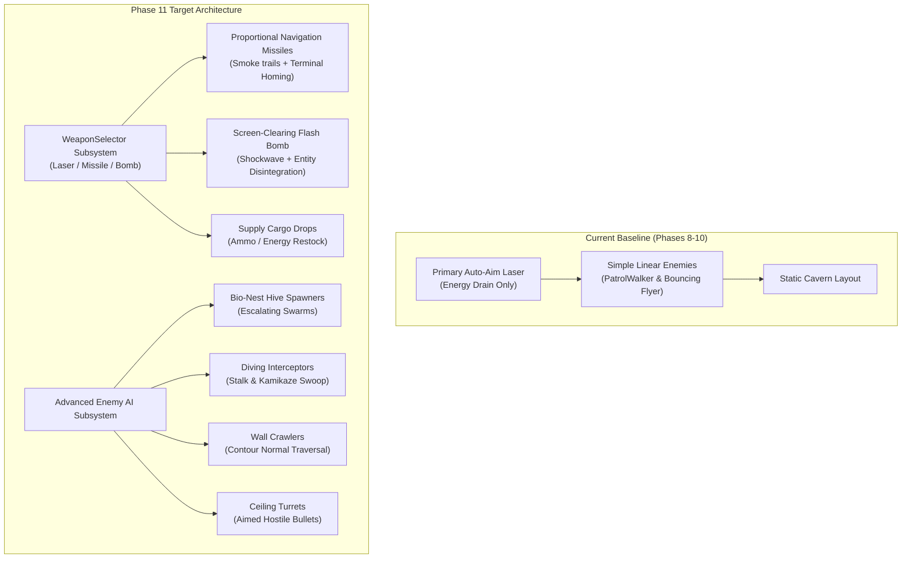
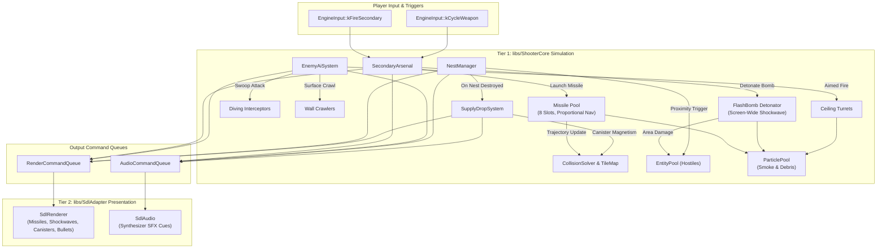
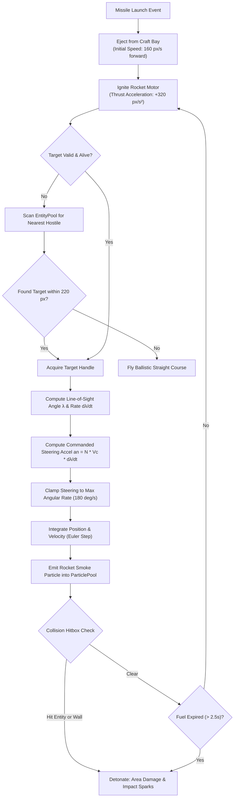
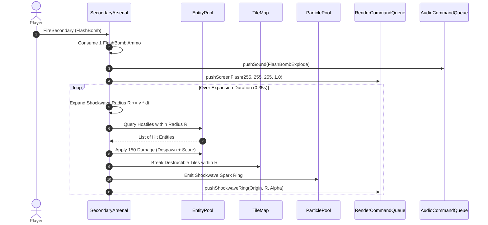
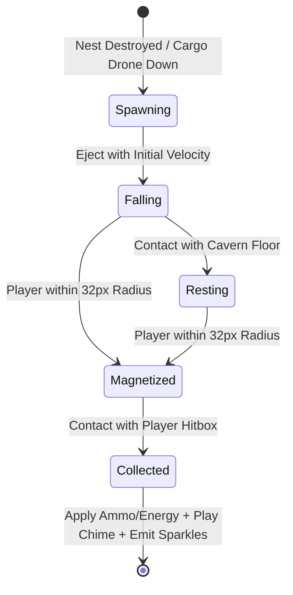
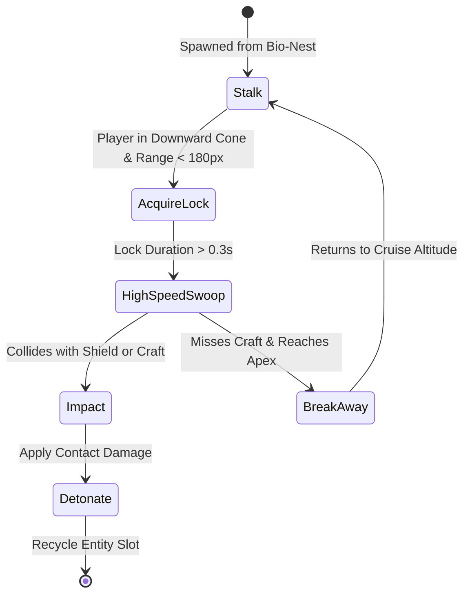
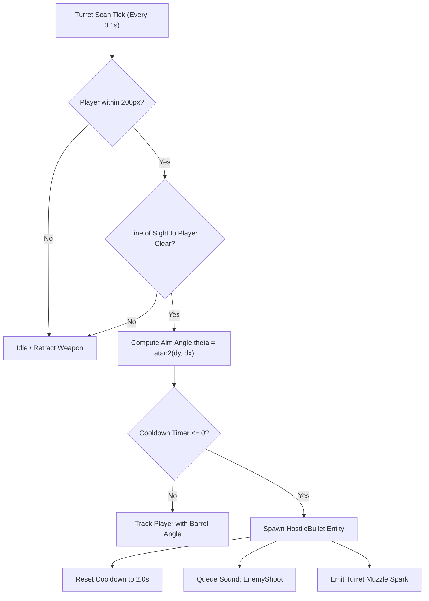

# Phase 11: Fire Hawk (Thexder 2) Secondary Arsenal & Advanced Enemy AI Implementation Plan

## 1. Executive Summary & Scope

Phase 11 introduces the tactical combat evolution first premiered in Game Arts' 1989 sequel, *Fire Hawk: Thexder - The Second Contact*. While the original *Thexder* (1985) pioneered the auto-aiming omni-directional laser beam and defensive shield barrier, *Fire Hawk* dramatically deepened the combat sandbox by equipping the player's transforming craft with a selectable **Secondary Arsenal** (homing micro-missiles, screen-clearing flash bombs, and supply cargo canisters) and pitting it against aggressive, specialized **Advanced Enemy AI Archetypes** (bio-nest hive spawners, diving interceptors, crawling wall infiltrators, and aimed ceiling turrets).

In Phase 11, the simulation engine transitions from basic linear drones and single-weapon laser attrition into a multi-tiered tactical combat simulation:
1. **Secondary Weapon Selection & Ammo Management**: The pilot can cycle between and deploy auxiliary ordnance with distinct tactical profiles, regulated by strongly-typed ammunition inventories and dedicated HUD weapon bay status indicators.
2. **Self-Propelled Homing Micro-Missiles**: Projectiles launched from craft bays that accelerate using proportional navigation (PN) guidance to hunt down airborne hostiles, trailing particulate smoke plumes.
3. **Screen-Clearing Flash Bomb Detonations**: Emergency ordnance releasing an expanding, high-yield thermonuclear shockwave that disintegrates light drones and destructible cavern barriers across the active viewport.
4. **Supply Cargo Drops (Canisters)**: Strategic resource canisters dropped by neutralized bio-nests and supply drones, replenishing missile magazines, flash bomb reserves, and energy pools.
5. **Dynamic Bio-Nest Hive Generators**: Organic subterranean hives that escalate drone spawn frequency as the craft lingers nearby, requiring prioritized player assault.
6. **Advanced Tactical Enemy Behaviors**:
   - **Diving Interceptors**: High-velocity kamikaze fighters executing swoop trajectories that force defensive Jet transformation or Shield deployment.
   - **Wall Crawlers**: Biomechanical arachnids adhering to continuous cavern contours (floors, sheer vertical cliffs, ceilings) using surface normal traversal.
   - **Ceiling Turrets**: Automated energy emplacements that track the craft through lower arc calculations and fire aimed energy bolts.

This implementation plan covers the complete integration across Tier 1 ([`libs/ShooterCore`](../libs/ShooterCore)), Tier 2 ([`libs/SdlAdapter`](../libs/SdlAdapter)), Tier 3 ([`apps/ThexderGame`](../apps/ThexderGame)), and the headless automated test suite ([`tests/ShooterCoreTests`](../tests/ShooterCoreTests)).

---

### ASCII Baseline vs Phase 11 Combat Sandbox Evolution

```
+---------------------------------------------------------------------------------------+
|                       PHASE 11 TACTICAL COMBAT EVOLUTION                              |
|                                                                                       |
|   CURRENT BASELINE (PHASES 8-10)              PHASE 11 AUTHENTIC FIRE HAWK EXPANSION  |
|                                                                                       |
|   1. Weaponry:                                1. Multi-Tiered Arsenal:                |
|      • Omni-directional lightning laser only     • Primary: Omni-directional laser    |
|      • Single energy pool drain                  • Secondary: Homing Micro-Missiles   |
|      • No secondary munitions                    • Secondary: Screen-Clearing Bomb    |
|                                                  • Weapon selector subsystem & ammo   |
|                                                                                       |
|   2. Logistics & Supply:                      2. In-Field Resource Logistics:         |
|      • Static energy pickups only                • Cargo canisters with physics drop  |
|      • No weapon resupply mechanics              • Missile and bomb ammo restocks     |
|                                                  • Emergency shield energy capsules   |
|                                                                                       |
|   3. Enemy AI Archetypes:                     3. Specialized Tactical Hostiles:       |
|      • Linear horizontal patrol drones           • Bio-Nest dynamic hive spawners     |
|      • Simple bouncing flyer drones              • Diving interceptors (swoop AI)     |
|      • No hostile projectile fire                • Wall crawlers (perimeter clinging) |
|                                                  • Aimed ceiling turrets & bullets    |
|                                                                                       |
|   4. Combat Particles:                        4. Expanded Combat Particles:           |
|      • Laser sparks and wall dust                • Dense rocket smoke particle trails |
|      • Shield hit deflection rings               • Screen flash & shockwave rings     |
|                                                  • Cluster explosion debris           |
+---------------------------------------------------------------------------------------+
```

### Mermaid Baseline vs Phase 11 Combat Architecture



---

### Core Objectives & Deliverables

1. **Secondary Weapon Management & Selection ([`libs/ShooterCore/SecondaryArsenal.h`](../libs/ShooterCore/SecondaryArsenal.h))**:
   - Support cycling between available secondary weapon modes: `None`, `HomingMissile`, and `FlashBomb`.
   - Track discrete, strongly-typed ammunition counts via [`SecondaryAmmo`](../libs/ShooterCore/Types.h) with strict underflow guards and zero heap allocations (`CERT ERR55-CPP`).
   - Integrate weapon cycling (`EngineInput::kCycleWeapon`) and secondary trigger (`EngineInput::kFireSecondary`) into engine input handling.
2. **Self-Guided Homing Micro-Missiles ([`libs/ShooterCore/SecondaryArsenal.h`](../libs/ShooterCore/SecondaryArsenal.h))**:
   - Manage a bounded array of active missiles (`kMaxActiveMissiles = 8`) in [`SecondaryArsenal`](../libs/ShooterCore/SecondaryArsenal.h).
   - Implement **Proportional Navigation (PN)** terminal guidance: missiles launch forward with initial ejection velocity, ignite rocket thrusters, calculate line-of-sight rate to target, and apply bounded angular acceleration toward the target's center.
   - Emit continuous particulate smoke plumes through [`ParticlePool`](../libs/ShooterCore/ParticlePool.h).
   - Handle warhead detonation upon enemy contact or solid obstacle impact, producing localized area-of-effect (AOE) damage.
3. **Screen-Clearing Flash Bomb Subsystem ([`libs/ShooterCore/SecondaryArsenal.h`](../libs/ShooterCore/SecondaryArsenal.h))**:
   - Trigger a high-yield energetic explosion centered on the active camera viewport.
   - Propagate a fast radial shockwave ring over 0.4 seconds, evaluating overlap against all active hostiles in [`EntityPool`](../libs/ShooterCore/EntityPool.h) and destructible masonry in [`TileMap`](../libs/ShooterCore/TileMap.h).
   - Emit screen-inversion flash commands to [`RenderCommandQueue`](../libs/ShooterCore/RenderCommandQueue.h) and acoustic detonation cues to [`AudioCommandQueue`](../libs/ShooterCore/AudioCommandQueue.h).
4. **Cargo Canister Supply Drop Subsystem ([`libs/ShooterCore/SupplyDropSystem.h`](../libs/ShooterCore/SupplyDropSystem.h))**:
   - Manage dropping supply containers with gravity and tilemap collision.
   - Support distinct payload types: `MissilePack` (+6 missiles), `FlashBomb` (+1 bomb), `EnergyBoost` (+30 energy points), and `ShieldRecharge` (+100% barrier gauge).
   - Proximity vacuum attraction: canisters within 32 pixels smoothly magnetize toward the player craft.
5. **Bio-Nest Hive Spawner Generator ([`libs/ShooterCore/NestManager.h`](../libs/ShooterCore/NestManager.h))**:
   - Maintain up to 16 stationary subterranean hives with structural hit points (`NestHealth`).
   - Dynamic spawn escalation: timer decreases as player remains within sensor proximity ($< 160$ px), spawning continuous waves of buzzers and diving interceptors until the nest core is eliminated.
   - Upon destruction, emit catastrophic explosion fragments and guarantee a cargo canister drop.
6. **Advanced Enemy AI Controller ([`libs/ShooterCore/EnemyAiSystem.h`](../libs/ShooterCore/EnemyAiSystem.h))**:
   - **Diving Interceptor AI**: State machine cycling through `Patrol`, `AcquireLock`, `HighSpeedSwoop`, and `BreakAway`.
   - **Wall Crawler AI**: Follows cavern surface normals around convex and concave corners without dislodging or clipping into tiles.
   - **Ceiling Turret AI**: Anchored to ceiling surfaces; calculates firing lead angle toward the player craft; fires bounded `HostileBullet` entities on calibrated cooldown timers.
7. **Hardware-Accelerated Presentation ([`libs/SdlAdapter/SdlRenderer.h`](../libs/SdlAdapter/SdlRenderer.h))**:
   - Render missiles with rotational headings, fiery exhaust points, and smoke particle plumes.
   - Render screen-clearing flash bomb white-out corona and expanding shockwave ring.
   - Render floating supply canisters with bobbing hover animations and glowing halos.
   - Render directional ceiling turrets and crawling bio-drones matching surface angles.
8. **Automated Headless Test Coverage ([`tests/ShooterCoreTests`](../tests/ShooterCoreTests))**:
   - Verify missile guidance math, fuel expiration, flash bomb damage radius, wall crawler perimeter traversal, and nest destruction drops under strict headless CTest execution.

---

## 2. Architecture & Subsystem Integration

Phase 11 strictly preserves the established three-tier decoupled architecture:
- **Tier 1: Core Simulation Engine ([`libs/ShooterCore`](../libs/ShooterCore))**: Pure C++17, 100% deterministic, zero dynamic memory allocations on simulation paths (`CERT ERR55-CPP`), strictly no external multimedia libraries.
- **Tier 2: Presentation Adapter ([`libs/SdlAdapter`](../libs/SdlAdapter))**: Consumes hardware-neutral render and audio queues to drive SDL2 hardware-accelerated rendering and streaming audio synthesis.
- **Tier 3: Game Application ([`apps/ThexderGame`](../apps/ThexderGame))**: Ties cavern map data, entity spawners, player input dispatch, and HUD status overlays into the master loop.

### 2.1 ASCII Architectural Integration Flow

```
+---------------------------------------------------------------------------------------+
|                               PHASE 11 ARCHITECTURAL FLOW                             |
|                                                                                       |
|   [Tier 1: libs/ShooterCore]                                                          |
|   ┌───────────────────────────────────────────────────────────────────────────────┐   |
|   │  EngineInput                                                                  │   |
|   │    • kFireSecondary (0x0100U) | kCycleWeapon (0x0200U)                        │   |
|   │                                                                               │   |
|   │  SecondaryArsenal                                                             │   |
|   │    • WeaponSelector: Cycles None <-> HomingMissile <-> FlashBomb              │   |
|   │    • AmmoInventory: Bounded storage for Missiles & Flash Bombs                │   |
|   │    • MissilePool: 8 active projectiles with Proportional Navigation           │   |
|   │    • FlashBombDetonator: Viewport shockwave expansion & AOE damage            │   |
|   │                                                                               │   |
|   │  EnemyAiSystem                                                                │   |
|   │    • DivingInterceptor: Stalk -> High-speed swoop acceleration               │   |
|   │    • WallCrawler: Normal-tracing perimeter walking around tile corners       │   |
|   │    • CeilingTurret: Directional scan & hostile bullet emission                │   |
|   │                                                                               │   |
|   │  NestManager                                                                  │   |
|   │    • 16 Bio-Nest hives with proximity-accelerated spawn frequency             │   |
|   │    • Catastrophic destruction debris & cargo drop triggering                  │   |
|   │                                                                               │   |
|   │  SupplyDropSystem                                                             │   |
|   │    • 16 Cargo Canister slots (Gravity, tile bounce, magnetic pickup)          │   |
|   │                                                                               │   |
|   │  Output Queues (Zero-Copy)                                                    │   |
|   │    • RenderCommandQueue: pushMissile, pushFlashBomb, pushCanister, pushBullet │   |
|   │    • AudioCommandQueue: MissileLaunch, BombDetonate, CanisterChime, TurretZap │   |
|   └──────────────────────────────────────┬────────────────────────────────────────┘   |
|                                          │ Render & Audio Commands                    |
|                                          ▼                                            |
|   [Tier 2: libs/SdlAdapter]                                                           |
|   ┌───────────────────────────────────────────────────────────────────────────────┐   |
|   │  SdlRenderer                                                                  │   |
|   │    • drawMissile: Rotated missile body + exhaust particle trail               │   |
|   │    • drawFlashBomb: Additive expanding shockwave ring + screen flash overlay  │   |
|   │    • drawCanister: Bobbing supply capsule + glowing indicator                 │   |
|   │    • drawTurrets & HostileBullets: Aimed muzzle rendering & energy bolts      │   |
|   │                                                                               │   |
|   │  SdlAudio                                                                     │   |
|   │    • Multi-channel synthesized sound effects for secondary ordnance and AI    │   |
|   └──────────────────────────────────────┬────────────────────────────────────────┘   |
|                                          │ Presentation & Player Interaction          |
|                                          ▼                                            |
|   [Tier 3: apps/ThexderGame]                                                          |
|   ┌───────────────────────────────────────────────────────────────────────────────┐   |
|   │  GameState & HudOverlay                                                       │   |
|   │    • Keyboard/Gamepad binding: Secondary fire & weapon select                 │   |
|   │    • Cockpit HUD secondary weapon bay display & ammunition indicators         │   |
|   └───────────────────────────────────────────────────────────────────────────────┘   |
+---------------------------------------------------------------------------------------+
```

### 2.2 Mermaid Subsystem Flow Diagram



---

## 3. Detailed Component Specifications

### 3.1 Secondary Arsenal & Ammunition Management

In *Fire Hawk*, the secondary arsenal provides specialized solutions for combat scenarios where the primary auto-aim laser is either out of range or insufficient against swarms.

#### 3.1.1 Weapon Selector & Ammo Inventory
The weapon selection state machine supports three states:
- `None`: No secondary weapon armed or ammunition depleted.
- `HomingMissile`: Micro-missile bay armed.
- `FlashBomb`: Screen-clearing thermonuclear flash bomb armed.

```cpp
/// @enum class SecondaryWeaponType
/// @brief Classification of auxiliary ordnance bays.
enum class SecondaryWeaponType : std::uint8_t {
    None = 0U,
    HomingMissile = 1U,
    FlashBomb = 2U
};
```

#### Strong Domain Value Objects: `SecondaryAmmo`
To comply with the project's **Domain Modeling Standard** and eliminate primitive obsession:
- Ammo counts are wrapped in explicit, bounds-checked value objects:
  - `SecondaryAmmo` guarantees inventory capacity caps (`kMaxMissiles = 24`, `kMaxBombs = 3`).
  - Single-argument constructors are marked `explicit constexpr ... noexcept`.
  - Decrement and replenishment operations prevent underflow/overflow.

```cpp
/// @class SecondaryAmmo
/// @brief Strongly-typed ammunition magazine counter.
class SecondaryAmmo final {
public:
    constexpr SecondaryAmmo() noexcept = default;

    explicit constexpr SecondaryAmmo(std::uint8_t count, std::uint8_t maxCap) noexcept
        : count_ { std::min(count, maxCap) }
        , maxCap_ { maxCap }
    {
    }

    [[nodiscard]] constexpr std::uint8_t count() const noexcept { return count_; }
    [[nodiscard]] constexpr bool hasAmmo() const noexcept { return count_ > 0U; }
    [[nodiscard]] constexpr bool isFull() const noexcept { return count_ >= maxCap_; }

    constexpr void consume() noexcept
    {
        if (count_ > 0U) {
            --count_;
        }
    }

    constexpr void replenish(std::uint8_t amount) noexcept
    {
        const std::uint16_t total { static_cast<std::uint16_t>(count_) + static_cast<std::uint16_t>(amount) };
        count_ = static_cast<std::uint8_t>(std::min(total, static_cast<std::uint16_t>(maxCap_)));
    }

private:
    std::uint8_t count_ { 0U };
    std::uint8_t maxCap_ { 0U };
};
```

---

### 3.2 Homing Micro-Missile Trajectory Solver & Guidance Law

The homing micro-missile is an airborne projectile that launches from the craft's secondary ordnance bay, accelerates under solid rocket propellant, and steers toward locked airborne or surface hostiles using **Proportional Navigation (PN)**.

#### 3.2.1 Missile Physics & Proportional Navigation Algorithm

```
+---------------------------------------------------------------------------------------+
|                       PROPORTIONAL NAVIGATION MISSILE GUIDANCE                        |
|                                                                                       |
|                                     Target (Vt)                                       |
|                                        /                                              |
|                                       / LOS Vector (R)                                |
|                                      /                                                |
|                             λ (LOS Angle)                                             |
|                                    /                                                  |
|                                   /                                                   |
|             Missile (Vm) ────────                                                     |
|                  \                                                                    |
|                   \-- Smoke Particle Plume                                            |
|                                                                                       |
|   Guidance Formula:                                                                   |
|     an = N * Vc * (dλ/dt)                                                             |
|     • an: Commanded lateral acceleration perpendicular to missile velocity vector     |
|     • N: Navigation constant (effective gain N = 3.5)                                 |
|     • Vc: Closing velocity along Line-of-Sight                                        |
|     • dλ/dt: Line-of-sight angular rate of rotation                                   |
+---------------------------------------------------------------------------------------+
```



#### 3.2.2 Missile Flight Parameters
- **Capacity**: Maximum of 8 concurrent active missiles (`kMaxActiveMissiles = 8`).
- **Initial Ejection Speed**: $160.0\text{ px/s}$ in craft forward facing direction.
- **Top Speed**: $360.0\text{ px/s}$ achieved after $0.6\text{ s}$ of motor burn.
- **Burn Duration (Fuel Limit)**: $2.5\text{ s}$ before self-detonating.
- **Damage Value**: $40\text{ HP}$ on direct hit; $20\text{ HP}$ radial splash within $24\text{ px}$.
- **Smoke Trail Emission**: Emits 1 smoke particle every $0.05\text{ s}$ into [`ParticlePool`](../libs/ShooterCore/ParticlePool.h).

---

### 3.3 Screen-Clearing Flash Bomb Subsystem

The **Flash Bomb** is Thexder's ultimate emergency defense in *Fire Hawk*, clearing swarming hostiles when cornered in cavern shafts.

#### 3.3.1 Detonation Mechanics
1. **Activation Trigger**: Triggered when `FlashBomb` is active secondary weapon and `EngineInput::kFireSecondary` is engaged.
2. **Viewport Shockwave Expansion**:
   - The detonation center is anchored to the player's craft position at trigger time.
   - A circular energetic shockwave ring expands radially outward at $900.0\text{ px/s}$, sweeping across the entire visible $320 \times 240$ camera viewport within $0.35\text{ s}$.
   - All active hostile entities whose bounding boxes fall within the current radius take $150\text{ HP}$ of instant thermonuclear damage (instantly vaporizing patrol drones, crawling bio-bugs, and incoming missiles).
   - Any destructible cavern walls (`TileType::DestructibleWall`) within the shockwave radius are immediately disintegrated.
3. **Audio-Visual Presentation Feedback**:
   - High-intensity screen flash: Generates a full-viewport white-out color overlay with decaying alpha ($1.0 \rightarrow 0.0$ over $0.4\text{ s}$).
   - Emits a dual-ring expanding circular wavefront rendered with `SDL_BLENDMODE_ADD`.
   - Queues `SoundEffectId::FlashBombExplode` causing low-frequency sub-bass explosion audio rumble.

```
+---------------------------------------------------------------------------------------+
|                       SCREEN-CLEARING FLASH BOMB DETONATION                           |
|                                                                                       |
|   +-------------------------------------------------------------------------------+   |
|   | Camera Viewport (320 x 240)                                                   |   |
|   |                                                                               |   |
|   |             [Enemy 1: Disintegrated!]                                        |   |
|   |                     \       . - ~ ~ ~ - .                                     |   |
|   |                       .  '                 '  .                               |   |
|   |                     /                           \                             |   |
|   |                    /      /~~~~~~~~~~~\          \                            |   |
|   |                   |      |  [Thexder]  |          |                           |   |
|   |                   |      |   Origin    |          |                           |   |
|   |                    \      \___________/          /                            |   |
|   |                     \                           /                             |   |
|   |                       .                       .                               |   |
|   |                         ' - . _ _ _ _ . - '                                   |   |
|   |                                       \                                       |   |
|   |                           Expanding Shockwave Ring (R(t) = v * t)             |   |
|   +-------------------------------------------------------------------------------+   |
+---------------------------------------------------------------------------------------+
```



---

### 3.4 Cargo Canisters & Supply Drop Logistics

In *Fire Hawk*, tactical survival depends on replenishing consumed ammunition and depleted energy by collecting floating cargo canisters dropped by destroyed bio-nests and heavy transport drones.

#### 3.4.1 Canister Types & Payloads

| Canister Type | Sprite Representation | Payload Effect | Drop Probability |
|:---|:---|:---|:---:|
| `MissilePack` | Green Ammo Crate with Missile Graphic | $+6$ Homing Micro-Missiles | $40\%$ |
| `FlashBomb` | Amber Cylindrical Nuclear Capsule | $+1$ Screen-Clearing Flash Bomb | $15\%$ |
| `EnergyBoost` | Cyan Glowing Energon Crystal | $+30$ Energy Points | $35\%$ |
| `ShieldRecharge` | Violet Pulsating Forcefield Sphere | Refills Shield Gauge to $100\%$ | $10\%$ |

#### 3.4.2 Canister Kinematics & Magnetic Proximity Attraction
- **Gravity & Air Resistance**: Drops initially with downward gravity ($120.0\text{ px/s}^2$) and low terminal fall speed ($60.0\text{ px/s}$).
- **Tilemap Bouncing**: Bounces lightly against solid cavern floors before coming to rest.
- **Magnetic Proximity Attraction**:
  - When the player craft moves within a $32.0\text{ px}$ attraction radius, the canister enters magnetic capture mode.
  - Smoothly accelerates toward craft center: $\vec{a}_{\text{mag}} = \frac{\vec{P}_{\text{craft}} - \vec{P}_{\text{canister}}}{\|\vec{P}_{\text{craft}} - \vec{P}_{\text{canister}}\|} \times 240.0\text{ px/s}^2$.
- **Collection**: Upon physical bounding box contact, the canister is collected, its payload is credited, a pickup chime (`SoundEffectId::CanisterPickup`) is queued, and 12 golden sparkle particles are emitted.

```
+---------------------------------------------------------------------------------------+
|                       CARGO CANISTER KINEMATICS & ATTRACTION                          |
|                                                                                       |
|   1. Dropped by Nest           2. Gentle Descent           3. Magnetic Capture        |
|      [Bio-Nest Core]                                                                  |
|            |                                                                          |
|            v                                                                          |
|       [ Canister ]                  [ Canister ]                  ( 32px Radius )     |
|                                          |                      . - ~ ~ ~ - .         |
|                                          v                     /             \        |
|                                     ### Floor ###             |  [Canister]  |        |
|                                                                \    =====>   /        |
|                                                                 ' - ~ ~ ~ - '         |
|                                                                    [Thexder]          |
+---------------------------------------------------------------------------------------+
```



---

### 3.5 Advanced Enemy AI Archetypes

Phase 11 introduces three distinct tactical enemy classes alongside the stationary bio-nest generator hives.

#### 3.5.1 Bio-Nest Generator Hive (`BioNest`)
- **Structure**: Biomechanical organic hive structure ($32 \times 32\text{ px}$) embedded in cavern walls or floors.
- **Durability**: $80\text{ HP}$. Resistant to weak fire, vulnerable to focused laser beams, missiles, and flash bombs.
- **Escalation Cycle**:
  - Baseline spawn interval: $4.0\text{ s}$.
  - When player craft is within proximity ($< 160\text{ px}$), the spawn timer escalates down to $1.2\text{ s}$, pouring out continuous waves of mechanical buzzers and diving interceptors.
- **Destruction**: Emits 4-phase catastrophic explosion sprites, 24 spark particles, awards 500 points, and drops 1 guaranteed cargo canister.

#### 3.5.2 Diving Interceptors (Swoop & Kamikaze Attack AI)
- **Visuals**: Sleek delta-wing robotic interceptor ($16 \times 16\text{ px}$).
- **State Machine**:
  1. `Stalk`: Hovers or cruises horizontally in upper cavern air corridors.
  2. `AcquireLock`: When the player craft passes within a $\pm 75^\circ$ downward cone and $< 180\text{ px}$, locks coordinates and flashes red.
  3. `HighSpeedSwoop`: Accelerates with high thrust ($300.0\text{ px/s}$) along a curved trajectory directly at the player craft's predicted position.
  4. `BreakAway`: If the attack misses the craft, recovers altitude or crashes into cavern walls.

```
+---------------------------------------------------------------------------------------+
|                       DIVING INTERCEPTOR SWOOP ATTACK AI                              |
|                                                                                       |
|   [Interceptor] ───> Cruise / Stalk                                                   |
|         \                                                                             |
|          \ (Lock-on Trigger: Player in downward cone)                                 |
|           \                                                                           |
|            \-- High-Speed Swoop Acceleration (300 px/s)                               |
|             \                                                                         |
|              \                                                                        |
|               ▼                                                                       |
|          [Player Craft] ─── (Dodge via Jet mode or absorb with Shield!)               |
|               /                                                                       |
|              /                                                                        |
|   Break-away or Wall Impact Crash                                                     |
+---------------------------------------------------------------------------------------+
```



#### 3.5.3 Wall Crawlers (Perimeter Contour Tracing AI)
- **Visuals**: Multi-legged biomechanical crawler ($16 \times 16\text{ px}$) adhering to cavern terrain.
- **Contour Navigation Algorithm**:
  - The crawler aligns its bottom edge with the local terrain surface normal ($N \in \{\text{Floor}, \text{RightWall}, \text{Ceiling}, \text{LeftWall}\}$).
  - Traverses along the perimeter at $50.0\text{ px/s}$.
  - At an inside corner (concave), rotates $90^\circ$ counter-clockwise and continues crawling up the adjoining surface.
  - At an outside corner (convex cliff edge), rotates $90^\circ$ clockwise around the corner edge without detaching into mid-air.
  - Zero dynamic allocations: internal state is stored in 2 bytes (`SurfaceNormal` + `TraversalDirection`).

```
+---------------------------------------------------------------------------------------+
|                       WALL CRAWLER PERIMETER CONTOUR TRACING                          |
|                                                                                       |
|   Ceiling Normal (Down [0, 1])                                                        |
|   ##########################################                                          |
|   # [Crawler <──]                          #                                          |
|   #                                        #                                          |
|   # (Inside Corner: Rotate 90 deg)         #  Left Wall Normal                        |
|   # ▲                                      #  (Right [1, 0])                          |
|   # |                                      #                                          |
|   # [Crawler]                              #                                          |
|   #                                        #                                          |
|   # (Outside Corner: Rotate around lip)    #                                          |
|   #######                                  #                                          |
|         #                                  #                                          |
|         # [Crawler ──>]                    #                                          |
|         ####################################                                          |
|         Floor Normal (Up [0, -1])                                                     |
+---------------------------------------------------------------------------------------+
```

#### 3.5.4 Ceiling Turrets (Aimed Hostile Projectile AI)
- **Visuals**: Armored semi-spherical gun pod ($16 \times 16\text{ px}$) bolted to cavern ceilings.
- **Behavior**:
  - Scans downward $180^\circ$ hemisphere for player craft within $200\text{ px}$.
  - Calculates lead angle to player craft center.
  - Fires an aimed energy bolt (`HostileBullet`, $120.0\text{ px/s}$) every $2.0\text{ s}$.
  - Bullets can be absorbed without damage by the active Shield Barrier or dodged. Direct contact with unshielded craft inflicts $15\text{ HP}$ damage.



---

## 4. Subsystem & File Modifications

### 4.1 Modifications in [`libs/ShooterCore`](../libs/ShooterCore)

#### 4.1.1 [`libs/ShooterCore/Types.h`](../libs/ShooterCore/Types.h)
- Add strongly-typed value objects and enumerations:
  - `SecondaryWeaponType`: `None`, `HomingMissile`, `FlashBomb`.
  - `SecondaryAmmo`: Bounds-checked ammunition magazine value object.
  - `CanisterType`: `MissilePack`, `FlashBomb`, `EnergyBoost`, `ShieldRecharge`.
  - `EnemyAiType`: `PatrolWalker`, `DivingInterceptor`, `WallCrawler`, `CeilingTurret`.
  - `AiBehaviorState`: Discrete state tag for hostile AI state machines.
  - `HomingMissile`: Spatial state, velocity, target EntityId, fuel timer, and smoke emission accumulator.
  - `CargoCanister`: Spatial state, velocity, CanisterType, resting state, and magnetic attraction flag.
  - `FlashBombState`: Detonation center WorldPos, current shockwave radius, maximum radius, and alpha timer.
  - Extend `SpriteId` with: `MissileInFlight`, `CanisterMissile`, `CanisterBomb`, `CanisterEnergy`, `CanisterShield`, `EnemyInterceptor`, `EnemyTurretCeiling`, `EnemyBulletHostile`.
  - Extend `SoundEffectId` with: `MissileLaunch`, `FlashBombExplode`, `CanisterPickup`, `EnemyShoot`, `WeaponSelect`.

#### 4.1.2 [`libs/ShooterCore/EngineInput.h`](../libs/ShooterCore/EngineInput.h)
- Add bit flags for secondary weapon actions:
  - `kFireSecondary = 0x0100U` (triggers armed secondary weapon).
  - `kCycleWeapon = 0x0200U` (cycles through available secondary weapon types).
- Add helper methods: `isFireSecondary()`, `isCycleWeapon()`.

#### 4.1.3 [`libs/ShooterCore/SecondaryArsenal.h`](../libs/ShooterCore/SecondaryArsenal.h) & [`.cpp`](../libs/ShooterCore/SecondaryArsenal.cpp) *(New)*
- Encapsulates secondary weapon cycling, ammunition tracking, missile simulation, and flash bomb detonation.
- Zero dynamic heap allocations (`CERT ERR55-CPP`):
  - Fixed-capacity array of 8 missiles: `std::array<HomingMissile, 8> missiles_`.
  - Proportional navigation solver function: `updateMissiles(DeltaTime dt, const EntityPool& targets, TileMap& map, ParticlePool& particles) noexcept`.
  - Flash bomb propagation solver: `updateFlashBomb(DeltaTime dt, EntityPool& targets, TileMap& map, ParticlePool& particles) noexcept`.

#### 4.1.4 [`libs/ShooterCore/EnemyAiSystem.h`](../libs/ShooterCore/EnemyAiSystem.h) & [`.cpp`](../libs/ShooterCore/EnemyAiSystem.cpp) *(New)*
- Encapsulates state machine updates for all active hostile entities in `EntityPool`.
- Sub-functions:
  - `updateInterceptors(DeltaTime dt, WorldPos playerPos, EntityPool& pool, const TileMap& map) noexcept`.
  - `updateWallCrawlers(DeltaTime dt, EntityPool& pool, const TileMap& map) noexcept`.
  - `updateCeilingTurrets(DeltaTime dt, WorldPos playerPos, EntityPool& pool, const TileMap& map, AudioCommandQueue& audio) noexcept`.

#### 4.1.5 [`libs/ShooterCore/NestManager.h`](../libs/ShooterCore/NestManager.h) & [`.cpp`](../libs/ShooterCore/NestManager.cpp) *(New)*
- Migrates and elevates `EntitySpawner` logic from `apps/ThexderGame` into the Tier 1 core simulation library to guarantee full deterministic headless testability.
- Manages up to 16 `BioNest` instances.
- Handles proximity escalation, drone instantiation, structural damage, and drops.

#### 4.1.6 [`libs/ShooterCore/SupplyDropSystem.h`](../libs/ShooterCore/SupplyDropSystem.h) & [`.cpp`](../libs/ShooterCore/SupplyDropSystem.cpp) *(New)*
- Manages up to 16 active `CargoCanister` instances.
- Applies gravity, tile collisions, magnetic proximity attraction toward player craft, and payload collection.

#### 4.1.7 [`libs/ShooterCore/RenderCommandQueue.h`](../libs/ShooterCore/RenderCommandQueue.h) & [`.cpp`](../libs/ShooterCore/RenderCommandQueue.cpp)
- Add render command pushers:
  - `pushMissile(WorldPos pos, FacingDirection facing, float angleDegrees) noexcept`.
  - `pushShockwave(WorldPos center, float radius, float alpha) noexcept`.
  - `pushCanister(WorldPos pos, CanisterType type, float bobOffset) noexcept`.
  - `pushTurret(WorldPos pos, float aimAngleDegrees) noexcept`.

#### 4.1.8 [`libs/ShooterCore/GameEngine.h`](../libs/ShooterCore/GameEngine.h) & [`.cpp`](../libs/ShooterCore/GameEngine.cpp)
- Embed `SecondaryArsenal`, `EnemyAiSystem`, `NestManager`, and `SupplyDropSystem` inside `GameEngine`.
- Wire `EngineInput::kFireSecondary` and `EngineInput::kCycleWeapon` during the `step()` simulation tick.
- Coordinate interactions between secondary weapons, enemies, nests, and cargo canisters.

---

### 4.2 Modifications in [`libs/SdlAdapter`](../libs/SdlAdapter)

#### 4.2.1 [`libs/SdlAdapter/SdlRenderer.h`](../libs/SdlAdapter/SdlRenderer.h) & [`.cpp`](../libs/SdlAdapter/SdlRenderer.cpp)
- Add specialized rendering methods:
  - `drawMissile(WorldPos pos, float angleDeg)`: Draws missile body with exhaust particle glow.
  - `drawShockwave(WorldPos center, float radius, float alpha)`: Draws expanding additive circular wavefront (`SDL_BLENDMODE_ADD`).
  - `drawCanister(WorldPos pos, CanisterType type, float bobOffset)`: Draws hovering cargo crate with pulsing color indicator.
  - `drawCeilingTurret(WorldPos pos, float aimAngleDeg)`: Draws mounting base and angled gun barrel.

#### 4.2.2 [`libs/SdlAdapter/SdlAudio.h`](../libs/SdlAdapter/SdlAudio.h) & [`.cpp`](../libs/SdlAdapter/SdlAudio.cpp)
- Extend software synthesizer callback with authentic 8-bit sound algorithms:
  - `MissileLaunch`: High-frequency whoosh sweeping down from $880\text{ Hz} \rightarrow 220\text{ Hz}$ on white-noise and square wave channels.
  - `FlashBombExplode`: Low-frequency sustained sub-bass rumble ($55\text{ Hz}$) with high initial decay.
  - `CanisterPickup`: Dual-tone arpeggiated bright chime ($523\text{ Hz} \rightarrow 659\text{ Hz} \rightarrow 784\text{ Hz}$).
  - `EnemyShoot`: Sharp metallic laser pulse ($440\text{ Hz} \rightarrow 110\text{ Hz}$).

---

### 4.3 Modifications in [`apps/ThexderGame`](../apps/ThexderGame)

#### 4.3.1 [`apps/ThexderGame/GameState.h`](../apps/ThexderGame/GameState.h) & [`.cpp`](../apps/ThexderGame/GameState.cpp)
- Map secondary weapon input keys:
  - Key `X` (or Gamepad `B` / `RB`): Fire Secondary Weapon (`EngineInput::kFireSecondary`).
  - Key `C` (or Gamepad `Y` / `LB`): Cycle Secondary Weapon (`EngineInput::kCycleWeapon`).

#### 4.3.2 [`apps/ThexderGame/HudOverlay.h`](../apps/ThexderGame/HudOverlay.h) & [`.cpp`](../apps/ThexderGame/HudOverlay.cpp)
- Render Cockpit HUD Secondary Weapon Bay:
  - Active Weapon Slot Icon: Displays graphical icon for `MISSILE`, `FLASH BOMB`, or `OFF`.
  - Numerical Ammo Counter: Shows remaining missile rounds ($00-24$) or flash bomb inventory ($0-3$).
  - Low-Ammo Warning Flashing when payload is down to final round.

#### 4.3.3 [`apps/ThexderGame/Level1Map.h`](../apps/ThexderGame/Level1Map.h) & [`.cpp`](../apps/ThexderGame/Level1Map.cpp)
- Populate Level 1 Caverns with authentic Phase 11 tactical structures:
  - 4 Bio-Nest organic hives strategically placed in cavern shafts.
  - 6 Ceiling Turrets defending narrow bottlenecks.
  - Wall crawler spawn routes along vertical shafts.

---

## 5. CMake Build Configuration & Project Structure

### 5.1 [`libs/ShooterCore/CMakeLists.txt`](../libs/ShooterCore/CMakeLists.txt)

```cmake
target_sources(ShooterCore PRIVATE
    AnimationController.cpp
    AudioCommandQueue.cpp
    CollisionSolver.cpp
    EnemyAiSystem.cpp       # NEW: Advanced Enemy AI State Machines
    EntityPool.cpp
    GameEngine.cpp
    Hitbox.cpp
    Logger.cpp
    NestManager.cpp         # NEW: Bio-Nest Hive Generator Management
    ParticlePool.cpp
    RenderCommandQueue.cpp
    SecondaryArsenal.cpp    # NEW: Homing Missiles & Flash Bomb System
    SupplyDropSystem.cpp    # NEW: Cargo Canister Logistics System
    TileMap.cpp
    TransformSystem.cpp
    WeaponSystem.cpp
)
```

### 5.2 [`tests/ShooterCoreTests/CMakeLists.txt`](../tests/ShooterCoreTests/CMakeLists.txt)

```cmake
add_executable(ShooterCoreTests
    Main.cpp
    TestAnimationController.cpp
    TestCollisionSolver.cpp
    TestCommandQueues.cpp
    TestDeterminismSoak.cpp
    TestEnemyAi.cpp           # NEW: Interceptor, Crawler, Turret AI Tests
    TestEngineInput.cpp
    TestEntityPool.cpp
    TestGameEngine.cpp
    TestHitbox.cpp
    TestNestManager.cpp       # NEW: Bio-Nest Spawning & Escalation Tests
    TestParticlePool.cpp
    TestSecondaryArsenal.cpp  # NEW: Proportional Nav, Missiles & Flash Bomb Tests
    TestShieldSystem.cpp
    TestSupplyDropSystem.cpp  # NEW: Canister Physics & Magnetism Tests
    TestTileMap.cpp
    TestTransformSystem.cpp
    TestTypes.cpp
    TestWeaponSystem.cpp
)
```

---

## 6. Automated Verification & Testing Strategy

To ensure zero regressions and maintain strict mathematical determinism, Phase 11 introduces comprehensive test suites in [`tests/ShooterCoreTests`](../tests/ShooterCoreTests).

### 6.1 Test Breakdown

```
+---------------------------------------------------------------------------------------+
|                       PHASE 11 AUTOMATED TEST MATRIX                                  |
|                                                                                       |
|   1. TestSecondaryArsenal.cpp:                                                        |
|      • testWeaponCycling(): Cycles None -> Missile -> Bomb -> None                    |
|      • testAmmoDepletionUnderflow(): Verifies 0-ammo blocks firing without crash      |
|      • testMissileProportionalNavigation(): Verifies missile steers toward target     |
|      • testMissileFuelBurnout(): Verifies missile self-detonates after 2.5s           |
|      • testFlashBombShockwaveExpansion(): Verifies radial AOE destroys enemies        |
|      • testFlashBombTileDestruction(): Verifies destructible walls are breached       |
|                                                                                       |
|   2. TestEnemyAi.cpp:                                                                 |
|      • testDivingInterceptorSwoop(): Verifies lock-on trigger and swoop trajectory    |
|      • testWallCrawlerInsideCorner(): Verifies 90° CCW turn on concave wall           |
|      • testWallCrawlerOutsideCorner(): Verifies 90° CW turn around convex cliff edge  |
|      • testCeilingTurretAimedFire(): Verifies bullet angle toward player craft        |
|      • testHostileBulletShieldAbsorption(): Verifies shield absorbs bullet damage     |
|                                                                                       |
|   3. TestNestManager.cpp:                                                             |
|      • testProximitySpawnEscalation(): Verifies spawn interval decreases near player  |
|      • testNestHealthDegradation(): Verifies weapons damage nest hitpoints            |
|      • testNestDestructionCanisterDrop(): Verifies cargo canister spawned on death    |
|                                                                                       |
|   4. TestSupplyDropSystem.cpp:                                                        |
|      • testCanisterGravityAndFloorRest(): Verifies landing kinematics                 |
|      • testCanisterMagneticAttraction(): Verifies acceleration toward craft < 32px    |
|      • testCanisterPickupCredit(): Verifies correct ammo/energy replenish applied     |
|                                                                                       |
|   5. TestDeterminismSoak.cpp (Expanded):                                              |
|      • 10,000 tick headless simulation with active missiles, bomb, nests, and AI     |
|      • Bitwise hash comparison between independent parallel runs                      |
+---------------------------------------------------------------------------------------+
```

---

## 7. Step-by-Step Implementation Flow

### ASCII Phased Task Breakdown

```
+---------------------------------------------------------------------------------------+
|                       PHASE 11 IMPLEMENTATION MILESTONES                              |
|                                                                                       |
|   Step 11.1: Core Types & Input Bitmask Extension                                     |
|              (Types.h: SecondaryAmmo, CanisterType, Missile/Bomb structs;             |
|               EngineInput.h: kFireSecondary, kCycleWeapon)                            |
|         │                                                                             |
|         ▼                                                                             |
|   Step 11.2: SecondaryArsenal Subsystem Implementation                                |
|              (SecondaryArsenal.h/.cpp: Proportional Nav, Missiles, Flash Bomb)        |
|         │                                                                             |
|         ▼                                                                             |
|   Step 11.3: SupplyDropSystem Subsystem Implementation                                |
|              (SupplyDropSystem.h/.cpp: Gravity, tile bounce, magnetic attraction)     |
|         │                                                                             |
|         ▼                                                                             |
|   Step 11.4: Bio-Nest Hive Generator Subsystem                                        |
|              (NestManager.h/.cpp: Proximity escalation, spawning, loot drop)          |
|         │                                                                             |
|         ▼                                                                             |
|   Step 11.5: Advanced Enemy AI State Machines                                         |
|              (EnemyAiSystem.h/.cpp: Diving Interceptor, Wall Crawler, Ceiling Turret)  |
|         │                                                                             |
|         ▼                                                                             |
|   Step 11.6: GameEngine Coordination & Command Queue Integration                      |
|              (GameEngine.cpp: Step loop wiring, RenderCommandQueue, AudioCommandQueue)|
|         │                                                                             |
|         ▼                                                                             |
|   Step 11.7: SDL Presentation Adapter (SdlRenderer & SdlAudio)                        |
|              (SdlRenderer.cpp: Missiles, Shockwaves, Canisters; SdlAudio: SFX Cues)   |
|         │                                                                             |
|         ▼                                                                             |
|   Step 11.8: Game Application HUD & Level 1 Map Integration                           |
|              (GameState.cpp, HudOverlay.cpp, Level1Map.cpp)                           |
|         │                                                                             |
|         ▼                                                                             |
|   Step 11.9: Comprehensive Automated Headless Test Suite & Soak Verification          |
|              (TestSecondaryArsenal, TestEnemyAi, TestNestManager, TestSupplyDrop)     |
+---------------------------------------------------------------------------------------+
```

### Detailed Execution Tasks

#### Step 11.1: Core Types & Input Bitmask Extension
- Define `SecondaryWeaponType`, `SecondaryAmmo`, `CanisterType`, `EnemyAiType`, `HomingMissile`, `CargoCanister`, and `FlashBombState` in [`libs/ShooterCore/Types.h`](../libs/ShooterCore/Types.h).
- Add `kFireSecondary = 0x0100U` and `kCycleWeapon = 0x0200U` in [`libs/ShooterCore/EngineInput.h`](../libs/ShooterCore/EngineInput.h).
- Add corresponding unit tests in [`tests/ShooterCoreTests/TestTypes.cpp`](../tests/ShooterCoreTests/TestTypes.cpp) and [`TestEngineInput.cpp`](../tests/ShooterCoreTests/TestEngineInput.cpp).

#### Step 11.2: SecondaryArsenal Subsystem Implementation
- Author [`libs/ShooterCore/SecondaryArsenal.h`](../libs/ShooterCore/SecondaryArsenal.h) and [`SecondaryArsenal.cpp`](../libs/ShooterCore/SecondaryArsenal.cpp).
- Implement weapon selector state cycling (`cycleWeapon()`).
- Implement proportional navigation missile guidance solver with bounded lateral acceleration.
- Implement screen-clearing flash bomb shockwave expansion and tile disintegration.
- Implement smoke trail particle emission into [`ParticlePool`](../libs/ShooterCore/ParticlePool.h).

#### Step 11.3: SupplyDropSystem Subsystem Implementation
- Author [`libs/ShooterCore/SupplyDropSystem.h`](../libs/ShooterCore/SupplyDropSystem.h) and [`SupplyDropSystem.cpp`](../libs/ShooterCore/SupplyDropSystem.cpp).
- Implement falling gravity, floor contact damping, and magnetic proximity capture when player craft is within $32\text{ px}$.
- Implement payload application upon collection contact.

#### Step 11.4: Bio-Nest Hive Generator Subsystem
- Author [`libs/ShooterCore/NestManager.h`](../libs/ShooterCore/NestManager.h) and [`NestManager.cpp`](../libs/ShooterCore/NestManager.cpp).
- Implement proximity-based spawn interval escalation.
- Implement structural durability, weapon hit damage handling, catastrophic explosion triggering, and guaranteed cargo canister drop.

#### Step 11.5: Advanced Enemy AI State Machines
- Author [`libs/ShooterCore/EnemyAiSystem.h`](../libs/ShooterCore/EnemyAiSystem.h) and [`EnemyAiSystem.cpp`](../libs/ShooterCore/EnemyAiSystem.cpp).
- Implement `DivingInterceptor`: Stalk $\rightarrow$ Lock $\rightarrow$ Swoop $\rightarrow$ Breakaway.
- Implement `WallCrawler`: Normal-tracing surface contour traversal with $90^\circ$ inside/outside corner rotations.
- Implement `CeilingTurret`: Aimed lead angle tracking and `HostileBullet` burst firing.

#### Step 11.6: GameEngine Coordination & Command Queue Integration
- Embed `SecondaryArsenal`, `SupplyDropSystem`, `NestManager`, and `EnemyAiSystem` into [`GameEngine`](../libs/ShooterCore/GameEngine.h).
- Wire input triggers in `GameEngine::step()`:
  - Process weapon cycling on rising edge of `kCycleWeapon`.
  - Process secondary weapon fire on `kFireSecondary`.
- Emit render commands in `GameEngine::emitCommands()`:
  - Missiles, shockwaves, canisters, turrets, and hostile bullets.
- Dispatch audio cues via [`AudioCommandQueue`](../libs/ShooterCore/AudioCommandQueue.h).

#### Step 11.7: SDL Presentation Adapter
- Update [`libs/SdlAdapter/SdlRenderer.cpp`](../libs/SdlAdapter/SdlRenderer.cpp):
  - Render missiles with rotational headings and glowing exhaust plumes.
  - Render additive expanding shockwave rings and screen white flash overlay.
  - Render hovering supply canisters with pulsing indicator colors.
  - Render angled ceiling turrets and crawling bio-bugs.
- Update [`libs/SdlAdapter/SdlAudio.cpp`](../libs/SdlAdapter/SdlAudio.cpp):
  - Add synthesizer algorithms for `MissileLaunch`, `FlashBombExplode`, `CanisterPickup`, and `EnemyShoot`.

#### Step 11.8: Game Application HUD & Level 1 Map Integration
- Update [`apps/ThexderGame/GameState.cpp`](../apps/ThexderGame/GameState.cpp):
  - Map keyboard keys `X` (secondary fire) and `C` (cycle weapon).
- Update [`apps/ThexderGame/HudOverlay.cpp`](../apps/ThexderGame/HudOverlay.cpp):
  - Add secondary weapon bay indicator and ammunition counter digits.
- Update [`apps/ThexderGame/Level1Map.cpp`](../apps/ThexderGame/Level1Map.cpp):
  - Seed bio-nests, ceiling turrets, and wall crawler patrol routes.

#### Step 11.9: Comprehensive Automated Headless Test Suite
- Author test files:
  - `TestSecondaryArsenal.cpp`: Missile homing, fuel limits, flash bomb AOE, weapon cycling.
  - `TestEnemyAi.cpp`: Interceptor swoop, wall crawler corners, ceiling turret fire.
  - `TestNestManager.cpp`: Spawn rate escalation, nest destruction, loot drops.
  - `TestSupplyDropSystem.cpp`: Canister gravity, magnetism, pickup replenishment.
- Expand `TestDeterminismSoak.cpp` to verify 10,000 continuous ticks with bitwise identical state hashes.

---

## 8. Safety & Compliance Verification Checklist

Before presenting any C++17 implementation code or committing changes, verify against the project standards:

- [ ] **MISRA C++:2023 Rule 7.0.6 & SEI CERT INT31-C**: All integer conversions are explicit (`static_cast`), signed and unsigned integers are never implicitly mixed, and fixed-width types strictly use `<cstdint>` within the `std::` namespace.
- [ ] **SEI CERT ERR55-CPP**: All functions on fast simulation paths (`SecondaryArsenal::update`, `EnemyAiSystem::update`, `NestManager::update`, `SupplyDropSystem::update`) are marked `noexcept` and execute with **zero dynamic heap allocations** (`std::vector`, `std::string`, `new`, `std::make_unique` are strictly prohibited).
- [ ] **SEI CERT STR37-C**: All character and string operations use locale-independent ASCII functions. Standard `<cctype>` functions taking signed `char` are strictly banned.
- [ ] **Include-What-You-Use (IWYU)**: Every header and source file directly includes headers defining the types, templates, and functions it references; companion headers do not supply transitive includes; forward declarations are used in headers where pointer/reference usage suffices.
- [ ] **Domain Modeling Standard**: No primitive obsession; ammunition is encapsulated in [`SecondaryAmmo`](../libs/ShooterCore/Types.h), positions in [`WorldPos`](../libs/ShooterCore/Types.h), velocities in [`Velocity`](../libs/ShooterCore/Types.h), and bounding volumes in [`Hitbox`](../libs/ShooterCore/Hitbox.h).
- [ ] **Function Name Length**: All function and method names are strictly under 30 characters in length.
- [ ] **Relative Path Rule**: All file and directory links in documentation are strictly relative.
- [ ] **Diagram Requirements**: Both ASCII and Mermaid diagrams are provided for all architectural workflows, missile navigation mathematics, and enemy AI state machines.
- [ ] **Zero Compiler Warnings**: Compiles with zero warnings under `-Wall -Wextra -pedantic` (`-Werror`) on Clang/GCC and `/W4` on MSVC with hardening flags enabled.

---

## 9. Expected Outcome

Upon successful execution of Phase 11:
1. **Authentic Fire Hawk Tactical Depth**: Players will command Thexder's full tactical arsenal—switching seamlessly between primary homing lasers, precision homing micro-missiles, and emergency screen-clearing flash bombs.
2. **Aggressive, Varied Enemy Encounters**: Encounters will elevate beyond predictable patrolling drones into dynamic tactical battles against relentless bio-nests, lethal diving interceptors, contour-crawling arachnids, and aimed ceiling turrets.
3. **Emergent Resource Logistics**: Canister supply drops will establish high-stakes risk/reward gameplay, encouraging players to assault hazardous bio-nest hives to restock ordnance and emergency shields.
4. **Architectural Purity & Determinism**: All secondary ordnance, AI behaviors, and drop logistics will execute with zero dynamic allocations, maintaining 100% deterministic headless testability and preparing the engine for Phase 12's sprawling labyrinth architecture and multi-phase boss encounters.

