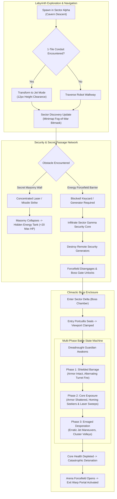
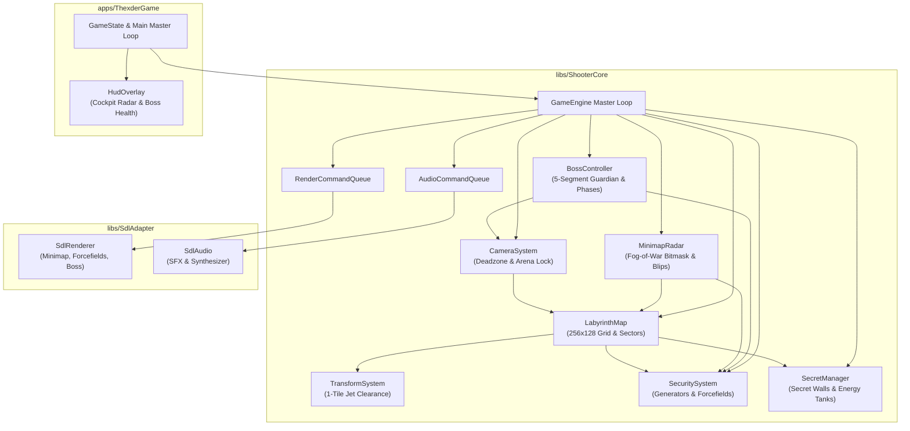
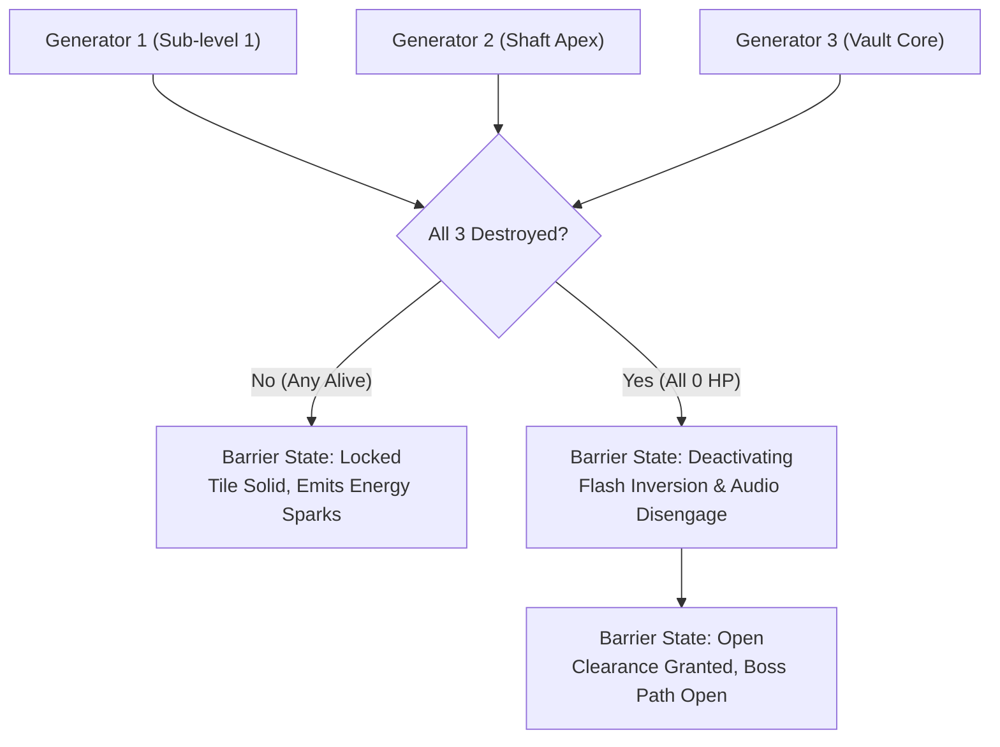
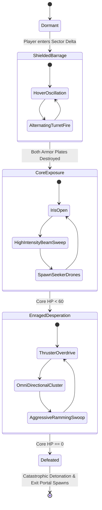

# Phase 12: Sprawling Labyrinth Architecture, Secret Passages & Boss Enclosure Implementation Plan

## 1. Executive Summary & Scope

Phase 12 elevates the *shoot-em-up-engine* from a constrained test cavern into the sprawling, non-linear subterranean fortress characteristic of Game Arts' *Thexder* (1985) and *Fire Hawk: Thexder - The Second Contact* (1989). Rather than a single continuous horizontal corridor, authentic Thexder stages are labyrinthine complexes of vertical gravitational shafts, narrow 1-tile crawling flues, fortified security nodes, concealed compartments behind destructible masonry, and sealed boss encounter arenas.

In Phase 12, the engine integrates five interconnected subsystems:
1. **Multi-Sector Labyrinth Spatial Partitioning**: A scalable, discrete grid architecture ($256 \times 128$ tiles) organized into distinct tactical sectors (Cavern Descent, Jet Transit Flues, Security Complex, Boss Enclosure).
2. **Transform-Constrained Navigation (1-Tile Crawlways)**: Tight conduits (16px high) that physically restrict movement to Jet mode (12px height), strictly penalizing or blocking Robot mode (28px height) and forcing high-speed flight maneuvers.
3. **Security Forcefields, Generators & Keycard Gating**: Dynamic barrier structures locked by remote security power generators and keycards, requiring players to explore branching pathways to neutralize power nodes before access to the boss chamber is granted.
4. **Secret Passages & Destructible Masonry**: Hidden alcoves disguised as impenetrable cavern rock, breachable only via concentrated continuous laser discharge or secondary explosive ordnance (missiles, flash bombs), concealing permanent energy tank upgrades and cargo supplies.
5. **Smooth Deadzone Camera & Viewport Lockout**: Advanced 2D camera tracking featuring configurable horizontal and vertical deadzone margins, smooth interpolation, sector boundary clamping, and arena containment lock during boss battles.
6. **Sector Radar & Real-Time Minimap Overlay**: Compact, zero-heap radar HUD displaying player position, discovered room sectors (fog-of-war tracking), security generator coordinates, locked forcefields, and boss telemetry.
7. **Multi-Segment Mechanical Boss: The Dreadnought Guardian**: A formidable stage boss featuring an armored chassis composed of independently destructible segments (Core, Left/Right Shield Platings, Twin Plasma Turrets, Booster Thrusters) governed by a 3-phase combat state machine (Shielded Barrage, Core Exposure, Enraged Overdrive).

---

### ASCII Baseline vs Phase 12 Labyrinth Evolution

```
+---------------------------------------------------------------------------------------+
|                       PHASE 12 LABYRINTH & BOSS ARCHITECTURE                          |
|                                                                                       |
|   CURRENT BASELINE (PHASES 8-11)              PHASE 12 SPRAWLING LABYRINTH EXPANSION  |
|                                                                                       |
|   1. Map Architecture:                        1. Multi-Sector Labyrinth:              |
|      • Linear 160x32 corridor                    • Sprawling 256x128 multi-room maze  |
|      • Uniform horizontal flow                   • Vertical shafts & jet crawlways    |
|      • No sector partitioning                    • Sector boundaries & room tracking  |
|                                                                                       |
|   2. Passage Clearance:                       2. Transform-Enforced Navigation:       |
|      • Wide 2-tile+ caverns                      • 1-tile (16px) high tunnels         |
|      • Robot mode fits everywhere                • Jet transformation strictly forced |
|                                                  • Clearance solver prevents stucks   |
|                                                                                       |
|   3. Progression Obstacles:                   3. Security Locking Mechanics:          |
|      • Destructible wall tiles only              • High-durability Security Generators|
|      • No persistent gates or doors              • Energy Forcefields & Keycard Doors |
|                                                  • Generator destruction unlocks gate |
|                                                                                       |
|   4. Secret Rooms:                            4. Concealed Caches:                    |
|      • None                                      • Secret masonry matching cavern rock|
|      • Pickups placed in open plain sight        • Hidden energy tank permanent buffs |
|                                                  • Ordnance resupply depots           |
|                                                                                       |
|   5. Camera Tracking:                         5. Advanced Camera Subsystem:           |
|      • Simple player centering                   • Smooth deadzone box tracking       |
|      • Global map clamping only                  • Sector boundary containment        |
|      • No arena lock mechanisms                  • Sealed boss enclosure lockout      |
|                                                                                       |
|   6. Navigation Telemetry:                    6. Tactical Minimap / Radar HUD:        |
|      • No minimap or radar                       • 32x16 sector chunk fog-of-war      |
|      • Blind traversal                           • Real-time player & target blips    |
|                                                                                       |
|   7. Stage Climax:                            7. Multi-Segment Dreadnought Boss:      |
|      • Static exit portal trigger                • 5-segment mechanical guardian      |
|      • No stage boss encounter                   • Destructible armor & core exposed  |
|                                                  • 3-phase tactical attack patterns   |
+---------------------------------------------------------------------------------------+
```

### Mermaid Labyrinth & Boss Architecture Flow



---

### Core Objectives & Deliverables

1. **Multi-Sector Labyrinth Layout (`libs/ShooterCore/LabyrinthMap.h`, `LabyrinthMap.cpp`)**:
   - Provide a sprawling $256 \times 128$ tile cavern complex organized into four discrete operational sectors:
     - **Sector Alpha (Cavern Entry & Vertical Descent)**: Broad caverns descending through staggered platforms with wall crawlers and patrol drones.
     - **Sector Beta (High-Speed Jet Flues)**: Long, claustrophobic 1-tile crawling conduits requiring Jet transformation, punctuated by hazard spikes and ceiling turrets.
     - **Sector Gamma (Security Complex)**: Fortified bunker housing 3 remote Security Generators defended by bio-nests and diving interceptors.
     - **Sector Delta (Boss Enclosure)**: Enclosed $32 \times 18$ tile arena with sealing blast doors and stage guardian pedestal.
2. **Transform Clearance Enforcement (`libs/ShooterCore/TransformSystem.h`)**:
   - Validate that 1-tile crawlways ($16$ px height) enforce strict clearance bounds:
     - Jet mode AABB ($24 \times 12$ px) clears successfully with 4px vertical margin.
     - Robot mode AABB ($16 \times 28$ px) is obstructed; attempting to transform from Jet to Robot within a 1-tile conduit is rejected with `TransformResult::BlockedByTerrain`.
3. **Security Generator & Barrier Gating Subsystem (`libs/ShooterCore/SecuritySystem.h`)**:
   - Manage up to 8 discrete `SecurityGenerator` nodes and `SecurityDoor` / `ForcefieldBarrier` gates.
   - Generators possess structural health (`GeneratorHealth = 100`) and emit localized energy hum.
   - When all linked generators for a barrier are destroyed, the barrier transitions from `State::Locked` to `State::Deactivated`, clearing collision clearance.
4. **Secret Masonry & Energy Tank Upgrades (`libs/ShooterCore/SecretManager.h`, `Types.h`)**:
   - Introduce `TileType::SecretWall`: Visually identical to regular cavern rock, but destructible by primary laser or secondary explosive ordnance.
   - Conceal secret chambers housing permanent `EnergyTank` upgrades: increases player maximum energy capacity from $100$ to $120$ (up to $200$ across 5 secret tanks), fully refilling the energy gauge upon acquisition.
5. **Smooth Deadzone Camera (`libs/ShooterCore/CameraSystem.h`)**:
   - Replace rigid centering with a smoothed deadzone tracking model ($64 \times 48$ px deadzone window).
   - Clamp viewport smoothly to active sector bounds.
   - Support `lockArena(Hitbox arenaBounds)`: Instantly locks camera motion to the boss enclosure when the encounter triggers.
6. **Sector Radar & Real-Time Minimap (`libs/ShooterCore/MinimapRadar.h`)**:
   - Maintain a $32 \times 16$ sector chunk fog-of-war bitset ($1$ bit per $8 \times 8$ tile block, totaling only 64 bytes).
   - Track player traversal in real-time, uncovering discovered sector chunks.
   - Project radar blips for the player craft (green), active security generators (yellow), locked barriers (red), and boss core (pulsing purple).
   - Emit zero-allocation hardware-neutral render commands to [`RenderCommandQueue`](../libs/ShooterCore/RenderCommandQueue.h).
7. **Multi-Segment Boss Guardian (`libs/ShooterCore/BossController.h`)**:
   - 5 distinct physical segments attached to a unified boss entity:
     - `CentralCore`: Main vulnerability; invulnerable until both armor plates are destroyed.
     - `LeftArmorPlate` & `RightArmorPlate`: High-durability ablative shields ($150$ HP each).
     - `TopPlasmaTurret` & `BottomPlasmaTurret`: Independent targeting turrets firing directional plasma orbs.
   - 3-Phase Boss AI:
     - `Phase::ShieldedBarrage`: Core sealed; turrets sweep alternating arcs; boss floats sinusoidally.
     - `Phase::CoreExposure`: Armor shattered; Core exposes glowing eye; sweeps continuous high-intensity beam and launches seeker drones.
     - `Phase::EnragedDesperation`: Erratic rapid thruster pulses; cluster bullet discharges; flashing red alert state.
8. **Automated Headless Test Suite (`tests/ShooterCoreTests`)**:
   - Exhaustive tests verifying sector containment, 1-tile jet clearance, security generator shutdown, secret masonry breach, deadzone camera clamping, minimap bitmask updates, and boss segment hitpoint progression under strict deterministic execution.

---

## 2. Architecture & Subsystem Integration

Phase 12 strictly maintains the three-tier decoupled architecture of the shoot-em-up engine:
- **Tier 1: Core Simulation Engine ([`libs/ShooterCore`](../libs/ShooterCore))**: Pure C++17, 100% deterministic, zero dynamic memory allocations on simulation paths (`CERT ERR55-CPP`), strictly no external dependencies.
- **Tier 2: Presentation Adapter ([`libs/SdlAdapter`](../libs/SdlAdapter))**: Consumes decoupled render and audio command queues to present hardware-accelerated forcefields, radar HUD overlays, and multi-segment boss transformations.
- **Tier 3: Game Application ([`apps/ThexderGame`](../apps/ThexderGame))**: Assembles the master $256 \times 128$ labyrinth map, configures sector spawners, binds HUD telemetry, and manages stage victory conditions.

### 2.1 ASCII Architectural Flow

```
+---------------------------------------------------------------------------------------+
|                               PHASE 12 ARCHITECTURAL FLOW                             |
|                                                                                       |
|   [Tier 1: libs/ShooterCore]                                                          |
|   ┌───────────────────────────────────────────────────────────────────────────────┐   |
|   │  LabyrinthMap                                                                 │   |
|   │    • 256x128 discrete TileMap grid with 4 functional sectors                  │   |
|   │    • 1-tile crawling flues (16px) enforcing Jet mode clearance                │   |
|   │    • TileType::SecretWall disguised masonry blocks                            │   |
|   │                                                                               │   |
|   │  SecuritySystem                                                               │   |
|   │    • Bounded array of 8 SecurityGenerators with structural hitpoints          │   |
|   │    • Bounded array of 8 SecurityDoors & Forcefields with locked/open state    │   |
|   │    • Generator destruction automatically drops linked forcefield gates        │   |
|   │                                                                               │   |
|   │  SecretManager                                                                │   |
|   │    • Tracks hidden alcoves, secret walls, and EnergyTank permanent upgrades   │   |
|   │    • Laser/explosive breach triggers acoustic crumbling & reveals chamber     │   |
|   │                                                                               │   |
|   │  CameraSystem                                                                 │   |
|   │    • Deadzone box tracking (64x48px) with smoothed interpolation              │   |
|   │    • Viewport boundary clamping to active SectorBounds                        │   |
|   │    • Arena containment lockdown during Sector Delta boss encounter            │   |
|   │                                                                               │   |
|   │  MinimapRadar                                                                 │   |
|   │    • 32x16 chunk discovery bitmask (64 bytes total; 0-heap)                   │   |
|   │    • Real-time player, generator, barrier, and boss blip tracking             │   |
|   │                                                                               │   |
|   │  BossController                                                               │   |
|   │    • 5-segment hierarchy: Central Core, L/R Armor, Top/Bottom Turrets         │   |
|   │    • Damage routing: Core protected until ablative armor plates destroyed     │   |
|   │    • 3-phase behavioral state machine with projectile & beam patterns         │   |
|   │                                                                               │   |
|   │  Decoupled Command Queues (Zero-Copy)                                         │   |
|   │    • RenderCommandQueue: Forcefields, Minimap HUD, Boss Segments, Core Flash  │   |
|   │    • AudioCommandQueue: Forcefield hum, Secret wall crumble, Boss siren/roar  │   |
|   └───────────────────────────────────────┬───────────────────────────────────────┘   |
|                                           │ Render / Audio Queues                     |
|                                           ▼                                           |
|   [Tier 2: libs/SdlAdapter]                                                           |
|   ┌───────────────────────────────────────────────────────────────────────────────┐   |
|   │  SdlRenderer: Hardware-accelerated forcefields, radar overlay, boss sprites   │   |
|   │  SdlAudio: Forcefield hum, barrier disengage click, boss explosion rumble    │   |
|   └───────────────────────────────────────────────────────────────────────────────┘   |
+---------------------------------------------------------------------------------------+
```

### 2.2 Mermaid Subsystem Dependencies



---

## 3. Detailed Component Specifications

### 3.1 Strong Domain Value Objects (`libs/ShooterCore/Types.h`)

To eliminate primitive obsession and comply with MISRA C++:2023 Rule 7.0.6, CERT INT31-C, and CERT ERR55-CPP, Phase 12 introduces strongly-typed, invariant-enforced value objects:

```cpp
/// @file Types.h
#pragma once

#include <cstddef>
#include <cstdint>
#include <algorithm>

namespace ShooterCore {

/// @enum class SectorId
/// @brief Distinct geographical sectors within the sprawling labyrinth.
enum class SectorId : std::uint8_t {
    Alpha = 0U,   ///< Cavern Entry & Vertical Descent Shaft
    Beta = 1U,    ///< Claustrophobic Jet Transit Flues & Hazard Spikes
    Gamma = 2U,   ///< Security Complex & Generator Matrix
    Delta = 3U,   ///< Sealed Boss Arena Enclosure
    Count = 4U
};

/// @struct SectorBounds
/// @brief World coordinate bounding rectangle for an individual labyrinth sector.
struct SectorBounds final {
    WorldPos min { 0.0f, 0.0f };
    WorldPos max { 0.0f, 0.0f };

    [[nodiscard]] constexpr bool contains(WorldPos pos) const noexcept
    {
        return (pos.x >= min.x) && (pos.x <= max.x) &&
               (pos.y >= min.y) && (pos.y <= max.y);
    }
};

/// @enum class SecurityGateState
/// @brief Physical operational state of forcefield and security blast doors.
enum class SecurityGateState : std::uint8_t {
    Locked = 0U,        ///< Impassable barrier; active energy forcefield
    Deactivating = 1U,  ///< Power cut; energy field collapsing
    Open = 2U           ///< Fully disengaged; clearance unobstructed
};

/// @class GeneratorHealth
/// @brief Durability state for stationary security power generators.
class GeneratorHealth final {
public:
    static constexpr std::uint16_t kMaxHealth { 100U };

    constexpr GeneratorHealth() noexcept = default;

    explicit constexpr GeneratorHealth(std::uint16_t hp) noexcept
        : hp_ { std::min(hp, kMaxHealth) }
    {
    }

    [[nodiscard]] constexpr std::uint16_t value() const noexcept { return hp_; }
    [[nodiscard]] constexpr bool isAlive() const noexcept { return hp_ > 0U; }

    constexpr void applyDamage(std::uint16_t amount) noexcept
    {
        if (amount >= hp_) {
            hp_ = 0U;
        } else {
            hp_ -= amount;
        }
    }

private:
    std::uint16_t hp_ { kMaxHealth };
};

/// @enum class BossSegmentType
/// @brief Anatomical classification of multi-segment boss components.
enum class BossSegmentType : std::uint8_t {
    CentralCore = 0U,
    LeftArmorPlate = 1U,
    RightArmorPlate = 2U,
    TopTurret = 3U,
    BottomTurret = 4U,
    Count = 5U
};

/// @enum class BossPhase
/// @brief Combat escalation state machine for the stage guardian.
enum class BossPhase : std::uint8_t {
    Dormant = 0U,
    ShieldedBarrage = 1U,
    CoreExposure = 2U,
    EnragedDesperation = 3U,
    Defeated = 4U
};

/// @class BossHealth
/// @brief Segmented hitpoint counter for boss sub-components.
class BossHealth final {
public:
    constexpr BossHealth() noexcept = default;

    explicit constexpr BossHealth(std::uint16_t hp, std::uint16_t maxHp) noexcept
        : hp_ { std::min(hp, maxHp) }
        , maxHp_ { maxHp }
    {
    }

    [[nodiscard]] constexpr std::uint16_t current() const noexcept { return hp_; }
    [[nodiscard]] constexpr std::uint16_t maximum() const noexcept { return maxHp_; }
    [[nodiscard]] constexpr bool isDestroyed() const noexcept { return hp_ == 0U; }

    constexpr void applyDamage(std::uint16_t amount) noexcept
    {
        if (amount >= hp_) {
            hp_ = 0U;
        } else {
            hp_ -= amount;
        }
    }

private:
    std::uint16_t hp_ { 100U };
    std::uint16_t maxHp_ { 100U };
};

} // namespace ShooterCore
```

---

### 3.2 Sprawling Labyrinth Architecture & 1-Tile Jet Conduits

#### 3.2.1 Level Architecture: Discrete Grid & Sectors

The labyrinth is designed as a continuous $256 \times 128$ tile map ($4096 \times 2048$ world pixels at 16px per tile). It is partitioned into four major sectors:

```
+-------------------------------------------------------------------------------+
|                       256 x 128 SPRAWLING LABYRINTH MAP                       |
|                                                                               |
|   (0,0)                                                     (256,0)           |
|   +-----------------------------------+-----------------------------------+   |
|   | SECTOR ALPHA: Cavern Descent      | SECTOR BETA: Jet Flues            |   |
|   | • Broad landing caves             | • 1-tile crawling conduits        |   |
|   | • Staggered vertical shafts       | • High-speed flight bottlenecks   |   |
|   | • Secret wall alcoves (Tank 1)    | • Hazard spike beds               |   |
|   | • Wall crawlers & drones          | • Diving interceptors             |   |
|   +-----------------------------------+-----------------------------------+   |
|   | SECTOR GAMMA: Security Complex    | SECTOR DELTA: Boss Enclosure      |   |
|   | • Heavy armored bulkheads         | • Sealed 32x18 arena              |   |
|   | • 3 Remote Security Generators    | • Entry blast portcullis (locks)  |   |
|   | • Secret room (Tank 2)            | • Dreadnought Guardian Boss       |   |
|   | • Forcefield barrier gates        | • Exit Warp Portal                |   |
|   +-----------------------------------+-----------------------------------+   |
|   (0,128)                                                   (256,128)         |
+-------------------------------------------------------------------------------+
```

#### 3.2.2 Transform-Enforced Navigation: 1-Tile Crawlways

In *Thexder*, the transformation mechanic is not merely cosmetic; it is an absolute spatial requirement to navigate tight tunnels.
- **Robot Dimensions**: Width = $16$ px, Height = $28$ px. Requires a minimum cavern height of 2 tiles ($32$ px).
- **Jet Dimensions**: Width = $24$ px, Height = $12$ px. Fits inside a 1-tile conduit ($16$ px vertical clearance) with 4px margin.

```
+-------------------------------------------------------------------------------+
|                       1-TILE CRAWLING CONDUIT CLEARANCE                       |
|                                                                               |
|   Solid Cavern Rock #######################################################   |
|                                                                               |
|   1-Tile Air Gap    ·······················································   |
|   (Height: 16px)     [==== Jet Mode (12px High) ====]  --> PASSES CLEANLY!    |
|                     ·······················································   |
|                                                                               |
|   Solid Cavern Rock #######################################################   |
|                                                                               |
|   Robot Attempt:    #######################################################   |
|                     [====]                                                    |
|                     |ROBOT| (28px High) --> COLLISION! TRANSFORMATION BLOCKED |
|                     [====]                                                    |
|                     #######################################################   |
+-------------------------------------------------------------------------------+
```

#### Clearance Invariant Verification:
When the player attempts to transform from Jet back to Robot inside a 1-tile tunnel, [`TransformSystem::requestTransform`](file:///c:/Users/Stavros/workspace/shoot-em-up-engine.git/libs/ShooterCore/TransformSystem.h) queries `TileMap::hasClearance(robotBox)`. Since the vertical extent overlaps the ceiling tile, the system immediately rejects the transformation:
- Returns `TransformResult::BlockedByTerrain`.
- Emits an audio negative feedback click (`SoundEffectId::Depleted`).
- Maintains Jet mode seamlessly, preventing clipping bugs or player entrapment.

---

### 3.3 Security System: Remote Generators & Forcefield Barriers

To open the sealed blast gates leading to the Boss Enclosure (Sector Delta), the player must navigate Sector Gamma and destroy three distributed **Security Generators**.

#### 3.3.1 Security Generator State Machine & Linkage

```
+-------------------------------------------------------------------------------+
|                       SECURITY GENERATOR & BARRIER ARCHITECTURE               |
|                                                                               |
|   [Generator 1: HP 100] ──┐                                                   |
|   [Generator 2: HP 100] ──┼──> [SecuritySystem Evaluator] ──> [Sector Barrier]|
|   [Generator 3: HP 100] ──┘         (All 3 Neutralized?)        (Deactivates) |
+-------------------------------------------------------------------------------+
```



#### 3.3.2 Specification: `libs/ShooterCore/SecuritySystem.h`

```cpp
/// @file SecuritySystem.h
#pragma once

#include <cstddef>
#include <cstdint>
#include <array>

#include "AudioCommandQueue.h"
#include "Hitbox.h"
#include "RenderCommandQueue.h"
#include "Types.h"

namespace ShooterCore {

class TileMap;

/// @struct SecurityGenerator
/// @brief Stationary high-voltage power node supplying energy to barrier gates.
struct SecurityGenerator final {
    WorldPos pos { 0.0f, 0.0f };
    Hitbox bounds { { 0.0f, 0.0f }, { 32.0f, 32.0f } };
    GeneratorHealth health { 100U };
    std::uint8_t linkedBarrierId { 0U };
    bool active { true };
};

/// @struct SecurityBarrier
/// @brief Impassable forcefield blocking access to locked sectors.
struct SecurityBarrier final {
    WorldPos pos { 0.0f, 0.0f };
    Hitbox bounds { { 0.0f, 0.0f }, { 16.0f, 48.0f } };
    SecurityGateState state { SecurityGateState::Locked };
    std::uint8_t requiredGenerators { 3U };
    std::uint8_t destroyedGenerators { 0U };
};

/// @class SecuritySystem
/// @brief Manages generator destruction, barrier unlocking, and collision synchronization.
class SecuritySystem final {
public:
    static constexpr std::size_t kMaxGenerators { 8U };
    static constexpr std::size_t kMaxBarriers { 4U };

    SecuritySystem() noexcept = default;

    /// @brief Register a new generator node in the world.
    bool registerGenerator(WorldPos pos, std::uint8_t barrierId) noexcept;

    /// @brief Register a security barrier gate in the world.
    bool registerBarrier(WorldPos pos, Hitbox bounds, std::uint8_t barrierId, std::uint8_t reqGen) noexcept;

    /// @brief Apply weapon damage to generators overlapping an area-of-effect or projectile.
    /// @param[in] hitArea Bounding box of the attack.
    /// @param[in] damage Amount of damage to inflict.
    /// @param[out] audioQueue Audio queue for destruction sounds.
    /// @return true if a generator was damaged.
    bool damageAt(const Hitbox& hitArea, std::uint16_t damage, AudioCommandQueue& audioQueue) noexcept;

    /// @brief Synchronize barrier open states with the physical TileMap grid.
    void syncTiles(TileMap& map) noexcept;

    /// @brief Emit render commands for forcefield shimmer and generator cores.
    void emitRender(RenderCommandQueue& renderQueue) const noexcept;

    /// @brief Query whether a specific barrier is disengaged.
    [[nodiscard]] bool isBarrierOpen(std::uint8_t barrierId) const noexcept;

    /// @brief Get active generator count.
    [[nodiscard]] std::size_t activeCount() const noexcept;

    /// @brief Get generator reference for minimap telemetry.
    [[nodiscard]] const std::array<SecurityGenerator, kMaxGenerators>& generators() const noexcept
    {
        return generators_;
    }

private:
    std::array<SecurityGenerator, kMaxGenerators> generators_ { };
    std::size_t generatorCount_ { 0U };

    std::array<SecurityBarrier, kMaxBarriers> barriers_ { };
    std::size_t barrierCount_ { 0U };
};

} // namespace ShooterCore
```

---

### 3.4 Secret Passages & Concealed Energy Tanks

#### 3.4.1 Secret Masonry Mechanics (`TileType::SecretWall`)

In classic *Thexder*, observant players discovering subtle wall fissures or blasting suspect dead-ends are rewarded with permanent upgrades.
- **Visual Disguise**: `TileType::SecretWall` is rendered with the exact same cavern tile sprite or color as `TileType::SolidWall`.
- **Destruction Conditions**:
  - Continuous Primary Laser: Requires 0.5s of focused laser contact (absorbs $15$ laser ticks).
  - Secondary Homing Missile: Breaches immediately on direct impact.
  - Flash Bomb Shockwave: Detonates and clears all secret walls within active camera viewport.
- **Acoustic Feedback**: Emits a distinct low-frequency masonry crumbling sound (`SoundEffectId::WallCrumble`) and spawns cluster rock debris particles.

#### 3.4.2 Permanent Upgrade: `EnergyTank` Value Object

```cpp
/// @class EnergyTank
/// @brief Permanent upgrade canister expanding the player craft's energy storage.
class EnergyTank final {
public:
    static constexpr std::uint16_t kCapacityBonus { 20U };
    static constexpr std::uint16_t kMaxPlayerEnergy { 200U };

    constexpr EnergyTank() noexcept = default;

    explicit constexpr EnergyTank(WorldPos pos) noexcept
        : pos_ { pos }
        , collected_ { false }
    {
    }

    [[nodiscard]] constexpr WorldPos position() const noexcept { return pos_; }
    [[nodiscard]] constexpr bool isCollected() const noexcept { return collected_; }

    constexpr void collect() noexcept { collected_ = true; }

private:
    WorldPos pos_ { 0.0f, 0.0f };
    bool collected_ { false };
};
```

When collected:
1. Player's maximum energy capacity increases: `maxEnergy = min(200, maxEnergy + 20)`.
2. Current energy pool instantly recharges to full capacity ($100\%$).
3. Audio queue plays iconic triumphant upgrade fanfare (`SoundEffectId::PowerUp`).
4. HUD maximum energy gauge expands visually.

---

### 3.5 Smooth Deadzone Camera & Viewport Lockout

#### 3.5.1 Deadzone Mathematical Model

To provide a cinematic, non-disorienting view during high-speed Jet flight while avoiding twitchy camera oscillations, the camera tracks the craft using a **Deadzone Window** ($W_{dead} = 64$ px, $H_{dead} = 48$ px) centered on the screen ($320 \times 240$ native resolution):

```
+-------------------------------------------------------------------------------+
|                       SMOOTH DEADZONE CAMERA MODEL                            |
|                                                                               |
|   +-----------------------------------------------------------------------+   |
|   | Viewport Extents (320 x 240)                                          |   |
|   |                                                                       |   |
|   |                    Deadzone Window (64 x 48)                          |   |
|   |                 +-----------------------------+                       |   |
|   |                 |                             |                       |   |
|   |                 |         [ Player ]          |                       |   |
|   |                 |      (Free motion zone)     |                       |   |
|   |                 |                             |                       |   |
|   |                 +-----------------------------+                       |   |
|   |                        |               |                              |   |
|   |                        v               v                              |   |
|   |               Camera scrolls only when player crosses                 |   |
|   |               the deadzone boundary margins.                          |   |
|   +-----------------------------------------------------------------------+   |
+-------------------------------------------------------------------------------+
```

Let $(P_x, P_y)$ be the player center, $(C_x, C_y)$ be the camera top-left position, and $(V_w, V_h) = (320, 240)$ be the viewport size:
- Screen center: $S_x = C_x + \frac{V_w}{2}, \quad S_y = C_y + \frac{V_h}{2}$.
- Horizontal deadzone bounds: $[S_x - \frac{W_{dead}}{2}, S_x + \frac{W_{dead}}{2}]$.
- Vertical deadzone bounds: $[S_y - \frac{H_{dead}}{2}, S_y + \frac{H_{dead}}{2}]$.
- If $P_x > S_x + \frac{W_{dead}}{2}$, target $C_{x, target} = P_x - \frac{V_w}{2} - \frac{W_{dead}}{2}$.
- If $P_x < S_x - \frac{W_{dead}}{2}$, target $C_{x, target} = P_x - \frac{V_w}{2} + \frac{W_{dead}}{2}$.
- Position is smoothed toward target using exponential dampening:
  $$C_x(t + \Delta t) = C_x(t) + (C_{x, target} - C_x(t)) \cdot (1 - e^{-\lambda \Delta t})$$
- Finally, $(C_x, C_y)$ is clamped strictly within the active `SectorBounds`.

#### 3.5.2 Boss Arena Containment Lock

When the player enters Sector Delta:
1. `CameraSystem::lockArena(arenaBounds)` is invoked.
2. The camera boundaries are instantly clamped to the arena walls ($512 \times 288$ px), preventing the player from scrolling the boss off-screen.
3. The entry portcullis drops, locking the player inside until the boss is defeated.

```cpp
/// @file CameraSystem.h
#pragma once

#include <cstdint>
#include <algorithm>
#include <cmath>

#include "Hitbox.h"
#include "Types.h"

namespace ShooterCore {

/// @class CameraSystem
/// @brief High-precision smoothed deadzone camera tracking with sector clamping.
class CameraSystem final {
public:
    static constexpr float kDefaultDeadzoneW { 64.0f };
    static constexpr float kDefaultDeadzoneH { 48.0f };
    static constexpr float kSmoothingFactor { 12.0f };

    constexpr CameraSystem() noexcept = default;

    /// @brief Update camera tracking relative to player position.
    void update(DeltaTime dt, WorldPos playerPos, const SectorBounds& bounds) noexcept;

    /// @brief Lock viewport strictly to boss enclosure arena.
    void lockArena(const SectorBounds& arenaBounds) noexcept;

    /// @brief Release arena lock and return to dynamic sector tracking.
    void unlockArena() noexcept;

    /// @brief Query current viewport world bounding box.
    [[nodiscard]] constexpr CameraViewport viewport() const noexcept
    {
        return viewport_;
    }

    /// @brief Direct setter for camera position (used during respawn / level start).
    void setPosition(WorldPos pos) noexcept
    {
        viewport_.pos = pos;
    }

private:
    CameraViewport viewport_ { { 0.0f, 0.0f }, 320.0f, 240.0f };
    bool isArenaLocked_ { false };
    SectorBounds lockedBounds_ { };
};

} // namespace ShooterCore
```

---

### 3.6 Sector Radar & Real-Time Minimap Overlay

#### 3.6.1 Fog-of-War Discovery Bitmask (Zero Dynamic Allocation)

To guide the player through the massive $256 \times 128$ cavern without excessive memory overhead, the minimap divides the world into a $32 \times 16$ grid of **Sector Chunks** ($8 \times 8$ tiles per chunk).
- Grid dimensions: $32$ columns $\times 16$ rows = $512$ total chunks.
- Storage: Represented as a compact `std::array<std::uint64_t, 8>` (512 bits = exactly 64 bytes).
- Zero heap allocation (`CERT ERR55-CPP`).

```
+-------------------------------------------------------------------------------+
|                       32 x 16 MINIMAP RADAR ARCHITECTURE                      |
|                                                                               |
|   Sector Chunk (8x8 tiles = 128x128 world pixels)                             |
|                                                                               |
|   Minimap Display (Cockpit HUD Corner: 64 x 32 px screen area)                |
|   ┌───────────────────────────────────────────────────────────────┐           |
|   │ [Unexplored: Fog]     ░░░░░░░░░░░░░░░░░░░░░░░░░░░░░░░░░░░░    │           |
|   │ [Explored Chunk]      ████████████░░░░░░░░░░░░░░░░░░░░░░░░    │           |
|   │ [Player Blip]         ▲ (Flashing Green)                      │           |
|   │ [Generator Blips]     ● ● ● (Yellow)                          │           |
|   │ [Locked Forcefield]   ■ (Red)                                 │           |
|   │ [Boss Telemetry]      ★ (Pulsing Purple in Sector Delta)      │           |
|   └───────────────────────────────────────────────────────────────┘           |
+-------------------------------------------------------------------------------+
```

#### 3.6.2 Minimap Radar Implementation

```cpp
/// @file MinimapRadar.h
#pragma once

#include <cstddef>
#include <cstdint>
#include <array>

#include "RenderCommandQueue.h"
#include "Types.h"

namespace ShooterCore {

class SecuritySystem;

/// @class MinimapRadar
/// @brief Compact, zero-heap tactical radar managing fog-of-war and target telemetry.
class MinimapRadar final {
public:
    static constexpr std::size_t kChunkCols { 32U };
    static constexpr std::size_t kChunkRows { 16U };
    static constexpr float kChunkPixelExtent { 128.0f }; // 8 tiles * 16px

    MinimapRadar() noexcept = default;

    /// @brief Update fog-of-war discovery around player coordinates.
    void updateDiscovery(WorldPos playerPos) noexcept;

    /// @brief Query whether a specific chunk has been traversed.
    [[nodiscard]] bool isDiscovered(std::size_t col, std::size_t row) const noexcept;

    /// @brief Emit hardware-neutral draw commands for HUD radar overlay.
    void emitCommands(RenderCommandQueue& renderQueue,
                      WorldPos playerPos,
                      const SecuritySystem& security,
                      WorldPos bossPos,
                      bool bossActive) const noexcept;

private:
    // 512 bits = 8 * 64-bit integers = 64 bytes total
    std::array<std::uint64_t, 8U> discoveryBitmask_ { };
};

} // namespace ShooterCore
```

---

### 3.7 Stage Boss Encounter: The Dreadnought Guardian

The centerpiece of Phase 12 is the climatic encounter in Sector Delta against the **Dreadnought Guardian**—a massive, biomechanical fortress insectoid inspired by Game Arts' iconic multi-phase guardians.

#### 3.7.1 Multi-Segment Anatomical Hierarchy

The Dreadnought Guardian consists of 5 distinct, independently tracked segments:

```
+-------------------------------------------------------------------------------+
|                       DREADNOUGHT GUARDIAN SEGMENTS                           |
|                                                                               |
|                    [Top Plasma Turret: 80 HP]                                 |
|                                |                                              |
|                                v                                              |
|       +-------------------------------------------------+                     |
|       | [Left Armor Plate: 150 HP]                      |                     |
|       |                                                 |                     |
|       |             [ CENTRAL CORE: 200 HP ]            | <== Main Objective  |
|       |              (Protected by Armor)               |                     |
|       |                                                 |                     |
|       | [Right Armor Plate: 150 HP]                     |                     |
|       +-------------------------------------------------+                     |
|                                ^                                              |
|                                |                                              |
|                   [Bottom Plasma Turret: 80 HP]                               |
|                                                                               |
|       <=== [Propulsion Booster: Sinusoidal Hover & Thrusters]                 |
+-------------------------------------------------------------------------------+
```

#### 3.7.2 Damage Routing & Invulnerability Invariant

- **Central Core Protection**: Frontal attacks against the `CentralCore` deal zero damage while either `LeftArmorPlate` or `RightArmorPlate` remains functional.
- **Armor Ablation**: Secondary missiles and concentrated laser attacks strip away the outer armor plates. Once both plates are destroyed, the core's protective iris opens, exposing the vulnerable pulsating core.
- **Turret Destruction**: Destroying `TopTurret` or `BottomTurret` reduces the boss's offensive firepower in subsequent phases.

#### 3.7.3 3-Phase State Machine



1. **Phase 1: `ShieldedBarrage`**:
   - Boss hovers smoothly along a vertical sinusoidal trajectory ($y(t) = y_0 + A \cdot \sin(\omega t)$).
   - Top and bottom turrets alternate firing aimed energy orbs every $1.2$ seconds.
   - Core is shielded. Player must use Jet mobility to flank and damage armor plates.
2. **Phase 2: `CoreExposure`**:
   - Armor plates shatter into burning fragments.
   - Core iris opens, radiating an intense glow.
   - Sweeps a continuous high-damage energy beam across a $\pm 45^\circ$ forward arc.
   - Periodically releases 2 homing seeker drones from rear vents.
3. **Phase 3: `EnragedDesperation` (Triggered at $< 30\%$ Core Health)**:
   - Flashes hazard red. Thrusters fire violently, executing sudden horizontal dashes toward the player.
   - Discharges omni-directional radial plasma clusters (8 orbs every 2 seconds).
   - Speed increases by $50\%$.

#### 3.7.4 Specification: `libs/ShooterCore/BossController.h`

```cpp
/// @file BossController.h
#pragma once

#include <cstddef>
#include <cstdint>
#include <array>

#include "AudioCommandQueue.h"
#include "Hitbox.h"
#include "RenderCommandQueue.h"
#include "Types.h"

namespace ShooterCore {

class EntityPool;
class ParticlePool;
class TileMap;

/// @struct BossSegment
/// @brief Physical sub-component of the multi-segment guardian.
struct BossSegment final {
    BossSegmentType type { BossSegmentType::CentralCore };
    WorldPos relativeOffset { 0.0f, 0.0f };
    Hitbox bounds { { 0.0f, 0.0f }, { 32.0f, 32.0f } };
    BossHealth health { 100U, 100U };
    bool isArmored { true };
};

/// @class BossController
/// @brief Master simulation controller for the Dreadnought Guardian boss.
class BossController final {
public:
    static constexpr std::size_t kSegmentCount { 5U };

    BossController() noexcept;

    /// @brief Initialize boss spawn position in Sector Delta.
    void spawn(WorldPos spawnPos) noexcept;

    /// @brief Master tick: updates kinematics, attacks, and phase transitions.
    void update(DeltaTime dt,
                WorldPos playerPos,
                EntityPool& entities,
                ParticlePool& particles,
                AudioCommandQueue& audioQueue) noexcept;

    /// @brief Apply damage to boss segments overlapping a weapon hitbox.
    /// @return true if damage was accepted by a vulnerable segment.
    bool applyDamage(const Hitbox& hitArea, std::uint16_t damage, AudioCommandQueue& audio) noexcept;

    /// @brief Emit render commands for all active boss segments and beam FX.
    void emitRender(RenderCommandQueue& renderQueue) const noexcept;

    /// @brief Query active combat phase.
    [[nodiscard]] constexpr BossPhase phase() const noexcept { return phase_; }

    /// @brief Query whether boss is defeated and chamber is clear.
    [[nodiscard]] constexpr bool isDefeated() const noexcept
    {
        return phase_ == BossPhase::Defeated;
    }

    /// @brief Query world center of the guardian core.
    [[nodiscard]] constexpr WorldPos corePosition() const noexcept
    {
        return rootPos_;
    }

private:
    void updatePhase1(DeltaTime dt, WorldPos playerPos, EntityPool& entities, AudioCommandQueue& audio) noexcept;
    void updatePhase2(DeltaTime dt, WorldPos playerPos, EntityPool& entities, AudioCommandQueue& audio) noexcept;
    void updatePhase3(DeltaTime dt, WorldPos playerPos, EntityPool& entities, AudioCommandQueue& audio) noexcept;

    WorldPos rootPos_ { 0.0f, 0.0f };
    Velocity velocity_ { 0.0f, 0.0f };
    float hoverTimer_ { 0.0f };
    float attackCooldown_ { 0.0f };

    BossPhase phase_ { BossPhase::Dormant };
    std::array<BossSegment, kSegmentCount> segments_ { };
};

} // namespace ShooterCore
```

---

## 4. Subsystem & File Modifications

### 4.1 Tier 1: Core Simulation Engine (`libs/ShooterCore`)

#### 4.1.1 [`libs/ShooterCore/Types.h`](../libs/ShooterCore/Types.h)
- Add `SectorId`, `SectorBounds`, `SecurityGateState`, `GeneratorHealth`, `BossSegmentType`, `BossPhase`, `BossHealth`.
- Extend `TileType` with `TileType::SecretWall` and `TileType::Forcefield`.
- Add `SoundEffectId::WallCrumble`, `SoundEffectId::SecurityAlarm`, `SoundEffectId::BossRoar`, `SoundEffectId::BossExplode`.
- Add `EnergyTank` value object.

#### 4.1.2 [`libs/ShooterCore/LabyrinthMap.h`](../libs/ShooterCore/LabyrinthMap.h) & [`.cpp`](../libs/ShooterCore/LabyrinthMap.cpp) (NEW)
- Construct $256 \times 128$ tile geometry with Sector Alpha, Beta, Gamma, and Delta layouts.
- Carve 1-tile crawling flues, vertical shafts, generator vaults, and the boss arena.
- Provide sector bounds queries and exit portal locations.

#### 4.1.3 [`libs/ShooterCore/SecuritySystem.h`](../libs/ShooterCore/SecuritySystem.h) & [`.cpp`](../libs/ShooterCore/SecuritySystem.cpp) (NEW)
- Manage 8 generator slots and 4 barrier gates.
- Implement generator health depletion, barrier disengagement, and tile collision synchronization.

#### 4.1.4 [`libs/ShooterCore/SecretManager.h`](../libs/ShooterCore/SecretManager.h) & [`.cpp`](../libs/ShooterCore/SecretManager.cpp) (NEW)
- Track secret masonry walls and concealed permanent energy tanks.
- Handle masonry collapse on laser/missile contact and energy capacity expansion.

#### 4.1.5 [`libs/ShooterCore/CameraSystem.h`](../libs/ShooterCore/CameraSystem.h) & [`.cpp`](../libs/ShooterCore/CameraSystem.cpp) (NEW)
- Implement smooth deadzone window ($64 \times 48$ px) camera tracking.
- Handle sector boundary clamping and boss arena lockout.

#### 4.1.6 [`libs/ShooterCore/MinimapRadar.h`](../libs/ShooterCore/MinimapRadar.h) & [`.cpp`](../libs/ShooterCore/MinimapRadar.cpp) (NEW)
- Implement 64-byte fog-of-war discovery bitmask for $32 \times 16$ chunks.
- Render radar frame, discovered sector blocks, player position, and security blips.

#### 4.1.7 [`libs/ShooterCore/BossController.h`](../libs/ShooterCore/BossController.h) & [`.cpp`](../libs/ShooterCore/BossController.cpp) (NEW)
- Implement 5-segment hierarchy, ablative armor damage routing, and 3-phase combat state machine.

#### 4.1.8 [`libs/ShooterCore/GameEngine.h`](../libs/ShooterCore/GameEngine.h) & [`.cpp`](../libs/ShooterCore/GameEngine.cpp)
- Wire `LabyrinthMap`, `SecuritySystem`, `SecretManager`, `CameraSystem`, `MinimapRadar`, and `BossController` into the master simulation loop.
- Expand player energy capacity handling to accommodate `EnergyTank` upgrades.

---

### 4.2 Tier 2: Presentation Adapter (`libs/SdlAdapter`)

#### 4.2.1 [`libs/SdlAdapter/SdlRenderer.h`](../libs/SdlAdapter/SdlRenderer.h) & [`.cpp`](../libs/SdlAdapter/SdlRenderer.cpp)
- Render pulsating electric forcefields using semi-transparent animated scanlines.
- Render minimap HUD overlay with high-contrast color-coded blips.
- Render boss segments with damage flash states, rotating plasma turrets, and energy beam sweep arcs.

#### 4.2.2 [`libs/SdlAdapter/SdlAudio.h`](../libs/SdlAdapter/SdlAudio.h) & [`.cpp`](../libs/SdlAdapter/SdlAudio.cpp)
- Synthesize masonry crumbling noise, forcefield electrical drone, security alarm siren, and multi-channel boss roar.

---

### 4.3 Tier 3: Game Application (`apps/ThexderGame`)

#### 4.3.1 [`apps/ThexderGame/GameState.h`](../apps/ThexderGame/GameState.h) & [`.cpp`](../apps/ThexderGame/GameState.cpp)
- Initialize $256 \times 128$ Labyrinth rather than legacy Level 1 corridor.
- Bind boss victory event to level completion warp portal activation.

#### 4.3.2 [`apps/ThexderGame/HudOverlay.h`](../apps/ThexderGame/HudOverlay.h) & [`.cpp`](../apps/ThexderGame/HudOverlay.cpp)
- Add minimap radar frame display to cockpit dashboard.
- Display boss health bar when active in Sector Delta.

---

## 5. CMake Build Configuration & Project Structure

### 5.1 [`libs/ShooterCore/CMakeLists.txt`](../libs/ShooterCore/CMakeLists.txt)

```cmake
target_sources(ShooterCore PRIVATE
    AnimationController.cpp
    AudioCommandQueue.cpp
    BossController.cpp      # NEW: Multi-Segment Boss State Machine
    CameraSystem.cpp        # NEW: Smooth Deadzone Camera Tracking
    CollisionSolver.cpp
    EnemyAiSystem.cpp
    EntityPool.cpp
    GameEngine.cpp
    Hitbox.cpp
    LabyrinthMap.cpp        # NEW: 256x128 Multi-Sector Labyrinth Layout
    Logger.cpp
    MinimapRadar.cpp        # NEW: 64-Byte Fog-of-War Radar Overlay
    NestManager.cpp
    ParticlePool.cpp
    RenderCommandQueue.cpp
    SecondaryArsenal.cpp
    SecretManager.cpp       # NEW: Secret Walls & Energy Tank Upgrades
    SecuritySystem.cpp      # NEW: Generators & Forcefield Gating
    SupplyDropSystem.cpp
    TileMap.cpp
    TransformSystem.cpp
    WeaponSystem.cpp
)
```

### 5.2 [`tests/ShooterCoreTests/CMakeLists.txt`](../tests/ShooterCoreTests/CMakeLists.txt)

```cmake
add_executable(ShooterCoreTests
    Main.cpp
    TestAnimationController.cpp
    TestBossController.cpp        # NEW: Boss Segments, Armor & Phases
    TestCameraSystem.cpp          # NEW: Deadzone & Arena Lock Clamping
    TestCollisionSolver.cpp
    TestCommandQueues.cpp
    TestDeterminismSoak.cpp
    TestEnemyAi.cpp
    TestEngineInput.cpp
    TestEntityPool.cpp
    TestGameEngine.cpp
    TestHitbox.cpp
    TestLabyrinthArchitecture.cpp # NEW: 1-Tile Jet Crawlways & Sectors
    TestMinimapRadar.cpp          # NEW: Fog-of-War Bitmask & Blips
    TestNestManager.cpp
    TestParticlePool.cpp
    TestSecondaryArsenal.cpp
    TestSecretManager.cpp         # NEW: Secret Masonry & Energy Tanks
    TestSecuritySystem.cpp        # NEW: Generators & Forcefield Gating
    TestShieldSystem.cpp
    TestSupplyDropSystem.cpp
    TestTileMap.cpp
    TestTransformSystem.cpp
    TestTypes.cpp
    TestWeaponSystem.cpp
)
```

---

## 6. Automated Verification & Testing Strategy

To ensure absolute determinism, zero dynamic allocation, and zero regression across the existing physics and weapon suites, Phase 12 introduces five dedicated automated test suites in [`tests/ShooterCoreTests`](../tests/ShooterCoreTests).

### 6.1 Test Breakdown

```
+---------------------------------------------------------------------------------------+
|                       PHASE 12 AUTOMATED TEST MATRIX                                  |
|                                                                                       |
|   1. TestLabyrinthArchitecture.cpp:                                                   |
|      • testMapDimensions(): Verifies 256x128 grid extents and tile boundaries         |
|      • testSectorPartitioning(): Validates coordinate bounds for Alpha, Beta, etc.    |
|      • testJetTunnelClearance(): Verifies Jet fits 1-tile flue; Robot is blocked      |
|      • testTransformBlockedInFlue(): Verifies requestTransform fails inside 1-tile gap|
|                                                                                       |
|   2. TestSecuritySystem.cpp:                                                          |
|      • testGeneratorDamageAndDestruction(): Verifies generator HP depletion           |
|      • testForcefieldBarrierLocked(): Verifies barrier blocks movement when locked    |
|      • testBarrierDisengagesAllGeneratorsDead(): Verifies barrier opens on 0 HP       |
|      • testTileSync(): Verifies TileMap collision updates cleanly on barrier open     |
|                                                                                       |
|   3. TestSecretManager.cpp:                                                           |
|      • testSecretWallLaserBreach(): Verifies focused laser collapses secret masonry   |
|      • testSecretWallMissileBreach(): Verifies missile impact destroys secret wall    |
|      • testEnergyTankCollection(): Verifies max energy increases 100 -> 120           |
|      • testEnergyTankMaxCap(): Verifies maximum energy cap capped at 200              |
|                                                                                       |
|   4. TestCameraSystem.cpp:                                                            |
|      • testDeadzoneIdle(): Player motion within 64x48 window does not move camera     |
|      • testDeadzoneTracking(): Crossing deadzone border smoothly moves viewport       |
|      • testSectorClamping(): Viewport clamped strictly to sector boundary             |
|      • testArenaLockout(): Viewport strictly confined to boss enclosure bounds        |
|                                                                                       |
|   5. TestMinimapRadar.cpp:                                                            |
|      • testBitmaskDiscovery(): Traversal sets correct bit in 64-byte array            |
|      • testFogOfWarUnexplored(): Unvisited chunks return false                        |
|      • testBlipCoordinates(): Verifies screen projection of player and generators     |
|                                                                                       |
|   6. TestBossController.cpp:                                                          |
|      • testArmorProtectsCore(): Damage to core deals 0 HP while armor plates intact   |
|      • testArmorDestruction(): Ablative plates take damage and break at 0 HP          |
|      • testPhaseTransitionToCoreExposure(): Phase advances to CoreExposure on breach  |
|      • testPhaseTransitionToEnraged(): Phase advances to Enraged at < 30% core HP     |
|      • testBossDefeated(): Core reaching 0 HP transitions to Defeated and clears arena|
+---------------------------------------------------------------------------------------+
```

---

## 7. Step-by-Step Implementation Flow

### Step 1: Types & Value Objects
- Define `SectorId`, `SectorBounds`, `SecurityGateState`, `GeneratorHealth`, `BossSegmentType`, `BossPhase`, `BossHealth`, and `EnergyTank` in [`libs/ShooterCore/Types.h`](../libs/ShooterCore/Types.h).
- Implement unit tests in `tests/ShooterCoreTests/TestTypes.cpp`.

### Step 2: Labyrinth Geometry & 1-Tile Clearance
- Author [`libs/ShooterCore/LabyrinthMap.h`](../libs/ShooterCore/LabyrinthMap.h) and [`.cpp`](../libs/ShooterCore/LabyrinthMap.cpp).
- Build $256 \times 128$ cavern layout with 1-tile crawling flues in Sector Beta.
- Verify transform rejection in 1-tile flues via `tests/ShooterCoreTests/TestLabyrinthArchitecture.cpp`.

### Step 3: Security System (Generators & Forcefields)
- Author [`libs/ShooterCore/SecuritySystem.h`](../libs/ShooterCore/SecuritySystem.h) and [`.cpp`](../libs/ShooterCore/SecuritySystem.cpp).
- Wire generator damage and barrier disengagement logic.
- Verify barrier tile synchronization via `tests/ShooterCoreTests/TestSecuritySystem.cpp`.

### Step 4: Secret Passages & Energy Tank Upgrades
- Author [`libs/ShooterCore/SecretManager.h`](../libs/ShooterCore/SecretManager.h) and [`.cpp`](../libs/ShooterCore/SecretManager.cpp).
- Implement `TileType::SecretWall` destructibility under laser and explosive ordnance.
- Implement permanent energy expansion in player state.
- Verify via `tests/ShooterCoreTests/TestSecretManager.cpp`.

### Step 5: Smooth Deadzone Camera & Arena Lock
- Author [`libs/ShooterCore/CameraSystem.h`](../libs/ShooterCore/CameraSystem.h) and [`.cpp`](../libs/ShooterCore/CameraSystem.cpp).
- Implement deadzone bounding box and exponential smoothing.
- Integrate sector clamping and arena lockdown.
- Verify via `tests/ShooterCoreTests/TestCameraSystem.cpp`.

### Step 6: Minimap Radar & Fog-of-War Bitmask
- Author [`libs/ShooterCore/MinimapRadar.h`](../libs/ShooterCore/MinimapRadar.h) and [`.cpp`](../libs/ShooterCore/MinimapRadar.cpp).
- Implement 64-byte chunk discovery bitmask and blip projection.
- Verify via `tests/ShooterCoreTests/TestMinimapRadar.cpp`.

### Step 7: Multi-Segment Boss Guardian
- Author [`libs/ShooterCore/BossController.h`](../libs/ShooterCore/BossController.h) and [`.cpp`](../libs/ShooterCore/BossController.cpp).
- Implement 5-segment hierarchy, armor damage routing, and 3-phase state machine.
- Verify via `tests/ShooterCoreTests/TestBossController.cpp`.

### Step 8: GameEngine Master Integration & Regression Audit
- Integrate all subsystems into [`libs/ShooterCore/GameEngine.h`](../libs/ShooterCore/GameEngine.h) and [`.cpp`](../libs/ShooterCore/GameEngine.cpp).
- Connect presentation in [`libs/SdlAdapter`](../libs/SdlAdapter) and [`apps/ThexderGame`](../apps/ThexderGame).
- Run full test suite: `ctest --output-on-failure`. Verify zero regressions and zero compiler warnings.

---

## 8. Safety & Compliance Verification Checklist

Before and during implementation, all Phase 12 code must be validated against the project's compliance framework:

1. **MISRA C++:2023 Rule 7.0.6 & SEI CERT INT31-C (Signed/Unsigned Safety)**:
   - All conversions between grid indices (`std::size_t`, `std::uint32_t`) and world coordinates (`float`) are explicit via `static_cast` with bounds verification.
   - Fixed-width integers explicitly use `<cstdint>` and `std::` qualification (e.g. `std::uint8_t`, `std::uint16_t`).
2. **SEI CERT ERR55-CPP (Zero Dynamic Allocation on Real-Time Paths)**:
   - All labyrinth sector queries, camera updates, minimap bitmask operations, and boss segment ticks operate strictly on stack variables, pre-allocated fixed buffers, and `std::array`. Zero calls to `new`, `malloc`, or dynamically resized containers on simulation paths.
3. **Domain Modeling & Value Objects**:
   - Every single-argument constructor is marked `explicit constexpr ... noexcept`.
   - Primitive obsession is strictly prohibited (`SectorId`, `GeneratorHealth`, `BossHealth`, `SectorBounds`).
4. **Include-What-You-Use (IWYU) & `<cstdint>`**:
   - Every header and source file explicitly includes all symbols it uses in canonical sorted groups.
   - All headers begin with `#pragma once`.
5. **Function Naming & Documentation**:
   - All function names are strictly under 30 characters.
   - All public APIs are fully documented with Doxygen tags (`/// @brief`, `@param`, `@return`).

---

## 9. Expected Outcome

Upon completion of Phase 12:
- The game features an authentic, sprawling $256 \times 128$ labyrinth with distinct vertical and horizontal sectors.
- Players are forced to master the Jet transformation to navigate claustrophobic 1-tile crawling flues.
- Progression requires tactical reconnaissance to destroy remote Security Generators and unlock fortified barriers.
- Inquisitive players are rewarded with permanent energy upgrades hidden behind secret masonry walls.
- Players navigate confidently using a smooth deadzone camera and real-time cockpit minimap radar.
- The stage culminates in an intense, multi-phase battle against the multi-segment Dreadnought Guardian within an enclosed arena, paving the way for the chiptune synthesizer and music soundtrack of Phase 13.

