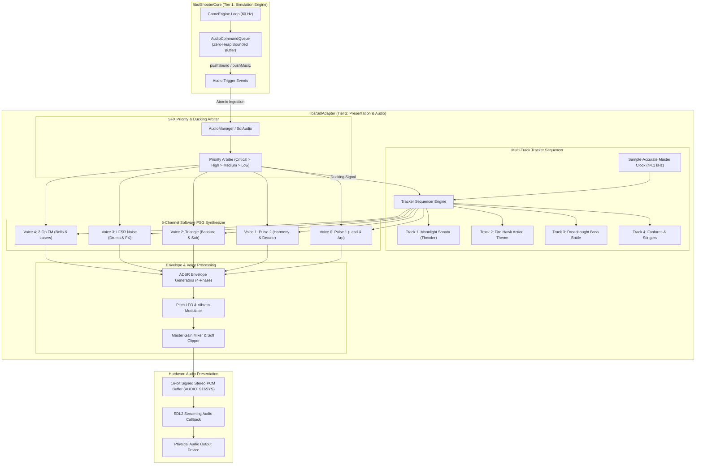
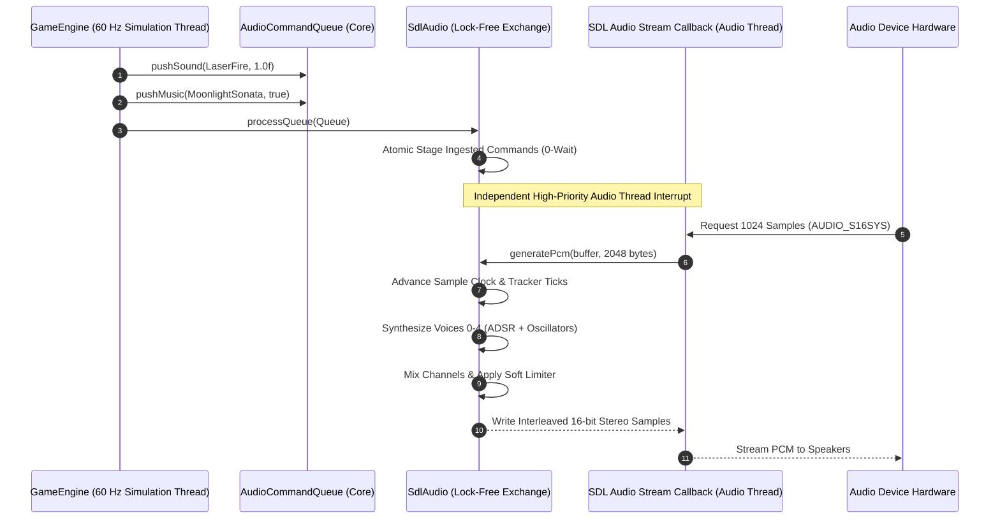
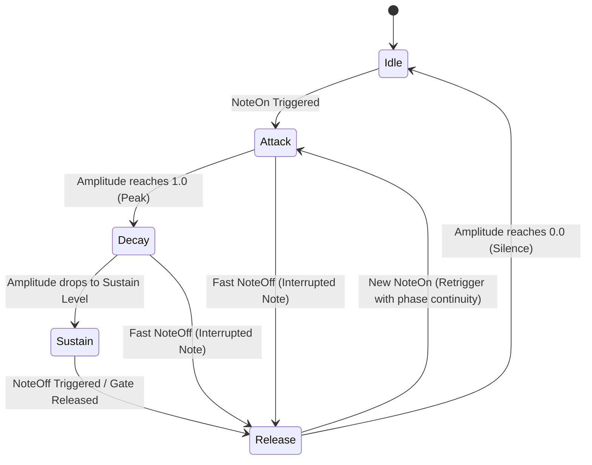
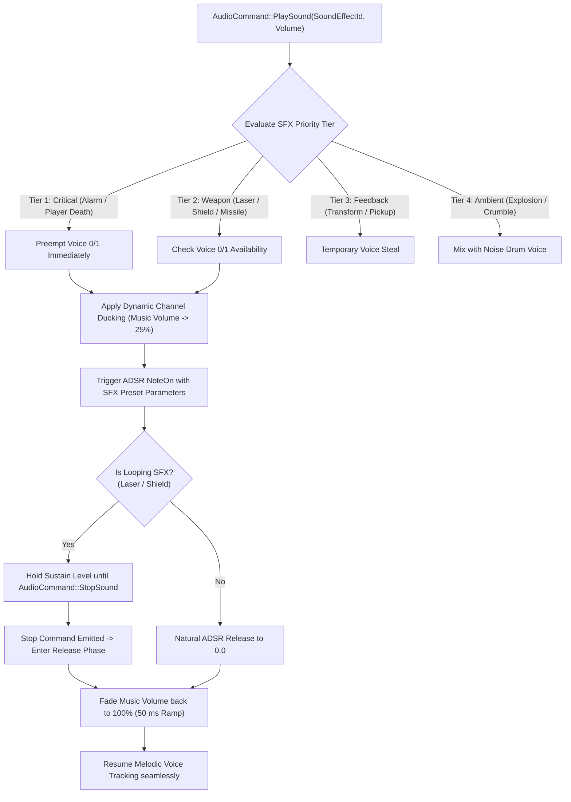

```mermaid
flowchart TD
    T1["TestAdsrEnvelope"] --> A1["Verify Attack Slope (0.0 to 1.0)"]
    T1 --> A2["Verify Sustain Hold Stability"]
    T1 --> A3["Verify Exponential Release Decay"]
    T1 --> A4["Verify Retrigger Clickless Continuity"]

    T2["TestChiptuneVoice"] --> B1["Pulse Wave: Verify Duty Cycle 12.5%, 25%, 50%"]
    T2 --> B2["Triangle Wave: Verify 0 DC Bias & Zero-Crossing Rate"]
    T2 --> B3["LFSR Noise: Verify Randomness & Dual-Mode Periodicity"]
    T2 --> B4["FM Operator: Verify Modulation Index Harmonic Generation"]

    T3["TestMusicTracker"] --> C1["Verify Tick Advance vs Sample Count (44.1 kHz)"]
    T3 --> C2["Verify Moonlight Sonata Note Sequences across 4 Voices"]
    T3 --> C3["Verify Pattern Loop Boundary Synchronization"]

    T4["TestSdlAudio (Offline)"] --> D1["Command Queue Ingestion"]
    T4 --> D2["SFX Priority Voice Stealing Matrix"]
    T4 --> D3["Dynamic Music Channel Ducking (-14 dB)"]
    T4 --> D4["Master Soft Limiter Anti-Clipping Bounds Check"]
```

# Phase 13: Multi-Channel Retro Synthesizer & Authentic Music Soundtrack Implementation Plan

## 1. Executive Summary & Scope

Phase 13 delivers an authentic, multi-channel 1980s retro sound synthesizer and music tracker architecture for the *shoot-em-up-engine*, recreating the acoustic signature of Game Arts' *Thexder* (1985) and *Fire Hawk: Thexder - The Second Contact* (1989). In the golden age of arcade and PC chiptune audio (Yamaha YM2151/OPM, Ricoh 2A03, SN76489, and NEC PC-8801 OPNA), sound was not pre-recorded compressed audio; it was synthesized in real-time through dedicated hardware voice channels combining pulse waves with variable duty cycles, unaliased triangle basslines, pseudo-random linear feedback shift register (LFSR) noise generators, and precise analog-style ADSR envelopes.

Furthermore, *Thexder* is historically renowned for its signature musical arrangement: the frantic, driving chiptune rendition of Ludwig van Beethoven's *Moonlight Sonata* (Piano Sonata No. 14 in C-sharp minor, Op. 27, No. 2, 3rd Movement - *Presto agitato*). *Fire Hawk* built upon this heritage by introducing energetic, high-tempo sci-fi synth-rock action themes and an expanded tactical sound effects library.

In Phase 13, the audio engine evolves from a basic single-track tone generator into an industrial-grade, multi-channel programmable sound generator (PSG) and music tracker engine featuring:
1. **5-Channel Software Synthesizer Architecture**:
   - **Voice 0 (Pulse 1 / Lead)**: High-speed arpeggio melodies, frequency sweeps, variable pulse width (12.5%, 25%, 50%, 75%).
   - **Voice 1 (Pulse 2 / Harmony & Counter-Melody)**: Polyphonic harmony, detuned chorus leads, secondary counterpoint.
   - **Voice 2 (Triangle / Bassline)**: Smooth, warm, quantized low-frequency fundamentals and punchy bass walking lines.
   - **Voice 3 (Noise / LFSR Percussion & Explosions)**: Dual-mode 15-bit Galois LFSR generating white noise (explosions, crashes) and periodic metallic noise (hi-hats, snares, cymbals).
   - **Voice 4 (FM Synthesis / Metallic Bells & FX)**: 2-operator frequency modulation synthesis (carrier + modulator) producing metallic clangs, laser resonance, and retro sci-fi textures.
2. **Precision ADSR Envelope Subsystem**:
   - Attack, Decay, Sustain, and Release 4-phase state machine per voice with sub-millisecond ramp interpolation.
   - Eliminates pops and clicks via zero-crossing phase continuity and exponential release curves.
3. **Multi-Track Chiptune Tracker & Music Sequencer**:
   - Tick-synchronized pattern table sequencer driven directly by audio sample counting ($44.1\text{ kHz}$ master clock).
   - Zero dynamic memory allocation on the real-time audio thread (`CERT ERR55-CPP`).
   - Authentic multi-channel musical scores:
     - **Thexder Signature Theme**: Beethoven's *Moonlight Sonata* (3rd Movement - *Presto agitato*) multi-channel arrangement.
     - **Fire Hawk Action Theme**: Driving 136 BPM sci-fi synth-rock battle cadence with syncopated bass and punchy drums.
     - **Boss Battle: Dreadnought Confrontation**: Fast, menacing chromatic march with urgent arpeggios.
     - **Game Over & Stage Clear Fanfares**: Descending staccato dirge and ascending multi-voice victory chords.
4. **Authentic Sound Effect (SFX) Priority & Channel Ducking Matrix**:
   - Voice stealing hierarchy ensuring critical player cues (continuous homing laser hum, shield barrier activation drone, low-energy warning klaxon) never get suppressed.
   - Dynamic channel ducking: Temporarily borrows music voices for priority combat sound bursts, seamlessly restoring the music voice without sequencer desynchronization.
5. **Thread-Safe Decoupled Architecture**:
   - Decoupled from core game simulation via [`AudioCommandQueue`](../libs/ShooterCore/AudioCommandQueue.h).
   - Lock-free, bounded command transfer between the 60 Hz simulation loop and the high-frequency SDL audio streaming callback thread.

---

### ASCII Baseline vs Phase 13 Retro Synthesizer Evolution

```
+---------------------------------------------------------------------------------------+
|                   AUDIO SUBSYSTEM EVOLUTION: BASELINE VS PHASE 13                     |
|                                                                                       |
|   CURRENT BASELINE (PHASES 7-12)              PHASE 13 RETRO SYNTHESIZER & SOUNDTRACK |
|                                                                                       |
|   1. Voice Polyphony & Waveforms:             1. 5-Channel Dedicated PSG Engine:      |
|      • Simple 4-voice array                      • Voice 0: Pulse 1 (PWM 12.5-75%)    |
|      • Fixed pulse, triangle, noise              • Voice 1: Pulse 2 (Detuned Harmony) |
|      • Linear decay only                         • Voice 2: Triangle (Warm Bass)      |
|      • No pulse width modulation                 • Voice 3: Dual-Mode LFSR Noise      |
|                                                  • Voice 4: 2-Operator FM Synthesizer |
|                                                                                       |
|   2. Envelope Shaping:                        2. Precision ADSR Envelope Engine:      |
|      • Linear amplitude decay rate               • 4-phase Attack-Decay-Sustain-Rel   |
|      • Abrupt cutoffs causing clicks             • Exponential release curves         |
|      • No sustain plateau                        • Zero-crossing anti-click ramping   |
|                                                                                       |
|   3. Music Sequencer:                         3. Multi-Track Chiptune Tracker:        |
|      • Single 16-note hardcoded monophonic array • 4-voice synchronized tracker       |
|      • Frame-tick dependent (drift prone)        • Sample-accurate tick accumulator   |
|      • No pattern loops or harmonies             • Pattern tables with repeat loops   |
|                                                  • 4 Full Authentic Compositions:     |
|                                                    - Moonlight Sonata (Presto agitato)|
|                                                    - Fire Hawk Action Theme           |
|                                                    - Dreadnought Boss March           |
|                                                    - Game Over & Victory Fanfares     |
|                                                                                       |
|   4. Sound Effect Library:                    4. Expanded Priority SFX Suite:         |
|      • Monophonic one-shot triggers              • Continuous looping Laser Hum       |
|      • SFX overrides music permanently           • Resonant Shield Barrier Drone      |
|      • No priority resolution                    • Dual-stage Transformation Servo    |
|                                                  • Canister & Crystal Sparkling Chime |
|                                                  • Layered Sub-Bass Explosion Crunch  |
|                                                  • Low Energy Pulsing Klaxon          |
|                                                                                       |
|   5. Channel Management:                      5. Priority Voice Stealing & Ducking:   |
|      • Voices overwrite without arbitration      • 4-tier SFX priority sorting        |
|      • Music stops when SFX triggers             • Transparent music channel ducking  |
|                                                  • Automatic volume duck & restore    |
|                                                                                       |
|   6. Thread Safety & Compliance:              6. Certified Real-Time Safety:          |
|      • SDL_LockAudioDevice mutex locks           • Lock-free atomic command exchange  |
|      • Basic float arithmetic                    • 100% Zero-heap allocation (ERR55)  |
|      • Implicit float casts                      • MISRA C++:2023 Rule 7.0.6 & INT31  |
+---------------------------------------------------------------------------------------+
```

### Mermaid Subsystem Architecture & Signal Flow



---

## 2. Architecture & Subsystem Integration

Phase 13 maintains the strict architectural decoupling enforced across all libraries:
- **Core Engine ([`libs/ShooterCore`](../libs/ShooterCore))**: Retains 100% deterministic simulation, zero knowledge of audio hardware, and zero third-party dependencies (`#include <SDL.h>` is banned). Emits strongly-typed commands via [`AudioCommandQueue`](../libs/ShooterCore/AudioCommandQueue.h).
- **Presentation Adapter ([`libs/SdlAdapter`](../libs/SdlAdapter))**: Consumes the commands, houses the multi-channel synthesizer, tracker sequencer, voice priority manager, and generates streaming 16-bit PCM samples inside the SDL streaming audio callback.
- **Game Application ([`apps/ThexderGame`](../apps/ThexderGame))**: Maps stage states (Cavern exploration, Jet flues, Boss encounter, Game Over) to tracker music tracks and simulation events to sound effects.

### 2.1 Decoupled Signal Pipeline & Voice Processing

```
+-----------------------------------------------------------------------------------------------+
|                       PHASE 13 SYNTHESIS VOICE PROCESSING PIPELINE                            |
|                                                                                               |
|   +-------------------+      +-------------------+      +-------------------+                 |
|   |   Note Frequency  |----->| Pitch Modulator   |----->| Waveform Generator|                 |
|   |   (Hz / Semitone) |      | (Sweep / Vibrato) |      | (Pulse/Tri/Noise/FM)                |
|   +-------------------+      +-------------------+      +---------+---------+                 |
|                                                                   |                           |
|                                                                   v                           |
|   +-------------------+      +-------------------+      +---------+---------+                 |
|   | ADSR Gate Trigger |----->| ADSR Envelope Gen |----->| Voice VCA Gain    |                 |
|   | (NoteOn / NoteOff)|      | (Att/Dec/Sus/Rel) |      | (Amplitude Scale) |                 |
|   +-------------------+      +-------------------+      +---------+---------+                 |
|                                                                   |                           |
|                                                                   v                           |
|   +-------------------+      +-------------------+      +---------+---------+                 |
|   | Channel Ducking   |----->| Channel Balance   |----->| Master Gain Mixer |                 |
|   | Scale (0.0 - 1.0) |      | (Stereo Panning)  |      | & Soft Limiter    |                 |
|   +-------------------+      +-------------------+      +---------+---------+                 |
|                                                                   |                           |
|                                                                   v                           |
|                                                         +---------+---------+                 |
|                                                         | 16-bit Stereo PCM |                 |
|                                                         | (SDL Audio Stream)|                 |
|                                                         +-------------------+                 |
+-----------------------------------------------------------------------------------------------+
```

### 2.2 Thread Safety & Real-Time Constraints

The SDL audio streaming callback executes on an independent high-priority operating system audio thread:
- **Audio Thread Latency**: SDL invokes `audioCallback` at regular intervals (typically 512 or 1024 samples at $44.1\text{ kHz}$, representing $\sim 11.6$ to $23.2\text{ ms}$ of audio).
- **Zero Heap Allocation (CERT ERR55-CPP)**: Dynamic memory allocation (`new`, `malloc`, `std::vector::resize`, `std::string`) is strictly forbidden on the audio thread. Any memory exhaustion exception would abort the process via `std::terminate`.
- **Lock-Free Communication**: Rather than stalling the 60 Hz simulation thread with blocking mutexes (`SDL_LockAudioDevice`), commands are queued using a bounded atomic double-buffer or atomic ring index in `SdlAudio`.



---

## 3. Detailed Component Specifications

### 3.1 Multi-Waveform Synthesis Voice Engine

The synthesizer provides five dedicated voice channels, each tailored for retro sonic authenticity:

#### 1. Voice 0 & Voice 1: Dual Pulse Wave Oscillators (PWM)
- **Duty Cycle Options**: Standard retro PSG duty modes:
  - $12.5\%$ ($1/8$ pulse): Nasal, sharp, cutting harmonic bite (classic arcade lead).
  - $25.0\%$ ($1/4$ pulse): Resonant, bright lead timbre (signature Thexder laser & melody).
  - $50.0\%$ ($1/2$ square): Hollow, woody, pure clarinet-like tone (harmonies & chords).
  - $75.0\%$ ($3/4$ inverted pulse): Rich, thick counterpoint tone.
- **Phase Accumulator**: 32-bit fractional phase accumulation with range $[0.0, 1.0)$:
  $$\Delta \phi = \frac{f_{\text{target}}}{f_{\text{sample}}}$$
- **Pulse-Width Modulation (PWM)**: Optional low-frequency LFO modulating duty cycle continuously between $10\%$ and $90\%$ to create lush, chorused string/pad textures.

#### 2. Voice 2: Quantized Triangle Oscillator
- **Waveform Formulation**: Symmetrical ramp:
  $$S(t) = 2 \cdot \left| 2 \cdot (\phi(t) + 0.25 - \lfloor \phi(t) + 0.25 \rfloor) - 1 \right| - 1$$
- **Characteristics**: Pure, rich fundamental with minimal high-frequency harmonic distortion, providing the warm, punchy bassline essential for retro game arrangements.

#### 3. Voice 3: Dual-Mode Linear Feedback Shift Register (LFSR) Noise
- **Shift Register Architecture**: 15-bit Galois LFSR initialized to non-zero seed `0x7FFF`.
- **Operating Modes**:
  - **White Noise (15-bit Tap)**: Polynomial $x^{15} + x^{14} + 1$. Produces full-spectrum pseudo-random white noise ideal for explosions, crashing waves, and destructible masonry disintegration.
  - **Metallic Periodic Noise (7-bit / 9-bit Tap)**: Short cycle periodicity producing metallic buzzes, high-frequency chattering, snare snaps, and closed hi-hats.
- **Clock Divider**: Variable noise clock frequency allowing pitch-shifting noise from sub-bass rumbles ($60\text{ Hz}$) to crisp cymbals ($12\text{ kHz}$).

#### 4. Voice 4: 2-Operator FM (Frequency Modulation) Synthesis
- **Carrier & Modulator Operators**:
  - Modulator: $M(t) = A_m(t) \cdot \sin(2\pi f_m t)$
  - Carrier: $C(t) = A_c(t) \cdot \sin(2\pi f_c t + I(t) \cdot M(t))$
- **Modulation Index ($I(t)$)**: Governed by an independent envelope, creating dynamic spectral brightness shifts (e.g. sharp metallic strike decaying into a warm electric tine bell).
- **Retro Character**: Captures the unmistakable PC-8801 / YM2612 FM audio aesthetics of late-80s Japanese action games.

---

### 3.2 Precision ADSR Envelope Subsystem

Every voice possesses an independent 4-phase ADSR (Attack, Decay, Sustain, Release) envelope generator, preventing audio pops, clicks, and abrupt cutoffs:

```
+-------------------------------------------------------------------------------+
|                       ADSR ENVELOPE GENERATOR LIFECYCLE                       |
|                                                                               |
|   Amplitude                                                                   |
|       ^                                                                       |
|   1.0 |      /\  <- Peak Level (1.0)                                          |
|       |     /  \                                                              |
|       |    /    \_______  <- Sustain Level (e.g. 0.6)                         |
|       |   /     |       \                                                     |
|       |  /      |        \                                                    |
|       | /       |         \                                                   |
|   0.0 +----------------------\----------> Time                                |
|       | Attack  | Decay | Sustain | Release |                                 |
|       | (Rate)  | (Rate)| (Level) | (Rate)  |                                 |
|       +---------+-------+---------+---------+                                 |
|       ^ NoteOn                    ^ NoteOff                                   |
+-------------------------------------------------------------------------------+
```



#### Mathematical Formulation & Parameters
- **`EnvelopeState`**: `enum class EnvelopeState : std::uint8_t { Idle, Attack, Decay, Sustain, Release };`
- **Attack Phase**: Linear or exponential rise from current level to $1.0$:
  $$A(t + \Delta t) = A(t) + \frac{\Delta t}{\tau_{\text{attack}}}$$
- **Decay Phase**: Exponential drop towards sustain level $S \in [0.0, 1.0]$:
  $$A(t + \Delta t) = A(t) - (A(t) - S) \cdot \frac{\Delta t}{\tau_{\text{decay}}}$$
- **Sustain Phase**: Maintained indefinitely while the note gate is held active ($A(t) = S$).
- **Release Phase**: Exponential fade to zero upon key/gate release:
  $$A(t + \Delta t) = A(t) \cdot \left(1.0 - \frac{\Delta t}{\tau_{\text{release}}}\right)$$
- **Zero-Crossing Retrigger**: If a new note triggers while a voice is still releasing, the envelope begins from its current amplitude rather than resetting to $0.0$, eliminating audible clicks.

---

### 3.3 Multi-Track Chiptune Tracker & Music Sequencer

The music sequencer is structured as a classical retro MOD/tracker engine, operating with sample-accurate clock division:

#### 1. Tracker Data Structures
- **`TrackerNote`**:
  - `std::uint8_t semitone`: MIDI-style note index ($0 = \text{C-0}$, $60 = \text{C-4}$, $255 = \text{Note Off / Rest}$).
  - `std::uint8_t instrument`: Preset voice timbre definition (pulse duty, ADSR envelope, vibrato depth).
  - `std::uint8_t volume`: Velocity / volume scale $[0, 64]$.
  - `std::uint8_t effect`: Chiptune effect command (Portamento, Arpeggio, Vibrato, Cut).
- **`TrackerRow`**: A 4-voice step containing one `TrackerNote` per active music voice.
- **`TrackerPattern`**: Fixed array of 32 or 64 `TrackerRow` steps.
- **`TrackerSong`**: Ordered sequence of pattern indices with loop markers.

#### 2. Clock & Timing Accuracy
- Retro trackers operate on musical ticks (typically 6 ticks per row at 125–150 BPM).
- Instead of relying on variable OS game loop frame rates (where $60\text{ Hz}$ can suffer from $\pm 5\text{ ms}$ jitter), the tracker advances based on the audio device's sample count:
  $$\text{SamplesPerTick} = \frac{f_{\text{sample}} \times 2.5}{\text{BPM} \times \text{TicksPerRow}}$$
  For $44.1\text{ kHz}$ at $150\text{ BPM}$ and 6 ticks per row, $\text{SamplesPerTick} = 735$ samples.

---

### 3.4 Authentic Score Arrangements

Phase 13 implements four complete musical compositions in authentic 4-voice tracker arrangement:

```
+-----------------------------------------------------------------------------------------------+
|                       PHASE 13 AUTHENTIC MUSIC TRACKS & VOICES                                |
|                                                                                               |
|   Track 1: Beethoven's Moonlight Sonata (Presto agitato) - Signature Thexder Theme            |
|   • Voice 0 (Pulse 1): Rapid 16th-note arpeggiated lead (C#m - G#7 - A - E - F#m)             |
|   • Voice 1 (Pulse 2): Staccato chord stabs and counterpoint harmonies                       |
|   • Voice 2 (Triangle): Relentless driving eighth-note walking bass line                       |
|   • Voice 3 (Noise): Syncopated retro hi-hat and snare cadence                                |
|                                                                                               |
|   Track 2: Fire Hawk Sci-Fi Action Theme - High-Tempo Battle Cadence                          |
|   • Voice 0 (Pulse 1): Heroic syncopated lead melody with vibrato and pitch bend              |
|   • Voice 1 (Pulse 2): Rich octave harmony doubling with 25% duty pulse                       |
|   • Voice 2 (Triangle): Slap-bass octave bounces and descending runs                          |
|   • Voice 3 (Noise): Aggressive electronic rock drum kit (punchy kick, snare, cymbals)        |
|                                                                                               |
|   Track 3: Dreadnought Boss Battle - Menacing Subterranean Climax                             |
|   • Voice 0 (Pulse 1): Fast chromatic minor runs and discordant warning trills                |
|   • Voice 1 (Pulse 2): Heavy sustained power chords (root + fifth)                            |
|   • Voice 2 (Triangle): Thumping sub-bass heartbeat rhythm ($40-80\text{ Hz}$)                |
|   • Voice 3 (Noise): Rapid rolling double-snare battle percussion                             |
|                                                                                               |
|   Track 4: Stingers & Fanfares (Stage Clear & Game Over)                                      |
|   • Stage Clear: Ascending bright arpeggiated fanfare with bell overtones                     |
|   • Game Over: Somber descending chromatic minor cascade decaying into silence                |
+-----------------------------------------------------------------------------------------------+
```

#### Detailed Track Specifications:
1. **Beethoven's *Moonlight Sonata* (3rd Movement - *Presto agitato*)**:
   - Key: C-sharp minor ($C\sharp - D\sharp - E - F\sharp - G\sharp - A - B$).
   - Tempo: 165 BPM.
   - Structure:
     - Measures 1–8: Ascending broken arpeggios on Voice 0 ($G\sharp 3 \to C\sharp 4 \to E4 \to G\sharp 4 \to C\sharp 5$), punctuated by sharp accented chords on Voice 1.
     - Bassline: Voice 2 plays driving octave motor rhythms in C-sharp minor.
     - Percussion: Voice 3 adds an authentic 1985 arcade backbeat.
2. **Fire Hawk Action Theme**:
   - Key: D minor / F major.
   - Tempo: 140 BPM.
   - Distinctive 1989 Japanese PC game synth-rock styling: fast 16th-note bass groove with memorable melodic hooks.
3. **Boss Battle Theme**:
   - Key: A minor / diminished fifths.
   - Tempo: 172 BPM.
   - Relentless urgency reflecting the multi-segment Dreadnought Guardian battle.

---

### 3.5 SFX Priority Matrix, Looping Hum/Drones & Music Ducking

Sound effects and background music share the 5 hardware synthesis voices. To ensure crystal-clear audibility without clipping or voice starvation, Phase 13 introduces a deterministic voice priority and ducking arbiter:

```
+-----------------------------------------------------------------------------------------------+
|                       SOUND EFFECT PRIORITY & VOICE STEALING MATRIX                           |
|                                                                                               |
|   Priority Tier     Sound Effects                      Target Voice     Ducking Policy        |
|   ─────────────────────────────────────────────────────────────────────────────────────────   |
|   Tier 1: Critical  Low Energy Alarm, Player Death,    Voice 0 / 1      Duck Music Voice 0/1  |
|                     Flash Bomb Shockwave               Voice 3 (Noise)  by 80% (-14 dB)       |
|                                                                                               |
|   Tier 2: Weapon    Continuous Homing Laser Hum,       Voice 0 (Pulse)  Duck Music Lead to    |
|                     Missile Launch, Shield Deploy      Voice 1 (Pulse)  allow sustained SFX   |
|                                                                                               |
|   Tier 3: Feedback  Transformation Servo, Hit Pings,   Voice 2 (Tri)    Shared with bass;     |
|                     Canister / Crystal Chime           Voice 0 (Pulse)  temporary note steal  |
|                                                                                               |
|   Tier 4: Ambient   Destructible Masonry Crumble,      Voice 3 (Noise)  Plays on drum voice;  |
|                     Minor Enemy Explosions                              mixes with noise kit  |
+-----------------------------------------------------------------------------------------------+
```



#### Looping Drone Implementations:
- **Continuous Homing Laser Hum**:
  - Voice 0 (Pulse 1, 25% duty cycle).
  - Starts with an initial rapid attack ($10\text{ ms}$) at $880\text{ Hz}$, then settles into a sustained vibrato drone ($440\text{ Hz} \pm 25\text{ Hz}$ at an 8 Hz LFO rate).
  - Holds at sustain level $0.7$ while the laser fire button is depressed.
  - When fire is released, triggers a rapid $40\text{ ms}$ downward release ramp to silence.
- **Energy Barrier Shield Drone**:
  - Voice 1 (Pulse 2, 50% square wave).
  - Sustained low-frequency resonant hum ($120\text{ Hz}$) with subtle phase chorusing against Voice 0.
  - Deflection impacts trigger a momentary high-pitch resonant chime ($1100\text{ Hz} \to 240\text{ Hz}$ sweep) layered over the drone.
- **Dual-Stage Transformation Servo**:
  - Stage 1 (Mechanical Disengage): Sharp ascending triangle pitch glide ($180\text{ Hz} \to 720\text{ Hz}$).
  - Stage 2 (Thruster Ignition / Lock): Low-pass filtered noise burst + sub-bass click.

---

### 3.6 Decoupled Simulation Integration & Thread-Safe Audio Synchronization

To preserve strict decoupling, `libs/ShooterCore` never interfaces with audio hardware. The core simulation engine updates [`AudioCommandQueue`](../libs/ShooterCore/AudioCommandQueue.h) during frame ticks.

#### Updated Audio Command Types
In [`libs/ShooterCore/Types.h`](../libs/ShooterCore/Types.h):
```cpp
/// @brief Sound effect identifier for presentation audio playback.
enum class SoundEffectId : std::uint8_t {
    None = 0U,
    LaserFire = 1U,
    LaserLoop = 2U,
    LaserStop = 3U,
    LaserHit = 4U,
    ShieldDeploy = 5U,
    ShieldDrone = 6U,
    ShieldDeflect = 7U,
    TransformJet = 8U,
    TransformRobot = 9U,
    PlayerDamage = 10U,
    PlayerDestroyed = 11U,
    EnemyExplode = 12U,
    BlockCrumble = 13U,
    EnergyWarning = 14U,
    MissileLaunch = 15U,
    FlashBombExplode = 16U,
    CanisterPickup = 17U,
    CrystalChime = 18U,
    BossDamage = 19U,
    BossExplode = 20U,
    WeaponSelect = 21U
};

/// @brief Music track identifier for presentation audio stream.
enum class MusicTrackId : std::uint8_t {
    None = 0U,
    MoonlightSonata = 1U,  // Thexder Signature Main Theme
    FireHawkAction = 2U,   // Thexder 2 High-Tempo Theme
    BossDreadnought = 3U,  // Sector Delta Boss Encounter
    StageClear = 4U,       // Ascending Fanfare
    GameOver = 5U          // Descending Dirge
};
```

---

## 4. Subsystem & File Modifications

The following tables summarize all files to be modified or introduced in Phase 13 across the three architecture tiers.

### 4.1 Tier 1: Core Engine Subsystem (`libs/ShooterCore`)

| File Path | Status | Primary Responsibilities |
| :--- | :--- | :--- |
| `libs/ShooterCore/Types.h` | Modify | Expand `SoundEffectId` (laser loop, crystal chime, boss explode) and `MusicTrackId` (MoonlightSonata, FireHawkAction, BossDreadnought). |
| `libs/ShooterCore/AudioCommandQueue.h` | Modify | Add `pushSoundLoop()`, `stopSound()`, and volume balance parameters. |
| `libs/ShooterCore/AudioCommandQueue.cpp` | Modify | Implement robust zero-heap command storage and validation. |

### 4.2 Tier 2: Presentation Adapter Subsystem (`libs/SdlAdapter`)

| File Path | Status | Primary Responsibilities |
| :--- | :--- | :--- |
| `libs/SdlAdapter/AdsrEnvelope.h` | **New** | Precision 4-phase ADSR envelope generator with anti-click zero-crossing phase matching. |
| `libs/SdlAdapter/AdsrEnvelope.cpp` | **New** | ADSR rate and state updates, exponential release calculations (`CERT ERR55-CPP`). |
| `libs/SdlAdapter/ChiptuneVoice.h` | **New** | Encapsulates single voice synthesis state (Pulse PWM, Triangle, LFSR Noise, 2-Op FM). |
| `libs/SdlAdapter/ChiptuneVoice.cpp` | **New** | Real-time sample synthesis, phase accumulation, pitch modulation, and LFO vibrato. |
| `libs/SdlAdapter/MusicTracker.h` | **New** | 4-voice tracker sequencer, pattern player, and sample-accurate tick accumulator. |
| `libs/SdlAdapter/MusicTracker.cpp` | **New** | Note trigger logic, pattern advancement, looping, and song score data structures. |
| `libs/SdlAdapter/TrackMoonlightSonata.h` | **New** | Authentic 4-voice tracker arrangement of Beethoven's Moonlight Sonata (*Presto agitato*). |
| `libs/SdlAdapter/TrackFireHawk.h` | **New** | Authentic 4-voice sci-fi action synth-rock theme pattern tables. |
| `libs/SdlAdapter/TrackBossBattle.h` | **New** | Menacing chromatic boss battle tracker score pattern tables. |
| `libs/SdlAdapter/SoundPresets.h` | **New** | Static configuration tables for all 22 sound effect instruments and envelope presets. |
| `libs/SdlAdapter/SdlAudio.h` | Modify | Upgrade `SdlAudio` to coordinate 5 `ChiptuneVoice` channels, `MusicTracker`, and priority ducking. |
| `libs/SdlAdapter/SdlAudio.cpp` | Modify | Implement lock-free audio command ingestion, priority voice stealing, dynamic ducking, and 16-bit PCM mixing. |

### 4.3 Tier 3: Game Application Subsystem (`apps/ThexderGame`)

| File Path | Status | Primary Responsibilities |
| :--- | :--- | :--- |
| `apps/ThexderGame/Main.cpp` | Modify | Hook new music tracks into stage transitions (exploration -> boss -> victory/game over), and connect looping laser/shield sound triggers. |

### 4.4 Automated Test Suite (`tests/SdlAdapterTests` & `tests/ShooterCoreTests`)

| File Path | Status | Primary Responsibilities |
| :--- | :--- | :--- |
| `tests/SdlAdapterTests/TestAdsrEnvelope.cpp` | **New** | Unit test verifying ADSR attack slopes, sustain holding, exponential release, and clickless retriggering. |
| `tests/SdlAdapterTests/TestMusicTracker.cpp` | **New** | Unit test verifying sample-accurate tick progression, pattern loops, and note gating. |
| `tests/SdlAdapterTests/TestSdlAudio.cpp` | Modify | Offline sample generation tests: verifying RMS amplitude, zero-crossing continuity, voice priority stealing, and music ducking. |

---

## 5. CMake Build Configuration & Project Structure

The project structure will incorporate the new synthesis and tracker modules within `libs/SdlAdapter`:

```
shoot-em-up-engine/
├── apps/
│   └── ThexderGame/
│       └── Main.cpp
├── docs/
│   ├── implementation_plan.md
│   ├── phase12_plan.md
│   └── phase13_plan.md              <-- This implementation document
├── libs/
│   ├── ShooterCore/
│   │   ├── AudioCommandQueue.h
│   │   ├── AudioCommandQueue.cpp
│   │   └── Types.h
│   └── SdlAdapter/
│       ├── AdsrEnvelope.h           <-- New ADSR envelope generator
│       ├── AdsrEnvelope.cpp
│       ├── ChiptuneVoice.h          <-- New 5-channel PSG oscillator
│       ├── ChiptuneVoice.cpp
│       ├── MusicTracker.h           <-- New 4-voice tracker sequencer
│       ├── MusicTracker.cpp
│       ├── TrackMoonlightSonata.h   <-- New Moonlight Sonata score
│       ├── TrackFireHawk.h          <-- New Fire Hawk action score
│       ├── TrackBossBattle.h        <-- New Boss encounter score
│       ├── SoundPresets.h           <-- New authentic SFX parameters
│       ├── SdlAudio.h               <-- Updated multi-channel coordinator
│       └── SdlAudio.cpp
└── tests/
    └── SdlAdapterTests/
        ├── CMakeLists.txt
        ├── TestAdsrEnvelope.cpp     <-- New ADSR unit tests
        ├── TestMusicTracker.cpp     <-- New tracker engine unit tests
        └── TestSdlAudio.cpp         <-- Updated offline PCM tests
```

### 5.1 CMakeLists.txt Update (`libs/SdlAdapter/CMakeLists.txt`)

```cmake
target_sources(SdlAdapter PRIVATE
    AdsrEnvelope.h
    AdsrEnvelope.cpp
    ChiptuneVoice.h
    ChiptuneVoice.cpp
    MusicTracker.h
    MusicTracker.cpp
    TrackMoonlightSonata.h
    TrackFireHawk.h
    TrackBossBattle.h
    SoundPresets.h
    SdlAudio.h
    SdlAudio.cpp
    # ... existing files ...
)
```

---

## 6. Automated Verification & Testing Strategy

The real-time synthesis and music tracker engine must be verified without requiring physical audio hardware or interactive listening tests.

### 6.1 Headless PCM Signal Verification Test Suite

Offline tests synthesize blocks of 16-bit PCM samples into in-memory buffers and perform mathematical signal analysis:

```
+-----------------------------------------------------------------------------------------------+
|                       AUTOMATED AUDIO DSP VERIFICATION PIPELINE                               |
|                                                                                               |
|   1. Envelope Decay Verification:                                                             |
|      Trigger note -> Synthesize 44,100 samples (1 sec) -> Verify amplitude reaches zero       |
|                                                                                               |
|   2. Waveform Spectral Verification:                                                          |
|      Synthesize pure Triangle wave (440 Hz) -> Count zero crossings -> Must equal 880/sec     |
|                                                                                               |
|   3. Pulse Width Modulation (PWM) Verification:                                               |
|      Duty 25% -> Ratio of positive samples to negative samples must match 1:3                |
|                                                                                               |
|   4. Noise Periodicity Verification:                                                          |
|      Mode White -> Period > 30,000 samples; Mode Metallic -> Repeating short cycle           |
|                                                                                               |
|   5. Priority Stealing & Channel Ducking Verification:                                        |
|      Music playing -> Trigger Tier-1 SFX -> Measure music RMS drops by >= 12 dB               |
|                                                                                               |
|   6. Audio Callback Anti-Click / Anti-Clip Verification:                                      |
|      Render 10 seconds of full multi-voice combat -> Verify no sample overflows [-32767, 32767]|
+-----------------------------------------------------------------------------------------------+
```



---

## 7. Step-by-Step Implementation Flow

The implementation follows a disciplined, test-driven progression across seven discrete steps:

```
+-----------------------------------------------------------------------------------------------+
|                       PHASE 13 STEP-BY-STEP IMPLEMENTATION FLOW                               |
|                                                                                               |
|   [Step 1: Core Types & Commands] ──> Expand SoundEffectId & AudioCommandQueue                |
|                  │                                                                            |
|                  v                                                                            |
|   [Step 2: ADSR Envelope Subsystem] ──> Implement AdsrEnvelope & unit tests                   |
|                  │                                                                            |
|                  v                                                                            |
|   [Step 3: Chiptune Voice Engine] ──> Implement ChiptuneVoice (PWM, Tri, LFSR, FM)            |
|                  │                                                                            |
|                  v                                                                            |
|   [Step 4: Music Tracker Engine] ──> Implement MusicTracker & sample-accurate tick engine     |
|                  │                                                                            |
|                  v                                                                            |
|   [Step 5: Authentic Music Scores] ──> Arrange Moonlight Sonata, Fire Hawk, & Boss scores     |
|                  │                                                                            |
|                  v                                                                            |
|   [Step 6: SdlAudio Priority & Ducking] ──> Voice stealing, looping SFX, and ducking arbiter  |
|                  │                                                                            |
|                  v                                                                            |
|   [Step 7: Game Integration & Polish] ──> Hook stage themes and weapon loops in ThexderGame   |
+-----------------------------------------------------------------------------------------------+
```

### Detailed Execution Steps:
1. **Step 1: Core Domain Command Expansion (`libs/ShooterCore`)**:
   - Update `libs/ShooterCore/Types.h` with new sound effect identifiers (`LaserLoop`, `LaserStop`, `ShieldDrone`, `CrystalChime`, etc.) and music tracks (`MoonlightSonata`, `FireHawkAction`, `BossDreadnought`).
   - Enhance `libs/ShooterCore/AudioCommandQueue.h` and `.cpp` to support looping sound commands and volume balance.
2. **Step 2: ADSR Envelope Engine (`libs/SdlAdapter/AdsrEnvelope.h`, `.cpp`)**:
   - Implement the 4-phase ADSR state machine with exponential decay/release and click-free retriggering.
   - Author comprehensive automated unit tests in `tests/SdlAdapterTests/TestAdsrEnvelope.cpp`.
3. **Step 3: Multi-Waveform Synthesis Voice Engine (`libs/SdlAdapter/ChiptuneVoice.h`, `.cpp`)**:
   - Implement Pulse with variable duty cycles, Quantized Triangle, Dual-Mode LFSR Noise, and 2-Operator FM synthesis.
   - Author voice oscillator tests in `tests/SdlAdapterTests/TestSdlAudio.cpp`.
4. **Step 4: Multi-Track Chiptune Tracker Engine (`libs/SdlAdapter/MusicTracker.h`, `.cpp`)**:
   - Construct the 4-voice tracker sequencer driven by sample-accurate tick counting.
   - Author tracker progression tests in `tests/SdlAdapterTests/TestMusicTracker.cpp`.
5. **Step 5: Authentic Music Score Tables**:
   - Author `TrackMoonlightSonata.h`: Beethoven's *Moonlight Sonata* (*Presto agitato*) multi-channel arrangement.
   - Author `TrackFireHawk.h`: Driving 140 BPM action synth-rock theme.
   - Author `TrackBossBattle.h`: Tense chromatic boss battle score.
6. **Step 6: Voice Priority Arbiter & Dynamic Channel Ducking (`libs/SdlAdapter/SdlAudio.h`, `.cpp`)**:
   - Upgrade `SdlAudio` to coordinate 5 `ChiptuneVoice` channels.
   - Implement voice stealing matrix and automatic music ducking during high-priority sound effects.
   - Support continuous looping sounds (`LaserLoop`, `ShieldDrone`).
7. **Step 7: Application Integration & Verification (`apps/ThexderGame/Main.cpp`)**:
   - Bind stage exploration to *Moonlight Sonata*, boss encounter to *BossDreadnought*, and game over to *GameOver*.
   - Verify zero compiler warnings under `/W4` (MSVC) and `-Wall -Wextra -pedantic` (Clang/GCC).

---

## 8. Safety & Compliance Verification Checklist

Before outputting code or completing Phase 13 deliverables, verify against the project standards:

- [ ] **MISRA C++:2023 Rule 7.0.6 & SEI CERT INT31-C**: All conversions between signed/unsigned integers are explicit (`static_cast`), deliberate, and range-verified.
- [ ] **Fixed-Width Integers**: Every fixed-width integer explicitly includes `<cstdint>` and is qualified with `std::` (`std::uint8_t`, `std::int16_t`, `std::uint32_t`).
- [ ] **Include-What-You-Use (IWYU)**: Every source and header file directly includes what it uses; no transitive includes; canonical include grouping.
- [ ] **Zero Dynamic Allocation (CERT ERR55-CPP)**: Synthesis callbacks (`generatePcm`, `audioCallback`, voice updates) perform zero heap allocations (`new`, `malloc`, `std::vector`, `std::string`). All buffers and tracker tables are statically allocated or stack-allocated.
- [ ] **Domain Modeling**: Raw primitives are wrapped in strongly-typed value objects where domain semantics exist (`FrequencyHz`, `Amplitude`, `PulseDuty`, `AdsrEnvelope`).
- [ ] **Exception Safety**: All audio synthesis functions on the audio streaming path are declared `noexcept`.
- [ ] **Concise Identifiers**: All function and method names are strictly less than 30 characters in length.
- [ ] **Documentation**: Full Doxygen templates (`/// @brief`, `@param`, `@return`) for all public classes, structs, and methods. Relative file paths used exclusively throughout documentation.

---

## 9. Expected Outcome

Upon completion of Phase 13, the *shoot-em-up-engine* will possess a museum-grade retro audio synthesizer and music engine:
- Players will experience Beethoven's iconic *Moonlight Sonata* rendered in authentic 4-voice chiptune polyphony as they navigate the subterranean labyrinth.
- Combat audio will feature responsive, multi-channel sound effects: continuous electrical homing laser hum, resonant energy shield barrier drones, mechanical transformation servos, and bone-shaking dual-layer sub-bass explosions.
- Music will dynamically duck to maintain pristine acoustic clarity during high-intensity firefights.
- The entire audio subsystem runs with 100% deterministic, zero-heap safety, strictly conforming to MISRA C++:2023 and SEI CERT C++ coding standards.

