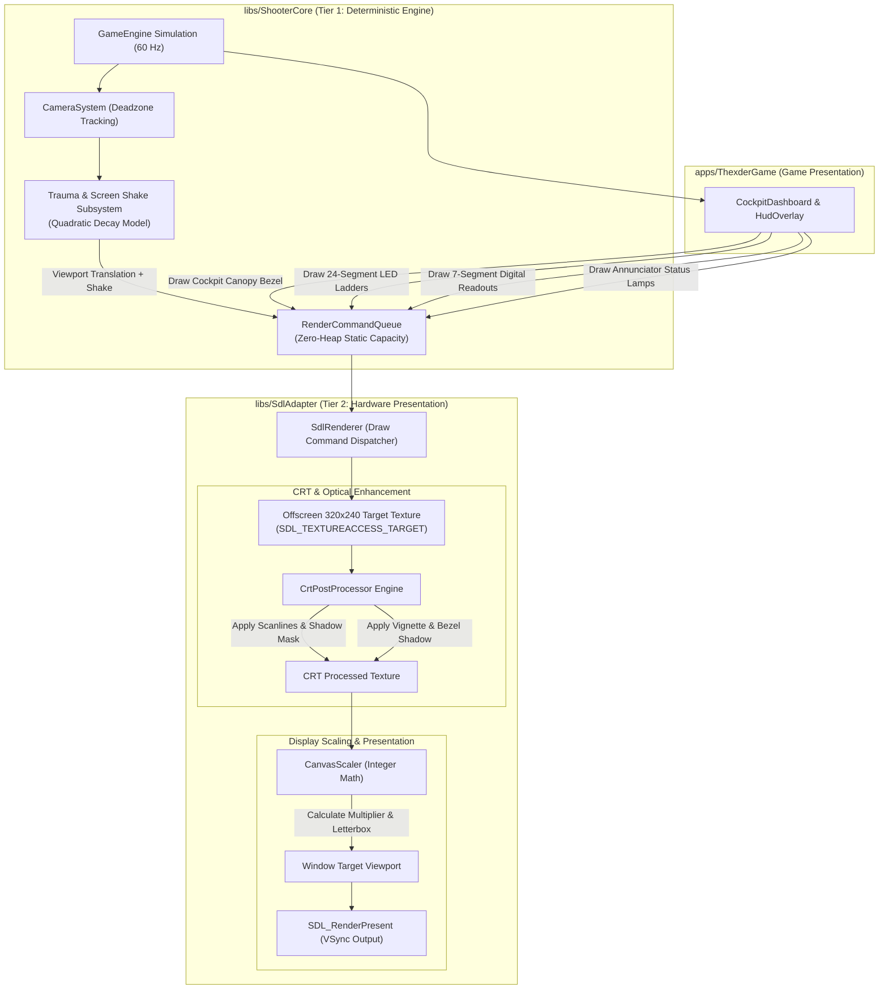
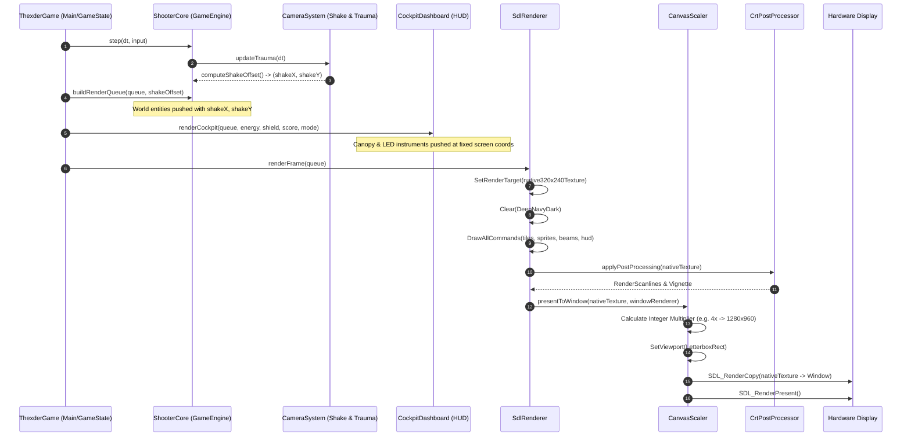
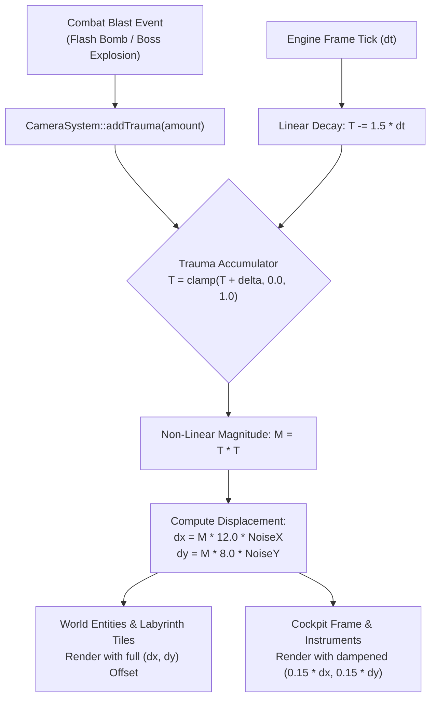
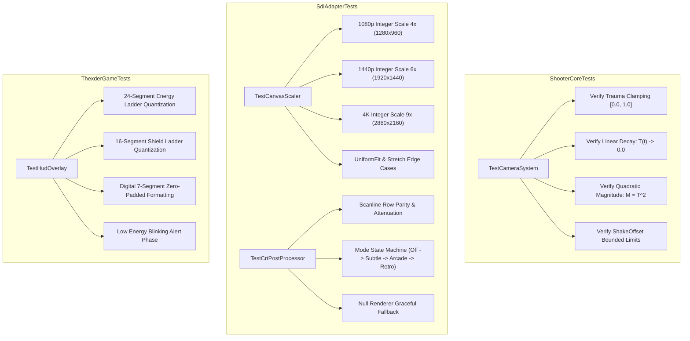

# Phase 14: Cockpit HUD Dashboard, CRT Presentation & Polish Implementation Plan

## 1. Executive Summary & Scope

Phase 14 delivers the final visual, tactile, and aesthetic transformation of the *shoot-em-up-engine*, elevating the game from a raw functional simulation into a museum-grade retro arcade experience. Inspired by the golden era of 1980s Japanese personal computer gaming (NEC PC-8801, Sharp X1, MSX2) and dedicated arcade mecha cockpits, Phase 14 immerses the pilot directly into the control module of the Thexder / Fire Hawk transformable combat armor.

In classic arcade and PC gaming, player feedback was defined not merely by on-screen sprites, but by physical framing, illuminated instruments, cathode-ray tube (CRT) optics, and visceral kinetic feedback. Phase 14 brings this complete presentation suite to life across six integrated subsystems:

1. **Industrial Cockpit Dashboard & Molded Bezel Frame**:
   - An authentic mecha cockpit frame encasing the active playfield, featuring riveted metallic struts, angled display bezels, tinted instrument glass, and armored canopy bulkheads.
   - Pilot status annunciators: Tactically illuminated warning lamps (`LOW ENERGY`, `SHIELD ON`, `TARGET LOCK`, `SYSTEM ALERT`).
   - Mechanical transformation mode badge: Dynamic 3-state animated telemetry displaying current operational configuration (Robot ground stance, Jet supersonic flight, or animated servo transition gears).
   - Secondary ordnance bay panel: Tactical readout displaying active munitions (Homing Micro-Missiles vs Screen-Clearing Flash Bombs), live inventory count, and empty-magazine alert status.

2. **Dual Segmented LED/LCD Instrument Bars**:
   - Elimination of flat, primitive solid rectangular health bars in favor of authentic discrete segmented ladder meters (e.g. 24 discrete illuminated segments per gauge).
   - **Energy Points Ladder**: Three-tier dynamic color gradient (Phosphor Cyan/Green when $> 50\%$, Amber Caution at $21\% - 50\%$, Flashing Crimson Alert when $\le 20\%$). Unlit LED segments retain subtle inactive cathode traces.
   - **Shield Gauge Ladder**: High-intensity cyan/blue barrier gauge displaying instantaneous capacitor charge and duration dissipation.

3. **Numeric Digital LED Counters & Seven-Segment Alphanumeric Displays**:
   - High-contrast digital LED readouts for primary score, persistent session high score, exact numeric energy reserve, and secondary ordnance inventory.
   - Zero-padded digital phosphor aesthetics faithfully recreating late-80s display hardware without external font textures.

4. **Pixel-Perfect Integer Aspect Ratio Canvas Scaler (`CanvasScaler`)**:
   - Offscreen intermediate render target isolating the internal $320 \times 240$ native canvas from physical window dimensions.
   - Pixel-perfect integer multiplier scaling ($1\times, 2\times, 3\times, 4\times, 5\times, \dots$) preserving razor-sharp non-distorted square pixels.
   - Centered letterboxing and pillarboxing with deep matte-black borders, eliminating irregular pixel stretching, shimmering, and aspect ratio distortion across widescreen displays (1080p, 1440p, 4K, ultrawide).
   - Fullscreen mode handling with automatic optimal integer factor resolution.

5. **Multi-Tier CRT Simulation Pipeline (`CrtPostProcessor`)**:
   - **Hardware-Accelerated Scanlines**: Alternate horizontal scanline modulation recreating authentic CRT electron gun beam passes.
   - **Phosphor Shadow Mask / Aperture Grille**: Microscopic RGB subpixel vertical triad tint reproducing physical cathode-ray tube phosphor dot pitch.
   - **Curvature & Vignette Roll-Off**: Subtle radial corner darkening and edge attenuation delivering the optical illusion of thick curved cathode glass without heavy fragment shader overhead.
   - Runtime configurable CRT presets: `Disabled`, `Subtle` (clean modern enhancement), `Arcade` (authentic cabinet feel), and `RetroCRT` (heavy vintage television simulation).

6. **Trauma-Based Non-Linear Screen Shake & Cockpit Inertial System**:
   - Deterministic, non-linear camera trauma system ($Trauma \in [0.0, 1.0]$, $Decay = 1.5\text{ s}^{-1}$) where kinetic shake magnitude scales quadratically ($Trauma^2$).
   - High-impact combat triggers: Screen-clearing flash bomb detonation ($+0.80$ trauma), Dreadnought boss explosion ($+1.00$ trauma), player hull breach ($+0.40$ trauma), structural secret masonry collapse ($+0.30$ trauma), and missile detonation ($+0.25$ trauma).
   - Decoupled cockpit inertia: Playfield terrain and entities shake vigorously relative to the viewport, while the armored cockpit frame remains anchored with dampened inertial recoil, establishing true first-person pilot presence.

7. **Production Polish & Quality-of-Life Suite**:
   - Stage transition visual shrouds (iris-wipe and fade transitions).
   - Critical low-energy pulsing emergency red perimeter vignette.
   - Runtime configuration toggles (`F1` CRT scanlines, `F2` Integer scaling mode, `F3` Screen shake, `F11` Fullscreen) backed by command-line gflags.

---

### ASCII Baseline vs Phase 14 Cockpit Presentation Evolution

```
+-----------------------------------------------------------------------------------------------+
|                       PRESENTATION PIPELINE EVOLUTION: BASELINE VS PHASE 14                   |
|                                                                                               |
|   CURRENT BASELINE (PHASES 8-13)                      PHASE 14 COCKPIT & CRT POLISH           |
|                                                                                               |
|   1. HUD Presentation:                                1. Molded Cockpit Frame & Dashboard:    |
|      • Simple rectangular solid color strips             • Molded mecha cockpit canopy frame  |
|      • Flat top & bottom solid bars                      • Angled glass bezels & rivets       |
|      • Basic text output without bezels                  • Tactical annunciator status lamps  |
|      • No cockpit framing or physical context            • Mode badge with animated servos    |
|                                                                                               |
|   2. Instrument Gauges:                               2. Dual Segmented LED Ladder Meters:    |
|      • Continuous solid colored fill rectangles          • Discrete 24-step LED segments      |
|      • Binary color swap (red/gold/cyan)                 • Unlit segment phosphor trace       |
|      • No discrete unlit cathode trace                   • 3-tier dynamic color ladder        |
|                                                          • Pulsing emergency warning phase    |
|                                                                                               |
|   3. Display Scaling:                                 3. Pixel-Perfect Integer Canvas Scaler: |
|      • SDL_RenderSetLogicalSize default stretch          • True offscreen 320x240 buffer      |
|      • Fractional scaling causes uneven pixel shimmer    • Integer multiplier (1x-9x)         |
|      • Blurry or distorted pixel aspect ratios           • Razor-sharp uniform pixels         |
|      • Inflexible window resizing                        • Centered letterbox / pillarbox     |
|                                                                                               |
|   4. CRT & Retro Display Optics:                      4. Multi-Tier CRT Post-Processor:       |
|      • None (flat raw digital rasterization)             • Hardware scanline line alternation |
|      • Harsh modern LCD appearance                       • Subpixel RGB aperture grille mask  |
|      • No optical depth or phosphor simulation           • Subtle glass curvature vignette    |
|                                                          • 4 selectable visual fidelity modes |
|                                                                                               |
|   5. Kinetic Combat Impact:                           5. Non-Linear Trauma Camera Shake:      |
|      • Static camera tracking only                       • Quadratic trauma decay model       |
|      • Explosions have no physical impact                • Flash bomb & boss kinetic blasts   |
|      • Player damage lacks visceral feedback             • Anchored cockpit inertial damper   |
|                                                                                               |
|   6. Engine Quality-of-Life:                          6. Polished Interactive Shell:          |
|      • Hardcoded display parameters                      • Runtime function hotkeys (F1-F11)  |
|      • Abrupt stage load / pause cuts                    • Smooth iris & fade stage shrouds   |
|      • No visual configuration flags                     • Low-energy red warning vignette    |
+-----------------------------------------------------------------------------------------------+
```

### Mermaid Subsystem Presentation Flow



---

## 2. Architecture & Subsystem Integration

Phase 14 strictly respects the repository's modular tier separation:
- **Core Engine ([`libs/ShooterCore`](../libs/ShooterCore))**: Retains 100% deterministic simulation, zero knowledge of SDL or hardware rendering APIs, and zero dynamic memory allocation (`CERT ERR55-CPP`). House the mathematical camera trauma model, kinetic shake decay calculations, and strongly-typed value objects.
- **Presentation Adapter ([`libs/SdlAdapter`](../libs/SdlAdapter))**: Manages hardware SDL render targets, integer-ratio canvas scaling, letterbox viewport geometry, scanline rasterization, and CRT aperture grille modulation.
- **Game Application ([`apps/ThexderGame`](../apps/ThexderGame))**: Composes the molded cockpit canopy, segmented LED gauges, digital numeric counters, and binds runtime hotkeys (`F1`-`F11`) to presentation settings.

### 2.1 Multi-Stage Rendering & Compositing Pipeline

The rendering lifecycle executes across five deterministic stages per frame:

```
+-----------------------------------------------------------------------------------------------+
|                       PHASE 14 COMPOSITING & PRESENTATION PIPELINE                            |
|                                                                                               |
|   STAGE 1: WORLD GEOMETRY & ENTITIES (Shake Offset Applied)                                   |
|   ┌────────────────────────────────────────────────────────────────────────┐                  |
|   │ • Labyrinth tiles, destructible masonry, security forcefields          │                  |
|   │ • Thexder robot/jet sprites, bio-nests, interceptors, crawler turrets  │                  |
|   │ • Homing laser beams, shield barrier bubble, particle shockwaves       │                  |
|   │   ==> Rendered to 320x240 Native Canvas with Camera Shake Offset       │                  |
|   └────────────────────────────────────────────────────────────────────────┘                  |
|                                     │                                                         |
|                                     v                                                         |
|   STAGE 2: COCKPIT CANOPY & DASHBOARD OVERLAY (Rock-Solid Anchor)                             |
|   ┌────────────────────────────────────────────────────────────────────────┐                  |
|   │ • Molded cockpit frame, riveted canopy struts, angled instrument bezels│                  |
|   │ • Dual 24-segment LED ladder bars (Energy & Shield)                    │                  |
|   │ • Digital 7-segment score, high score, and ammo counters               │                  |
|   │ • Tactical annunciator lamps & mode configuration badge                │                  |
|   │   ==> Composite directly over Native Canvas (No shake / Dampened kick) │                  |
|   └────────────────────────────────────────────────────────────────────────┘                  |
|                                     │                                                         |
|                                     v                                                         |
|   STAGE 3: CRT OPTICAL POST-PROCESSING (Offscreen Texture Pipeline)                           |
|   ┌────────────────────────────────────────────────────────────────────────┐                  |
|   │ • Offscreen Native Texture (320x240)                                   │                  |
|   │ • Scanline Modulation: Alternate row luminance reduction (15% - 50%)   │                  |
|   │ • Aperture Grille: Micro-triad subpixel RGB phosphor tint              │                  |
|   │ • Vignette Roll-Off: Radial corner shading simulating CRT glass curves │                  |
|   │   ==> Generates Processed 320x240 Optical Frame                        │                  |
|   └────────────────────────────────────────────────────────────────────────┘                  |
|                                     │                                                         |
|                                     v                                                         |
|   STAGE 4: CANVAS SCALING & LETTERBOXING (Integer Multiplier)                                 |
|   ┌────────────────────────────────────────────────────────────────────────┐                  |
|   │ • Query physical window dimensions (e.g. 1920x1080)                    │                  |
|   │ • Calculate integer factor: N = min(1920/320, 1080/240) = 4 (1280x960) │                  |
|   │ • Center destination viewport: OffsetX = (1920-1280)/2, OffsetY = 60   │                  |
|   │ • Fill letterbox/pillarbox margins with pure matte black               │                  |
|   │   ==> Blit processed texture to physical display via SDL_RenderCopy    │                  |
|   └────────────────────────────────────────────────────────────────────────┘                  |
|                                     │                                                         |
|                                     v                                                         |
|   STAGE 5: HARDWARE VSYNC PRESENTATION                                                        |
|   ┌────────────────────────────────────────────────────────────────────────┐                  |
|   │ • SDL_RenderPresent: Flush frame to physical display buffer            │                  |
|   └────────────────────────────────────────────────────────────────────────┘                  |
+-----------------------------------------------------------------------------------------------+
```

### 2.2 Sequence Diagram: Complete Frame Presentation Cycle



---

## 3. Detailed Component Specifications

### 3.1 Cockpit Dashboard & Industrial Bezel Overlay

The centerpiece of Phase 14's visual overhaul is the **Molded Cockpit Frame**, replacing the plain top/bottom colored strips with a tactile, mechanical canopy dashboard that frames the $320 \times 240$ playfield.

#### 1. Frame Geometry & Visual Framing
- **Top Canopy Header** ($320 \times 16\text{ px}$):
  - Chamfered titanium-gray outer frame with industrial corner brackets and recessed rivet studs.
  - Left Section: Dual Segmented Energy Ladder ($84\text{ px}$ wide) with digital LED numeric display.
  - Center Section: Primary tactical score display (`SC: 000000`) and persistent record (`HI: 000000`) encased in high-contrast optical bezels.
  - Right Section: Segmented Shield Gauge ($48\text{ px}$ wide) and barrier capacitor percentage.
- **Bottom Control Console** ($320 \times 18\text{ px}$):
  - Armored mecha control deck featuring angled hazard hazard chevrons, avionics diagnostics, and active configuration telemetry.
  - Left Section: **Mechanical Transformation Mode Badge**:
    - Robot Stance: Green LED badge with humanoid silhouette icon (`[ROBOT]`).
    - Jet Flight: Cyan LED badge with aerodynamic swept-wing fighter icon (`[ JET ]`).
    - Transformation Transition: Pulsing amber badge with rotating mechanical gear graphic (`[TRANS]`).
  - Center Section: **Operational Sector Telemetry**: Current mission sector identifier (e.g. `SEC 01: CAVERN`, `SEC 04: CORE ARENA`), radar blip alert, and stage clock timer.
  - Right Section: **Secondary Weapon Bay Status**:
    - Munition icon (`MSL` / `BMB`) illuminated in weapon-specific color (Gold for Homing Missiles, Orange-Red for Flash Bombs).
    - Digital LED ammo counter with low-ammo warning alert when count $\le 2$.
- **Perimeter Canopy Struts & Bezel Glare**:
  - Left and right display borders feature $2\text{ px}$ structural struts with simulated glass refraction highlights, creating physical depth between the cockpit canopy and the deep subterranean cavern beyond.

```
+-----------------------------------------------------------------------------------------------+
|                       MOLDED COCKPIT CANOPY DASHBOARD LAYOUT                                  |
|                                                                                               |
|  [RIVET] ┌─ ENERGY LADDER ──────┐ ┌── SCORE ──┐ ┌─ HI-SCORE ─┐ ┌─ SHIELD LADDER ─┐ [RIVET]    |
|  o======o| [][][][][][][][][] 99 | | SC:014500 | | HI:050000 | | [][][][][][] 100% |o======o  |
|  |      └───────────────────────┘ └───────────┘ └───────────┘ └──────────────────┘      |  |
|  |                                                                                      |  |
|  |                             ACTIVE 320x206 PLAYFIELD                                 |  |
|  |                 (Labyrinth Terrain, Thexder Craft, Enemy Swarms)                     |  |
|  |                                                                                      |  |
|  |======o                                                                        o======|  |
|  [RIVET] ┌── MODE ──┐ ┌─── SECTOR TELEMETRY ───┐ ┌── ANNUNCIATORS ──┐ ┌─ SEC ARSENAL ─┐ [RIVET]    |
|  o======o| [ JET ]  | | SEC 01: SUBTERRANEAN   | | [!LOW!] [SHIELD] | | MSL: 08 [RDY] |o======o  |
|         └───────────┘ └────────────────────────┘ └──────────────────┘ └───────────────┘      |
+-----------------------------------------------------------------------------------------------+
```

#### 2. Tactical Annunciator Warning Lamps
A dedicated pilot alert bank located on the console dash provides instantaneous optical warning feedback:
- `LOW EN`: Flashes brightly at $4\text{ Hz}$ when Energy $\le 20\text{ EP}$.
- `SHIELD`: Glows steady electric cyan while the shield barrier is actively absorbing collisions.
- `LOCK`: Amber warning beacon triggered when homing micro-missiles achieve telemetry lock on enemy aircraft.
- `DANGER`: Pulsing crimson strobe triggered inside the Dreadnought Boss sealed arena.

---

### 3.2 Dual Segmented LED/LCD Instrument Bars

Phase 14 replaces basic flat rectangular bars with **Discrete Segmented LED Ladder Gauges**:

#### 1. Segmented Ladder Specifications
- **Energy Points Ladder**:
  - Divided into exactly $24$ discrete rectangular LED segments ($2\text{ px}$ width, $6\text{ px}$ height, $1\text{ px}$ gap).
  - Unlit segments are rendered with a subtle inactive dark phosphor trace (`RGBA(12, 28, 36, 180)`), mimicking real unpowered LCD/LED bars.
  - Active illuminated segments scale dynamically according to player energy ratio:
    $$\text{SegmentsLit} = \left\lfloor \frac{\text{Energy}}{\text{MaxEnergy}} \cdot 24 \right\rfloor$$
- **Three-Tier Dynamic Color Thresholds**:
  - **Nominal State ($> 50\%$ Energy)**: High-tech phosphor cyan/green segments (`RGBA(0, 240, 200, 255)`).
  - **Caution State ($21\% - 50\%$ Energy)**: High-visibility amber segments (`RGBA(255, 200, 30, 255)`).
  - **Emergency Alert State ($\le 20\%$ Energy)**: High-intensity crimson segments (`RGBA(255, 40, 40, 255)`) pulsing with a $4\text{ Hz}$ sine modulation.
- **Shield Barrier Ladder**:
  - Composed of $16$ discrete rectangular segments ($2\text{ px}$ width, $6\text{ px}$ height, $1\text{ px}$ gap).
  - Illuminated with brilliant cobalt cyan (`RGBA(40, 200, 255, 255)`) featuring an outer luminance bloom border.

```
+-----------------------------------------------------------------------------------------------+
|                       SEGMENTED LED LADDER METER VISUALIZATION                                |
|                                                                                               |
|   1. NOMINAL ENERGY (100 EP - ALL 24 SEGMENTS ILLUMINATED CYAN):                              |
|   [■][■][■][■][■][■][■][■][■][■][■][■][■][■][■][■][■][■][■][■][■][■][■][■]  100 EP            |
|                                                                                               |
|   2. CAUTION ENERGY (45 EP - 11 ILLUMINATED AMBER, 13 UNLIT PHOSPHOR TRACE):                  |
|   [■][■][■][■][■][■][■][■][■][■][■][·][·][·][·][·][·][·][·][·][·][·][·][·]   45 EP            |
|                                                                                               |
|   3. CRITICAL ENERGY (15 EP - 3 PULSING CRIMSON SEGMENTS, 21 UNLIT):                          |
|   [▲][▲][▲][·][·][·][·][·][·][·][·][·][·][·][·][·][·][·][·][·][·][·][·][·]   15 EP <!LOW!>   |
|                                                                                               |
|   (■ = Illuminated active LED, · = Unlit dark cathode trace, ▲ = Pulsing alert LED)           |
+-----------------------------------------------------------------------------------------------+
```

---

### 3.3 Numeric Digital LED Counters & Seven-Segment Alphanumeric Displays

To guarantee razor-sharp legibility and zero memory allocations, numeric telemetry is formatted into fixed stack character buffers and rasterized using an expanded, optimized digital bitmap font:

- **Primary Score Counter**: 6-digit zero-padded digital readout (`014500`).
- **High Score Display**: 6-digit persistent session record with golden phosphor glow (`050000`).
- **Precision Energy Value**: 3-digit numeric indicator displaying exact remaining Energy Points (`085`).
- **Secondary Ordnance Inventory**: 2-digit ammunition counter with weapon badge (`MSL: 08`, `BMB: 03`).
- **Zero-Allocation Stack Formatting**: All string formatting utilizes [`HudOverlay::formatDecimal`](../apps/ThexderGame/HudOverlay.h) with standard fixed stack buffers (`std::array<char, 16>`), strictly adhering to `CERT ERR55-CPP`.

---

### 3.4 Pixel-Perfect Integer Aspect Ratio Canvas Scaler (`CanvasScaler`)

In modern PC displays (1080p, 1440p, 4K, 16:10 laptop screens, 21:9 ultrawides), naive hardware stretching produces blurry bilinear filtering or jagged, non-uniform nearest-neighbor scaling (where some game pixels are 3 physical pixels wide while neighbors are 4, producing hideous crawling artifacts during scrolling).

The [`CanvasScaler`](../libs/SdlAdapter/CanvasScaler.h) guarantees museum-quality rendering by isolating the internal logical canvas into an offscreen hardware render target and scaling via strict integer multiples.

#### 1. Mathematical Formulation for Integer Scaling
Given a physical window resolution $(W_{\text{window}}, H_{\text{window}})$ and native logical canvas dimensions $(W_{\text{native}} = 320, H_{\text{native}} = 240)$:

1. **Maximum Integer Scale Factor ($N$)**:
   $$N = \max\left(1, \min\left(\left\lfloor \frac{W_{\text{window}}}{W_{\text{native}}} \right\rfloor, \left\lfloor \frac{H_{\text{window}}}{H_{\text{native}}} \right\rfloor\right)\right)$$

2. **Scaled Viewport Dimensions**:
   $$W_{\text{scaled}} = N \cdot W_{\text{native}}$$
   $$H_{\text{scaled}} = N \cdot H_{\text{native}}$$

3. **Centered Letterbox / Pillarbox Offsets**:
   $$X_{\text{offset}} = \left\lfloor \frac{W_{\text{window}} - W_{\text{scaled}}}{2} \right\rfloor$$
   $$Y_{\text{offset}} = \left\lfloor \frac{H_{\text{window}} - H_{\text{scaled}}}{2} \right\rfloor$$

```
+-----------------------------------------------------------------------------------------------+
|                       INTEGER ASPECT RATIO LETTERBOXING & PILLARBOXING                        |
|                                                                                               |
|   PHYSICAL WINDOW: 1920 x 1080 (16:9 Full HD)                                                 |
|   NATIVE CANVAS:   320 x 240 (4:3 Retro Canvas)                                               |
|   INTEGER FACTOR:  N = min(1920/320, 1080/240) = min(6, 4.5) = 4                              |
|   SCALED CANVAS:   1280 x 960 (Exact 4x Multiplier, Perfect Uniform 4x4 Pixel Blocks)         |
|                                                                                               |
|   0,0 ─────────────────────────────────────────────────────────────────── 1920,0              |
|   │               TOP PILLARBOX MARGIN (Y_offset = 60 px)                │                    |
|   │   ───────────────────────────────────────────────────────────────    │                    |
|   │   │  LEFT MARGIN  │                               │ RIGHT MARGIN│    │                    |
|   │   │(X_offset=320) │     SCALED 4x CANVAS AREA     │(X_offset=320│    │                    |
|   │   │               │          1280 x 960           │             │    │                    |
|   │   │  MATTE BLACK  │      (Zero Pixel Shimmer)     │ MATTE BLACK │    │                    |
|   │   │               │                               │             │    │                    |
|   │   ───────────────────────────────────────────────────────────────    │                    |
|   │              BOTTOM PILLARBOX MARGIN (Y_offset = 60 px)              │                    |
|   0,1080 ──────────────────────────────────────────────────────────────── 1920,1080           |
+-----------------------------------------------------------------------------------------------+
```

#### 2. Scaler Operating Modes
The `CanvasScaler` provides three selectable aspect ratio strategies:
1. **`IntegerOnly` (Default / Purist Mode)**: Strictly clamps to integer multiples ($N \in \{1, 2, 3, 4, 5, 6, 8, 9\}$). Never permits fractional stretching.
2. **`UniformFit` (Aspect-Correct Uniform Scaling)**: Scales by the maximum continuous floating-point factor preserving $4:3$ aspect ratio without integer restriction. Uses high-quality linear filtering for displays where integer letterboxing leaves large borders.
3. **`Stretch` (Fullscreen Fill)**: Expands across the entire display window (for players prioritizing screen coverage over aspect ratio purity).

---

### 3.5 Scanline & CRT Simulation Pipeline (`CrtPostProcessor`)

Phase 14 introduces hardware-accelerated CRT optical simulation to replicate the warm, organic glow of 1980s cathode-ray arcade monitors.

#### 1. Hardware-Accelerated Scanline Synthesis
- Rather than executing expensive pixel shaders that penalize low-end GPUs or software fallbacks, scanlines are applied using a pre-baked procedural horizontal modulation mask.
- **Scanline Pattern**: Every even pixel row retains 100% luminance, while every odd pixel row is dimmed by a configurable attenuation factor ($15\%$ in `Subtle` mode, $35\%$ in `Arcade` mode, $50\%$ in `RetroCRT` mode).
- **Luminance Conservation**: Scanline attenuation is balanced by a subtle master brightness boost ($+10\%$), preventing the overall image from appearing uncomfortably dim.

#### 2. Phosphor Shadow Mask / Aperture Grille Simulation
- Authentically models the vertical phosphor triad stripes of Sony Trinitron and high-resolution arcade monitors.
- Applies a microscopic 3-column repeating color bias: Column 0 has a subtle red emphasis ($+8\%$ Red), Column 1 has a green emphasis ($+8\%$ Green), Column 2 has a blue emphasis ($+8\%$ Blue).
- When combined with integer scaling, each native pixel cleanly subdivides into distinct phosphor subpixels, producing the authentic micro-structure of arcade display glass.

#### 3. Vignette Roll-Off & Curved Glass Bezel Illusion
- Real CRT tubes are physically convex, creating natural optical falloff towards screen corners.
- A four-corner radial vignette mask attenuates luminance towards the outer extremities:
  $$I_{\text{out}}(x, y) = I_{\text{in}}(x, y) \cdot \left(1.0 - k_{\text{vignette}} \cdot \left[\left(\frac{x - x_c}{x_c}\right)^4 + \left(\frac{y - y_c}{y_c}\right)^4\right]\right)$$
- The 4th-power polynomial creates a wide flat center with rapid edge curvature, creating the optical illusion of a curved CRT glass tube without geometrical pixel warping.

```
+-----------------------------------------------------------------------------------------------+
|                       CRT SIMULATION OPTICAL PROCESSING PIPELINE                              |
|                                                                                               |
|   +-------------------+      +-------------------+      +-------------------+                 |
|   | Native 320x240    |----->| Scanline Modulator|----->| Aperture Grille   |                 |
|   | Render Target     |      | (Odd Row Dimming) |      | (RGB Triad Mask)  |                 |
|   +-------------------+      +-------------------+      +---------+---------+                 |
|                                                                   |                           |
|                                                                   v                           |
|   +-------------------+      +-------------------+      +---------+---------+                 |
|   | Physical Window   |<-----| CanvasScaler      |<-----| Radial Vignette   |                 |
|   | (Integer Blit)    |      | (Letterbox Frame) |      | (Glass Curvature) |                 |
|   +-------------------+      +-------------------+      +-------------------+                 |
+-----------------------------------------------------------------------------------------------+
```

---

### 3.6 Non-Linear Trauma-Based Screen Shake System (`CameraSystem`)

Screen shake is often implemented naively as linear random offsets that feel unnatural or induce motion sickness. Phase 14 implements a state-of-the-art **Trauma-Based Non-Linear Screen Shake Model** in [`CameraSystem`](../libs/ShooterCore/CameraSystem.h).

#### 1. Mathematical Trauma Formulation
1. **Trauma Variable ($\mathcal{T}$)**:
   - Floating-point scalar clamped in range $[0.0, 1.0]$.
   - Represents accrued physical trauma/shock sustained by the aircraft or subterranean structure.

2. **Trauma Linear Decay**:
   $$\mathcal{T}_{t} = \max\left(0.0, \mathcal{T}_{t - \Delta t} - k_{\text{decay}} \cdot \Delta t\right)$$
   Where $k_{\text{decay}} = 1.5\text{ s}^{-1}$ (a maximum shockwave dissipates completely in $\approx 0.67\text{ seconds}$).

3. **Non-Linear Kinetic Displacement (The Trauma Square Rule)**:
   Kinetic displacement magnitude $\mathcal{M}$ scales quadratically with trauma:
   $$\mathcal{M} = \mathcal{T}^2$$
   *Crucial Property*: Minor impacts ($\mathcal{T} = 0.2 \implies \mathcal{M} = 0.04$) produce imperceptible structural vibrations, while catastrophic blasts ($\mathcal{T} = 1.0 \implies \mathcal{M} = 1.00$) deliver bone-shaking violent shockwaves.

4. **Multi-Axis Shake Displacement**:
   $$\Delta x = \mathcal{M} \cdot \text{MaxOffsetX} \cdot \text{Noise}_x(t)$$
   $$\Delta y = \mathcal{M} \cdot \text{MaxOffsetY} \cdot \text{Noise}_y(t)$$
   $$\Delta \theta = \mathcal{M} \cdot \text{MaxAngle} \cdot \text{Noise}_\theta(t)$$
   Where:
   - $\text{MaxOffsetX} = 12.0\text{ px}$
   - $\text{MaxOffsetY} = 8.0\text{ px}$
   - $\text{MaxAngle} = 2.5^{\circ}$
   - $\text{Noise}(t)$ is a deterministic pseudo-random or periodic harmonic generator yielding values in $[-1.0, 1.0]$.

#### 2. Combat Event Trauma Matrix
Different combat occurrences inject calibrated quantities of trauma into the camera system:

| Combat Event | Injected Trauma ($\Delta \mathcal{T}$) | Visual & Acoustic Feedback |
| :--- | :---: | :--- |
| **Flash Bomb Detonation** | $+0.80$ | White screen flash, screen-clearing EMP wave |
| **Dreadnought Boss Core Destruction** | $+1.00$ | Catastrophic structural explosion sequence |
| **Dreadnought Armor Segment Breach** | $+0.40$ | Heavy armor plate detachment shockwave |
| **Unshielded Player Hull Damage** | $+0.40$ | Red cockpit warning flash, electrical glitch |
| **Secret Masonry Wall Laser Breach** | $+0.30$ | Rock cave-in debris particles |
| **Bio-Nest Hive Destruction** | $+0.25$ | Organic explosion crunch |
| **Homing Micro-Missile Impact** | $+0.20$ | Smoke burst and concussion wave |

#### 3. Decoupled Cockpit Inertia
To maximize immersion, the world scene shakes with the full camera displacement $(\Delta x, \Delta y)$, while the cockpit canopy frame remains securely anchored with dampened inertia (absorbing $85\%$ of the vibration, transmitting only a subtle $15\%$ kinetic kick to the dashboard gauges).



---

### 3.7 Polish, Transitions & Quality-of-Life Enhancements

1. **Stage Transition Shrouds**:
   - **Iris Wipe**: Circular aperture expanding outward from the player craft upon level launch, and constricting to darkness upon extraction.
   - **Fade-to-Black**: Smooth exponential opacity fade during game over and mission complete sequences.
2. **Low-Energy Warning Perimeter Vignette**:
   - When Energy drops below $20\text{ EP}$, a soft pulsing red perimeter vignette pulses in synchronization with the audio klaxon, reinforcing the desperate fight for survival.
3. **Interactive Runtime Presentation Hotkeys**:
   - `F1`: Cycle CRT Filter Mode (`Disabled` $\rightarrow$ `Subtle` $\rightarrow$ `Arcade` $\rightarrow$ `RetroCRT`).
   - `F2`: Cycle Scaling Strategy (`IntegerOnly` $\rightarrow$ `UniformFit` $\rightarrow$ `Stretch`).
   - `F3`: Toggle Screen Shake System (`Enabled` $\leftrightarrow$ `Disabled`).
   - `F11` / `Alt+Enter`: Toggle Borderless / Fullscreen mode with automatic aspect ratio recalculation.
4. **Command-Line Configuration Flags**:
   - Support seamless command-line configuration via `gflags` in `apps/ThexderGame/Main.cpp`:
     - `--crt_mode=<0..3>`: Select default CRT post-processing profile.
     - `--integer_scale=<bool>`: Force strict integer scaling.
     - `--screen_shake=<bool>`: Enable or disable camera trauma shake.

---

## 4. Domain Modeling & Value Types

Per the project's [Domain Modeling Standard](../.agents/rules/domain-modeling.md), primitive obsession is strictly prohibited. All coordinates, trauma values, scale factors, and display modes are encapsulated in zero-cost, strongly-typed C++17 value objects.

### 4.1 Value Object Definitions (`libs/ShooterCore/Types.h`)

```cpp
namespace ShooterCore {

/// @class Trauma
/// @brief Strongly-typed scalar representing camera shake trauma in range [0.0, 1.0].
class Trauma final {
public:
    constexpr Trauma() noexcept = default;
    explicit constexpr Trauma(float val) noexcept
        : value_ { std::clamp(val, 0.0f, 1.0f) }
    {
    }

    [[nodiscard]] constexpr float value() const noexcept { return value_; }
    [[nodiscard]] constexpr float magnitude() const noexcept { return value_ * value_; }
    [[nodiscard]] constexpr bool isActive() const noexcept { return value_ > 0.001f; }

    constexpr void decay(float dtSec, float rate = 1.5f) noexcept
    {
        value_ = std::max(0.0f, value_ - rate * dtSec);
    }

    constexpr void add(float delta) noexcept
    {
        value_ = std::clamp(value_ + delta, 0.0f, 1.0f);
    }

private:
    float value_ { 0.0f };
};

/// @struct ShakeOffset
/// @brief Multi-axis displacement applied to the rendering camera viewport.
struct ShakeOffset final {
    float x { 0.0f };
    float y { 0.0f };
    float angleDegrees { 0.0f };
};

/// @enum class CrtFilterMode
/// @brief Selectable optical presentation modes for retro display emulation.
enum class CrtFilterMode : std::uint8_t {
    Disabled = 0U,
    Subtle = 1U,
    Arcade = 2U,
    RetroCrt = 3U
};

/// @enum class AspectRatioMode
/// @brief Scaling strategy utilized by CanvasScaler for physical window presentation.
enum class AspectRatioMode : std::uint8_t {
    IntegerOnly = 0U,
    UniformFit = 1U,
    Stretch = 2U
};

/// @struct DisplayViewport
/// @brief Destination letterbox/pillarbox rectangle on the physical window surface.
struct DisplayViewport final {
    std::int32_t x { 0 };
    std::int32_t y { 0 };
    std::int32_t width { 320 };
    std::int32_t height { 240 };
    std::uint32_t integerScale { 1U };
};

} // namespace ShooterCore
```

---

## 5. Algorithmic Formulations & Mathematical Models

### 5.1 Deterministic Pseudo-Random Noise for Camera Shake
To satisfy `CERT ERR55-CPP` and maintain strict cross-platform determinism without floating-point locale divergence, `CameraSystem` employs an unaliased, multi-frequency sinusoidal noise synthesis:

$$\text{Noise}_x(t) = \sin(t \cdot 43.7) \cdot 0.6 + \sin(t \cdot 97.1) \cdot 0.4$$
$$\text{Noise}_y(t) = \cos(t \cdot 51.3) \cdot 0.6 + \cos(t \cdot 89.4) \cdot 0.4$$
$$\text{Noise}_\theta(t) = \sin(t \cdot 31.9) \cdot 0.7 + \cos(t \cdot 67.2) \cdot 0.3$$

This closed-form formulation produces organic, high-frequency kinetic chatter that never repeats in identifiable cycles, requires zero memory allocations, and executes in nanoseconds on all CPUs.

### 5.2 Segmented LED Quantization Formula
Given current resource points $P$, maximum capacity $P_{\text{max}}$, and total discrete physical LED segments $S_{\text{total}}$:

$$S_{\text{lit}} = \text{clamp}\left(\left\lfloor \frac{P}{P_{\text{max}}} \cdot S_{\text{total}} + 0.001 \right\rfloor, 0, S_{\text{total}}\right)$$

If $P > 0$ and $S_{\text{lit}} == 0$, $S_{\text{lit}}$ is clamped to $1$ to ensure that even $1\text{ EP}$ of remaining life is visually discernible to the pilot before absolute defeat.

---

## 6. Verification & Automated Test Strategy

In compliance with project standards, the presentation and camera shake subsystems must be 100% verified via automated headless CTests without requiring physical display hardware or human observation.

### 6.1 Automated Test Suites

```
+-----------------------------------------------------------------------------------------------+
|                       PHASE 14 AUTOMATED VERIFICATION ARCHITECTURE                           |
|                                                                                               |
|   1. Camera Trauma & Shake Verification (tests/ShooterCoreTests/TestCameraSystem.cpp):        |
|      • Verify Trauma clamping [0.0, 1.0] and quadratic decay to zero                          |
|      • Verify ShakeOffset displacement magnitude scales quadratically                         |
|      • Verify deterministic repeatability of noise generator                                  |
|                                                                                               |
|   2. CanvasScaler Integer Math Verification (tests/SdlAdapterTests/TestCanvasScaler.cpp):     |
|      • Test 1080p (1920x1080) -> Multiplier 4x (1280x960), Offset (320, 60)                   |
|      • Test 1440p (2560x1440) -> Multiplier 6x (1920x1440), Offset (320, 0)                    |
|      • Test 4K (3840x2160) -> Multiplier 9x (2880x2160), Offset (480, 0)                      |
|      • Test smaller window (400x300) -> Multiplier 1x (320x240), Offset (40, 30)              |
|      • Test zero division & negative dimension hardening                                      |
|                                                                                               |
|   3. Cockpit & Segmented HUD Verification (tests/ThexderGameTests/TestHudOverlay.cpp):        |
|      • Verify LED ladder segment count for 100%, 50%, 20%, 1%, 0% energy                      |
|      • Verify unlit background cathode segments are properly enqueued                         |
|      • Verify annunciator lamps toggle on critical conditions                                 |
|      • Verify zero heap allocation during complete HUD frame generation                       |
|                                                                                               |
|   4. CRT Post-Processing Verification (tests/SdlAdapterTests/TestCrtPostProcessor.cpp):       |
|      • Verify scanline row attenuation mask periodicity                                       |
|      • Verify CRT mode switching state transitions                                            |
|      • Verify headless null-renderer robustness                                               |
+-----------------------------------------------------------------------------------------------+
```

### Mermaid Test Suite Flow



---

## 7. Step-by-Step Implementation Flow

Implementation proceeds across eight discrete, test-driven steps:

```
+-----------------------------------------------------------------------------------------------+
|                       PHASE 14 STEP-BY-STEP IMPLEMENTATION ROADMAP                            |
|                                                                                               |
|   [Step 1: Core Types & Trauma Modeling] ──> Add Trauma, ShakeOffset & CrtFilterMode to Types |
|                  │                                                                            |
|                  v                                                                            |
|   [Step 2: Camera Shake in CameraSystem] ──> Implement addTrauma, decay, & shake offsets       |
|                  │                                                                            |
|                  v                                                                            |
|   [Step 3: Segmented LED Meters & Cockpit] ──> Upgrade HudOverlay with canopy, LEDs, & badges  |
|                  │                                                                            |
|                  v                                                                            |
|   [Step 4: CanvasScaler Integer Pipeline] ──> Implement CanvasScaler in libs/SdlAdapter       |
|                  │                                                                            |
|                  v                                                                            |
|   [Step 5: CRT Post-Processor Engine] ──> Implement CrtPostProcessor scanlines & vignette    |
|                  │                                                                            |
|                  v                                                                            |
|   [Step 6: SdlRenderer Target Integration] ──> Offscreen 320x240 buffer & compositing pipeline|
|                  │                                                                            |
|                  v                                                                            |
|   [Step 7: Application Polish & Hotkeys] ──> Wire F1-F11 hotkeys, trauma events in ThexderGame|
|                  │                                                                            |
|                  v                                                                            |
|   [Step 8: Automated CTest Suite & Polish] ──> Add unit tests & verify zero warnings & format  |
+-----------------------------------------------------------------------------------------------+
```

### Detailed Execution Steps:

1. **Step 1: Core Domain Types & Value Objects (`libs/ShooterCore/Types.h`)**:
   - Define `Trauma`, `ShakeOffset`, `AspectRatioMode`, `CrtFilterMode`, and `DisplayViewport`.
   - Ensure all fixed-width integer types explicitly include `<cstdint>` and use `std::` qualification.
2. **Step 2: Non-Linear Trauma Camera Shake (`libs/ShooterCore/CameraSystem.h`, `.cpp`)**:
   - Add `addTrauma(float delta)`, `updateTrauma(DeltaTime dt)`, and `shakeOffset() const`.
   - Implement deterministic noise generator and quadratic displacement math.
   - Author unit tests in `tests/ShooterCoreTests/TestCameraSystem.cpp`.
3. **Step 3: Molded Cockpit Frame & Segmented LED HUD (`apps/ThexderGame/HudOverlay.h`, `.cpp`)**:
   - Implement canopy bezel frame rasterization, corner rivets, and perimeter struts.
   - Implement 24-segment Energy ladder and 16-segment Shield ladder with unlit background traces.
   - Implement 7-segment digital font for scores and ammo counts.
   - Update tests in `tests/ThexderGameTests/TestHudOverlay.cpp`.
4. **Step 4: Integer Canvas Scaler (`libs/SdlAdapter/CanvasScaler.h`, `.cpp`)**:
   - Implement integer factor calculation, letterbox/pillarbox centered rect computation, and viewport binding.
   - Author comprehensive resolution tests in `tests/SdlAdapterTests/TestCanvasScaler.cpp`.
5. **Step 5: CRT Post-Processor Engine (`libs/SdlAdapter/CrtPostProcessor.h`, `.cpp`)**:
   - Implement scanline row overlay, aperture grille subpixel tint, and vignette corner attenuation.
   - Author unit tests in `tests/SdlAdapterTests/TestCrtPostProcessor.cpp`.
6. **Step 6: Hardware Offscreen Target & SdlRenderer Integration (`libs/SdlAdapter/SdlRenderer.h`, `.cpp`)**:
   - Add offscreen $320 \times 240$ `SDL_Texture` target in `SdlRenderer`.
   - Render world and HUD to offscreen target, pass through `CrtPostProcessor`, and present via `CanvasScaler`.
7. **Step 7: Game Integration, Trauma Events & Runtime Hotkeys (`apps/ThexderGame/Main.cpp`, `GameState.cpp`)**:
   - Connect combat events (flash bomb, boss segment explosion, player damage, secret wall breach) to `CameraSystem::addTrauma`.
   - Add runtime hotkeys: `F1` (CRT Mode), `F2` (Scaling Mode), `F3` (Screen Shake Toggle), `F11` (Fullscreen Toggle).
   - Add gflags: `--crt_mode`, `--integer_scale`, `--screen_shake`.
8. **Step 8: Quality Gate & Formatting Pass**:
   - Execute test suites via `ctest --output-on-failure`.
   - Enforce include cleanliness via `python3 scripts/verify_iwyu_cstdint.py`.
   - Enforce code style via `clang-format -i` and `python3 scripts/verify_clang_format.py`.

---

## 8. Safety & Compliance Verification Checklist

Before finalizing Phase 14 deliverables, verify against the project standards:

- [ ] **MISRA C++:2023 Rule 7.0.6 & SEI CERT INT31-C**: All conversions between signed/unsigned integers are explicit (`static_cast`), deliberate, and range-verified.
- [ ] **Fixed-Width Integers**: Every fixed-width integer explicitly includes `<cstdint>` and is qualified with `std::` (`std::uint8_t`, `std::int32_t`, `std::size_t`).
- [ ] **Include-What-You-Use (IWYU)**: Every source and header file directly includes what it uses; no transitive includes; canonical include grouping.
- [ ] **Zero Dynamic Allocation (CERT ERR55-CPP)**: Fast simulation and rendering loops perform zero heap allocations (`new`, `malloc`, `std::vector::resize`, `std::string`). Offscreen targets and buffers are pre-allocated during initialization.
- [ ] **Domain Modeling**: Raw primitives are wrapped in strongly-typed value objects (`Trauma`, `ShakeOffset`, `AspectRatioMode`, `CrtFilterMode`).
- [ ] **Exception Safety**: All methods on real-time rendering and simulation paths are declared `noexcept`.
- [ ] **Concise Identifiers**: All function and method names are strictly less than 30 characters in length.
- [ ] **Documentation**: Full Doxygen templates (`/// @brief`, `@param`, `@return`) for all public classes, structs, and methods. Relative file paths used exclusively throughout documentation.

---

## 9. Expected Outcome

Upon completion of Phase 14:
- The game will present an **authentic mecha cockpit experience**, framing the subterranean labyrinth with a tactile canopy dashboard, illuminated rivets, and annunciator lamps.
- Health and barrier status will be tracked through **discrete segmented LED ladders**, replicating physical instruments with active color gradients and unlit cathode traces.
- Displays across all modern resolutions (1080p, 1440p, 4K) will render with **pixel-perfect integer aspect ratio scaling**, surrounded by pristine matte-black pillarbox borders and zero pixel shimmer.
- The display will capture the warm, organic atmosphere of 1980s arcade cabinets through **hardware-accelerated CRT scanlines, aperture grille phosphors, and subtle glass curvature**.
- High-yield explosions and combat impacts will deliver **visceral kinetic feedback through non-linear trauma camera shake**, while the anchored cockpit dashboard grounds the player firmly in the pilot's seat.
- The entire presentation architecture operates with **100% deterministic safety, zero dynamic heap allocations, and strict MISRA/CERT compliance**.

