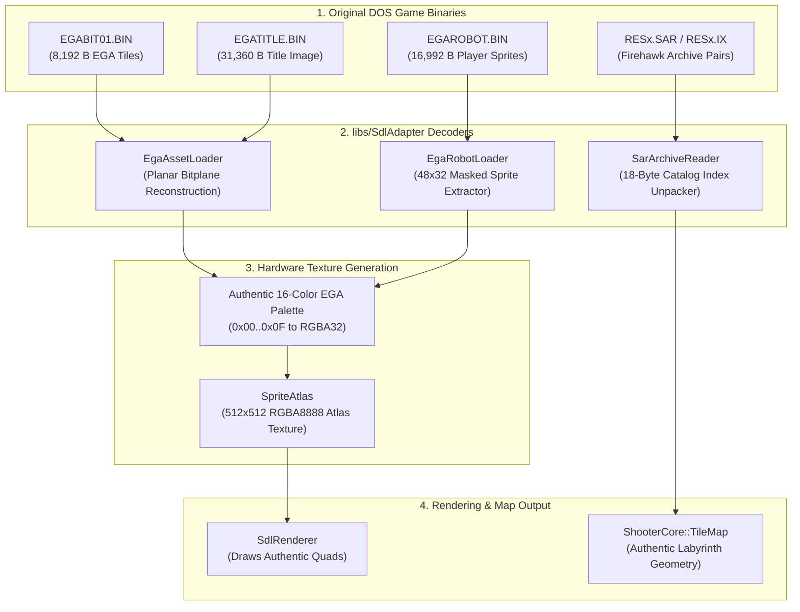

# Phase 15: Binary Asset Ingestion Pipeline (EGA & SAR Decoders) Implementation Plan

## 1. Executive Summary & Architectural Scope

Phase 15 transitions the engine from synthetic, procedural shape rendering ([`ProceduralSprites.cpp`](../apps/ThexderGame/ProceduralSprites.cpp) and [`SpriteAtlas.cpp`](../libs/SdlAdapter/SpriteAtlas.cpp)) to authentic, historical asset rendering by integrating direct binary decoders for the original MS-DOS releases of **Thexder** (1987) and **Firehawk: Thexder - The Second Contact** (1990).

Based on the reverse-engineering analysis in [thexder_firehawk_dos_investigation.md](thexder_firehawk_dos_investigation.md), the asset pipeline bridges legacy 16-bit MS-DOS binary formats into modern hardware-accelerated SDL2 textures and zero-heap CPU buffers.

### Core Objectives
1. **4-Plane EGA Bitplane Tile Decoder (`EgaAssetLoader`)**:
   - Parse `EGABIT01.BIN` (8,192 bytes) into 64 distinct $16 \times 16$ pixel tiles across four sequential 2,048-byte bitplanes (Blue, Green, Red, Intensity).
   - Parse `EGATITLE.BIN` (31,360 bytes) into the authentic $320 \times 196$ title screen.
   - Parse `EGACHRS.BIN` (4,096 bytes) into authentic $8 \times 8$ monospace font glyphs.
2. **Authentic Mecha Sprite Loader (`EgaRobotLoader`)**:
   - Parse `EGAROBOT.BIN` (16,992 bytes) containing 88 animation frames ($48 \times 32$ pixels, 192 bytes per frame, 6 bytes per row $\times$ 32 rows).
   - Extract walking strides, 8-way directional aiming, low-profile crouching, multi-stage metamorphosis, and supersonic jet flight orientations.
3. **Sierra/Game Arts SAR Archive Reader (`SarArchiveReader`)**:
   - Parse 18-byte catalog index records in `RES1.IX`, `RES2.IX`, and `RES3.IX`.
   - Extract and stream stage maps (`KMxx`), character tilesets (`CTxx`), actor sprites (`CGxx`, `EGxx`), animation cutscenes (`KAxx`), and effects (`EFCx`) from `RES1.SAR`, `RES2.SAR`, and `RES3.SAR`.
4. **Zero-Heap Adapter Atlas Binding (`SpriteAtlas`)**:
   - Bind unpacked RGBA32 surfaces directly into the hardware sprite atlas and render pipeline, eliminating procedural geometric placeholder primitives.

---

## 2. Technical Architecture & Data Flow

### ASCII Pipeline: Binary Ingestion & Atlas Generation
```
+-------------------------------------------------------------------------------+
|                       PHASE 15 ASSET INGESTION ARCHITECTURE                   |
|                                                                               |
|   [LEGACY DOS BINARY ASSETS]                                                  |
|         ├─► EGABIT01.BIN (8,192 B: 64 Tiles @ 16x16, 4 Planes x 2048 B)       |
|         ├─► EGAROBOT.BIN (16,992 B: 88 Sprites @ 48x32, 6 B/Row x 32 Rows)    |
|         ├─► EGATITLE.BIN (31,360 B: 320x196 Title Screen)                     |
|         ├─► EGACHRS.BIN  (4,096 B: 8x8 Monospace Font Glyphs)                 |
|         └─► RESx.SAR / IX (Firehawk Modular Compressed Asset Archives)        |
|                                                                               |
|   [DECODING & EXTRACTION SUBSYSTEMS] (libs/SdlAdapter)                        |
|         │                                                                     |
|         ├──► [EgaAssetLoader]                                                 |
|         │      • Recombines 4-plane bitplanes into 4-bit EGA Palette Indices  |
|         │      • Maps indices 0..15 to canonical 32-bit RGBA color values     |
|         │                                                                     |
|         ├──► [EgaRobotLoader]                                                 |
|         │      • Unpacks 48-bit wide raster scanlines (32 lines per frame)    |
|         │      • Isolates 88 discrete motion states with transparency masking |
|         │                                                                     |
|         └──► [SarArchiveReader]                                               |
|                • Parses 18-Byte Header Catalog Index Records                  |
|                • Extracts Stage Geometry (KMxx) and 256-Color Assets (CGxx)   |
|                                                                               |
|   [SDL2 PRESENTATION ATLAS]                                                   |
|         │                                                                     |
|         ▼                                                                     |
|   [SdlAdapter::SpriteAtlas] ──► [SDL_Texture 512x512 RGBA8888]               |
|         │                                                                     |
|         ▼                                                                     |
|   [SdlRenderer] ──► Authentic 1987 / 1990 Pixel-Perfect Hardware Rendering    |
+-------------------------------------------------------------------------------+
```

### Mermaid Architecture: Decoding & Integration Pipeline


---

## 3. Detailed Component Specifications

### 3.1 EGA 4-Plane Bitplane Decoder (`EgaAssetLoader`)
- **Header**: [`libs/SdlAdapter/EgaAssetLoader.h`](../libs/SdlAdapter/EgaAssetLoader.h)
- **Source**: [`libs/SdlAdapter/EgaAssetLoader.cpp`](../libs/SdlAdapter/EgaAssetLoader.cpp)

#### 4-Plane Planar Bitplane Layout
Each tile in `EGABIT01.BIN` is $16 \times 16$ pixels ($2 \text{ bytes per line} \times 16 \text{ lines} = 32 \text{ bytes per plane}$).
The 8,192-byte file contains 64 tiles stored sequentially across 4 distinct bitplanes:
- **Plane 0 (Blue)**: Offset `0x0000 .. 0x07FF` (2,048 bytes)
- **Plane 1 (Green)**: Offset `0x0800 .. 0x0FFF` (2,048 bytes)
- **Plane 2 (Red)**: Offset `0x1000 .. 0x17FF` (2,048 bytes)
- **Plane 3 (Intensity)**: Offset `0x1800 .. 0x1FFF` (2,048 bytes)

For tile index $T \in [0, 63]$, row $Y \in [0, 15]$, byte column $B \in [0, 1]$, and bit position $i \in [0, 7]$:
$$\text{Offset}(P, T, Y, B) = P \times 2048 + T \times 32 + Y \times 2 + B$$
$$\text{ColorNibble} = \text{bit}_0(P_0) \mid (\text{bit}_1(P_1) \ll 1) \mid (\text{bit}_2(P_2) \ll 2) \mid (\text{bit}_3(P_3) \ll 3)$$

#### Canonical 16-Color EGA Color Table
```cpp
constexpr std::array<std::uint32_t, 16> kEgaRgbaPalette {
    0xFF000000U, // 0: Black
    0xFFAA0000U, // 1: Blue (0x0000AA)
    0xFF00AA00U, // 2: Green (0x00AA00)
    0xFFAAAA00U, // 3: Cyan (0x00AAAA)
    0xFF0000AAU, // 4: Red (0xAA0000)
    0xFFAA00AAU, // 5: Magenta (0xAA00AA)
    0xFF0055AAU, // 6: Brown (0xAA5500)
    0xFFAAAAAAU, // 7: Light Gray (0xAAAAAA)
    0xFF555555U, // 8: Dark Gray (0x555555)
    0xFFFF5555U, // 9: Bright Blue (0x5555FF)
    0xFF55FF55U, // 10: Bright Green (0x55FF55)
    0xFFFFFF55U, // 11: Bright Cyan (0x55FFFF)
    0xFF5555FFU, // 12: Bright Red (0xFF5555)
    0xFFFF55FFU, // 13: Bright Magenta (0xFF55FF)
    0xFF55FFFFU, // 14: Yellow (0xFFFF55)
    0xFFFFFFFFU  // 15: White (0xFFFFFF)
};
```

---

### 3.2 Authentic Mecha Sprite Extractor (`EgaRobotLoader`)
- **Header**: [`libs/SdlAdapter/EgaRobotLoader.h`](../libs/SdlAdapter/EgaRobotLoader.h)
- **Source**: [`libs/SdlAdapter/EgaRobotLoader.cpp`](../libs/SdlAdapter/EgaRobotLoader.cpp)

#### Sprite Dimensions & Framing
- **Input File**: `EGAROBOT.BIN` (16,992 bytes).
- **Sprite Dimensions**: $48 \times 32$ pixels.
- **Row Stride**: 6 bytes per line ($6 \times 8 = 48$ bits).
- **Frame Stride**: $6 \text{ bytes/row} \times 32 \text{ rows} = 192 \text{ bytes per frame}$.
- **Total Frames**: $16,992 / 192 = 88.5$ frames (88 full $48 \times 32$ frames + one 16-row half-frame).

#### Frame State Allocation Table
| Frame Range | Mecha Mode | Animation State / Direction |
| :--- | :--- | :--- |
| `0 .. 7` | Robot | Ground walk cycle stepping right (head, torso, counter-stepping legs). |
| `8 .. 15` | Robot | Ground walk cycle stepping left. |
| `16 .. 23` | Robot | Aiming laser: Forward, Diagonal-Up, Vertical, Diagonal-Down (Right). |
| `24 .. 31` | Robot | Aiming laser: Forward, Diagonal-Up, Vertical, Diagonal-Down (Left). |
| `32 .. 39` | Robot | Squatting / Crouching pose (16 px height for low tunnels). |
| `40 .. 55` | Morphing | Multi-step transformation sequence: Robot $\rightarrow$ Jet. |
| `56 .. 71` | Jet | Supersonic flight in 8 cardinal/diagonal headings (Right/Left/Up/Down). |
| `72 .. 79` | Jet | Thruster flare and afterburner plume cycling. |
| `80 .. 87` | Special | Shield barrier encapsulation and damage flash frames. |

---

### 3.3 Firehawk SAR Archive Reader (`SarArchiveReader`)
- **Header**: [`libs/SdlAdapter/SarArchiveReader.h`](../libs/SdlAdapter/SarArchiveReader.h)
- **Source**: [`libs/SdlAdapter/SarArchiveReader.cpp`](../libs/SdlAdapter/SarArchiveReader.cpp)

#### 18-Byte Catalog Index Record Specification
Each entry in `RES1.IX`, `RES2.IX`, `RES3.IX` maps to a discrete asset:
```cpp
#pragma pack(push, 1)
struct SarCatalogEntry {
    char token[8];               ///< 8-character ASCII asset tag (e.g. "KM01    ")
    std::uint16_t flags;        ///< Internal allocation flags (typically 0x7000)
    std::uint16_t uncompressed; ///< Uncompressed size in bytes
    std::uint16_t compressed;   ///< Compressed size inside .SAR archive
    std::uint16_t offset;       ///< Byte offset within companion .SAR file
    std::uint16_t reserved;     ///< Reserved padding (0x0000)
};
#pragma pack(pop)
```

#### Token Registry
- `KM01` .. `KM12`: Labyrinth maze layout arrays for Stages 1 through 12.
- `CT01` .. `CT12`: Character tile sets (EGA and 256-color MCGA).
- `CG01` .. `CG12`: Primary actor sprite sheets.
- `EG11` .. `EG92`: Alien enemy and boss sprite atlases.
- `KA00` .. `KA12`: Keyframe animation cutscenes (Arthur pilot cockpit, transformation).
- `EFC1` .. `EFC4`: Secondary weapons and explosion particles.

---

## 4. Implementation Steps & Work Breakdown

```
+-------------------------------------------------------------------------------+
|                       PHASE 15 STEP-BY-STEP IMPLEMENTATION                    |
|                                                                               |
|   Step 1: Palette & EGA Bitplane Decoder (EgaAssetLoader)                     |
|           • Ingest EGABIT01.BIN (64 tiles x 4 planes x 2048 B)                |
|           • Implement bitplane pixel assembly and RGBA32 conversion           |
|           • Automated test verification (tests/SdlAdapterTests)               |
|                                                                               |
|   Step 2: 48x32 Mecha Sprite Atlas Decoder (EgaRobotLoader)                   |
|           • Parse EGAROBOT.BIN (88 frames @ 48x32, 6 B/row x 32 rows)         |
|           • Generate transparent alpha mask and unpack walk/aim/jet frames    |
|           • Frame state indexing and atlas blitting                           |
|                                                                               |
|   Step 3: Title & Font Decoders (EGATITLE.BIN & EGACHRS.BIN)                  |
|           • Decode 320x196 title screen and 8x8 font glyphs                   |
|           • Replaces procedural title logo in ProceduralSprites.cpp           |
|                                                                               |
|   Step 4: Firehawk SAR/IX Archive Unpacker (SarArchiveReader)                 |
|           • Parse 18-byte catalog header records                              |
|           • Unpack KMxx maps, CTxx tiles, CGxx sprites                        |
|                                                                               |
|   Step 5: SpriteAtlas & Hardware Renderer Integration                         |
|           • Deprecate fillBox/pushBar in SpriteAtlas.cpp                      |
|           • Bind decoded bitmaps to SDL2 hardware texture surface             |
|           • Clang-format, zero warnings compilation, and CTest pass           |
+-------------------------------------------------------------------------------+
```

---

## 5. Automated Verification & Testing Strategy

```
+-------------------------------------------------------------------------------+
|                           TESTING & SAFETY GATES                              |
|                                                                               |
|   Gate 1: Headless Unit Tests (tests/SdlAdapterTests/EgaAssetLoaderTests.cpp) |
|           • Validate exact 64-tile unpack from synthetic planar buffer        |
|           • Verify pixel values of Tile 0 against authentic round brick       |
|           • Verify 88-frame boundary checks and row stride calculation        |
|                                                                               |
|   Gate 2: SAR Catalog Reader Tests (tests/SdlAdapterTests/SarReaderTests.cpp) |
|           • Verify 18-byte record unpack and token lookups                    |
|           • Verify archive offset calculations and buffer bounds checks       |
|                                                                               |
|   Gate 3: Compliance & Style Gates                                            |
|           • MISRA C++:2023 Rule 7.0.6 (Explicit static_cast for planar math)  |
|           • SEI CERT ERR55-CPP (Zero heap allocation in decode loops)         |
|           • IWYU & <cstdint> mandatory inclusion                              |
|           • clang-format verification with zero diff discrepancies            |
+-------------------------------------------------------------------------------+
```

---

## 6. Verification Checklist

Before completing Phase 15:
- [ ] `EgaAssetLoader` decodes `EGABIT01.BIN` into 64 valid $16 \times 16$ RGBA tiles.
- [ ] `EgaRobotLoader` unpacks all 88 frames ($48 \times 32$) from `EGAROBOT.BIN`.
- [ ] `SarArchiveReader` parses `RES1.IX`, `RES2.IX`, `RES3.IX` and extracts assets from `RESx.SAR`.
- [ ] Procedural placeholder boxes in `SpriteAtlas.cpp` are replaced by authentic decoded textures.
- [ ] All code adheres to `clang-format`, MISRA, and SEI CERT C++ standards.
- [ ] Headless test suite passes with zero warnings: `ctest --output-on-failure`.

