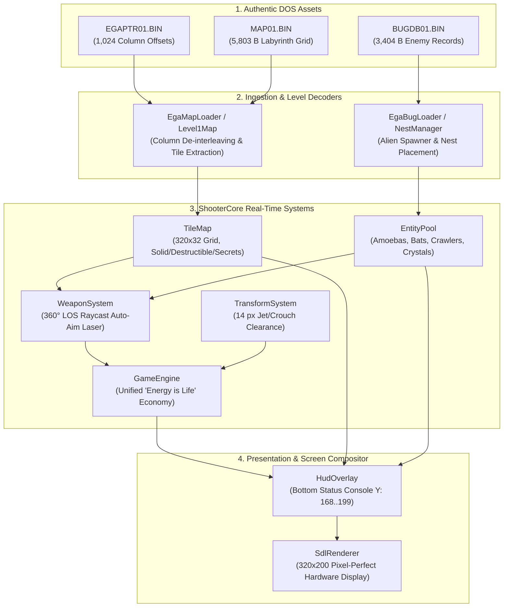
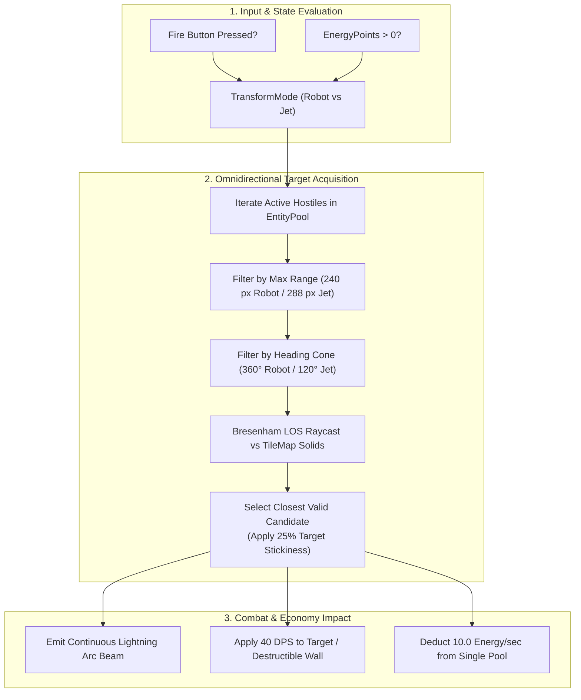

# Phase 16: Authentic Thexder 1 Level Ingestion, Auto-Aiming Laser & Bottom HUD Realignment Implementation Plan

## 1. Executive Summary & Architectural Scope

Phase 16 delivers authentic 1:1 gameplay, level geometry, combat mechanics, and visual presentation parity with the original 1987 Game Arts / Sierra MS-DOS release of **Thexder**.

Following the binary asset ingestion groundwork established in [Phase 15](phase15_plan.md) and the reverse-engineering analysis in [thexder_firehawk_dos_investigation.md](thexder_firehawk_dos_investigation.md), Phase 16 replaces all synthetic placeholders with native binary loaders, rewrites combat targeting to use authentic 360-degree line-of-sight auto-locking, enforces the signature "Energy is Life" single-pool economy, realigns the status HUD to the screen bottom, and implements sub-tile jet flight clearance for narrow 16-pixel labyrinth tunnels.

```
+-------------------------------------------------------------------------------+
|                       PHASE 16 CORE DELIVERABLES OVERVIEW                     |
|                                                                               |
|   1. Authentic World 1 Map Ingestion:                                         |
|      • Parse MAP01.BIN (5,803 B) indexed via EGAPTR01.BIN (1,024 column ptrs) |
|      • Decode 320x32 labyrinth with destructible barriers & secret caches     |
|                                                                               |
|   2. Alien Nest Spawner Subsystem:                                            |
|      • Parse BUGDB01.BIN (3,404 B, 46 records x 74 B) entity database         |
|      • Place authentic bio-nests, spawn cadences, and alien archetypes        |
|                                                                               |
|   3. Omnidirectional Auto-Aiming Laser:                                       |
|      • 360° real-time line-of-sight raycast sweep in Robot mode               |
|      • Forward 120° targeting cone in Jet mode                                |
|      • Continuous energy drain & direct target damage coupling                |
|                                                                               |
|   4. Unified "Energy is Life" Economy:                                        |
|      • Single energy reserve (0..100 baseline, expandable up to 250)           |
|      • Shields, lasers, enemy hits, and environmental hazards drain energy    |
|                                                                               |
|   5. Authentic Bottom Status Console HUD:                                     |
|      • Deprecate molded top canopy & side struts                              |
|      • 320x32 bottom console: SCORE, HI-SCORE, segmented ENERGY, SHIELD, RADAR |
|                                                                               |
|   6. 1-Tile Clearance Flight & Crouch Physics:                                |
|      • Strict 14 px height bounding box for Jet mode and crouching Robot      |
|      • Seamless traversal of narrow 16 px (1-tile) rock crevices              |
+-------------------------------------------------------------------------------+
```

---

## 2. Technical Architecture & Data Flow

### 2.1 ASCII Architecture: Phase 16 Subsystem Interconnect

```
+---------------------------------------------------------------------------------------------------+
|                           PHASE 16 ENGINE ARCHITECTURE & DATA FLOW                                |
|                                                                                                   |
|   [BINARY ASSETS (assets/thexder)]                                                                |
|         ├─► EGAPTR01.BIN (2,048 B: 1024 16-bit Column Offsets)                                    |
|         ├─► MAP01.BIN    (5,803 B: 181 Unique Labyrinth Columns @ 32 Tiles High)                  |
|         └─► BUGDB01.BIN  (3,404 B: 46 Records x 74 B Alien & Nest Database)                      |
|                                                                                                   |
|   [INGESTION & SPATIAL DECODERS] (libs/ShooterCore & apps/ThexderGame)                            |
|         │                                                                                         |
|         ├──► [EgaMapLoader / Level1Map]                                                           |
|         │      • Translates column offsets into contiguous 320x32 tile matrix                     |
|         │      • Isolates 6-bit tile index (0..63) and 2-bit attribute flags (0x40/0x80/0xC0)     |
|         │      • Populates ShooterCore::TileMap with solid, destructible, & secret blocks         |
|         │                                                                                         |
|         └──► [EgaBugLoader / NestManager]                                                         |
|                • Extracts nest world coordinates (X, Y) and enemy spawn parameters                |
|                • Instantiates bio-generators in ShooterCore::EntityPool with zero heap churn      |
|                                                                                                   |
|   [CORE SIMULATION & COMBAT SYSTEMS] (libs/ShooterCore)                                           |
|         │                                                                                         |
|         ├──► [WeaponSystem: 360° Auto-Aim Laser]                                                  |
|         │      • Line-of-sight raycast against TileMap obstacles                                  |
|         │      • Nearest-target lock-on with spatial stickiness hysteresis                        |
|         │      • Drains 10.0 energy/sec; deals continuous structural damage                       |
|         │                                                                                         |
|         ├──► [GameEngine: Unified Energy Economy]                                                 |
|         │      • EnergyPoints pool [0..100..250] replaces separate health meters                  |
|         │      • Shield deployment drains discrete 15.0 energy/sec                                |
|         │      • Hazard / entity damage directly depletes Energy; 0 Energy = Game Over             |
|         │                                                                                         |
|         └──► [TransformSystem: 1-Tile Clearance Physics]                                          |
|                • Robot upright: 24x30 px AABB (2-tile vertical clearance)                         |
|                • Robot crouch & Jet flight: 30x14 px AABB (1-tile 16 px clearance)                 |
|                                                                                                   |
|   [PRESENTATION & HUD OVERLAY] (apps/ThexderGame)                                                 |
|         │                                                                                         |
|         ▼                                                                                         |
|   [HudOverlay: Realigned Bottom Status Console]                                                   |
|         • Screen Top (Y: 0..167): 320x168 Unobstructed Action Playfield                           |
|         • Screen Bottom (Y: 168..199): 320x32 Authentic Status Dashboard                          |
|           [SCORE 00000000] [ENERGY ###/###] [SHIELD: ON/OFF] [RADAR SCANNER] [HI-SCORE 00000000]   |
+---------------------------------------------------------------------------------------------------+
```

### 2.2 Mermaid Architecture: Data Flow & System Execution



---

## 3. Detailed Component Specifications

### 3.1 Binary Level Ingestion Engine (`Level1Map` / `EgaMapLoader`)

- **Headers**: [`apps/ThexderGame/Level1Map.h`](../apps/ThexderGame/Level1Map.h), [`libs/ShooterCore/TileMap.h`](../libs/ShooterCore/TileMap.h)
- **Sources**: [`apps/ThexderGame/Level1Map.cpp`](../apps/ThexderGame/Level1Map.cpp), [`libs/ShooterCore/TileMap.cpp`](../libs/ShooterCore/TileMap.cpp)

#### 3.1.1 Column Pointer Table Decoding (`EGAPTR01.BIN`)
`EGAPTR01.BIN` is a 2,048-byte binary file containing 1,024 16-bit little-endian pointers ($1024 \times 2 = 2048 \text{ bytes}$).
The level labyrinth is divided into 10 horizontal macro-blocks ($B \in [0, 9]$), each 32 columns wide, yielding a total map extent of $320 \text{ columns} \times 32 \text{ rows}$.

The pointer table is structured as 8 rows of 128 words (256 bytes per row). Each row $R \in [0, 7]$ stores 4 consecutive columns per macro-block $B$:
$$\text{TableIndex}(B, R, C) = R \times 128 + B \times 4 + C \quad (C \in [0, 3])$$
$$\text{MapColumn}(B, R, C) = B \times 32 + R \times 4 + C \quad (\text{MapColumn} \in [0, 319])$$

For any given world column $X \in [0, 319]$:
$$B = \lfloor X / 32 \rfloor, \quad X_{\text{block}} = X \bmod 32, \quad R = \lfloor X_{\text{block}} / 4 \rfloor, \quad C = X_{\text{block}} \bmod 4$$
$$\text{Offset} = \text{Pointers}[\text{TableIndex}(B, R, C)]$$

```
+-------------------------------------------------------------------------------+
|                       EGAPTR01.BIN COLUMN DE-INTERLEAVING                     |
|                                                                               |
|   Table Row 0: Block 0 (Col 0..3),   Block 1 (Col 0..3),   ... Block 9        |
|   Table Row 1: Block 0 (Col 4..7),   Block 1 (Col 4..7),   ... Block 9        |
|   Table Row 2: Block 0 (Col 8..11),  Block 1 (Col 8..11),  ... Block 9        |
|   Table Row 3: Block 0 (Col 12..15), Block 1 (Col 12..15), ... Block 9        |
|   Table Row 4: Block 0 (Col 16..19), Block 1 (Col 16..19), ... Block 9        |
|   Table Row 5: Block 0 (Col 20..23), Block 1 (Col 20..23), ... Block 9        |
|   Table Row 6: Block 0 (Col 24..27), Block 1 (Col 24..27), ... Block 9        |
|   Table Row 7: Block 0 (Col 28..31), Block 1 (Col 28..31), ... Block 9        |
+-------------------------------------------------------------------------------+
```

#### 3.1.2 Tile Byte Format & Bitplane Attribute Flags
`MAP01.BIN` contains 5,803 bytes. World 1 defines 181 unique column vectors of 32 vertical tiles ($181 \times 32 = 5792 \text{ bytes}$), plus an 11-byte stage termination footer.

Each cell byte $Byte \in [0, 255]$ encodes both a 6-bit tile sprite index into `EGABIT01.BIN` and a 2-bit collision/interaction attribute:
- **`TileIndex = Byte & 0x3F`** ($0 \dots 63$): Exact graphic tile index matching `EGABIT01.BIN`.
- **`AttributeFlag = Byte & 0xC0`**:
  - `0x00`: **Empty / Passthrough Tile** (or static background element when `TileIndex == 0`).
  - `0x40`: **Destructible Masonry Barrier** (crumbles after taking $5.0 \text{ damage}$ from laser; awards score).
  - `0x80`: **Concealed Secret Passage / Wall** (solid visual appearance, passable by craft or destroyed to reveal passages).
  - `0xC0`: **Hazard Conduit / Energy Cache** (impassable acid/lava or crystal chamber wall).

#### 3.1.3 World 1 Boundary & Coordinate Mapping
- **Total Level Extent**: 320 tiles wide $\times$ 32 tiles high ($5120 \times 512 \text{ pixels}$).
- **Tile Size**: $16.0 \times 16.0 \text{ pixels}$.
- **Player Initial Spawn**: World column 4, row 6 ($X = 72.0 \text{ px}, Y = 96.0 \text{ px}$).
- **Stage Exit Trigger**: World column 178, row 26 ($X = 2848.0 \text{ px}, Y = 416.0 \text{ px}$).

---

### 3.2 Alien Nest & Entity Database Ingestion (`NestManager` / `EgaBugLoader`)

- **Headers**: [`libs/ShooterCore/NestManager.h`](../libs/ShooterCore/NestManager.h), [`libs/ShooterCore/EntityPool.h`](../libs/ShooterCore/EntityPool.h)
- **Sources**: [`libs/ShooterCore/NestManager.cpp`](../libs/ShooterCore/NestManager.cpp), [`libs/ShooterCore/EntityPool.cpp`](../libs/ShooterCore/EntityPool.cpp)

#### 3.2.1 Record Format of `BUGDB01.BIN`
`BUGDB01.BIN` (3,404 bytes) comprises 46 fixed-length records of 74 bytes each ($46 \times 74 = 3404 \text{ bytes}$):
- **Records 0..3**: World 1 global encounter tables, spawn frequency curves, and enemy durability presets.
- **Records 4..45**: Spatial placement slots for alien hives and fixed entities.

Each nest record contains up to 6 entity descriptor entries (12 bytes per descriptor):
```cpp
#pragma pack(push, 1)
struct EgaBugEntry {
    std::uint16_t typeId;        ///< Alien archetype (1: Amoeba, 2: Flitter/Bat, 3: Crawler)
    std::uint16_t worldX;        ///< Horizontal pixel coordinate in world space
    std::uint16_t worldY;        ///< Vertical pixel coordinate in world space
    std::uint16_t spawnInterval; ///< Base spawn timer in ticks
    std::uint16_t initialHealth; ///< Hit points before destruction
    std::uint16_t dropItemType;  ///< Loot table index (Energy Crystal bonus)
};
#pragma pack(pop)
```

#### 3.2.2 Authentic Alien Archetypes & Behavior
1. **Amoeba / Protozoa (`typeId == 1`)**:
   - Spawns from ceiling hives; drifts downward with floating sinusoidal horizontal oscillation.
   - Durability: $10 \text{ HP}$. Drops small energy crystal ($+5 \text{ EN}$) on defeat.
2. **Flitter / Cave Bat (`typeId == 2`)**:
   - Fast, erratic flight paths; swoops toward the player when within $160 \text{ px}$ proximity.
   - Durability: $15 \text{ HP}$. Deals $8 \text{ EN}$ collision damage on unshielded contact.
3. **Crawler / Centipede (`typeId == 3`)**:
   - Climbs labyrinth floors and walls; navigates tight 16-pixel tunnels.
   - Durability: $25 \text{ HP}$. Can only be engaged with horizontal laser aim or jet strafing.

```
+-------------------------------------------------------------------------------+
|                       BUGDB01.BIN ENTITY DISPATCH MODEL                       |
|                                                                               |
|   [BUGDB01.BIN] ──► Parse 46 Records @ 74 Bytes                               |
|                           │                                                   |
|                           ▼                                                   |
|   [NestManager::addNest(WorldPos, Health, Interval, Type)]                    |
|         │                                                                     |
|         ├──► Proximity Check: Distance(Player, Nest) < 160 px                 |
|         │      • If True: Accelerate spawn timer (1.2 s cadence)              |
|         │      • If False: Standard patrol spawn timer (4.0 s cadence)        |
|         │                                                                     |
|         ▼                                                                     |
|   [EntityPool::spawnEntity(Type, Position, Velocity)]                         |
|         • Zero dynamic allocations (CERT ERR55-CPP)                           |
|         • Up to 32 simultaneous active hostile aliens                         |
+-------------------------------------------------------------------------------+
```

---

### 3.3 Continuous Omnidirectional Auto-Aiming Laser (`WeaponSystem`)

- **Header**: [`libs/ShooterCore/WeaponSystem.h`](../libs/ShooterCore/WeaponSystem.h)
- **Source**: [`libs/ShooterCore/WeaponSystem.cpp`](../libs/ShooterCore/WeaponSystem.cpp)

#### 3.3.1 Line-of-Sight Raycast Architecture
In Thexder, the player never needs to manually align a crosshair: the mecha's targeting computer automatically acquires the nearest hostile target within line of sight.

1. **Target Filtering & Angular Cone**:
   - **Robot Mode**: $360^\circ$ omnidirectional targeting ($\cos \theta \ge -1.0$).
   - **Jet Mode**: Forward-focused $120^\circ$ conical targeting ($\cos \theta \ge 0.50$ relative to current jet heading).
   - Maximum acquisition range: $240.0 \text{ px}$ (Robot), $288.0 \text{ px}$ (Jet).

2. **Bresenham / DDA Line-of-Sight Grid Raycasting**:
   - For every candidate target within range and angular cone, perform a continuous line trace from player weapon muzzle $(X_0, Y_0)$ to target center $(X_1, Y_1)$.
   - Sample intervening cells in `TileMap`. If any cell along the ray is `isSolid()` (rock wall, forcefield, or closed door), the line of sight is obstructed and the candidate is rejected.

3. **Spatial Stickiness Hysteresis**:
   - To prevent rapid oscillation between two equidistant targets, an active lock maintains a $+25\%$ distance preference bonus ($d_{\text{effective}} = d_{\text{actual}} \times 0.75$).

4. **Continuous Energy Consumption & Damage Application**:
   - When firing, energy is continuously consumed at $10.0 \text{ points/sec}$ ($\Delta E = 10.0 \times \Delta t$).
   - The beam deals continuous damage ($40.0 \text{ DPS}$) to the locked target or destructible barrier.
   - If no valid entity target exists, the laser fires in the current facing direction until intersecting the nearest solid tile, inflicting damage on destructible blocks.

```
+-------------------------------------------------------------------------------+
|                       AUTO-AIMING LASER RAYCAST ARCHITECTURE                  |
|                                                                               |
|   [PLAYER CRAFT]                                                              |
|        │ (Muzzle Origin)                                                      |
|        │                                                                      |
|        ├──► Candidate 1: Dist = 90 px, Behind Solid Wall ──► [REJECTED (LOS)] |
|        │                                                                      |
|        ├──► Candidate 2: Dist = 140 px, Clear Line of Sight ──► [LOCKED!]     |
|        │                                                            │         |
|        └──► Candidate 3: Dist = 200 px, Clear Line of Sight         │         |
|                                                                     ▼         |
|   [CONTINUOUS BEAM RENDERING]                                [40 DPS DAMAGE]  |
|   • Multi-segment lightning arc from muzzle to Candidate 2   [-10 EN/SEC]     |
+-------------------------------------------------------------------------------+
```



---

### 3.4 Unified "Energy is Life" Economy (`GameEngine`)

- **Header**: [`libs/ShooterCore/GameEngine.h`](../libs/ShooterCore/GameEngine.h)
- **Source**: [`libs/ShooterCore/GameEngine.cpp`](../libs/ShooterCore/GameEngine.cpp)

#### 3.4.1 Single Energy Pool Specification
In authentic Thexder, there is no separate "Hit Points" or "Health Bar": **Energy is Life**.
- **Baseline Capacity**: $100.0 \text{ points}$.
- **Expanded Maximum**: Up to $250.0 \text{ points}$ through alien energy crystal absorption.
- **Immediate Game Over**: If Energy reaches $0.0$, the craft instantly explodes into shrapnel debris.

```
+-------------------------------------------------------------------------------+
|                       UNIFIED "ENERGY IS LIFE" ECONOMY                        |
|                                                                               |
|   ENERGY INFLOW (+)                                   ENERGY CONSUMPTION (-)  |
|   • Small Crystal:    +5.0 EN                         • Auto-Aim Laser:       |
|   • Medium Crystal:  +10.0 EN                           -10.0 EN/sec          |
|   • Super Crystal:   +50.0 EN (Raises max +10)        • Deflector Shield:     |
|                                                         -15.0 EN/sec          |
|                           ┌────────────────────┐      • Alien Collision:      |
|                           │    ENERGY POOL     │        -8.0 to -25.0 EN      |
|                           │    [0 ... 250]     │      • Enemy Projectile:     |
|                           └─────────┬──────────┘        -5.0 to -15.0 EN      |
|                                     │                 • Acid / Lava Hazard:   |
|                                     ▼ (Pool == 0)       -20.0 EN/sec          |
|                             [CRAFT DESTRUCTION]                               |
+-------------------------------------------------------------------------------+
```

#### 3.4.2 Shield Barrier Dynamics
- Activating the shield creates a visible hexagonal/elliptical forcefield encasing the craft.
- Consumes energy at $15.0 \text{ points/sec}$ while deployed.
- Provides complete immunity to enemy collisions, projectile damage, and environmental hazards.
- Enemies impacting the shield take instant retaliatory kinetic damage ($50 \text{ damage}$) and bounce back.

---

### 3.5 Realigned Bottom Status Console HUD (`HudOverlay`)

- **Header**: [`apps/ThexderGame/HudOverlay.h`](../apps/ThexderGame/HudOverlay.h)
- **Source**: [`apps/ThexderGame/HudOverlay.cpp`](../apps/ThexderGame/HudOverlay.cpp)

#### 3.5.1 Viewport Partitioning & Layout Realignment
The molded cockpit canopy frame and side struts are completely deprecated. The viewport is divided horizontally into an unobstructed action screen and a dedicated bottom status console:
- **Game Action Viewport**: $X: 0 \dots 319, \quad Y: 0 \dots 167$ ($320 \times 168 \text{ pixels}$).
- **Bottom Status Console**: $X: 0 \dots 319, \quad Y: 168 \dots 199$ ($320 \times 32 \text{ pixels}$).

#### 3.5.2 Console Layout Map ($320 \times 32$ pixels)
```
+---------------------------------------------------------------------------------------------------+
| Y: 168  +-------------------------------------------------------------------------------------+   |
| Y: 169  | BEZEL DIVIDER LINE (EGA Color 7: Light Gray 0xAAAAAA)                               |   |
| Y: 170  +-------------------------------------------------------------------------------------+   |
| Y: 172  | SCORE      [00125400]    ENERGY [====================] [ 92/100]    RADAR [  o  ]   |   |
| Y: 182  | HI-SCORE   [00500000]    SHIELD [ON / 08.4s]         MODE: [ROBOT]  WORLD [ 1-1 ]   |   |
| Y: 198  +-------------------------------------------------------------------------------------+   |
+---------------------------------------------------------------------------------------------------+
  X: 0    X: 12        X: 80         X: 110 X: 160               X: 230         X: 260      X: 316
```

1. **Score & High Score Blocks ($X: 12 \dots 100, Y: 172 \dots 194$)**:
   - Monospace zero-padded 8-digit decimal readouts using authentic $8 \times 8$ EGA font glyphs.
2. **Energy Meter & Numeric Readout ($X: 110 \dots 225, Y: 172 \dots 180$)**:
   - Dual-segmented ladder gauge ($20 \text{ segments}$).
   - Color grading: Phosphor Green ($> 50\%$), Amber Gold ($21\% - 50\%$), Flashing Crimson ($\le 20\%$).
   - Exact numerical display: `[ 92/100]`.
3. **Shield Annunciator & Mode Indicator ($X: 110 \dots 225, Y: 182 \dots 190$)**:
   - Active status: `SHIELD [ON / 08.4s]` in bright cyan; `SHIELD [OFF]` in dark gray.
   - Mode badge: `MODE: [ROBOT]` vs `MODE: [ JET ]`.
4. **Mini-Radar / Sector Scanner ($X: 250 \dots 310, Y: 172 \dots 194$)**:
   - Real-time sector map displaying active macro-block and player blip.

---

### 3.6 1-Tile Clearance Flight & Crouch Physics (`TransformSystem`)

- **Header**: [`libs/ShooterCore/TransformSystem.h`](../libs/ShooterCore/TransformSystem.h)
- **Source**: [`libs/ShooterCore/TransformSystem.cpp`](../libs/ShooterCore/TransformSystem.cpp)

#### 3.6.1 Hitbox Dimensions by Operational Mode
In original Thexder, the player transforms into a sleek, aerodynamic jet to fly through tight 1-tile horizontal crawlways. The bounding boxes must strictly honor tile clearance:

| Configuration | Hitbox Width | Hitbox Height | Tile Clearance | Description |
| :--- | :--- | :--- | :--- | :--- |
| **Robot Upright** | $24.0 \text{ px}$ | $30.0 \text{ px}$ | 2 vertical tiles ($32 \text{ px}$) | Standard walking and jumping stance. |
| **Robot Crouching** | $24.0 \text{ px}$ | $14.0 \text{ px}$ | 1 vertical tile ($16 \text{ px}$) | Low-profile stance; fits under low rock barriers. |
| **Jet Flight** | $30.0 \text{ px}$ | $14.0 \text{ px}$ | 1 vertical tile ($16 \text{ px}$) | Supersonic flight; traverses 16 px tunnels smoothly. |

```
+-------------------------------------------------------------------------------+
|                       HITBOX PROFILES & 1-TILE TUNNEL CLEARANCE               |
|                                                                               |
|   ROBOT UPRIGHT (24x30 px):                   JET / CROUCH (30x14 px):        |
|   ┌─────────────┐                             ┌────────────────────────┐      |
|   │    HEAD     │                             │                        │ 14 px|
|   │    TORSO    │ 30 px                       └────────────────────────┘      |
|   │    LEGS     │                                                             |
|   └─────────────┘                                                             |
|   Requires 2 Tiles Height (32 px)             Fits in 1-Tile Conduit (16 px)  |
|                                                                               |
|   === SOLID ROCK CEILING (Y = 16 px) =====================================    |
|         ▲                                                                     |
|         │ 16 px Tunnel Clearance                                              |
|         ▼                                                                     |
|   === SOLID ROCK FLOOR (Y = 32 px) =======================================    |
+-------------------------------------------------------------------------------+
```

---

## 4. Step-by-Step Implementation Roadmap

```
+-------------------------------------------------------------------------------+
|                       PHASE 16 IMPLEMENTATION ROADMAP                         |
|                                                                               |
|   Step 1: Column-Oriented Level Ingestion (EgaMapLoader & Level1Map)          |
|           • Ingest EGAPTR01.BIN (1,024 column offsets) & MAP01.BIN (5,803 B)   |
|           • Implement 8-row de-interleaving and populate 320x32 TileMap       |
|           • Parse destructible (0x40) and secret (0x80) attribute flags       |
|                                                                               |
|   Step 2: Binary Alien Database & Bio-Nest Loader (EgaBugLoader & NestManager)|
|           • Ingest BUGDB01.BIN (46 records @ 74 bytes)                        |
|           • Spawn authentic bio-generators, Amoebas, Bats, and Crawlers       |
|           • Integrate crystal energy drops into SupplyDropSystem              |
|                                                                               |
|   Step 3: 360° Omnidirectional Auto-Aiming Laser (WeaponSystem)               |
|           • Implement Bresenham line-of-sight raycaster vs TileMap obstacles  |
|           • Omnidirectional lock in Robot mode; 120° cone in Jet mode         |
|           • Balance continuous 10 EN/sec drain and 40 DPS damage delivery     |
|                                                                               |
|   Step 4: Unified "Energy is Life" Economy (GameEngine & Types)               |
|           • Deprecate separated health meters; link life directly to Energy   |
|           • Route all collision, projectile, and hazard damage to Energy      |
|           • Implement shield instant deflection and energy drain              |
|                                                                               |
|   Step 5: Bottom Status Console Realignment (HudOverlay)                      |
|           • Remove molded top canopy frame and side struts                    |
|           • Draw 320x32 status console at screen bottom (Y: 168..199)         |
|           • Render Score, Hi-Score, Segmented Energy, Shield lamp, and Radar  |
|                                                                               |
|   Step 6: 1-Tile Clearance Physics & Jet Traversal (TransformSystem)          |
|           • Enforce 14 px height bounding box for Jet and Crouch modes        |
|           • Verify seamless high-speed traversal through 16 px tunnels        |
+-------------------------------------------------------------------------------+
```

---

## 5. Automated Verification & Testing Strategy

```
+-------------------------------------------------------------------------------+
|                           TESTING & SAFETY GATES                              |
|                                                                               |
|   Gate 1: Level Ingestion Unit Tests (tests/ShooterCoreTests/MapLoaderTests)   |
|           • Verify 320x32 column pointer resolution from synthetic buffer     |
|           • Confirm tile index masking (& 0x3F) and attribute flags (& 0xC0)  |
|           • Verify Player Spawn and Exit Portal coordinates                   |
|                                                                               |
|   Gate 2: Enemy Ingestion Tests (tests/ShooterCoreTests/BugDbLoaderTests)     |
|           • Parse 74-byte records and verify hive positions in World 1        |
|           • Verify spawn cadence escalation under player proximity            |
|                                                                               |
|   Gate 3: Auto-Aiming Laser & LOS Tests (tests/ShooterCoreTests/WeaponTests)  |
|           • Raycast occlusion test: Wall between craft and target breaks lock |
|           • Target stickiness test: 25% hysteresis prevents target oscillation|
|           • Jet cone constraint test: Targets outside 120° heading rejected   |
|                                                                               |
|   Gate 4: Energy Economy & Hitbox Clearance (tests/ShooterCoreTests/Physics)  |
|           • Verify zero dynamic heap allocation during simulation ticks       |
|           • Jet 14 px AABB navigates 16 px tunnel without collision snags     |
|           • Damage reduction directly drains Energy; 0 Energy = Game Over     |
|                                                                               |
|   Gate 5: Compliance & Style Gates                                            |
|           • MISRA C++:2023 Rule 7.0.6 (Explicit static_cast for planar math)  |
|           • SEI CERT ERR55-CPP (Zero heap allocation in real-time loops)      |
|           • IWYU & <cstdint> mandatory inclusion                              |
|           • clang-format verification with zero diff discrepancies            |
+-------------------------------------------------------------------------------+
```

---

## 6. Implementation Verification Checklist

Before completing Phase 16:
- [ ] `Level1Map` / `EgaMapLoader` ingests `MAP01.BIN` and `EGAPTR01.BIN`, reconstructing the authentic $320 \times 32$ labyrinth.
- [ ] Destructible barrier blocks (`0x40`) take laser damage and crumble; secret walls (`0x80`) conceal passages.
- [ ] `NestManager` / `EgaBugLoader` ingests `BUGDB01.BIN` and spawns authentic alien waves with proximity triggers.
- [ ] Auto-aiming laser tracks the nearest visible target in $360^\circ$ (Robot) and $120^\circ$ (Jet), respecting wall occlusions.
- [ ] Health and energy are unified into a single $0 \dots 100 \dots 250$ pool; damage and weapon usage directly drain energy.
- [ ] Top canopy frame is removed; authentic bottom status console is rendered at $Y: 168 \dots 199$.
- [ ] Jet and crouch hitboxes strictly observe $14 \text{ px}$ height, enabling smooth traversal of $16 \text{ px}$ conduits.
- [ ] All code strictly adheres to MISRA C++:2023, SEI CERT ERR55-CPP, IWYU `<cstdint>`, and `.clang-format`.
- [ ] Full headless test suite passes cleanly: `ctest --output-on-failure`.

