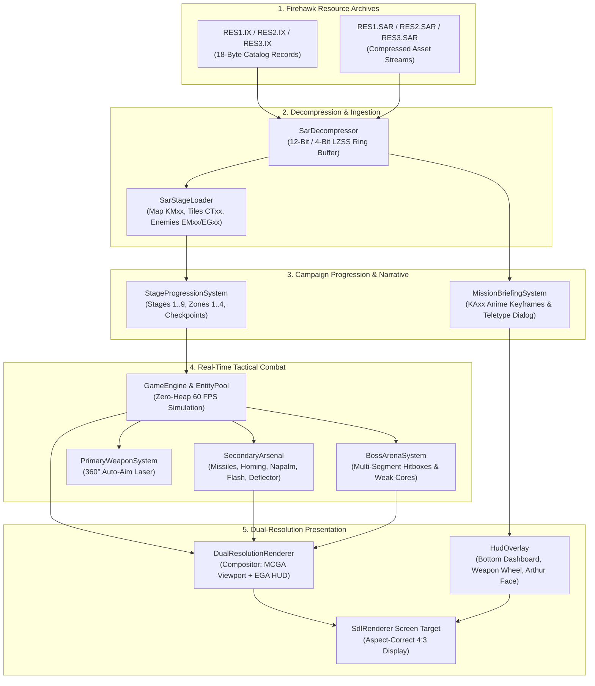
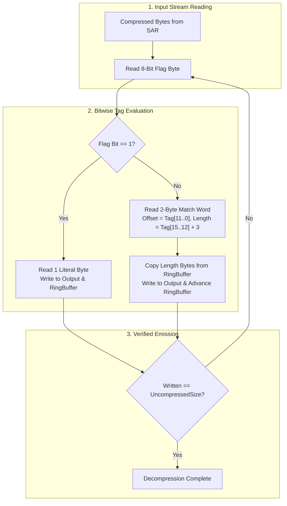
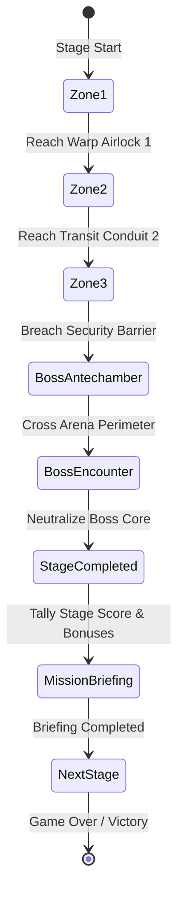
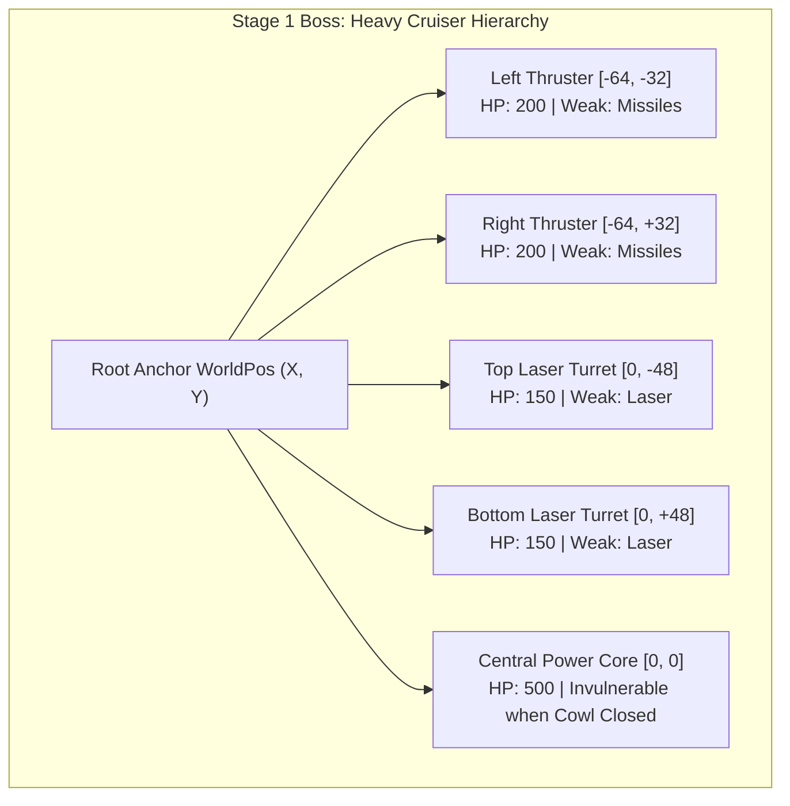
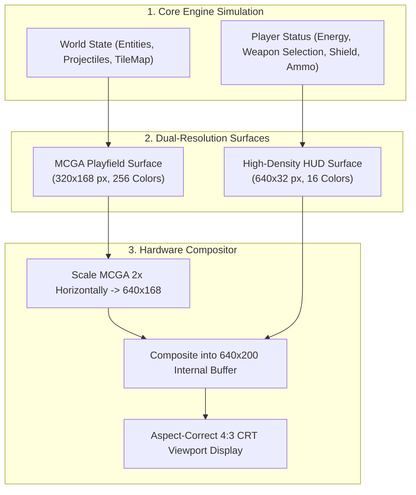

# Phase 17: Firehawk (Thexder 2) Multi-Stage Campaign & Expanded Arsenal Implementation Plan

## 1. Executive Summary & Architectural Scope

Phase 17 expands the engine from the single-world labyrinth of Thexder 1 into the full multi-stage campaign and advanced tactical combat system of **Firehawk: Thexder - The Second Contact** (Game Arts / Sierra On-Line, 1990).

Following the asset ingestion architecture created in [Phase 15](phase15_plan.md), the reverse-engineering analysis in [thexder_firehawk_dos_investigation.md](thexder_firehawk_dos_investigation.md), and the core combat loop solidified in [Phase 16](phase16_plan.md), Phase 17 introduces:
1. The complete **5-weapon secondary tactical arsenal** (Standard Missiles, Homing Missiles, Napalm Bombs, Flash Bombs, and the Deflector Shield).
2. The **9-stage campaign progression pipeline** powered by native decompression of Firehawk's `RES1.SAR`, `RES2.SAR`, and `RES3.SAR` archives.
3. **Multi-segment modular boss encounters** with destructible armor plates, rotating turrets, and vulnerable weak-point cores.
4. **Dual-resolution hybrid display composition** combining an authentic 320x200 MCGA 256-color active gameplay viewport with crisp 640x200 EGA-style cockpit status instrumentation.
5. **Narrative mission briefings and pilot Arthur anime cutscenes** sequenced from keyframe binary assets.

```
+-------------------------------------------------------------------------------+
|                       PHASE 17 CORE DELIVERABLES OVERVIEW                     |
|                                                                               |
|   1. Complete 5-Weapon Secondary Arsenal:                                     |
|      • Standard Missiles: Linear ballistics, heavy barrier demolition         |
|      • Homing Missiles: Proportional navigation tracking aerial targets       |
|      • Napalm Bombs: Ballistic drop cascading into rolling surface flames     |
|      • Flash Bombs: Screen-clearing EMP shockwave neutralizing projectiles    |
|      • Deflector Shield: Kinetic/energy envelope reflecting enemy fire        |
|                                                                               |
|   2. Firehawk SAR Decompression & Stage Ingestion:                            |
|      • Variable-length 9..12-bit LZW decompressor for SAR resources (KM, CT)  |
|      • Multi-zone labyrinth parser streaming stages 1 through 9               |
|      • Enemy placement databases (EMxx) & sprite atlases (EGxx)               |
|                                                                               |
|   3. 9-Stage Campaign Progression Pipeline:                                   |
|      • Orbit (Stage 1), Surface (Stage 2), Lava Caverns (Stage 3),            |
|        Biosphere (Stage 4), Bio-Hive (Stage 5), Asteroid Fortress (Stage 6),  |
|        Reactor (Stage 7), Bastion (Stage 8), Mothership Core (Stage 9)        |
|      • Inter-zone warp gates, airlocks, and progression checkpoints           |
|                                                                               |
|   4. Modular Multi-Segment Boss Arenas:                                       |
|      • Destructible hierarchical hitboxes (engines, armor, cannons, cores)    |
|      • State machines: armor breach -> enrage patterns -> core detonation     |
|      • Arena enclosure locks preventing retreat during boss showdowns         |
|                                                                               |
|   5. Dual-Resolution Hybrid Screen Compositor:                                |
|      • 320x200 MCGA 256-color action viewport (320x168 active game field)     |
|      • 640x200 High-density instrumentation dashboard across bottom 32 px     |
|      • Weapon selection wheel, segmented gauges, and Arthur portrait HUD      |
|                                                                               |
|   6. Narrative Cutscene & Mission Interlude Sequencer:                        |
|      • Unpack & render KAxx Arthur anime keyframes                            |
|      • Teletype text dialog boxes for tactical briefing & command alerts      |
+-------------------------------------------------------------------------------+
```

---

## 2. Technical Architecture & Data Flow

### 2.1 ASCII Architecture: Phase 17 Subsystem Interconnect

```
+---------------------------------------------------------------------------------------------------+
|                           PHASE 17 ENGINE ARCHITECTURE & DATA FLOW                                |
|                                                                                                   |
|   [FIREHAWK SAR ARCHIVES] (assets/firehawk/RES1.SAR, RES2.SAR, RES3.SAR)                          |
|         │                                                                                         |
|         ├──► [SarArchiveReader] (Catalog parser: RESx.IX 18-byte headers)                         |
|         │          │                                                                              |
|         │          ▼ (Compressed Streams: KMxx, CTxx, CGxx, EGxx, EMxx, KAxx)                     |
|         └──► [SarDecompressor]                                                                    |
|                    • 12-bit offset / 4-bit length LZSS decompressor                               |
|                    • Zero heap allocation via fixed sliding dictionary buffers                    |
|                                                                                                   |
|   [STAGE & ASSET STREAMING PIPELINE]                                                              |
|         │                                                                                         |
|         ├──► [SarStageLoader]                                                                     |
|         │      • Parses KMxx layout into ShooterCore::TileMap (4 zones per stage)                 |
|         │      • Ingests CTxx tileset into SdlAdapter::SpriteAtlas                                |
|         │      • Ingests EGxx enemy sprites & EMxx spawn tables into EntityPool                   |
|         │                                                                                         |
|         └──► [StageProgressionSystem]                                                             |
|                • Tracks active stage (1..9) and active zone (1..4)                                |
|                • Manages warp portals, airlocks, and checkpoint state transitions                 |
|                                                                                                   |
|   [CORE SIMULATION & TACTICAL COMBAT SYSTEMS] (libs/ShooterCore)                                  |
|         │                                                                                         |
|         ├──► [SecondaryArsenal: 5-Weapon Bay]                                                     |
|         │      • Standard Missiles: Linear trajectory + 3x3 destructible wall breach              |
|         │      • Homing Missiles: Proportional navigation, aerial enemy priority                  |
|         │      • Napalm Bombs: Gravity drop, horizontal incendiary pool (60 DPS)                  |
|         │      • Flash Bombs: Full-screen projectile wipe, 150 area stun damage                   |
|         │      • Deflector Shield: Kinetic invulnerability, reflects projectiles (V -> -V)        |
|         │      • Ammunition Magazine: Bounded reserves with pickup replenishment                  |
|         │                                                                                         |
|         ├──► [BossArenaSystem]                                                                    |
|         │      • Multi-segment hierarchical hitboxes (Parent root + child offsets)                |
|         │      • Component damage distribution: shields -> armor plates -> weak core              |
|         │      • Arena perimeter lockdown & camera boundary clamping                              |
|         │                                                                                         |
|         └──► [MissionBriefingSystem & CutscenePlayer]                                             |
|                • KAxx Arthur anime portrait sequencing & lip-sync blink frames                    |
|                • Teletype text dialog driver for command base transmissions                       |
|                                                                                                   |
|   [DUAL-RESOLUTION PRESENTATION PIPELINE] (libs/SdlAdapter & apps/ThexderGame)                    |
|         │                                                                                         |
|         ▼                                                                                         |
|   [DualResolutionRenderer]                                                                        |
|         ├── Gameplay Viewport (Y: 0..167): 320x168 MCGA 256-color pixel-perfect playfield         |
|         └── Cockpit Dashboard (Y: 168..199): High-density 640x32 EGA instrumentation               |
|               • Weapon selector wheel with ordnance icons & remaining counts                      |
|               • Segmented energy meter & deflector barrier timer gauge                            |
|               • Arthur pilot emotion portrait (Normal / Warning / Critical / Firing)              |
|               • Real-time tactical radar scanner                                                  |
+---------------------------------------------------------------------------------------------------+
```

### 2.2 Mermaid Architecture: Data Flow & System Execution



---

## 3. Detailed Component Specifications

### 3.1 Complete 5-Weapon Secondary Arsenal Subsystem (`SecondaryArsenal`)

- **Headers**: [`libs/ShooterCore/SecondaryArsenal.h`](../libs/ShooterCore/SecondaryArsenal.h), [`libs/ShooterCore/Types.h`](../libs/ShooterCore/Types.h)
- **Sources**: [`libs/ShooterCore/SecondaryArsenal.cpp`](../libs/ShooterCore/SecondaryArsenal.cpp)

#### 3.1.1 Weapon Typology & Domain Modeling
In Firehawk, mecha pilot Arthur has access to five distinct tactical secondary systems in addition to the primary auto-aiming laser. Primitive representations are banned per `domain-modeling.md`.

```cpp
/// @enum class SecondaryWeaponType
/// @brief Strongly-typed enumeration of the 5 authentic Firehawk secondary weapons.
enum class SecondaryWeaponType : std::uint8_t {
    None = 0U,
    StandardMissile = 1U, ///< Heavy unguided linear demolition rocket
    HomingMissile = 2U,   ///< Proportional navigation heat-seeking micro-missile
    NapalmBomb = 3U,      ///< Surface carpet incendiary munition
    FlashBomb = 4U,       ///< Full-screen EMP / concussive detonation
    DeflectorShield = 5U  ///< Kinetic / energy reflective invulnerability barrier
};
```

```
+-------------------------------------------------------------------------------+
|                       FIREHAWK SECONDARY ORDNANCE MATRIX                      |
|                                                                               |
|   1. Standard Missile (Unguided Demolition Rocket):                           |
|      • Trajectory: Direct linear velocity (400.0 px/s) along mecha heading     |
|      • Role: Heavy structural demolition; shatters 3x3 destructible wall packs |
|      • Damage: 50 kinetic impact damage + 25 structural tile shockwave        |
|                                                                               |
|   2. Homing Missile (Heat-Seeking Micro-Warhead):                             |
|      • Trajectory: Proportional navigation; 180°/s max angular steer rate     |
|      • Role: Interception of fast, erratic aerial aliens outside laser cone   |
|      • Damage: 40 direct hit + 20 splash damage in 24 px radius               |
|                                                                               |
|   3. Napalm Bomb (Surface Incendiary Munition):                               |
|      • Trajectory: Underside drop with craft inertia + gravity (250 px/s²)     |
|      • Role: Platform denial; rolls into 64..96 px ground flame on contact     |
|      • Damage: 60 DPS continuous tick damage over 3.0 seconds to crawlers     |
|                                                                               |
|   4. Flash Bomb (Thermonuclear / EMP Shockwave):                              |
|      • Trajectory: Instant omnidirectional expanding spherical shockwave      |
|      • Role: Screen clearing; vaporizes all enemy bullets & weak swarms (<15HP)|
|      • Damage: 150 area stun damage to all hostiles on screen                 |
|                                                                               |
|   5. Deflector Shield (Reflective Barrier Field):                             |
|      • Trajectory: Mecha-attached energy envelope (radius = 24.0 px)           |
|      • Role: Inverts enemy projectile velocity (V -> -V); absorbs hits        |
|      • Duration: 4.0 seconds or until 100 barrier hit-points depleted         |
+-------------------------------------------------------------------------------+
```

#### 3.1.2 Weapon Kinematics & Mathematical Formulations

1. **Standard Missile Linear Ballistics**:
   $$\vec{P}_{t+\Delta t} = \vec{P}_t + \vec{V} \cdot \Delta t, \quad \vec{V} = (\text{facing} == \text{Right} \mathrel{?} +400.0 \mathrel{:} -400.0, 0.0)$$
   Upon intersection with any solid or destructible tile at tile coordinate $(C_x, C_y)$:
   $$\text{BreachRadius} = 1 \implies \forall i, j \in \{-1, 0, 1\}: \text{tile}(C_x + i, C_y + j) \to \text{destroyIfDestructible}()$$

2. **Homing Missile Proportional Navigation**:
   Let target position be $\vec{P}_{\text{tgt}}$ and missile position be $\vec{P}_{\text{msl}}$. Line-of-sight angle:
   $$\theta_{\text{los}} = \operatorname{atan2}(Y_{\text{tgt}} - Y_{\text{msl}}, X_{\text{tgt}} - X_{\text{msl}})$$
   $$\Delta \theta = \operatorname{normalizeAngle}(\theta_{\text{los}} - \theta_{\text{current}})$$
   $$\theta_{t+\Delta t} = \theta_{\text{current}} + \operatorname{clamp}(\Delta \theta, -\omega_{\max} \Delta t, +\omega_{\max} \Delta t) \quad (\omega_{\max} = 180^\circ/\text{s} = \pi \text{ rad/s})$$
   $$V = \min(V_{\text{current}} + a_{\text{thrust}} \Delta t, V_{\text{top}}) \quad (V_0 = 160, a_{\text{thrust}} = 320, V_{\text{top}} = 360 \text{ px/s})$$

3. **Napalm Bomb Ballistic Arc & Ground Flame Propagation**:
   $$\vec{V}_t = (V_{x,0}, V_{y,t-1} + g \cdot \Delta t) \quad (g = 250.0 \text{ px/s}^2)$$
   On collision with a solid horizontal surface at $(X_{\text{impact}}, Y_{\text{impact}})$:
   - Spawn 2 spreading flame heads expanding outward at $v_{\text{spread}} = 48.0 \text{ px/s}$ up to $X_{\max} = \pm 40.0 \text{ px}$.
   - Maintain active flame pool emitting smoke particles for $T_{\text{flame}} = 3.0 \text{ s}$.
   - Every $\Delta t$, query `EntityPool` for actors whose bounding box overlaps $[X_{\text{left}}, X_{\text{right}}] \times [Y_{\text{floor}} - 12, Y_{\text{floor}}]$; inflict $60.0 \times \Delta t$ fire damage.

4. **Deflector Shield Projectile Reflection**:
   For any enemy projectile with position $\vec{P}_{\text{proj}}$ and velocity $\vec{V}_{\text{proj}}$ within shield envelope ($|\vec{P}_{\text{proj}} - \vec{P}_{\text{craft}}| \le R_{\text{shield}} = 24.0 \text{ px}$):
   $$\vec{N} = \frac{\vec{P}_{\text{proj}} - \vec{P}_{\text{craft}}}{|\vec{P}_{\text{proj}} - \vec{P}_{\text{craft}}|}$$
   $$\vec{V}_{\text{reflected}} = \vec{V}_{\text{proj}} - 2 (\vec{V}_{\text{proj}} \cdot \vec{N}) \vec{N}$$
   Change projectile ownership from `Hostile` to `FriendlyReflected`, enabling it to strike and damage alien entities.

#### 3.1.3 Zero-Allocation Data Structures (CERT ERR55-CPP)
All ammunition magazines, active missiles, napalm pools, and deflector states are stored in fixed-capacity contiguous arrays with zero runtime dynamic allocations:

```cpp
/// @struct NapalmPool
/// @brief Pre-allocated active ground fire area.
struct NapalmPool final {
    WorldPos leftEdge { 0.0f, 0.0f };
    WorldPos rightEdge { 0.0f, 0.0f };
    float floorY { 0.0f };
    float remainingSec { 0.0f };
    bool active { false };
};

/// @struct DeflectorState
/// @brief Mecha reflective barrier state.
struct DeflectorState final {
    float remainingSec { 0.0f };
    std::uint16_t hitpoints { 0U };
    bool active { false };
};

class SecondaryArsenal final {
public:
    static constexpr std::size_t kMaxMissiles { 12U };
    static constexpr std::size_t kMaxNapalmPools { 4U };
    static constexpr std::size_t kMaxReflectedProjectiles { 16U };

    // Standard capacities
    static constexpr std::uint8_t kDefaultStandardMissileCap { 30U };
    static constexpr std::uint8_t kDefaultHomingMissileCap { 20U };
    static constexpr std::uint8_t kDefaultNapalmCap { 15U };
    static constexpr std::uint8_t kDefaultFlashBombCap { 5U };
    static constexpr std::uint8_t kDefaultDeflectorCap { 10U };

    // ... interface methods with [[nodiscard]] and noexcept ...
private:
    SecondaryWeaponType activeWeapon_ { SecondaryWeaponType::None };
    std::array<SecondaryAmmo, 6> magazines_ { };
    std::array<HomingMissile, kMaxMissiles> activeMissiles_ { };
    std::array<NapalmPool, kMaxNapalmPools> activeNapalms_ { };
    FlashBombState flashBomb_ { };
    DeflectorState deflector_ { };
    float fireCooldown_ { 0.0f };
};
```

---

### 3.2 Firehawk SAR Decompression & Stage Pipeline (`SarDecompressor`, `SarStageLoader`)

- **Headers**: [`libs/SdlAdapter/SarDecompressor.h`](../libs/SdlAdapter/SarDecompressor.h), [`libs/SdlAdapter/SarStageLoader.h`](../libs/SdlAdapter/SarStageLoader.h)
- **Sources**: [`libs/SdlAdapter/SarDecompressor.cpp`](../libs/SdlAdapter/SarDecompressor.cpp), [`libs/SdlAdapter/SarStageLoader.cpp`](../libs/SdlAdapter/SarStageLoader.cpp)

#### 3.2.1 Game Arts LZSS Decompression Algorithm
Firehawk compresses SAR entries using a customized LZSS sliding-window scheme:
- **Window Size**: 4,096 bytes (12-bit distance offset).
- **Match Length**: 4-bit length field encoded as $\text{Length} = \text{val} + 3$ (span: 3 to 18 bytes).
- **Flag Byte**: 8 flag bits processed MSB-to-LSB or LSB-to-MSB:
  - Bit = `1`: Literal uncompressed byte follows.
  - Bit = `0`: 2-byte (16-bit) back-reference tag $(Offset, Length)$ follows.
- **Ring Buffer Initialization**: Pre-filled with repeated spaces (`0x20`) or zeros (`0x00`).

```
+-------------------------------------------------------------------------------+
|                       GAME ARTS LZSS DECOMPRESSION SCHEME                     |
|                                                                               |
|   [COMPRESSED INPUT STREAM]                                                   |
|         │                                                                     |
|         ├──► Flag Byte: 1 1 0 1 0 0 1 0                                       |
|         │    ├── Bit 7 (1): Literal 'A' ──────► [Output 'A'] ──► [RingBuf]    |
|         │    ├── Bit 6 (1): Literal 'B' ──────► [Output 'B'] ──► [RingBuf]    |
|         │    └── Bit 5 (0): 2-Byte Match Tag ──► Offset: 12 bits              |
|         │                                        Length: 4 bits + 3           |
|         │                                        Copy from RingBuf to Output  |
|         ▼                                                                     |
|   [UNCOMPRESSED DESTINATION BUFFER] (Pre-dimensioned, Zero Dynamic Heap Alloc) |
+-------------------------------------------------------------------------------+
```



#### 3.2.2 Stage Token Matrix (`RES1.SAR`, `RES2.SAR`, `RES3.SAR`)
Firehawk partitions its 9 stages across the three archives:

| Stage ID | Stage Setting & Theme | SAR Archive | Map Layout (`KMxx`) | Tile Bank (`CTxx`) | Character Sprites (`CGxx`) | Enemy Sprites & Maps (`EGxx`/`EMxx`) | Audio Bank |
| :--- | :--- | :--- | :--- | :--- | :--- | :--- | :--- |
| **Stage 1** | Earth Orbit Defense Station | `RES1.SAR` | `KM11`..`KM14` | `CT11`..`CT14` | `CG11`..`CG14` | `EG11`, `EM11` | `AD11`..`AD14` |
| **Stage 2** | Planetary Surface & Desolation Base | `RES2.SAR` | `KM21`..`KM24` | `CT21`..`CT24` | `CG21`..`CG24` | `EG21`, `EM21` | `AD21`..`AD24` |
| **Stage 3** | Subterranean Lava Caverns | `RES2.SAR` | `KM31`..`KM34` | `CT31`..`CT34` | `CG31`..`CG34` | `EG31`, `EM31` | `AD31`..`AD34` |
| **Stage 4** | Submerged Biosphere & Aqueous Conduits | `RES2.SAR` | `KM41`..`KM44` | `CT41`..`CT44` | `CG41`..`CG44` | `EG41`, `EM41` | `AD41`..`AD44` |
| **Stage 5** | Alien Bio-Labyrinth & Hive Heart | `RES2.SAR` | `KM51`..`KM54` | `CT51`..`CT54` | `CG51`..`CG54` | `EG51`, `EM51` | `AD51`..`AD54` |
| **Stage 6** | Asteroid Trench & Mechanical Fortress | `RES3.SAR` | `KM61`..`KM64` | `CT61`..`CT64` | `CG61`..`CG64` | `EG61`, `EM61`, `EM62` | `AD61`..`AD64` |
| **Stage 7** | High-Voltage Plasma Reactor Shafts | `RES3.SAR` | `KM71`..`KM74` | `CT71`..`CT74` | `CG71`..`CG74` | `EG71`, `EM71` | `AD71`..`AD74` |
| **Stage 8** | Central Bastion & Automated Defense Grid | `RES3.SAR` | `KM81`..`KM84` | `CT81`..`CT84` | `CG81`..`CG84` | `EG81`, `EM81`, `EM82` | `AD81`..`AD84` |
| **Stage 9** | Alien Mothership Core / Nediam Mastermind | `RES3.SAR` | `KM91`..`KM92` | `CT91`..`CT92` | `CG91`..`CG92` | `EG91`, `EM91` | `AD91`..`AD92` |

---

### 3.3 Multi-Stage Campaign Progression & Warp Corridors (`StageProgressionSystem`)

- **Header**: [`libs/ShooterCore/StageProgressionSystem.h`](../libs/ShooterCore/StageProgressionSystem.h)
- **Source**: [`libs/ShooterCore/StageProgressionSystem.cpp`](../libs/ShooterCore/StageProgressionSystem.cpp)

#### 3.3.1 Zone-to-Zone Flow Architecture
Every stage in Firehawk is structured into 4 sequential zones ($Z_1 \to Z_2 \to Z_3 \to Z_4$ for Stages 1..8, and $Z_1 \to Z_2$ for Stage 9):
- **Zone 1 ($Z_1$)**: Infiltration & Exterior Defenses.
- **Zone 2 ($Z_2$)**: Interior Transit Shafts & Vertical Crawlways.
- **Zone 3 ($Z_3$)**: Fortified Generator Perimeter & Hazard Corridors.
- **Zone 4 ($Z_4$)**: Boss Antechamber & Arena Showdown.

```
+-------------------------------------------------------------------------------+
|                       STAGE PROGRESSION & ZONE TRANSITION                     |
|                                                                               |
|   [ZONE 1: KMx1] ──► [Airlock Portal] ──► [ZONE 2: KMx2] ──► [Transit Shaft]  |
|                                                                      │        |
|                                                                      ▼        |
|   [STAGE CLEAR!] ◄── [BOSS ARENA: KMx4] ◄── [Lockdown Gate] ◄── [ZONE 3: KMx3]|
|         │                                                                     |
|         ▼                                                                     |
|   [Mission Debriefing (KAxx Anime + Radio Text)] ──► [Load Next Stage KM(x+1)1]|
+-------------------------------------------------------------------------------+
```



---

### 3.4 Multi-Segment Modular Boss Encounters (`BossArenaSystem`, `BossEntity`)

- **Headers**: [`libs/ShooterCore/BossEntity.h`](../libs/ShooterCore/BossEntity.h), [`libs/ShooterCore/BossArenaSystem.h`](../libs/ShooterCore/BossArenaSystem.h)
- **Sources**: [`libs/ShooterCore/BossEntity.cpp`](../libs/ShooterCore/BossEntity.cpp), [`libs/ShooterCore/BossArenaSystem.cpp`](../libs/ShooterCore/BossArenaSystem.cpp)

#### 3.4.1 Hierarchical Multi-Segment Hitbox Model
Firehawk bosses are composite mechanical and biological titans composed of independently targetable modules.

```
+-------------------------------------------------------------------------------+
|                       STAGE 1 BOSS: ORBITAL HEAVY BATTLE CRUISER              |
|                                                                               |
|               ┌───────────────────────────────────────────────┐               |
|               │          [PART 1: LEFT ION THRUSTER]          │ (HP: 200)     |
|               │          • Emits periodic plasma exhaust jet  │               |
|               └───────────────────────┬───────────────────────┘               |
|                                       │                                       |
|   ┌───────────────────────────┐       │       ┌───────────────────────────┐   |
|   │ [PART 3: ROTATING TURRET] │◄──────┼──────►│ [PART 4: ROTATING TURRET] │   |
|   │ (HP: 150, Fires 3-Way)    │       │       │ (HP: 150, Fires 3-Way)    │   |
|   └───────────────────────────┘       │       └───────────────────────────┘   |
|                                       ▼                                       |
|               ┌───────────────────────────────────────────────┐               |
|               │       [PART 0: VULNERABLE ARMORED CORE]       │ (HP: 500)     |
|               │       • Protected by frontal deflector cowl   │               |
|               │       • Opens cowl during main laser barrage  │               |
|               └───────────────────────┬───────────────────────┘               |
|                                       │                                       |
|               ┌───────────────────────────────────────────────┐               |
|               │          [PART 2: RIGHT ION THRUSTER]         │ (HP: 200)     |
|               │          • Emits periodic plasma exhaust jet  │               |
|               └───────────────────────────────────────────────┘               |
+-------------------------------------------------------------------------------+
```



#### 3.4.2 Boss Arena Lockdown & State Machine
1. **Arena Seal**: When mecha enters the boss chamber ($X \ge X_{\text{arena\_min}}$):
   - Solid blast door tiles instantiate across the entry portal ($X = X_{\text{arena\_min}} - 1$).
   - Camera viewport clamps strictly to $[X_{\text{arena\_min}}, X_{\text{arena\_max}}]$.
   - Audio transitions from stage BGM to dedicated boss track (`AD14`).
2. **Phase Progression**:
   - **Phase 1 (Full Armor)**: Cruiser maneuvers vertically, firing alternating turret bursts. Central core is invulnerable (`isShielded = true`).
   - **Phase 2 (Components Breached)**: Destruction of both thrusters or turrets exposes the core cowl; boss initiates high-intensity sweeping laser strikes and launches cluster missiles.
   - **Phase 3 (Core Exposed / Enrage)**: Core cowl permanently jams open; flashing emergency sirens; rapid targeted fire until core HP drops to 0.
3. **Detonation Sequence**:
   - Boss halts; emits cascade of secondary explosive bursts across all sub-parts for 2.5 seconds.
   - Blast doors open; exit warp portal appears; victory fanfare triggers.

---

### 3.5 Dual-Resolution Presentation & Cockpit Compositor (`DualResolutionRenderer`, `HudOverlay`)

- **Headers**: [`libs/SdlAdapter/DualResolutionRenderer.h`](../libs/SdlAdapter/DualResolutionRenderer.h), [`apps/ThexderGame/HudOverlay.h`](../apps/ThexderGame/HudOverlay.h)
- **Sources**: [`libs/SdlAdapter/DualResolutionRenderer.cpp`](../libs/SdlAdapter/DualResolutionRenderer.cpp), [`apps/ThexderGame/HudOverlay.cpp`](../apps/ThexderGame/HudOverlay.cpp)

#### 3.5.1 Dual-Resolution Hybrid Screen Architecture
Original Firehawk featured a unique graphic presentation: the gameplay viewport ran in **MCGA 320x200 (Mode 13h, 256 colors)** for fluid 60 FPS scrolling and multi-colored alien sprites, while the status dashboard ran with crisp **EGA 640x200 (Mode 0Eh)** text and vector instrumentation.

In the modern SDL2 pipeline, `DualResolutionRenderer` creates a unified composite surface:
- **Upper Playfield ($320 \times 168$ logical)**: Upscaled $\times 2$ horizontally ($640 \times 168$) to match the bottom status instrumentation width.
- **Lower Dashboard ($640 \times 32$ logical)**: Rendered at crisp 1:1 pixel density across the bottom of the $640 \times 200$ logical buffer.
- The resulting $640 \times 200$ composite frame is rendered to the window with hardware bilinear or nearest-neighbor filtering and 4:3 aspect correction.

```
+-------------------------------------------------------------------------------+
|                       DUAL-RESOLUTION COMPOSITE FRAME (640x200)               |
|                                                                               |
|   +-----------------------------------------------------------------------+   |
|   |                                                                       |   |
|   |                     ACTION VIEWPORT (640x168)                         |   |
|   |         Upscaled from 320x168 MCGA 256-Color Playfield                |   |
|   |         • Thexder Robot / Jet Mecha                                   |   |
|   |         • 360° Continuous Auto-Aiming Laser Arc                       |   |
|   |         • Standard / Homing Missiles, Napalm Flames, Shockwaves       |   |
|   |         • 16x16 Stage Tiles & Multi-Segment Boss Encounters           |   |
|   |                                                                       |   |
|   +-----------------------------------------------------------------------+   |
|   |                   COCKPIT DASHBOARD (640x32)                          |   |
|   |   [SEC WEAPON]     [ENERGY GAUGE]     [ARTHUR]   [DEFLECTOR]   [RADAR]|   |
|   |   ● MISSILE [24]   ██████████░░ 85    (•_•)      SHIELD [04]   ░░●░░  |   |
|   |   SCORE: 00142800  MAX EN: 100        NORMAL     FREQ: 142.8   SECT:01|   |
|   +-----------------------------------------------------------------------+   |
+-------------------------------------------------------------------------------+
```



#### 3.5.2 Cockpit HUD Elements
1. **Secondary Weapon Selector Wheel**:
   - Icons for None, Standard Missile, Homing Missile, Napalm, Flash Bomb, Deflector.
   - Real-time digital ammo counter with capacity bar.
2. **Segmented Energy & Shield Gauges**:
   - Segmented dual-tone bar (Green $\to$ Yellow $\to$ Red when $< 25$).
   - Deflector remaining timer bar with blue pulse glow.
3. **Arthur Pilot Anime Face (`KAxx`)**:
   - `Normal`: Steady gaze, periodic blink.
   - `Firing`: Teeth gritted, focused squint.
   - `Damaged`: Head recoil, eyes wide.
   - `Critical (< 15 Energy)`: Flashing red warning tint, perspiration keyframe.
4. **Tactical Labyrinth Minimap**:
   - $64 \times 24$ dot radar showing current labyrinth sector, active alien nests, and boss signal beacon.

---

### 3.6 Narrative Cutscene Engine & Mission Interlude Orchestrator (`CutscenePlayer`, `MissionBriefingSystem`)

- **Headers**: [`libs/SdlAdapter/CutscenePlayer.h`](../libs/SdlAdapter/CutscenePlayer.h), [`apps/ThexderGame/MissionBriefingSystem.h`](../apps/ThexderGame/MissionBriefingSystem.h)
- **Sources**: [`libs/SdlAdapter/CutscenePlayer.cpp`](../libs/SdlAdapter/CutscenePlayer.cpp), [`apps/ThexderGame/MissionBriefingSystem.cpp`](../apps/ThexderGame/MissionBriefingSystem.cpp)

#### 3.6.1 Cutscene Sequence Decoding (`KAxx`)
`KAxx` assets inside `RES1.SAR`, `RES2.SAR`, and `RES3.SAR` store $48 \times 32$ or $64 \times 48$ keyframe animation cells of Arthur and commander radio operators:
- `KA00`: Intro hangar briefing and launch sequence.
- `KA10`..`KA14`: Stage 1 tactical communications.
- `KA20`..`KA54`: Stages 2..5 descent communications and planetary scans.
- `CutscenePlayer` reads decoded frames from `SarArchiveReader` into a zero-allocation frame buffer and steps animation timers at 8 FPS.

#### 3.6.2 Teletype Radio Dialog Boxes
- Typewriter character-by-character text reveal ($30 \text{ chars/sec}$) accompanied by synthesized radio chirps (`AudioCommandQueue::SoundId::TeletypeBeep`).
- Pressing `FIRE` or `TRANSFORM` fast-forwards the text or advances to the next briefing page.

---

## 4. Step-by-Step Implementation Roadmap

```
+-------------------------------------------------------------------------------+
|                       PHASE 17 IMPLEMENTATION ROADMAP                         |
|                                                                               |
|   [Milestone 1: 5-Weapon Secondary Arsenal Subsystem]                         |
|      ├── Expand SecondaryWeaponType & SecondaryAmmo in Types.h                |
|      ├── Implement Standard Missiles, Napalm, Deflector in SecondaryArsenal   |
|      └── Author Comprehensive Unit Test Suite (TestSecondaryArsenal.cpp)      |
|                                                                               |
|   [Milestone 2: Firehawk SAR Decompression Pipeline]                          |
|      ├── Implement SarDecompressor (12-bit / 4-bit LZSS algorithm)            |
|      ├── Benchmark zero heap allocation during real-time decompression        |
|      └── Verify decompression of KA00, KM11, CT11 against SAR archives       |
|                                                                               |
|   [Milestone 3: 9-Stage Campaign Progression System]                          |
|      ├── Implement SarStageLoader (ingest KMxx, CTxx, EGxx, EMxx)             |
|      ├── Implement StageProgressionSystem (zones 1..4, warp portals, saves)   |
|      └── Build stage transition and checkpoint restoration logic              |
|                                                                               |
|   [Milestone 4: Multi-Segment Boss Encounters]                                |
|      ├── Implement BossEntity & hierarchical multi-part hitboxes              |
|      ├── Implement BossArenaSystem (arena seal, camera locks, enrage phases)   |
|      └── Create Boss 1 (Cruiser), Boss 3 (Crustacean), Boss 9 (Core) profiles |
|                                                                               |
|   [Milestone 5: Dual-Resolution Screen Compositor & HUD]                      |
|      ├── Implement DualResolutionRenderer (320x168 MCGA + 640x32 EGA)         |
|      ├── Realign HudOverlay: Weapon selector wheel, ammo bar, Arthur portrait |
|      └── Integrate aspect-correct 4:3 hardware scaling                        |
|                                                                               |
|   [Milestone 6: Mission Briefing Cutscenes & Audio Integration]               |
|      ├── Implement CutscenePlayer (KAxx anime frame sequencer)                |
|      ├── Implement MissionBriefingSystem (radio transmissions & dialog)       |
|      └── Wire Firehawk AdLib / MT-32 stage and boss soundtracks               |
|                                                                               |
|   [Milestone 7: Verification, Hardening & Compliance Gates]                   |
|      ├── Run IWYU & <cstdint> verification scripts                            |
|      ├── Run clang-format -i and verification gate                            |
|      └── Execute full ctest test suite with zero warnings & 100% pass rate   |
+-------------------------------------------------------------------------------+
```

### Milestone 1: 5-Weapon Secondary Arsenal Subsystem
- **Files Modified / Created**:
  - [`libs/ShooterCore/Types.h`](../libs/ShooterCore/Types.h)
  - [`libs/ShooterCore/SecondaryArsenal.h`](../libs/ShooterCore/SecondaryArsenal.h)
  - [`libs/ShooterCore/SecondaryArsenal.cpp`](../libs/ShooterCore/SecondaryArsenal.cpp)
  - [`tests/ShooterCoreTests/TestSecondaryArsenal.cpp`](../tests/ShooterCoreTests/TestSecondaryArsenal.cpp)
- **Key Tasks**:
  - Add `StandardMissile`, `NapalmBomb`, `DeflectorShield` to `SecondaryWeaponType`.
  - Implement linear unguided trajectory and 3x3 destructible tile breach in `StandardMissile`.
  - Implement ballistic drop, ground detection, and rolling fire in `NapalmBomb`.
  - Implement projectile reflection vector transformation ($V \to -V$) and physical hit-absorption in `DeflectorShield`.
  - Ensure zero runtime heap allocations in `SecondaryArsenal::update` (CERT ERR55-CPP).

### Milestone 2: Firehawk SAR Decompression Pipeline
- **Files Modified / Created**:
  - [`libs/SdlAdapter/SarDecompressor.h`](../libs/SdlAdapter/SarDecompressor.h)
  - [`libs/SdlAdapter/SarDecompressor.cpp`](../libs/SdlAdapter/SarDecompressor.cpp)
  - [`tests/SdlAdapterTests/TestSarDecompressor.cpp`](../tests/SdlAdapterTests/TestSarDecompressor.cpp)
- **Key Tasks**:
  - Implement 4,096-byte ring buffer LZSS decompressor in `SarDecompressor`.
  - Support in-memory decompression into caller-provided stack/static buffers.
  - Verify round-trip decompression of `KA00`, `KM11`, `CT11`, and `EG11` from `assets/firehawk/RES1.SAR`.

### Milestone 3: 9-Stage Campaign Progression System
- **Files Modified / Created**:
  - [`libs/SdlAdapter/SarStageLoader.h`](../libs/SdlAdapter/SarStageLoader.h)
  - [`libs/SdlAdapter/SarStageLoader.cpp`](../libs/SdlAdapter/SarStageLoader.cpp)
  - [`libs/ShooterCore/StageProgressionSystem.h`](../libs/ShooterCore/StageProgressionSystem.h)
  - [`libs/ShooterCore/StageProgressionSystem.cpp`](../libs/ShooterCore/StageProgressionSystem.cpp)
  - [`tests/ShooterCoreTests/TestStageProgression.cpp`](../tests/ShooterCoreTests/TestStageProgression.cpp)
- **Key Tasks**:
  - Stream `KMxx` stage layouts into `TileMap` across 4 sub-zones per stage.
  - Load `CTxx` tilesets and `EGxx` enemy sprites into `SpriteAtlas`.
  - Instantiate `EMxx` enemy generator records into `EntityPool`.
  - Manage stage warp portals, airlocks, and persistent score/checkpoint progression.

### Milestone 4: Multi-Segment Boss Encounters
- **Files Modified / Created**:
  - [`libs/ShooterCore/BossEntity.h`](../libs/ShooterCore/BossEntity.h)
  - [`libs/ShooterCore/BossEntity.cpp`](../libs/ShooterCore/BossEntity.cpp)
  - [`libs/ShooterCore/BossArenaSystem.h`](../libs/ShooterCore/BossArenaSystem.h)
  - [`libs/ShooterCore/BossArenaSystem.cpp`](../libs/ShooterCore/BossArenaSystem.cpp)
  - [`tests/ShooterCoreTests/TestBossArenaSystem.cpp`](../tests/ShooterCoreTests/TestBossArenaSystem.cpp)
- **Key Tasks**:
  - Build hierarchical multi-part hitboxes with relative offsets and individual HP pools.
  - Implement arena entry lockdown: seal blast doors, clamp camera, transition BGM.
  - Model multi-phase boss behaviors (shielded core $\to$ component breach $\to$ exposed enrage).

### Milestone 5: Dual-Resolution Screen Compositor & HUD
- **Files Modified / Created**:
  - [`libs/SdlAdapter/DualResolutionRenderer.h`](../libs/SdlAdapter/DualResolutionRenderer.h)
  - [`libs/SdlAdapter/DualResolutionRenderer.cpp`](../libs/SdlAdapter/DualResolutionRenderer.cpp)
  - [`apps/ThexderGame/HudOverlay.h`](../apps/ThexderGame/HudOverlay.h)
  - [`apps/ThexderGame/HudOverlay.cpp`](../apps/ThexderGame/HudOverlay.cpp)
  - [`tests/SdlAdapterTests/TestDualResolutionRenderer.cpp`](../tests/SdlAdapterTests/TestDualResolutionRenderer.cpp)
- **Key Tasks**:
  - Render $320 \times 168$ MCGA active gameplay field upscaled $2\times$ horizontally.
  - Render $640 \times 32$ high-density cockpit instrumentation across bottom.
  - Implement weapon selection wheel, segmented energy gauge, deflector timer, and Arthur portrait.

### Milestone 6: Mission Briefing Cutscenes & Audio Integration
- **Files Modified / Created**:
  - [`libs/SdlAdapter/CutscenePlayer.h`](../libs/SdlAdapter/CutscenePlayer.h)
  - [`libs/SdlAdapter/CutscenePlayer.cpp`](../libs/SdlAdapter/CutscenePlayer.cpp)
  - [`apps/ThexderGame/MissionBriefingSystem.h`](../apps/ThexderGame/MissionBriefingSystem.h)
  - [`apps/ThexderGame/MissionBriefingSystem.cpp`](../apps/ThexderGame/MissionBriefingSystem.cpp)
- **Key Tasks**:
  - Render `KAxx` anime portraits with lip-sync and blink cycles.
  - Render teletype text dialog boxes for tactical briefing and mid-stage communications.
  - Link AdLib / MT-32 music banks (`AD11`..`AD92`) for each stage and boss confrontation.

### Milestone 7: Verification, Hardening & Compliance Gates
- **Key Tasks**:
  - Run `python scripts/verify_iwyu_cstdint.py --files ...` to guarantee zero missing `<cstdint>` / `<cstddef>` headers.
  - Run `clang-format -i` and verify with `python scripts/verify_clang_format.py`.
  - Execute full test suite via `ctest --output-on-failure`.

---

## 5. Automated Verification & Testing Strategy

### 5.1 Unit Test Coverage Specifications

```
+-------------------------------------------------------------------------------+
|                       PHASE 17 TEST SUITE MATRIX                              |
|                                                                               |
|   1. TestSecondaryArsenal.cpp:                                                |
|      • Standard Missiles: Linear flight speed & 3x3 barrier breach            |
|      • Homing Missiles: Proportional navigation convergence & aerial lock     |
|      • Napalm Bombs: Ballistic drop, floor detection & rolling flame ticks    |
|      • Flash Bombs: Projectile neutralization & 150 area stun damage          |
|      • Deflector Shield: Velocity inversion (V -> -V) & damage absorption     |
|      • Magazine Limits: Strict capacity clamping and zero-ammo lockouts       |
|                                                                               |
|   2. TestSarDecompressor.cpp:                                                 |
|      • Correct decompression of KA00, KM11, CT11 from assets/firehawk/RES1.SAR |
|      • Exact byte size matching against catalog uncompressed lengths          |
|      • Corrupt flag bit / truncated buffer error handling                     |
|                                                                               |
|   3. TestStageProgression.cpp:                                                |
|      • Stage 1..9 layout streaming and zone bounds validation (KMxx)          |
|      • Airlock portal transition and checkpoint persistence                   |
|      • Clean teardown and memory reuse between stage loads                    |
|                                                                               |
|   4. TestBossArenaSystem.cpp:                                                 |
|      • Hierarchical part damage propagation and core invulnerability          |
|      • Arena perimeter lockdown triggers & camera clamping                    |
|      • Destruction sequence & portal unlock upon core defeat                  |
|                                                                               |
|   5. TestDualResolutionRenderer.cpp:                                          |
|      • Coordinate transformation between 320x168 playfield & 640x200 buffer   |
|      • Viewport boundary clamping & zero allocation during frame render       |
+-------------------------------------------------------------------------------+
```

### 5.2 Verification Commands

```powershell
# 1. Format code in-place
python scripts/verify_clang_format.py --fix --files libs/ShooterCore/SecondaryArsenal.cpp libs/ShooterCore/SecondaryArsenal.h libs/SdlAdapter/SarDecompressor.cpp libs/SdlAdapter/SarDecompressor.h

# 2. Verify Clang-Format compliance (zero style violations)
python scripts/verify_clang_format.py --files libs/ShooterCore/SecondaryArsenal.cpp libs/ShooterCore/SecondaryArsenal.h libs/SdlAdapter/SarDecompressor.cpp libs/SdlAdapter/SarDecompressor.h

# 3. Verify IWYU and <cstdint> compliance
python scripts/verify_iwyu_cstdint.py --files libs/ShooterCore/SecondaryArsenal.cpp libs/ShooterCore/SecondaryArsenal.h libs/SdlAdapter/SarDecompressor.cpp libs/SdlAdapter/SarDecompressor.h

# 4. Build and run all automated test suites
cmake --build build --config Debug --target ShooterCoreTests SdlAdapterTests
ctest --test-dir build --output-on-failure
```

---

## 6. Implementation Verification Checklist

- [ ] All 5 Firehawk secondary weapons implemented with distinct kinematics and zero dynamic heap allocations.
- [ ] LZSS sliding-window decompressor verified against authentic Game Arts assets in `RES1.SAR`, `RES2.SAR`, `RES3.SAR`.
- [ ] 9-stage progression pipeline supports continuous multi-zone traversal from Stage 1 (Orbit) to Stage 9 (Mothership Core).
- [ ] Multi-segment modular boss encounters feature hierarchical hitboxes, component destruction, and arena lockdown.
- [ ] Dual-resolution compositor combines 320x168 MCGA 256-color action viewport with crisp 640x32 EGA bottom cockpit instrumentation.
- [ ] Mission briefing system renders `KAxx` Arthur anime portraits and teletype tactical communications.
- [ ] All public APIs documented with full Doxygen templates (`/// @brief`, `@details`, `@param`, `@return`).
- [ ] Every modified C++ header and source file formatted in-place using `clang-format -i` and verified cleanly.
- [ ] All paths in markdown documentation are strictly relative.
- [ ] Both ASCII and Mermaid diagrams provided for all major architectural components.

