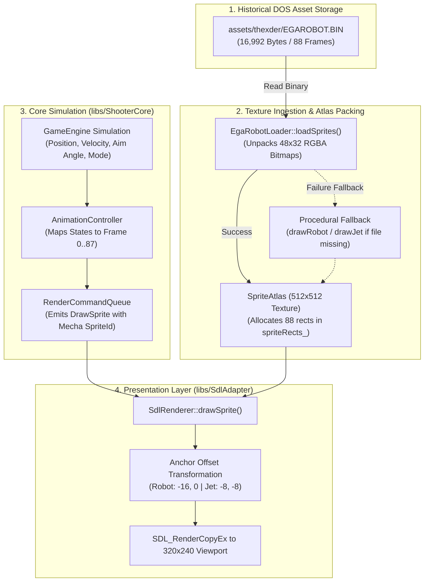

# Phase 18: Authentic EGA Mecha Sprite Atlas & Directional Animation Integration Plan

## 1. Executive Summary & Architectural Scope

Phase 18 completes the player mecha rendering migration initiated in [Phase 15](phase15_plan.md). While Phase 15 established and verified the offline binary decoder [[libs/SdlAdapter/EgaRobotLoader.cpp](../libs/SdlAdapter/EgaRobotLoader.cpp)], the active in-game renderer continues to draw synthetic geometric approximations (`drawRobot()`, `drawJet()`) defined in [[libs/SdlAdapter/SpriteAtlas.cpp](../libs/SdlAdapter/SpriteAtlas.cpp)].

Phase 18 replaces all procedural mecha drawing with authentic, historical 88-frame assets extracted from `assets/thexder/EGAROBOT.BIN`. It solves texture capacity constraints, integrates visual anchor offsetting to preserve tight tunnel collision hitboxes, and connects the core simulation state machine to full 8-way directional aiming and flight animations.

```
+-------------------------------------------------------------------------------+
|                       PHASE 18 CORE DELIVERABLES OVERVIEW                     |
|                                                                               |
|   1. 512x512 Sprite Atlas Surface Expansion (libs/SdlAdapter/SpriteAtlas):     |
|      • Expand texture dimensions from 256x256 (65,536 px) to 512x512 (262,144)|
|      • Sufficient VRAM budget to house all 88 frames of 48x32 px (135,168 px) |
|      • Dynamic blitting of decoded RGBA mecha frames into dedicated atlas bank|
|                                                                               |
|   2. Runtime Ingestion & Procedural Deprecation:                              |
|      • Wire EgaRobotLoader::loadSprites directly into SpriteAtlas::init()     |
|      • Automated graceful fallback to procedural graphics if asset missing    |
|      • Unit test verification under tests/SdlAdapterTests                     |
|                                                                               |
|   3. Visual Anchor Offsetting (libs/SdlAdapter/SdlRenderer):                  |
|      • Decouple 48x32 px visual sprite frame from physical swept hitboxes     |
|      • Robot Mode: Draw offset (-16 px, 0 px) centering on 16x32 px hitbox    |
|      • Jet Mode: Draw offset (-8 px, -8 px) centering on 32x16 px flight box  |
|                                                                               |
|   4. 88-Frame Directional Animation Controller (libs/ShooterCore):            |
|      • Stride Walk Cycle: Frames 0..7 (Right) and 8..15 (Left)                |
|      • 8-Way Laser Aim: Frames 16..23 (Right) and 24..31 (Left)               |
|      • Tunnel Crouch: Frames 32..39 low-profile crawl stance                  |
|      • Morph Metamorphosis: Frames 40..55 multi-step transformation           |
|      • 8-Heading Jet Flight: Frames 56..71 driven by velocity vector (vx, vy) |
|      • Thruster Flare & Shield Flashes: Frames 72..79 and 80..87              |
+-------------------------------------------------------------------------------+
```

---

## 2. Technical Architecture & Data Flow

### 2.1 ASCII Pipeline: Authentic EGA Mecha Integration Flow

```
+---------------------------------------------------------------------------------------------------+
|                           PHASE 18 ENGINE ARCHITECTURE & DATA FLOW                                |
|                                                                                                   |
|   [assets/thexder/EGAROBOT.BIN] (16,992 Bytes, 88 Frames @ 48x32)                                 |
|         │                                                                                         |
|         ▼                                                                                         |
|   [EgaRobotLoader] (libs/SdlAdapter/EgaRobotLoader.cpp)                                           |
|         • Decode 6 bytes/row x 32 rows per frame into RGBA32 format                               |
|         • Extract all 88 animation frames with alpha transparency                                 |
|         │                                                                                         |
|         ▼ (Ingestion during SpriteAtlas::init)                                                    |
|   [SpriteAtlas] (libs/SdlAdapter/SpriteAtlas.cpp - 512x512 Canvas)                                |
|         ├─► [Tileset Region: 0..255, 0..127] (EGABIT01.BIN 16x16 tiles)                          |
|         ├─► [Enemy Sprites: 0..255, 128..255] (Bugs, amoebas, crawlers)                          |
|         └─► [Mecha Bank: 0..511, 256..511] (88 authentic 48x32 frames)                            |
|                 │                                                                                 |
|                 ▼                                                                                 |
|   [AnimationController] (libs/ShooterCore/AnimationController.cpp)                                |
|         • Inputs: Velocity (vx, vy), FacingDirection, Laser Aim Angle, Crouch, Mode               |
|         • Output: Authentic Mecha Frame Index (0..87)                                             |
|                 │                                                                                 |
|                 ▼                                                                                 |
|   [SdlRenderer] (libs/SdlAdapter/SdlRenderer.cpp)                                                 |
|         • Query source rect from SpriteAtlas using Frame Index                                    |
|         • Apply visual anchor offset:                                                             |
|             Robot: DstX = PosX - 16, DstY = PosY                                                  |
|             Jet:   DstX = PosX - 8,  DstY = PosY - 8                                              |
|         • SDL_RenderCopyEx with sub-pixel preservation                                            |
+---------------------------------------------------------------------------------------------------+
```

### 2.2 Mermaid Pipeline: Frame Ingestion & Rendering Pipeline



---

## 3. Subsystem Implementation Specifications

### 3.1 512x512 SpriteAtlas Surface Expansion (`libs/SdlAdapter/SpriteAtlas`)

The sprite atlas surface must be enlarged to host the entire 88-frame mecha sheet without sacrificing existing tilemap and entity sprite allocations.

* **Surface Budgeting:**
  * Width: $512\text{ px}$, Height: $512\text{ px}$ (Total pixels: $262,144$).
  * Bytes per pixel: $4$ ($32$-bit RGBA).
  * In-memory footprint: $1.0\text{ MB}$ VRAM / RAM buffer.
* **Atlas Partitioning Map:**
  * `Y: 0 .. 127`: World 1 & 2 tilemaps ($16 \times 16$ px tiles from `EGABIT01.BIN`).
  * `Y: 128 .. 255`: Enemy bug sprites, nests, canisters, and projectile burst effects.
  * `Y: 256 .. 511`: Authentic 48x32 mecha bank ($10 \text{ columns} \times 9 \text{ rows} = 90$ frame slots of $48 \times 32$ px).
* **Graceful Degradation:**
  * In `SpriteAtlas::init()`, `EgaRobotLoader::loadSprites("assets/thexder/EGAROBOT.BIN", ...)` is called first.
  * If the file is successfully read, authentic frames are copied into the mecha partition.
  * If the file cannot be opened (headless tests, minimal build distributions), the procedural generator runs and populates placeholder slots.

### 3.2 Visual Anchor Offsetting (`libs/SdlAdapter/SdlRenderer`)

To maintain authentic 1-tile labyrinth clearance while displaying 48x32 mecha sprites, collision hitboxes and visual draw rectangles are strictly separated:

```
+-------------------------------------------------------------------------------+
|                       VISUAL ANCHOR OFFSET GEOMETRY                           |
|                                                                               |
|   ROBOT STANCE (16x32 Hitbox, 48x32 Visual Sprite):                           |
|                                                                               |
|   (PosX - 16, PosY)                                    (PosX + 32, PosY)      |
|   +-------------------+-------------------------------+-------------------+   |
|   |   Left Arm/Laser  |    COLLISION HITBOX (16x32)   |   Right Weapon    |   |
|   |   (Visual Only)   |    X: PosX .. PosX + 16       |   (Visual Only)   |   |
|   |                   |    Y: PosY .. PosY + 32       |                   |   |
|   +-------------------+-------------------------------+-------------------+   |
|                                                                               |
|   JET FLIGHT (32x16 Hitbox, 48x32 Visual Sprite):                             |
|                                                                               |
|   (PosX - 8, PosY - 8)                                 (PosX + 40, PosY - 8)  |
|   +-----------------------------------------------------------------------+   |
|   |   Top Fin / Wingtip (Visual Only, Y: PosY - 8 .. PosY)                |   |
|   |   +---------------------------------------------------------------+   |   |
|   |   |    JET COLLISION HITBOX (32x16 Tunnel Clearance)              |   |   |
|   |   |    X: PosX .. PosX + 32, Y: PosY .. PosY + 16                 |   |   |
|   |   +---------------------------------------------------------------+   |   |
|   |   Lower Fin / Engine Exhaust (Visual Only, Y: PosY + 16 .. PosY + 24) |   |   |
|   +-----------------------------------------------------------------------+   |
+-------------------------------------------------------------------------------+
```

* **Robot Draw Anchor:**
  $$\text{DrawX} = \text{WorldX} - 16.0f, \quad \text{DrawY} = \text{WorldY}$$
* **Jet Draw Anchor:**
  $$\text{DrawX} = \text{WorldX} - 8.0f, \quad \text{DrawY} = \text{WorldY} - 8.0f$$

### 3.3 88-Frame State Mapping (`libs/ShooterCore/AnimationController`)

The animation state machine is expanded to index the full historical sprite matrix:

| State | Frame Range | Trigger Condition |
| :--- | :--- | :--- |
| **Walk Right** | `0 .. 7` | Robot mode, $v_x > 0$, on ground. Cycles at 15 Hz. |
| **Walk Left** | `8 .. 15` | Robot mode, $v_x < 0$, on ground. Cycles at 15 Hz. |
| **Aim Right** | `16 .. 23` | Robot mode, laser active, facing right. Indexed by aim elevation ($-\pi/2 \to \pi/2$). |
| **Aim Left** | `24 .. 31` | Robot mode, laser active, facing left. Indexed by aim elevation. |
| **Crouch** | `32 .. 39` | Robot mode, down key pressed, low-profile squat. |
| **Morph** | `40 .. 55` | Transition between Robot and Jet modes. Progressive 16-frame folding cycle. |
| **Jet Flight** | `56 .. 71` | Jet mode. 8 cardinal/diagonal headings quantized from $(\text{atan2}(v_y, v_x))$. |
| **Thruster Flare** | `72 .. 79` | Jet mode with active acceleration thrust. Cycles exhaust plumes. |
| **Shield Flash** | `80 .. 87` | Shield barrier active or damage deflection tick. |

---

## 4. Implementation Steps & Work Breakdown

```
+-------------------------------------------------------------------------------+
|                       PHASE 18 STEP-BY-STEP WORK BREAKDOWN                    |
|                                                                               |
|   Step 1: SpriteAtlas Texture Resizing & Allocation                           |
|           • Expand kAtlasWidth and kAtlasHeight to 512 px in SpriteAtlas.h     |
|           • Update source rectangle lookup tables in SpriteAtlas.cpp          |
|           • Verify zero memory leaks or allocation failures                   |
|                                                                               |
|   Step 2: Runtime Ingestion Pipeline Integration                              |
|           • Wire EgaRobotLoader::loadSprites() into SpriteAtlas::init()       |
|           • Implement color-key alpha masking for authentic EGA palette       |
|           • Add fallback safeguard for headless test configurations           |
|                                                                               |
|   Step 3: Anchor Offsetting in SdlRenderer                                    |
|           • Update SdlRenderer::drawSprite() with mecha offset logic          |
|           • Verify 1-tile tight tunnel navigation without wall clipping       |
|                                                                               |
|   Step 4: AnimationController 88-Frame Mapping                                |
|           • Expand SpriteId enumeration in Types.h with full mecha frames     |
|           • Implement 8-way directional aiming and 8-way jet flight indexing  |
|           • Unit test verification under tests/ShooterCoreTests               |
|                                                                               |
|   Step 5: Visual Verification & clang-format Audit                            |
|           • Verify zero style discrepancies via clang-format                  |
|           • Run full CTest suite to verify 100% pass                          |
+-------------------------------------------------------------------------------+
```

---

## 5. Verification Checklist & Safety Standards

Before completing Phase 18 implementation, verify against the repository safety standards:
- [ ] **IWYU & `<cstdint>`:** Explicit direct inclusion of `<cstdint>` and `<cstddef>` across all modified files.
- [ ] **Domain Modeling:** Zero primitive obsession; all frame indexing and offsets strongly typed (`MISRA C++:2023 Rule 7.0.6`).
- [ ] **Zero Dynamic Allocation:** `AnimationController` and `SdlRenderer` offset routines marked `noexcept` with zero heap allocation (`CERT ERR55-CPP`).
- [ ] **Formatting:** All modified source and header files formatted in-place with `clang-format -i` and passing `verify_clang_format.py`.
- [ ] **Test Coverage:** Automated unit tests covering all 88 frame selections, bounds clamping, and anchor offsets passing under `ctest`.

