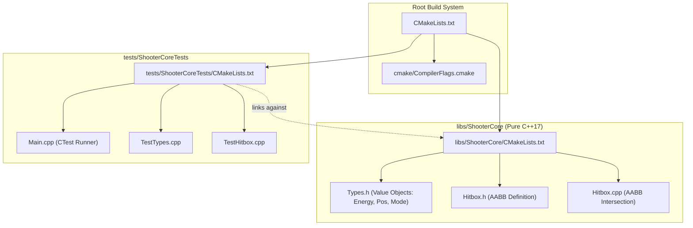

# Phase 1: Build Structure & Root CMakeLists.txt Implementation Plan

## 1. Overview & Objectives

Phase 1 establishes the build infrastructure and foundational domain types for the Shoot'Em-Up Game Engine:
1. **Modular CMake Build System**:
   - Modern CMake configuration supporting cross-platform compilation on both **Linux** (GCC, Clang) and **Windows** (MSVC, Clang-CL).
   - Strict compiler hardening flags: `-Wall -Wextra -pedantic -Werror`, `/W4` on MSVC, `-Wconversion`, `-fstack-protector-strong`.
2. **Core Domain Types (`libs/ShooterCore/Types.h`)**:
   - Zero-cost, strongly-typed C++17 value objects eliminating Primitive Obsession.
   - Invariant validation upon construction, explicit `<cstdint>` and `<cstddef>` inclusion, strict `std::` prefixing, and zero dynamic heap allocations (`CERT ERR55-CPP`).
3. **Hitbox Geometry (`libs/ShooterCore/Hitbox.{h,cpp}`)**:
   - Co-located AABB intersection and containment calculation on `WorldPos`.
4. **Hardware-Free Unit Test Seam (`tests/ShooterCoreTests`)**:
   - Deterministic test harness running under CTest validating domain invariants and geometry calculations.

---

## 2. Architecture & File Layout

### ASCII File Layout Diagram
```
+-------------------------------------------------------------------------------+
|                       PHASE 1 DIRECTORY & ARTIFACT LAYOUT                     |
|                                                                               |
|   shoot-em-up-engine.git/                                                     |
|   ├── CMakeLists.txt                       <-- Top-level project configuration|
|   ├── cmake/                                                                  |
|   │   └── CompilerFlags.cmake              <-- -Werror, /W4, hardening flags  |
|   ├── libs/                                                                   |
|   │   └── ShooterCore/                     <-- Pure C++17 Core Engine (Tier 1)|
|   │       ├── CMakeLists.txt               <-- Core library target            |
|   │       ├── Types.h                      <-- Strong value objects           |
|   │       ├── Hitbox.h                     <-- AABB boundary declarations     |
|   │       └── Hitbox.cpp                   <-- AABB intersection logic        |
|   └── tests/                                                                  |
|       └── ShooterCoreTests/                <-- Headless CTest Suite           |
|           ├── CMakeLists.txt               <-- Test runner target             |
|           ├── Main.cpp                     <-- Deterministic runner entry     |
|           ├── TestTypes.cpp                <-- Invariant & clamp tests        |
|           └── TestHitbox.cpp               <-- AABB collision tests           |
+-------------------------------------------------------------------------------+
```

### Mermaid Architecture Diagram


---

## 3. Detailed Specifications

### 3.1 `cmake/CompilerFlags.cmake`
- Exposes `apply_compiler_flags(TARGET_NAME)`
- **MSVC (`cl.exe` / `clang-cl`)**:
  - Compiler: `/W4`, `/WX` (warnings as errors), `/permissive-`, `/EHsc`, `/sdl` (Security Development Lifecycle checks), `/guard:cf` (Control Flow Guard), `/utf-8`, `/GS` (buffer security check).
  - Strict type conversions: `/w14242`, `/w14254`, `/w14263`, `/w14265`, `/w14287`, `/we4289`, `/w14296`, `/w14311`, `/w14545`, `/w14546`, `/w14547`, `/w14549`, `/w14555`, `/w14826`, `/w14905`, `/w14906`, `/w14928`.
  - Linker: `/WX` (linker warnings as errors), `/GUARD:CF`, `/DYNAMICBASE`, `/HIGHENTROPYVA`, `/NXCOMPAT` (Data Execution Prevention).
  - Definitions: `_CRT_SECURE_NO_WARNINGS=0`.
- **GCC / Clang**:
  - Compiler: `-Wall`, `-Wextra`, `-pedantic`, `-pedantic-errors`, `-Werror` (warnings as errors).
  - Strict diagnostics: `-Wconversion`, `-Wsign-conversion`, `-Wshadow`, `-Wnon-virtual-dtor`, `-Wold-style-cast`, `-Wcast-align`, `-Wunused`, `-Woverloaded-virtual`, `-Wnull-dereference`, `-Wdouble-promotion`, `-Wformat=2`, `-Wimplicit-fallthrough`.
  - Platform Linker Hardening:
    - Windows PE/COFF: `LINKER:/WX`, `LINKER:/GUARD:CF`, `LINKER:/DYNAMICBASE`, `LINKER:/HIGHENTROPYVA`, `LINKER:/NXCOMPAT` (or `--fatal-warnings`, `--dynamicbase`, `--nxcompat`, `--high-entropy-va` on GNU ld).
    - Linux / POSIX ELF: `-fstack-protector-strong`, `-fPIE`, `LINKER:--fatal-warnings`, `LINKER:-z,relro`, `LINKER:-z,now`, `LINKER:-z,noexecstack`, `-pie`, `_GLIBCXX_ASSERTIONS`, `_FORTIFY_SOURCE=2`.

### 3.2 `libs/ShooterCore/Types.h`
Value types to implement:
- `TransformMode`: `enum class TransformMode : std::uint8_t { Robot, Jet, TransformingToRobot, TransformingToJet };`
- `EnergyPoints`:
  - Enforces range $[0, 100]$ (or powerup ceiling).
  - Explicit constructors: `explicit constexpr EnergyPoints(std::uint16_t val) noexcept;`
  - Zero-heap arithmetic: `deduct(EnergyPoints cost) noexcept`, `replenish(EnergyPoints gain) noexcept`.
- `ShieldGauge`:
  - Enforces range $[0, 100]\%$.
  - `[[nodiscard]] constexpr bool isActive() const noexcept;`
- `WorldPos`:
  - `float x{0.0f}`, `float y{0.0f}`
  - Conversions to `TileCoord` using integer tile dimensions.
- `TileCoord`:
  - `std::uint32_t col{0}`, `std::uint32_t row{0}`
- `Velocity`:
  - `float dx{0.0f}`, `float dy{0.0f}`
- `DamageValue`:
  - `explicit constexpr DamageValue(std::uint16_t dmg) noexcept;`

### 3.3 `libs/ShooterCore/Hitbox.{h,cpp}`
- Represents an Axis-Aligned Bounding Box (AABB):
  - `WorldPos min{0.0f, 0.0f};`
  - `WorldPos max{0.0f, 0.0f};`
- Invariant: $max.x \ge min.x$ and $max.y \ge min.y$.
- Methods:
  - `[[nodiscard]] constexpr float width() const noexcept;`
  - `[[nodiscard]] constexpr float height() const noexcept;`
  - `[[nodiscard]] bool intersects(const Hitbox& other) const noexcept;`
  - `[[nodiscard]] bool contains(const WorldPos& point) const noexcept;`

### 3.4 `tests/ShooterCoreTests`
- Smoke test verifying:
  - `EnergyPoints` clamping invariant at 0 and 100.
  - `EnergyPoints` deduction refusing underflow.
  - `Hitbox` intersection, separation, and edge-touching behavior.
  - Coordinate mapping from `WorldPos` to `TileCoord`.

---

## 4. Execution Steps & Verification Checklist

1. **Step 1: Write `cmake/CompilerFlags.cmake` and root `CMakeLists.txt`**.
2. **Step 2: Implement `libs/ShooterCore/CMakeLists.txt`**.
3. **Step 3: Implement `libs/ShooterCore/Types.h` and `libs/ShooterCore/Hitbox.{h,cpp}`**.
4. **Step 4: Implement `tests/ShooterCoreTests/CMakeLists.txt` and unit test files**.
5. **Step 5: Run IWYU static analysis**:
   ```bash
   python .agents/skills/iwyu-cstdint/scripts/verify_iwyu_cstdint.py --strict
   ```
6. **Step 6: Build and execute CTest suite**:
   ```bash
   cmake -B build -S .
   cmake --build build --config Debug
   ctest --test-dir build --output-on-failure
   ```

