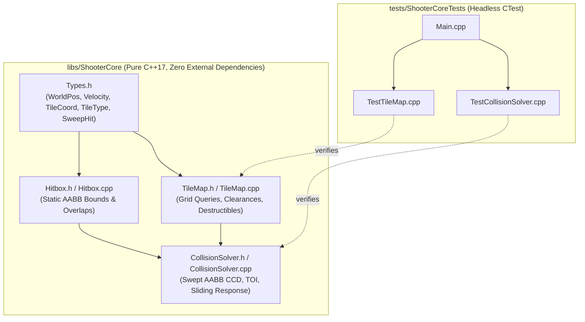
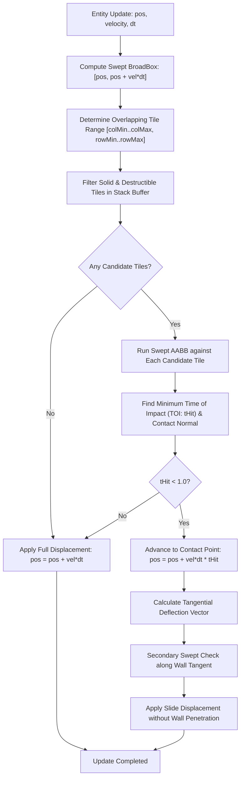
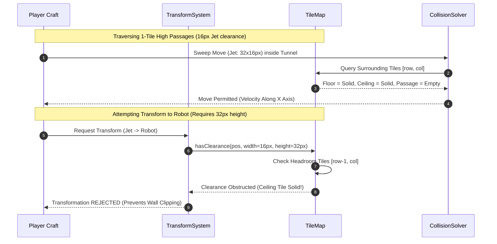

# Phase 2: TileMap & Collision Solver (TileMap.h, Swept AABB Physics) Implementation Plan

## 1. Executive Summary & Scope

Phase 2 implements the core spatial environment and physics resolution engine for the Shoot'Em-Up Game Engine in `libs/ShooterCore`:
1. **Labyrinthine Grid Storage (`TileMap.h`, `TileMap.cpp`)**:
   - Deterministic 2D tile grid representing solid walls, destructible barrier blocks, hazard zones, and traversable open corridors.
   - Safe out-of-bounds querying, discrete coordinate clipping, and zero-allocation tile query interfaces.
   - Destructible block state tracking and health degradation upon projectile impact.
   - Geometric headroom and clearance verification for player state transitions (1-tile Jet tunnels vs. 2-tile Robot chambers).
2. **Continuous Collision Detection & Solver (`CollisionSolver.h`, `CollisionSolver.cpp`)**:
   - Continuous Collision Detection (CCD) via **Swept AABB** physics against static tile geometries.
   - Mathematical prevention of high-speed tunneling through thin 1-tile walls at high velocities ($> 16\text{ px/tick}$).
   - Contact normal calculation and tangential velocity projection for smooth **corner sliding** along labyrinth corridors.
   - Zero dynamic heap allocations during simulation queries (`SEI CERT ERR55-CPP`).
   - Fully compliant with **MISRA C++:2023** and **SEI CERT C++** standards.
3. **Headless Verification Suite (`tests/ShooterCoreTests`)**:
   - Comprehensive unit tests verifying swept intersection accuracy, tunnel traversal clearances, corner sliding responses, and destructible block degradation.

---

## 2. Architecture & File Layout

All components reside within the pure C++17 core library (`libs/ShooterCore`) with zero external dependencies, accompanied by headless tests in `tests/ShooterCoreTests`.

### 2.1 ASCII File Layout Diagram
```
+-------------------------------------------------------------------------------+
|                       PHASE 2 DIRECTORY & ARTIFACT LAYOUT                     |
|                                                                               |
|   shoot-em-up-engine.git/                                                     |
|   ├── CMakeLists.txt                                                          |
|   ├── cmake/                                                                  |
|   │   ├── CompilerFlags.cmake              <-- Strict flags & hardening       |
|   │   └── GitHooks.cmake                   <-- Clang-format pre-commit hook   |
|   ├── docs/                                                                   |
|   │   ├── implementation_plan.md           <-- Master roadmap                 |
|   │   ├── phase1_plan.md                   <-- Phase 1 baseline specification |
|   │   └── phase2_plan.md                   <-- This document                  |
|   ├── libs/                                                                   |
|   │   └── ShooterCore/                     <-- Pure C++17 Tier 1 Core Engine  |
|   │       ├── CMakeLists.txt                                                  |
|   │       ├── Types.h                      <-- Extended with Tile/Sweep types |
|   │       ├── Hitbox.h / .cpp              <-- AABB geometry & intersection   |
|   │       ├── TileMap.h / .cpp             <-- 2D grid & clearance queries   |
|   │       └── CollisionSolver.h / .cpp     <-- Swept AABB & corner sliding    |
|   └── tests/                                                                  |
|       └── ShooterCoreTests/                <-- Headless CTest Suite           |
|           ├── CMakeLists.txt                                                  |
|           ├── Main.cpp                     <-- Test runner entry point        |
|           ├── TestTypes.cpp                <-- Invariant & arithmetic tests   |
|           ├── TestHitbox.cpp               <-- AABB static intersection tests |
|           ├── TestTileMap.cpp              <-- Tile queries & destructibles   |
|           └── TestCollisionSolver.cpp      <-- Swept AABB & sliding physics   |
+-------------------------------------------------------------------------------+
```

### 2.2 Mermaid Architecture Diagram


---

## 3. Mathematical & Algorithmic Foundation

### 3.1 Discrete vs. Continuous (Swept) Collision Detection
Discrete collision checks evaluate box overlap at discrete time snapshots $t_0$ and $t_1 = t_0 + \Delta t$. If an entity moves with high velocity $\vec{v}$ through a thin obstacle of width $W_{\text{wall}}$ such that:
$$|\vec{v} \cdot \Delta t| > W_{\text{wall}}$$
the entity steps completely across the wall in a single simulation tick without ever triggering an overlap, resulting in **tunneling** (wall clipping).

Continuous Collision Detection (CCD) calculates the continuous trajectory swept by the moving AABB over the normalized interval $t \in [0, 1]$ and determines the exact **Time of Impact (TOI)** $t_{\text{hit}}$ and **Contact Normal** $\hat{n}$.

### 3.2 Minkowski Sum / Raycast Formulation
Sweeping an AABB box $B$ with dimensions $(W_B, H_B)$ against a static tile $T$ with bounds $[T_{\min}, T_{\max}]$ is mathematically equivalent to expanding tile $T$ by the moving box's extents:
$$T_{\text{expanded}} = \left[ T_{\min} - \begin{pmatrix} W_B \\ H_B \end{pmatrix}, T_{\max} \right]$$
and performing a raycast from origin $P_0 = B_{\min}$ along displacement vector $\vec{d} = \vec{v} \cdot \Delta t$.

For each coordinate axis $k \in \{x, y\}$:
$$t_{\text{entry}, k} = \begin{cases}
\dfrac{T_{\text{expanded},\min, k} - P_{0, k}}{d_k} & \text{if } d_k > 0 \\
\dfrac{T_{\text{expanded},\max, k} - P_{0, k}}{d_k} & \text{if } d_k < 0 \\
-\infty & \text{if } d_k = 0 \text{ and } P_0 \text{ inside bounds} \\
+\infty & \text{if } d_k = 0 \text{ and } P_0 \text{ outside bounds}
\end{cases}$$

$$t_{\text{exit}, k} = \begin{cases}
\dfrac{T_{\text{expanded},\max, k} - P_{0, k}}{d_k} & \text{if } d_k > 0 \\
\dfrac{T_{\text{expanded},\min, k} - P_{0, k}}{d_k} & \text{if } d_k < 0 \\
+\infty & \text{if } d_k = 0
\end{cases}$$

The overall collision interval is:
$$t_{\text{entry}} = \max(t_{\text{entry}, x}, t_{\text{entry}, y})$$
$$t_{\text{exit}} = \min(t_{\text{exit}, x}, t_{\text{exit}, y})$$

A valid collision occurs if and only if:
$$t_{\text{entry}} < t_{\text{exit}} \quad \text{and} \quad t_{\text{entry}, x} < 1.0 \quad \text{and} \quad t_{\text{entry}, y} < 1.0 \quad \text{and} \quad t_{\text{entry}} \ge 0.0$$

The contact surface normal $\hat{n}$ corresponds to the axis with the latest entry time:
$$\hat{n} = \begin{cases}
\begin{pmatrix} -\operatorname{sgn}(d_x), & 0 \end{pmatrix}^T & \text{if } t_{\text{entry}, x} > t_{\text{entry}, y} \\
\begin{pmatrix} 0, & -\operatorname{sgn}(d_y) \end{pmatrix}^T & \text{if } t_{\text{entry}, y} > t_{\text{entry}, x}
\end{cases}$$

### 3.3 Broadphase Spatial Partitioning (Zero-Heap Tile Clamping)
To avoid testing every tile in the map, a broadphase AABB bounding box encloses the sweep from $P_0$ to $P_0 + \vec{d}$:
$$\text{BroadBox} = \left[ \min(B_{\min}, B_{\min} + \vec{d}), \max(B_{\max}, B_{\max} + \vec{d}) \right]$$

The discrete range of overlapping tile columns and rows is:
$$\text{col}_{\min} = \text{clamp}\left( \left\lfloor \frac{\text{BroadBox}.\min.x}{\text{TileSize}} \right\rfloor, 0, \text{MapWidth} - 1 \right)$$
$$\text{col}_{\max} = \text{clamp}\left( \left\lfloor \frac{\text{BroadBox}.\max.x}{\text{TileSize}} \right\rfloor, 0, \text{MapWidth} - 1 \right)$$
$$\text{row}_{\min} = \text{clamp}\left( \left\lfloor \frac{\text{BroadBox}.\min.y}{\text{TileSize}} \right\rfloor, 0, \text{MapHeight} - 1 \right)$$
$$\text{row}_{\max} = \text{clamp}\left( \left\lfloor \frac{\text{BroadBox}.\max.y}{\text{TileSize}} \right\rfloor, 0, \text{MapHeight} - 1 \right)$$

Iterating over this bounded grid requires **zero heap allocation** (`CERT ERR55-CPP`), operating within fixed stack variables.

### 3.4 Corner Sliding & Deflection
When an entity impacts an obstacle obliquely, rather than halting all motion, remaining movement is deflected along the surface tangent plane:
$$\vec{d}_{\text{remaining}} = (1.0 - t_{\text{hit}}) \cdot \left( \vec{d} - (\vec{d} \cdot \hat{n})\hat{n} \right)$$
A secondary sweep resolves the remaining tangential motion, allowing the player to glide smoothly into 1-tile tunnels and around corridor corners without catching on block edges.

---

## 4. Visual Diagrams

### 4.1 ASCII Minkowski Swept AABB & Sliding Diagram
```
+-------------------------------------------------------------------------------+
|                      SWEPT AABB & CORNER SLIDING MECHANICS                    |
|                                                                               |
|   1. Swept Path & Minkowski Expansion:                                        |
|   P0 [Box] ─────── Velocity Vector ───────> [Target Wall Tile]                |
|      │                                               │                        |
|      ▼ (Minkowski Expands Wall by Half-Extents)      ▼                        |
|   P0 ──────────── Raycast ────────────> [ Expanded Hitbox ]                   |
|                                         ^ Impact at t = 0.65                  |
|                                         Normal = (-1.0, 0.0)                  |
|                                                                               |
|   2. Tangential Corner Slide into 1-Tile Tunnel:                              |
|   ############################################ (Ceiling Wall)                 |
|            ↗ (Diagonal move)   ==================================             |
|   [Jet] ──/───> Hits Ceiling -> Slides Right Along Tangent Vector             |
|   ######################       ==================================             |
|                        #       #                                              |
|                        #       # (1-Tile High Tunnel Clearance = 16px)        |
+-------------------------------------------------------------------------------+
```

### 4.2 Mermaid Collision Resolution Pipeline


### 4.3 Mermaid 1-Tile Tunnel Clearance Verification


---

## 5. Subsystem & Component Specifications

### 5.1 Value Types (`libs/ShooterCore/Types.h`)
Extending domain models with type safety:
- `TileType`:
  ```cpp
  enum class TileType : std::uint8_t {
      Empty = 0U,
      SolidWall = 1U,
      DestructibleWall = 2U,
      Hazard = 3U
  };
  ```
- `TileHealth`:
  - Strongly-typed health representation for destructible barriers (e.g. range $[0, 3]$ hits).
- `ContactNormal`:
  ```cpp
  enum class ContactNormal : std::uint8_t {
      None = 0U,
      Left = 1U,   // Impacted right face of entity, normal points left (-1, 0)
      Right = 2U,  // Impacted left face of entity, normal points right (+1, 0)
      Up = 3U,     // Impacted bottom face of entity, normal points up (0, -1)
      Down = 4U    // Impacted top face of entity, normal points down (0, +1)
  };
  ```
- `SweepHit`:
  ```cpp
  struct SweepHit final {
      bool collided{false};
      float toi{1.0f};                          // Time of Impact in [0.0, 1.0]
      ContactNormal normal{ContactNormal::None}; // Surface normal
      TileCoord hitTile{0U, 0U};                // Coordinates of impacted tile
      TileType tileType{TileType::Empty};       // Material type of impacted tile
  };
  ```

### 5.2 Labyrinth Tile Grid (`libs/ShooterCore/TileMap.h` / `.cpp`)
- **Memory & Allocation Strategy**:
  - Zero heap allocation during gameplay frame updates (`CERT ERR55-CPP`).
  - Pre-allocated flat buffer up to maximum level dimensions (e.g. `kMaxCols = 256U`, `kMaxRows = 128U`) or dynamically sized once during level load.
- **Key Method Signatures (All < 30 Characters)**:
  - `[[nodiscard]] std::uint32_t width() const noexcept`
  - `[[nodiscard]] std::uint32_t height() const noexcept`
  - `[[nodiscard]] float tileSize() const noexcept`
  - `[[nodiscard]] TileType getTile(TileCoord coord) const noexcept`
  - `[[nodiscard]] bool isSolid(TileCoord coord) const noexcept`
  - `[[nodiscard]] bool isDestructible(TileCoord coord) const noexcept`
  - `[[nodiscard]] bool isHazard(TileCoord coord) const noexcept`
  - `void setTile(TileCoord coord, TileType type) noexcept`
  - `bool damageTile(TileCoord coord) noexcept`
  - `bool destroyTile(TileCoord coord) noexcept`
  - `[[nodiscard]] bool hasClearance(const Hitbox& box) const noexcept`
  - `[[nodiscard]] Hitbox getTileBox(TileCoord coord) const noexcept`

### 5.3 Swept Physics & Collision Solver (`libs/ShooterCore/CollisionSolver.h` / `.cpp`)
- **Key Method Signatures (All < 30 Characters)**:
  - `[[nodiscard]] SweepHit sweepBox(const Hitbox& box, Velocity vel, float dt, const Hitbox& obstacle) noexcept`
  - `[[nodiscard]] SweepHit sweepMap(const Hitbox& box, Velocity vel, float dt, const TileMap& map) noexcept`
  - `[[nodiscard]] WorldPos resolveMove(const Hitbox& box, Velocity vel, float dt, const TileMap& map) noexcept`
  - `[[nodiscard]] bool checkOverlap(const Hitbox& box, const TileMap& map) noexcept`
  - `[[nodiscard]] bool raycast(WorldPos start, WorldPos end, const TileMap& map, WorldPos& outHit) noexcept`

---

## 6. Pre-Commit Hook Configuration in CMake

To enforce code formatting standards continuously, CMake integrates a Git pre-commit hook targeting `clang-format`.

### 6.1 Integration Architecture
1. **Module `cmake/GitHooks.cmake`**:
   - Detects `clang-format` on system path.
   - Provides CMake targets:
     - `cmake --build <dir> --target format`: Formats all C++ source and header files in-place.
     - `cmake --build <dir> --target check-format`: Checks repository formatting without altering files.
   - Configures `cmake/git-hooks/pre-commit.in` to `.git/hooks/pre-commit` with strict `LF` line endings (`configure_file(... NEWLINE_STYLE LF)`).
2. **Hook Execution (`.git/hooks/pre-commit`)**:
   - Inspects staged C/C++ files (`git diff --cached --name-only --diff-filter=ACMR`).
   - Runs `clang-format --dry-run --Werror "$FILE"`.
   - Halts commit (`exit 1`) and prints diagnostic instructions if formatting violations exist.

---

## 7. Comprehensive Unit Test Specifications (`tests/ShooterCoreTests`)

### 7.1 `TestTileMap.cpp`
- **Bounds Checking**:
  - Out-of-bounds `TileCoord` returns `TileType::SolidWall` (perimeter boundary enforcement).
  - Valid coordinates return configured tile type.
- **Destructible Blocks**:
  - `damageTile()` reduces durability; once health reaches 0, tile converts to `TileType::Empty`.
  - `destroyTile()` immediately transitions solid destructible block to `TileType::Empty`.
- **Clearance Queries**:
  - `hasClearance()` returns `true` when tested in open space.
  - `hasClearance()` returns `false` if any overlapping tile is `SolidWall` or `DestructibleWall`.
  - Tests 1-tile height ($16\text{px}$) clearance in a narrow tunnel.
  - Tests 2-tile height ($32\text{px}$) rejection when ceiling tile is obstructed.

### 7.2 `TestCollisionSolver.cpp`
- **High-Velocity Tunneling Prevention**:
  - Box at $x = 0$ moving at $1000\text{ px/s}$ with $\Delta t = 0.05\text{ s}$ ($\Delta x = 50\text{ px}$) against a 1-tile wall at $x = 16$.
  - Asserts collision detected ($collided == \text{true}$), $\text{TOI} \in (0.0, 1.0)$, and position halts in front of wall without crossing.
- **Surface Normal Direction**:
  - Moving right $\rightarrow$ Normal is `ContactNormal::Left` ($(-1, 0)$).
  - Moving left $\rightarrow$ Normal is `ContactNormal::Right` ($(+1, 0)$).
  - Falling down $\rightarrow$ Normal is `ContactNormal::Up` ($(0, -1)$).
  - Jumping up $\rightarrow$ Normal is `ContactNormal::Down` ($(0, +1)$).
- **Corner Sliding**:
  - Moving diagonally into a horizontal floor ($\vec{v} = (100, 100)$).
  - Verifies horizontal velocity is preserved while vertical penetration is canceled ($\Delta x > 0$, $\Delta y = 0$).
- **Multi-Tile Broadphase Handling**:
  - Verifies collision correctly identifies the nearest tile when multiple tiles are within the swept trajectory.

---

## 8. Verification & Compliance Checklist

Before completing Phase 2 implementation, verify:
- [ ] Explicit `<cstdint>` and `<cstddef>` with strict `std::` namespace qualification across all files (`SEI CERT INT31-C`, `MISRA C++:2023`).
- [ ] Zero dynamic heap allocations in simulation, tile query, and collision routines (`CERT ERR55-CPP`).
- [ ] All public member functions have concise names strictly less than 30 characters.
- [ ] Variables explicitly initialized using `{}`.
- [ ] Functions returning status or computed values marked `[[nodiscard]]`.
- [ ] Full Doxygen docstrings on all interfaces (`/// @brief`, `@param`, `@return`).
- [ ] Static analysis passes: `python .agents/skills/iwyu-cstdint/scripts/verify_iwyu_cstdint.py --strict`.
- [ ] Code formatting passes: `cmake --build build --target check-format`.
- [ ] Pre-commit hook verified: blocks unformatted commits and permits compliant code.
- [ ] 100% test pass rate under CTest: `ctest --test-dir build --output-on-failure`.

