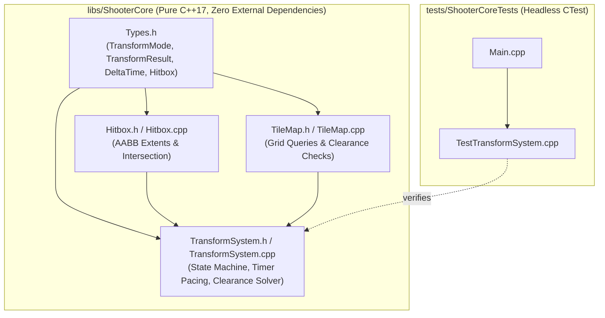
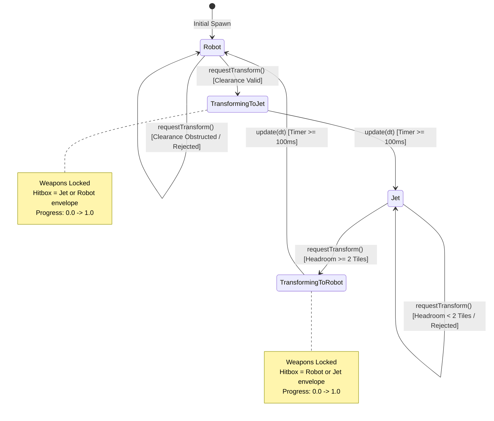

# Phase 3: Transformation State Machine (Robot <-> Jet Clearance Logic) Implementation Plan

## 1. Executive Summary & Scope

Phase 3 implements the mechanical transformation engine and spatial clearance enforcement for the Shoot'Em-Up Game Engine in `libs/ShooterCore`:
1. **Dual-Mode Transformation State Machine (`TransformSystem.h`, `TransformSystem.cpp`)**:
   - Deterministic finite state machine governing four discrete states: `Robot`, `Jet`, `TransformingToJet`, and `TransformingToRobot`.
   - Fixed-step timer pacing for transformation animations ($100\text{ ms}$, corresponding to 6 ticks at $60\text{ Hz}$).
   - Weapon and thrust lockout during intermediate transformation phases.
   - Comprehensive state query accessors and atomic transition control.
2. **Geometric Headroom & Spatial Clearance Verification**:
   - Enforces Thexder's core spatial constraint: Robot requires 2 vertical tiles ($32\text{ px}$ height, $16\text{ px}$ width), while Jet occupies 1 vertical tile and 2 horizontal tiles ($16\text{ px}$ height, $32\text{ px}$ width).
   - Headroom validation against `TileMap::hasClearance`: Transformation from Jet to Robot is strictly rejected when ceiling clearance is obstructed (e.g., inside 1-tile-high tunnels), preventing wall clipping.
   - Mathematical bounding box projection and anchor alignment (bottom-aligned ground contact vs. center-aligned flight).
   - Rejection reporting via strongly-typed `TransformResult` value objects.
3. **MISRA C++:2023 & SEI CERT Compliance**:
   - Zero dynamic heap allocation during simulation ticks (`SEI CERT ERR55-CPP`).
   - Strong value types eliminating Primitive Obsession (`MISRA C++:2023 Rule 7.0.6`, `SEI CERT INT31-C`).
   - Strict IWYU, `<cstdint>` usage, and `noexcept` boundaries.
   - Function identifiers strictly under 30 characters.
4. **Automated Headless Verification Suite (`tests/ShooterCoreTests/TestTransformSystem.cpp`)**:
   - Comprehensive CTest coverage validating transitions, animation pacing, tunnel headroom obstruction, lateral wall clearances, and state query invariants.

---

## 2. Architecture & File Layout

All transformation logic resides in `libs/ShooterCore` with zero external dependencies, accompanied by headless tests in `tests/ShooterCoreTests`.

### 2.1 ASCII File Layout Diagram
```
+-------------------------------------------------------------------------------+
|                       PHASE 3 DIRECTORY & ARTIFACT LAYOUT                     |
|                                                                               |
|   shoot-em-up-engine.git/                                                     |
|   ├── CMakeLists.txt                                                          |
|   ├── cmake/                                                                  |
|   │   ├── CompilerFlags.cmake              <-- Strict flags & hardening       |
|   │   └── GitHooks.cmake                   <-- Git hooks automation           |
|   ├── docs/                                                                   |
|   │   ├── implementation_plan.md           <-- Master roadmap                 |
|   │   ├── phase1_plan.md                   <-- Phase 1 baseline specification |
|   │   ├── phase2_plan.md                   <-- Phase 2 physics & TileMap      |
|   │   └── phase3_plan.md                   <-- This document                  |
|   ├── libs/                                                                   |
|   │   └── ShooterCore/                     <-- Pure C++17 Tier 1 Core Engine  |
|   │       ├── CMakeLists.txt                                                  |
|   │       ├── Types.h                      <-- Extended with Transform types  |
|   │       ├── Hitbox.h / .cpp              <-- AABB geometry & intersection   |
|   │       ├── TileMap.h / .cpp             <-- 2D grid & clearance queries   |
|   │       ├── CollisionSolver.h / .cpp     <-- Swept AABB & sliding physics   |
|   │       └── TransformSystem.h / .cpp     <-- Transformation state machine   |
|   └── tests/                                                                  |
|       └── ShooterCoreTests/                <-- Headless CTest Suite           |
|           ├── CMakeLists.txt                                                  |
|           ├── Main.cpp                     <-- Test runner entry point        |
|           ├── TestTypes.cpp                <-- Invariant & arithmetic tests   |
|           ├── TestHitbox.cpp               <-- AABB static intersection tests |
|           ├── TestTileMap.cpp              <-- Tile queries & destructibles   |
|           ├── TestCollisionSolver.cpp      <-- Swept AABB & sliding physics   |
|           └── TestTransformSystem.cpp      <-- Transformation & clearance test|
+-------------------------------------------------------------------------------+
```

### 2.2 Mermaid Architecture Diagram


---

## 3. Mathematical & Algorithmic Foundation

### 3.1 Mode Dimensions and Spatial Footprints

The player craft operates with distinct physical dimensions depending on the active configuration:

| Mode | Width ($W$) | Height ($H$) | Tile Span ($W \times H$) | Movement Dynamics | Primary Purpose |
| :--- | :--- | :--- | :--- | :--- | :--- |
| **Robot** | $16.0\text{ px}$ | $32.0\text{ px}$ | $1 \times 2\text{ tiles}$ | Ground walking, jumping ($g \approx 980\text{ px/s}^2$) | Combat, vertical traversal, precise platforming |
| **Jet** | $32.0\text{ px}$ | $16.0\text{ px}$ | $2 \times 1\text{ tiles}$ | Omnidirectional thrust, zero gravity, inertia | Rapid flight, navigating tight 1-tile tunnels |

### 3.2 Coordinate Anchor Models & Hitbox Projection

When transitioning between modes, maintaining continuity of the entity's position is critical to avoid artificial shifts or instant collisions with terrain.

#### Grounded Anchor Model (Bottom-Center Alignment)
When grounded on terrain, the bottom contact line remains invariant during transformation:
- Given current Jet bottom coordinate $Y_{\text{bottom}} = P_{\min}.y + H_{\text{jet}}$ and horizontal center $X_{\text{center}} = P_{\min}.x + \frac{W_{\text{jet}}}{2}$:
- The proposed Robot bounding box $[R_{\min}, R_{\max}]$ is calculated as:
$$R_{\min}.x = X_{\text{center}} - \frac{W_{\text{robot}}}{2} = P_{\min}.x + \frac{32 - 16}{2} = P_{\min}.x + 8.0$$
$$R_{\max}.x = R_{\min}.x + W_{\text{robot}} = R_{\min}.x + 16.0$$
$$R_{\max}.y = Y_{\text{bottom}} = P_{\min}.y + 16.0$$
$$R_{\min}.y = R_{\max}.y - H_{\text{robot}} = (P_{\min}.y + 16.0) - 32.0 = P_{\min}.y - 16.0$$

#### In-Flight Anchor Model (Center-Center Alignment)
When airborne, the craft center $(X_c, Y_c)$ remains invariant:
$$X_c = P_{\min}.x + \frac{W_{\text{current}}}{2}, \quad Y_c = P_{\min}.y + \frac{H_{\text{current}}}{2}$$
The target bounding box $[T_{\min}, T_{\max}]$ for target mode extents $(W_t, H_t)$ is:
$$T_{\min}.x = X_c - \frac{W_t}{2}, \quad T_{\min}.y = Y_c - \frac{H_t}{2}$$
$$T_{\max}.x = T_{\min}.x + W_t, \quad T_{\max}.y = T_{\min}.y + H_t$$

`TransformSystem` supports configurable anchor projection (`BottomCenter` for grounded transitions, `Center` for aerial flight transitions, and `TopLeft` for discrete grid alignment).

### 3.3 Clearance Verification Algorithm

To prevent wall clipping and phase tunneling, the transformation request undergoes an atomic clearance query against the `TileMap` before entering the transition state:

```
Algorithm: EvaluateTransformClearance
Input:
    CurrentMode: TransformMode (Robot or Jet)
    CurrentPos: WorldPos (Top-left coordinate)
    Anchor: AnchorMode (BottomCenter, Center, TopLeft)
    Map: const TileMap&
Output:
    TransformResult (Success, RejectedObstruction, AlreadyInState, Busy)

1. If CurrentMode is TransformingToJet or TransformingToRobot:
       Return TransformResult::Busy
2. TargetMode = (CurrentMode == Robot) ? Jet : Robot
3. TargetDims = GetDimensions(TargetMode)
4. TargetBox = ComputeProjectedBox(CurrentPos, CurrentMode, TargetDims, Anchor)
5. If NOT Map.hasClearance(TargetBox):
       Return TransformResult::RejectedObstruction
6. Return TransformResult::Success
```

### 3.4 Finite State Machine & Animation Pacing

The state machine transitions through intermediate non-operational states:
- Duration: $T_{\text{trans}} = 0.100\text{ s}$ ($100\text{ ms}$). At $60\text{ Hz}$ fixed timestep ($\Delta t \approx 16.667\text{ ms}$), this requires exactly 6 simulation ticks.
- During intermediate states (`TransformingToJet`, `TransformingToRobot`):
  - Weapon systems are locked (`isWeaponLocked() == true`).
  - Active dimensions retain the starting form until completion of the timer, at which point the bounding box snaps to target dimensions.
  - Intermediate hitbox interpolates or preserves minimum envelope to avoid mid-transition tunneling.

---

## 4. Visual Diagrams

### 4.1 ASCII Clearance Verification & Tunnel Scenarios
```
+-------------------------------------------------------------------------------+
|                       TRANSFORMATION CLEARANCE SCENARIOS                      |
|                                                                               |
|   Scenario A: Jet in 1-Tile Tunnel Attempting Transform to Robot (REJECTED)   |
|   #########################################################################   |
|   # Solid Ceiling Tile (row - 1)                                          #   |
|   #########################################################################   |
|   #               [ Jet: 32x16 px ]                                       #   |
|   #               Proposed Robot: [16x32 px]                              #   |
|   #               ^ Overlaps Ceiling Tile! -> REJECTED: Obstructed        #   |
|   #########################################################################   |
|   # Solid Floor Tile (row + 1)                                            #   |
|   #########################################################################   |
|                                                                               |
|   Scenario B: Jet in Open Chamber Attempting Transform to Robot (PERMITTED)   |
|   . . . . . . . . . . . . . . . . . . . . . . . . . . . . . . . . . . . . .   |
|   . Empty Space (Headroom >= 32 px)                                       .   |
|   .               [ Proposed Robot: 16x32 px ]                            .   |
|   .               No solid overlap detected! -> PERMITTED                 .   |
|   #########################################################################   |
|   # Solid Floor Tile                                                      #   |
|   #########################################################################   |
|                                                                               |
|   Scenario C: Robot in Narrow 1-Tile Shaft Attempting Jet (REJECTED)          |
|   ###             ###                                                         |
|   ###  [ Robot ]  ###  Jet requires 32 px width (2 tiles).                    |
|   ###  [ 16x32 ]  ###  Overlaps lateral wall! -> REJECTED: Obstructed         |
|   ###             ###                                                         |
+-------------------------------------------------------------------------------+
```

### 4.2 Mermaid Transformation State Diagram


### 4.3 Mermaid Sequence Diagram: Clearance Query Lifecycle
```mermaid
sequenceDiagram
    autonumber
    participant Input as Player Input / GameEngine
    participant System as TransformSystem
    participant Map as TileMap

    Input->>System: requestTransform(playerPos, Map)
    System->>System: Check current state (Idle vs Transforming)
    System->>System: Calculate target Hitbox (e.g. Robot 16x32 at Anchor)
    System->>Map: hasClearance(targetHitbox)
    
    alt Clearance Obstructed (Inside Tunnel)
        Map-->>System: false (Overlaps solid tile)
        System-->>Input: TransformResult::RejectedObstruction
        Note over System,Input: Mode remains unchanged; no timer started
    else Clearance Unobstructed
        Map-->>System: true (Clear space available)
        System->>System: Set state to TransformingToRobot
        System->>System: Reset transition timer (0.0s / 6 ticks)
        System-->>Input: TransformResult::Success
        
        loop Fixed Simulation Ticks (6 Ticks @ 60 Hz)
            Input->>System: update(dt = 0.01667s)
            System->>System: Accumulate timer
            System-->>Input: isTransforming() == true, weapons locked
        end
        
        System->>System: Timer reaches 0.100s -> Transition to Robot
        Input->>System: mode()
        System-->>Input: TransformMode::Robot
    end
```

---

## 5. Detailed Component Specifications

### 5.1 Domain Types (`libs/ShooterCore/Types.h`)

Extend `libs/ShooterCore/Types.h` with strongly-typed values:

```cpp
/// @brief Result codes returned by transformation requests.
enum class TransformResult : std::uint8_t {
    Success = 0U,
    RejectedObstruction = 1U,
    AlreadyInState = 2U,
    Busy = 3U
};

/// @brief Geometric anchor mode used to project hitboxes during transformation.
enum class AnchorMode : std::uint8_t {
    BottomCenter = 0U, // Aligns bottom edge and centers horizontally (grounded)
    Center = 1U,       // Centers both horizontally and vertically (in flight)
    TopLeft = 2U       // Anchors top-left origin (discrete coordinate mapping)
};
```

### 5.2 Transformation Subsystem (`libs/ShooterCore/TransformSystem.h`)

```cpp
#pragma once

#include <cstddef>
#include <cstdint>

#include "Hitbox.h"
#include "TileMap.h"
#include "Types.h"

namespace ShooterCore {

/// @class TransformSystem
/// @brief Deterministic dual-mode transformation state machine.
/// @details Enforces spatial clearance before allowing state transitions.
/// Operates with zero dynamic heap allocations (CERT ERR55-CPP).
class TransformSystem final {
public:
    static constexpr float kRobotWidth { 16.0f };
    static constexpr float kRobotHeight { 32.0f };
    static constexpr float kJetWidth { 32.0f };
    static constexpr float kJetHeight { 16.0f };
    static constexpr float kDefaultTransitionSec { 0.100f }; // 100 ms

    /// @brief Construct transformation system in default Robot state.
    /// @param[in] transitionSec Duration in seconds for transformation animation.
    explicit constexpr TransformSystem(float transitionSec = kDefaultTransitionSec) noexcept
        : transitionDuration_ { transitionSec }
    {
    }

    /// @brief Get current transformation mode.
    /// @return Active TransformMode.
    [[nodiscard]] constexpr TransformMode mode() const noexcept
    {
        return mode_;
    }

    /// @brief Check whether currently undergoing transformation.
    /// @return true if TransformingToJet or TransformingToRobot.
    [[nodiscard]] constexpr bool isTransforming() const noexcept
    {
        return (mode_ == TransformMode::TransformingToJet) ||
               (mode_ == TransformMode::TransformingToRobot);
    }

    /// @brief Check whether weapons are locked due to active transformation.
    /// @return true if transforming; false if ready in stable Robot or Jet state.
    [[nodiscard]] constexpr bool isWeaponLocked() const noexcept
    {
        return isTransforming();
    }

    /// @brief Get transformation animation completion progress.
    /// @return Normalized progress in [0.0, 1.0].
    [[nodiscard]] constexpr float progress() const noexcept;

    /// @brief Request transformation to the alternate craft mode.
    /// @param[in] currentPos Current origin of the craft.
    /// @param[in] map Terrain grid to verify clearance against.
    /// @param[in] anchor Alignment model for projected target hitbox.
    /// @return TransformResult indicating success or rejection cause.
    [[nodiscard]] TransformResult requestTransform(
        WorldPos currentPos,
        const TileMap& map,
        AnchorMode anchor = AnchorMode::BottomCenter) noexcept;

    /// @brief Advance simulation timer by fixed delta time.
    /// @param[in] dt Timestep in seconds.
    void update(DeltaTime dt) noexcept;

    /// @brief Force state for testing or level initialization.
    /// @param[in] targetMode Mode to apply immediately.
    void forceState(TransformMode targetMode) noexcept;

    /// @brief Compute projected bounding box for target mode at specified anchor.
    /// @param[in] currentPos Current position.
    /// @param[in] currentMode Origin mode.
    /// @param[in] targetMode Desired mode.
    /// @param[in] anchor Alignment model.
    /// @return Calculated target Hitbox.
    [[nodiscard]] static Hitbox projectBox(
        WorldPos currentPos,
        TransformMode currentMode,
        TransformMode targetMode,
        AnchorMode anchor) noexcept;

    /// @brief Get physical dimensions for specified mode.
    /// @param[in] mode Evaluated craft configuration.
    /// @param[out] width Horizontal extent in world units.
    /// @param[out] height Vertical extent in world units.
    static constexpr void getDimensions(
        TransformMode mode,
        float& width,
        float& height) noexcept;

private:
    TransformMode mode_ { TransformMode::Robot };
    float transitionDuration_ { kDefaultTransitionSec };
    float transitionTimer_ { 0.0f };
};

} // namespace ShooterCore
```

---

## 6. Implementation & Compliance Analysis

### 6.1 MISRA C++:2023 & SEI CERT Compliance Matrix
- **MISRA C++:2023 Rule 7.0.6 & SEI CERT INT31-C**: Explicit static casts on all enum-to-integer translations and coordinate integer bounds.
- **SEI CERT ERR55-CPP**: All query and update methods are strictly `noexcept` and execute with **zero dynamic heap allocation** (`0-heap`).
- **SEI CERT STR37-C**: No character conversion functions used; all identifiers and tokens use ASCII representations.
- **Function Identifier Policy**: All public methods have names strictly under 30 characters (e.g., `requestTransform` is 16 chars; `isWeaponLocked` is 14 chars; `projectBox` is 10 chars).

### 6.2 Include-What-You-Use (IWYU) Policy
- `TransformSystem.h`:
  - Directly includes `<cstddef>`, `<cstdint>`, `"Hitbox.h"`, `"TileMap.h"`, `"Types.h"`.
- `TransformSystem.cpp`:
  - Associated header: `"TransformSystem.h"`.
  - Directly includes `<algorithm>`, `<cstdint>`, `<cstddef>`.
  - Canonical header group ordering enforced.

---

## 7. Step-by-Step Test-Driven Verification Plan

### Step 1: Types & Dimension Tests
- Verify dimension constants ($16\text{ px} \times 32\text{ px}$ for Robot, $32\text{ px} \times 16\text{ px}$ for Jet).
- Verify `AnchorMode` projections across `BottomCenter`, `Center`, and `TopLeft`.

### Step 2: Immediate Transformation in Open Space
- Place craft in empty $10 \times 10$ tilemap.
- Call `requestTransform` from `Robot` $\rightarrow$ verifies state transitions to `TransformingToJet`.
- Call `update(0.05f)` $\rightarrow$ progress is $50\%$, weapons locked.
- Call `update(0.05f)` $\rightarrow$ state snaps to `Jet`, progress is $100\%$, weapons unlocked.

### Step 3: Headroom Rejection in 1-Tile Tunnel
- Build $10 \times 3$ tilemap where row 0 is solid, row 1 is open (16 px height), row 2 is solid.
- Place `Jet` at $(x=32, y=16)$.
- Call `requestTransform` to `Robot`.
- Verify: returns `TransformResult::RejectedObstruction`. State remains `Jet`. No timer started.

### Step 4: Lateral Obstruction Rejection
- Build vertical 1-tile shaft where column 0 is solid, column 1 is open (16 px width), column 2 is solid.
- Place `Robot` in shaft.
- Call `requestTransform` with lateral projection $\rightarrow$ verified rejection due to side walls.

### Step 5: Busy State Locking
- While in `TransformingToJet`, calling `requestTransform` returns `TransformResult::Busy`.

---

## 8. Definition of Done
1. `libs/ShooterCore/TransformSystem.h` and `.cpp` implemented and integrated into `libs/ShooterCore/CMakeLists.txt`.
2. `tests/ShooterCoreTests/TestTransformSystem.cpp` added to CTest runner and passing with 100% green tests.
3. Zero compiler warnings under MSVC `/W4 /WX` and GCC/Clang `-Wall -Wextra -pedantic -Werror`.
4. Formatting passes `clang-format --dry-run --Werror`.
5. IWYU verification passes via `python scripts/verify_iwyu_cstdint.py`.

