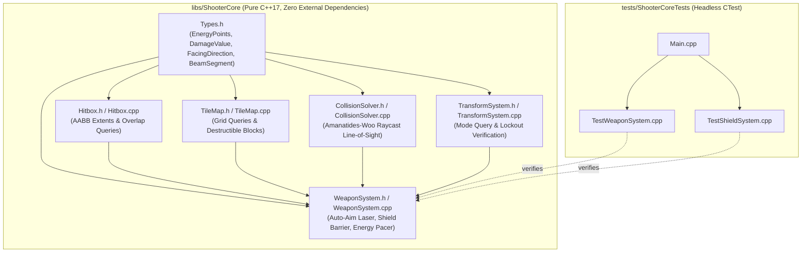
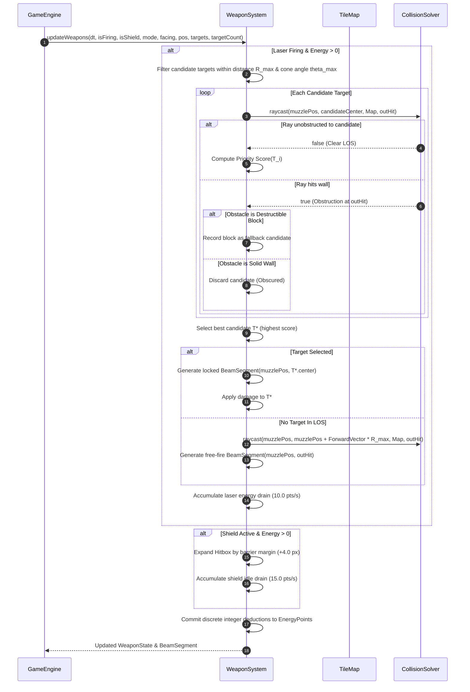
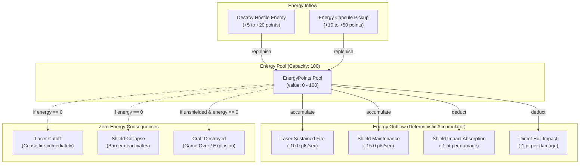

# Phase 4: Weapons & Energy System (Auto-Aim Laser & Shield Barrier) Implementation Plan

## 1. Executive Summary & Scope

Phase 4 implements the combat, targeting, and defense subsystems for the Shoot'Em-Up Game Engine within `libs/ShooterCore`. It translates Game Arts' iconic **Thexder** weapon systems into a high-performance, deterministic C++17 architecture:

1. **Continuous Auto-Aim Homing Laser (`WeaponSystem.h`, `WeaponSystem.cpp`)**:
   - Continuous forward/arc beam emission that automatically acquires, tracks, and locks onto the highest-priority hostile target within line of sight.
   - Line-of-sight (LOS) clearance verification via `CollisionSolver::raycast`: Solid wall tiles obstruct targeting and absorb free-firing laser energy.
   - Mode-dependent targeting envelopes:
     - **Robot Mode**: Wide field-of-fire forward and upward targeting arc ($\approx 150^\circ$ cone) accommodating walking, jump-firing, and vertical tracking.
     - **Jet Mode**: Directionally focused forward tracking cone ($\approx 90^\circ$ cone) optimized for high-speed corridor combat.
   - Prioritization scoring algorithm evaluating distance, angular alignment relative to facing direction, and target classification (enemy craft vs. destructible obstacle blocks).
   - Continuous damage delivery over simulation ticks, with destructible block erosion via `TileMap::damageTile`.
   - Real-time beam geometry generation (`BeamSegment`) emitting discrete spatial coordinates for decoupled rendering by Tier 2 presentation adapters.

2. **Energy Shield Barrier Subsystem**:
   - Player-activated protective force field surrounding the craft's hitbox with an expanded defensive perimeter.
   - Complete invulnerability to enemy contact damage and incoming hostile projectiles while engaged.
   - Projectile deflection / neutralization logic: Hostile projectiles striking the barrier are reflected or dissolved on impact.
   - Energy consumption model: Sustained idle maintenance drain plus instantaneous impact absorption deductions proportional to incoming threat damage.
   - Automatic barrier collapse upon energy pool exhaustion.

3. **Unified Single-Pool Energy Management**:
   - Universal `EnergyPoints` pool (0 to 100) acting as life meter, ammunition reservoir, and barrier shield battery.
   - Sub-point fractional drain accumulator (`DrainAccumulator`) ensuring deterministic, zero-drift, float-to-integer rate integration across variable `DeltaTime` steps without truncation bias.
   - Energy replenishment upon enemy destruction, subject to strict maximum capacity bounds.
   - Immediate weapon lockout and barrier deactivation when energy reaches zero.

4. **Safety & Zero-Heap Architecture (`MISRA C++:2023`, `SEI CERT ERR55-CPP`)**:
   - Zero dynamic heap allocation (`std::vector`, `std::string`, `new`, `std::make_unique`) during real-time target searches, raycasts, or firing updates.
   - Fixed-capacity candidate buffers (`kMaxTargets = 32U`) and stack-based geometric evaluation.
   - Strongly-typed domain value objects preventing Primitive Obsession (`EnergyPoints`, `DamageValue`, `FacingDirection`, `LaserState`, `ShieldState`, `BeamSegment`).
   - Function identifiers strictly under 30 characters.
   - Strict Include-What-You-Use (IWYU) and standard `<cstdint>` qualification.

5. **Deterministic Headless Test Suite (`tests/ShooterCoreTests/TestWeaponSystem.cpp`, `TestShieldSystem.cpp`)**:
   - Comprehensive headless CTest coverage verifying LOS raycast obstructions, targeting prioritization, mode arc constraints, shield impact deflection, and energy drain pacing.

---

## 2. Architecture & File Layout

All weapon, targeting, and barrier logic resides strictly within `libs/ShooterCore` with zero external dependencies (no SDL2, no OpenGL, no OS headers), accompanied by headless tests in `tests/ShooterCoreTests`.

### 2.1 ASCII File Layout Diagram
```
+-------------------------------------------------------------------------------+
|                       PHASE 4 DIRECTORY & ARTIFACT LAYOUT                     |
|                                                                               |
|   shoot-em-up-engine.git/                                                     |
|   ├── CMakeLists.txt                                                          |
|   ├── cmake/                                                                  |
|   │   ├── CompilerFlags.cmake              <-- Strict flags & hardening       |
|   │   └── GitHooks.cmake                   <-- Git hooks automation           |
|   ├── docs/                                                                   |
|   │   ├── implementation_plan.md           <-- Master roadmap                 |
|   │   ├── phase1_plan.md                   <-- Phase 1 baseline & types       |
|   │   ├── phase2_plan.md                   <-- Phase 2 physics & TileMap      |
|   │   ├── phase3_plan.md                   <-- Phase 3 transformation machine |
|   │   └── phase4_plan.md                   <-- This document                  |
|   ├── libs/                                                                   |
|   │   └── ShooterCore/                     <-- Pure C++17 Tier 1 Core Engine  |
|   │       ├── CMakeLists.txt                                                  |
|   │       ├── Types.h                      <-- Extended with Weapon types     |
|   │       ├── Hitbox.h / .cpp              <-- AABB spatial calculations      |
|   │       ├── TileMap.h / .cpp             <-- 2D grid & destructible queries |
|   │       ├── CollisionSolver.h / .cpp     <-- Swept AABB & Raycast LOS       |
|   │       ├── TransformSystem.h / .cpp     <-- Robot <-> Jet state machine    |
|   │       └── WeaponSystem.h / .cpp        <-- Auto-aim laser & shield system |
|   └── tests/                                                                  |
|       └── ShooterCoreTests/                <-- Headless CTest Suite           |
|           ├── CMakeLists.txt                                                  |
|           ├── Main.cpp                     <-- Test runner entry point        |
|           ├── TestHarness.h                <-- Assertion macros               |
|           ├── TestTypes.cpp                <-- Invariant & arithmetic tests   |
|           ├── TestHitbox.cpp               <-- AABB static intersection tests |
|           ├── TestTileMap.cpp              <-- Tile queries & destructibles   |
|           ├── TestCollisionSolver.cpp      <-- Swept AABB & raycast tests     |
|           ├── TestTransformSystem.cpp      <-- Transformation & clearance test|
|           ├── TestWeaponSystem.cpp         <-- Laser targeting & LOS tests    |
|           └── TestShieldSystem.cpp         <-- Shield defense & drain tests   |
+-------------------------------------------------------------------------------+
```

### 2.2 Mermaid Architecture Diagram


---

## 3. Mathematical & Algorithmic Foundation

### 3.1 Auto-Aim Target Acquisition & Field of Fire

The auto-locking laser continuously seeks the optimal target within an angular cone aligned with the craft's horizontal or vertical facing direction.

#### Target Representation & Spatial Bounds
Each candidate target $T_i$ possesses an Axis-Aligned Bounding Box (AABB) $[P_{\min}, P_{\max}]$, center coordinate $C_i = \left(P_{\min}.x + \frac{W_i}{2}, P_{\min}.y + \frac{H_i}{2}\right)$, and category (Hostile Entity or Destructible Tile).

#### Angular Range & Mode-Dependent Envelopes
Let craft muzzle origin be $O = (x_0, y_0)$ and horizontal facing vector be $\vec{F} = (F_x, 0)$ where $F_x \in \{+1.0, -1.0\}$.
The vector to candidate target center is:
$$\vec{D}_i = C_i - O = (C_i.x - x_0, C_i.y - y_0)$$
Euclidean distance is:
$$d_i = \|\vec{D}_i\| = \sqrt{(C_i.x - x_0)^2 + (C_i.y - y_0)^2}$$

The angle $\theta_i$ between facing vector $\vec{F}$ and target vector $\vec{D}_i$ is computed via dot product:
$$\cos(\theta_i) = \frac{\vec{F} \cdot \vec{D}_i}{\|\vec{F}\| \|\vec{D}_i\|} = \frac{F_x \cdot (C_i.x - x_0)}{d_i}$$

| Parameter | Robot Mode | Jet Mode | Semantic Rationale |
| :--- | :--- | :--- | :--- |
| **Max Range ($R_{\max}$)** | $240.0\text{ px}$ (15 tiles) | $288.0\text{ px}$ (18 tiles) | Jet speed necessitates extended forward engagement |
| **Max Cone Angle ($\theta_{\max}$)** | $\pm 75.0^\circ$ ($\cos \theta \ge 0.2588$) | $\pm 45.0^\circ$ ($\cos \theta \ge 0.7071$) | Robot has broad turret pivot; Jet has rigid forward cowl |
| **Upward Aiming Option** | Supported ($\vec{F} = (0, -1)$) | Not Supported (Horizontal only) | Robot walking enables vertical anti-air fire |

A candidate $T_i$ is discarded if $d_i > R_{\max}$ or $\cos(\theta_i) < \cos(\theta_{\max})$.

#### Line-of-Sight (LOS) Verification
Even if geometrically inside the cone, target $T_i$ is obscured if solid terrain lies between $O$ and $C_i$.
LOS is verified using the fast voxel traversal raycast implemented in `CollisionSolver::raycast`:
```
WorldPos hitPos;
bool blocked = CollisionSolver::raycast(muzzlePos, targetCenter, map, hitPos);
```
- If `blocked == true`:
  - If `hitPos` is before the target bounds ($d_{\text{hit}} < d_i - \epsilon$), LOS is obstructed; target is rejected.
  - If the obstacle struck is a `DestructibleWall` and no hostile entity has clear LOS, the destructible block becomes a secondary target.
- If `blocked == false`: LOS is clear.

#### Target Prioritization Function
When multiple candidates satisfy range, cone, and LOS conditions, the selection heuristic prioritizes proximity, forward focus, and threat classification:
$$\text{Score}(T_i) = w_d \cdot \left(1.0 - \frac{d_i}{R_{\max}}\right) + w_\theta \cdot \cos(\theta_i) + w_t$$
where:
- Proximity weight $w_d = 0.50$
- Angular focus weight $w_\theta = 0.30$
- Threat bonus $w_t = 0.20$ for Hostile Entities, $0.00$ for Destructible Blocks.

The target maximizing $\text{Score}(T_i)$ is selected for lock-on.

### 3.2 Continuous Laser Damage & Beam Geometry

Once locked onto target $T^*$, or during unobstructed free-firing:
1. **Locked Firing**:
   - Beam endpoint snaps directly to $C^*$.
   - Delivers continuous damage to target:
     $$\Delta \text{Damage} = \text{DamageRate} \times \Delta t \quad (\text{e.g., } 60\text{ damage/second})$$
   - If target is a destructible block, block health is decremented at discrete intervals (e.g., 1 hit every $0.20\text{ s}$).
2. **Free Firing (No Locked Target)**:
   - Beam extends along craft orientation vector until striking solid terrain via raycast, or terminating at $R_{\max}$.
   - If terminating on a `DestructibleWall`, it delivers erosion damage to that block.

### 3.3 Energy Consumption & Deterministic Pacing

Thexder employs a single shared energy pool where $E \in [0, 100]$. Weapons, shields, and incoming hull impacts consume this reservoir.

#### Fractional Rate Integration Model
Fixed-width integer types (`std::uint16_t`) cannot natively represent fractional per-tick deductions (e.g., $10.0\text{ points/sec}$ at $60\text{ Hz}$ equates to $0.1667\text{ points/tick}$). Truncating to integer zero causes free usage, while rounding up to 1 causes 60 points/sec consumption.

To solve this, the engine uses a deterministic sub-point accumulator (`DrainAccumulator`):
$$A_{t+\Delta t} = A_t + (\text{Rate}_{\text{laser}} \cdot \text{isLaserFiring} + \text{Rate}_{\text{shield}} \cdot \text{isShieldActive}) \times \Delta t$$
When $A_{t+\Delta t} \ge 1.0$:
$$N = \lfloor A_{t+\Delta t} \rfloor$$
$$A_{t+\Delta t} \leftarrow A_{t+\Delta t} - N$$
$$E_{t+\Delta t} = \max(0, E_t - N)$$

| Subsystem | Sustained Consumption Rate | Instantaneous Impact Cost | Behavior on $E = 0$ |
| :--- | :--- | :--- | :--- |
| **Laser Weapon** | $10.0\text{ points/second}$ | None | Instant beam cutoff |
| **Shield Barrier** | $15.0\text{ points/second}$ | $1.0\text{ point per } 1\text{ damage absorbed}$ | Instant shield collapse |
| **Hull (Unshielded)**| None | $1.0\text{ point per } 1\text{ damage received}$ | Player craft destruction |

### 3.4 Shield Barrier Defense & Collision Deflection

The shield barrier surrounds the craft with an expanded spatial envelope:
$$B_{\min} = P_{\min} - (\delta, \delta), \quad B_{\max} = P_{\max} + (\delta, \delta)$$
where margin $\delta = 4.0\text{ px}$.

1. **Hostile Projectile Intersection**:
   - When a projectile enters barrier bounds $[B_{\min}, B_{\max}]$, the barrier triggers deflection:
     - Projectile velocity vector $\vec{V}_{\text{proj}}$ is inverted: $\vec{V}_{\text{new}} = -\vec{V}_{\text{proj}}$, or the projectile is immediately dissolved.
     - Damage value $D$ is transferred to barrier accumulator:
       $$\text{Drain} = \text{static\_cast}\langle\text{std::uint16\_t}\rangle(D)$$
       $$E \leftarrow \max(0, E - \text{Drain})$$
     - Player hull takes $0$ damage.
2. **Exhaustion Collapse**:
   - If energy drops to 0 during an impact or sustained drain tick, shield barrier immediately collapses (`isActive() == false`). Subsequent impacts strike the bare hull directly.

---

## 4. Visual Diagrams

### 4.1 ASCII Auto-Aim Cone & Raycast Scenarios
```
+-------------------------------------------------------------------------------+
|                       AUTO-AIM TARGETING & LOS SCENARIOS                      |
|                                                                               |
|   Scenario A: Enemy in Open Space (LOCKED & DAMAGED)                          |
|   .........................................................................   |
|   .                  Cone Boundary (+75 deg)                              .   |
|   .                /                                                      .   |
|   .   [ Player ] ===== Laser Beam =====> [ Enemy A ] (Score: 0.88, LOCKED) .   |
|   .                \                                                      .   |
|   .                  Cone Boundary (-75 deg)                              .   |
|   .........................................................................   |
|                                                                               |
|   Scenario B: Enemy Obscured Behind Solid Wall (REJECTED & FREE FIRED)        |
|   .........................................................................   |
|   .                /                                                      .   |
|   .   [ Player ] ===== Laser Beam =====> ####### [ Enemy B ]              .   |
|   .                \                     # WALL # (LOS Blocked: REJECTED) .   |
|   .                 \                    #######                          .   |
|   .                  Beam impacts wall at hitPos                          .   |
|   .........................................................................   |
|                                                                               |
|   Scenario C: Destructible Wall in Line of Sight (TARGETED & DAMAGED)         |
|   .........................................................................   |
|   .                /                                                      .   |
|   .   [ Player ] ===== Laser Beam =====> [ DESTRUCTIBLE BLOCK ]           .   |
|   .                \                     (Health: 3 -> 2 -> 1 -> Crumbles).   |
|   .........................................................................   |
+-------------------------------------------------------------------------------+
```

### 4.2 ASCII Shield Barrier Deflection & Energy Drain
```
+-------------------------------------------------------------------------------+
|                       SHIELD BARRIER IMPACT RESOLUTION                        |
|                                                                               |
|             +---------------------------------------+                         |
|             |        SHIELD BARRIER BOUNDS          |                         |
|             |          (Margin = +4.0 px)           |                         |
|             |     +---------------------------+     |                         |
|   Incoming  |     |                           |     |                         |
|   Projectile|     |        THEXDER CRAFT      |     |                         |
|   =======>  |*    |         (Robot/Jet)       |     |                         |
|   Impact    |     |                           |     |                         |
|   Point     |     +---------------------------+     |                         |
|             +---------------------------------------+                         |
|                                                                               |
|   Impact Resolution:                                                          |
|   1. Craft Hull Damage: 0 (Invulnerable)                                      |
|   2. Projectile State: Deflected / Dissolved                                  |
|   3. Energy Deduction: EnergyPoints -= ProjectileDamage                       |
|   4. If Energy == 0: Barrier Collapses Immediately                            |
+-------------------------------------------------------------------------------+
```

### 4.3 Mermaid Auto-Aim Target Selection Sequence Diagram


### 4.4 Mermaid Energy Pool Flowchart


---

## 5. Detailed Component Specifications

### 5.1 New Domain Types in `libs/ShooterCore/Types.h`

```cpp
/// @brief Discrete facing orientation of the player craft.
enum class FacingDirection : std::uint8_t {
    Left = 0U,
    Right = 1U,
    Up = 2U,
    Down = 3U
};

/// @brief Target category classification for auto-aim priority.
enum class TargetType : std::uint8_t {
    Hostile = 0U,
    Destructible = 1U
};

/// @struct TargetCandidate
/// @brief Bounded spatial representation of a targetable entity.
struct TargetCandidate final {
    std::uint32_t id { 0U };
    Hitbox bounds {};
    TargetType type { TargetType::Hostile };
    bool active { false };

    [[nodiscard]] constexpr WorldPos center() const noexcept
    {
        return WorldPos {
            bounds.minX() + (bounds.width() * 0.5f),
            bounds.minY() + (bounds.height() * 0.5f)
        };
    }
};

/// @struct BeamSegment
/// @brief Spatial coordinates and state of the emitted laser beam for rendering.
struct BeamSegment final {
    WorldPos origin { 0.0f, 0.0f };
    WorldPos endpoint { 0.0f, 0.0f };
    bool lockedToTarget { false };
    bool active { false };
    std::uint32_t targetId { 0U };
};

/// @class DrainAccumulator
/// @brief Deterministic fractional energy deduction pacer.
class DrainAccumulator final {
public:
    constexpr DrainAccumulator() noexcept = default;

    /// @brief Add fractional consumption based on rate and delta time.
    /// @param[in] ratePerSecond Energy points consumed per second.
    /// @param[in] dt Timestep duration in seconds.
    constexpr void accumulate(float ratePerSecond, float dt) noexcept
    {
        if (ratePerSecond > 0.0f && dt > 0.0f) {
            accumulator_ += ratePerSecond * dt;
        }
    }

    /// @brief Extract accrued whole integer energy deductions.
    /// @return Integer points to deduct from pool.
    [[nodiscard]] constexpr std::uint16_t consumeWhole() noexcept
    {
        if (accumulator_ < 1.0f) {
            return 0U;
        }
        const auto whole { static_cast<std::uint16_t>(accumulator_) };
        accumulator_ -= static_cast<float>(whole);
        return whole;
    }

    /// @brief Reset accrued drain to zero.
    constexpr void reset() noexcept
    {
        accumulator_ = 0.0f;
    }

private:
    float accumulator_ { 0.0f };
};
```

### 5.2 `WeaponSystem.h` Specification

```cpp
#pragma once

#include <cstddef>
#include <cstdint>

#include <array>

#include "CollisionSolver.h"
#include "Hitbox.h"
#include "TileMap.h"
#include "Types.h"

namespace ShooterCore {

/// @class WeaponSystem
/// @brief Orchestrates auto-aim homing laser, shield barrier, and single-pool energy consumption.
/// @details Executes with 0 dynamic heap allocations per CERT ERR55-CPP.
class WeaponSystem final {
public:
    static constexpr std::size_t kMaxTargets { 32U };
    static constexpr float kLaserRangeRobot { 240.0f };
    static constexpr float kLaserRangeJet { 288.0f };
    static constexpr float kRobotConeCos { 0.2588f };  // cos(75 deg)
    static constexpr float kJetConeCos { 0.7071f };    // cos(45 deg)
    static constexpr float kLaserDrainRate { 10.0f };  // points / sec
    static constexpr float kShieldDrainRate { 15.0f }; // points / sec
    static constexpr float kLaserDamageRate { 60.0f }; // damage / sec
    static constexpr float kShieldMargin { 4.0f };     // pixels beyond craft

    constexpr WeaponSystem() noexcept = default;

    /// @brief Query whether laser is currently actively firing.
    /// @return true if firing and energy available.
    [[nodiscard]] constexpr bool isLaserActive() const noexcept
    {
        return laserActive_;
    }

    /// @brief Query whether shield barrier is currently deployed.
    /// @return true if shield deployed and energy available.
    [[nodiscard]] constexpr bool isShieldActive() const noexcept
    {
        return shieldActive_;
    }

    /// @brief Retrieve active laser beam spatial coordinates for presentation.
    /// @return Active BeamSegment struct.
    [[nodiscard]] constexpr BeamSegment getBeamSegment() const noexcept
    {
        return beam_;
    }

    /// @brief Retrieve defensive perimeter bounding box for the shield barrier.
    /// @param[in] craftBox Current craft bounding box.
    /// @return Expanded AABB surrounding the craft.
    [[nodiscard]] static constexpr Hitbox computeShield(const Hitbox& craftBox) noexcept
    {
        return Hitbox {
            craftBox.minX() - kShieldMargin,
            craftBox.minY() - kShieldMargin,
            craftBox.maxX() + kShieldMargin,
            craftBox.maxY() + kShieldMargin
        };
    }

    /// @brief Primary simulation tick updating weapons, targeting, shield, and energy pool.
    /// @param[in] dt Simulation delta time.
    /// @param[in] fireIntent Player weapon trigger intent.
    /// @param[in] shieldIntent Player shield deployment intent.
    /// @param[in] isTransforming Whether transformation lock is active.
    /// @param[in] mode Active transformation mode (Robot vs Jet).
    /// @param[in] facing Current facing direction.
    /// @param[in] craftBox Current craft bounding box.
    /// @param[in] map Discrete tilemap environment for LOS and destructibles.
    /// @param[in] targets Bounded array of active target candidates.
    /// @param[in] targetCount Number of valid candidates in targets array.
    /// @param[in,out] energy Single-pool energy points reservoir.
    void updateWeapons(
        DeltaTime dt,
        bool fireIntent,
        bool shieldIntent,
        bool isTransforming,
        TransformMode mode,
        FacingDirection facing,
        const Hitbox& craftBox,
        TileMap& map,
        const std::array<TargetCandidate, kMaxTargets>& targets,
        std::size_t targetCount,
        EnergyPoints& energy) noexcept;

    /// @brief Process an impact against the craft or active shield barrier.
    /// @param[in] damage Incoming damage value.
    /// @param[in,out] energy Single-pool energy points reservoir.
    /// @return true if impact was absorbed by shield; false if it penetrated to hull.
    bool absorbImpact(DamageValue damage, EnergyPoints& energy) noexcept;

    /// @brief Reset targeting, beam, and accumulator states.
    void reset() noexcept;

private:
    [[nodiscard]] static WorldPos computeMuzzle(
        const Hitbox& craftBox,
        FacingDirection facing,
        TransformMode mode) noexcept;

    [[nodiscard]] static std::int32_t findBestTarget(
        WorldPos muzzle,
        FacingDirection facing,
        TransformMode mode,
        const TileMap& map,
        const std::array<TargetCandidate, kMaxTargets>& targets,
        std::size_t targetCount) noexcept;

    bool laserActive_ { false };
    bool shieldActive_ { false };
    BeamSegment beam_ {};
    DrainAccumulator laserDrain_ {};
    DrainAccumulator shieldDrain_ {};
    DrainAccumulator tileDamagePacer_ {};
};

} // namespace ShooterCore
```

---

## 6. Implementation & Compliance Analysis

### 6.1 MISRA C++:2023 & SEI CERT Compliance Matrix

| Rule | Requirement | Implementation Strategy in Phase 4 |
| :--- | :--- | :--- |
| **MISRA C++:2023 Rule 7.0.6** | Explicit signed/unsigned conversions | All enum, integer, and coordinate casts explicitly use `static_cast<std::uint16_t>`, `static_cast<std::size_t>`, or `static_cast<float>`. |
| **SEI CERT INT31-C** | Safe integer conversions | Energy deductions and drain accumulations use saturating subtraction and min/max bounds checking. |
| **SEI CERT ERR55-CPP** | Exception safety & `noexcept` | All update, query, and raycast methods are strictly marked `noexcept` and execute with **zero dynamic heap allocation** (`0-heap`). |
| **SEI CERT STR37-C** | Deterministic character handling | No `<cctype>` functions; all diagnostics and comparisons use locale-independent integer enums. |
| **Identifier Length Rule** | Names strictly $< 30$ characters | Verified: `updateWeapons` (13), `absorbImpact` (12), `computeShield` (13), `getBeamSegment` (14), `isLaserActive` (13), `isShieldActive` (14). |

### 6.2 Include-What-You-Use (IWYU) Policy

- `libs/ShooterCore/Types.h`:
  - Directly includes `<cstddef>`, `<cstdint>`, `<algorithm>`.
- `libs/ShooterCore/WeaponSystem.h`:
  - Directly includes `<cstddef>`, `<cstdint>`, `<array>`, `"CollisionSolver.h"`, `"Hitbox.h"`, `"TileMap.h"`, `"Types.h"`.
- `libs/ShooterCore/WeaponSystem.cpp`:
  - Associated header: `"WeaponSystem.h"`.
  - Directly includes `<algorithm>`, `<cmath>`, `<cstddef>`, `<cstdint>`.
  - Canonical header group ordering enforced.

---

## 7. Step-by-Step Test-Driven Verification Plan

### Step 1: Energy Drain & Accumulator Pacing Tests (`TestWeaponSystem.cpp`)
- **Objective**: Verify that fractional per-second rates translate into exact integer deductions without drift.
- **Test Case 1.1**: Advance $60\text{ ticks}$ at $\Delta t = \frac{1}{60}\text{ s}$ with laser firing ($10.0\text{ pts/s}$). Verify starting energy $100$ drops to exactly $90$.
- **Test Case 1.2**: Advance $60\text{ ticks}$ with shield active ($15.0\text{ pts/s}$). Verify energy drops from $100$ to exactly $85$.
- **Test Case 1.3**: Advance with both laser and shield simultaneously ($25.0\text{ pts/s}$). Verify energy drops from $100$ to $75$.
- **Test Case 1.4**: Firing with $E = 0$ results in immediate laser cutoff and zero negative underflow.

### Step 2: Line-of-Sight & Auto-Aiming Tests (`TestWeaponSystem.cpp`)
- **Objective**: Verify that `CollisionSolver::raycast` properly filters out obscured candidates and selects optimal targets.
- **Test Case 2.1**: Single enemy in open space within $100\text{ px}$ forward arc $\rightarrow$ Target acquired, `beam_.lockedToTarget == true`, endpoint matches target center.
- **Test Case 2.2**: Single enemy behind a $16\text{ px}$ solid wall $\rightarrow$ LOS blocked, auto-aim rejects enemy, beam fires forward and terminates at wall face.
- **Test Case 2.3**: Two enemies at distances $80\text{ px}$ and $180\text{ px}$ $\rightarrow$ Closer enemy is prioritized and locked.
- **Test Case 2.4**: Hostile enemy at $120\text{ px}$ vs. Destructible block at $100\text{ px}$ $\rightarrow$ Enemy receives priority score bonus and is targeted despite slightly greater distance.

### Step 3: Transformation Mode Targeting Constraints (`TestWeaponSystem.cpp`)
- **Objective**: Verify Robot vs. Jet cone angles and transformation lockouts.
- **Test Case 3.1**: Enemy at $60^\circ$ elevation angle:
  - In **Robot Mode** ($\pm 75^\circ$ cone): Target acquired and locked.
  - In **Jet Mode** ($\pm 45^\circ$ cone): Target out-of-cone, rejected; beam fires straight forward.
- **Test Case 3.2**: Triggering weapon while `isTransforming == true` $\rightarrow$ Weapon locked, no beam emitted, no energy consumed.

### Step 4: Destructible Block Laser Erosion (`TestWeaponSystem.cpp`)
- **Objective**: Verify continuous laser firing chips away and collapses destructible tiles.
- **Test Case 4.1**: Direct laser at destructible wall (Health: 3 hits). Firing for $0.20\text{ s}$ reduces health to 2; continuous firing across $0.60\text{ s}$ destroys tile (`TileType::Empty`).

### Step 5: Shield Barrier Defense & Deflection Tests (`TestShieldSystem.cpp`)
- **Objective**: Verify invulnerability, projectile impact absorption, and exhaustion collapse.
- **Test Case 5.1**: Deploy shield with $E = 100$. Apply impact of $20\text{ damage}$.
  - Verify `absorbImpact` returns `true`.
  - Craft takes $0$ hull damage.
  - Energy pool decrements from $100$ to $80$.
- **Test Case 5.2**: Deploy shield with $E = 10$. Apply impact of $25\text{ damage}$.
  - Verify energy pool drops to $0$.
  - Shield collapses (`isShieldActive() == false`).
- **Test Case 5.3**: Incoming impact with shield inactive $\rightarrow$ `absorbImpact` returns `false`, indicating hull hit.

---

## 8. Definition of Done

1. **Header & Source Files**:
   - `libs/ShooterCore/WeaponSystem.h` and `libs/ShooterCore/WeaponSystem.cpp` created and added to `libs/ShooterCore/CMakeLists.txt`.
   - `libs/ShooterCore/Types.h` updated with `FacingDirection`, `TargetType`, `TargetCandidate`, `BeamSegment`, and `DrainAccumulator`.
2. **Automated Headless Test Suite**:
   - `tests/ShooterCoreTests/TestWeaponSystem.cpp` and `tests/ShooterCoreTests/TestShieldSystem.cpp` added to `tests/ShooterCoreTests/CMakeLists.txt`.
   - 100% test pass rate under headless CTest execution.
3. **Safety & Compiler Compliance**:
   - Compiles with zero warnings under MSVC `/W4 /WX` and GCC/Clang `-Wall -Wextra -pedantic -Werror`.
   - Passes static verification scripts: `python scripts/verify_iwyu_cstdint.py`.
   - Passes formatting check: `clang-format --dry-run --Werror`.
4. **Zero Dynamic Allocation**:
   - No `new`, `delete`, `std::vector`, or `std::string` on real-time weapon update paths (`CERT ERR55-CPP`).

