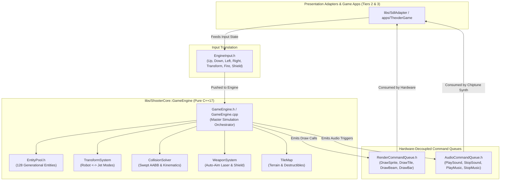
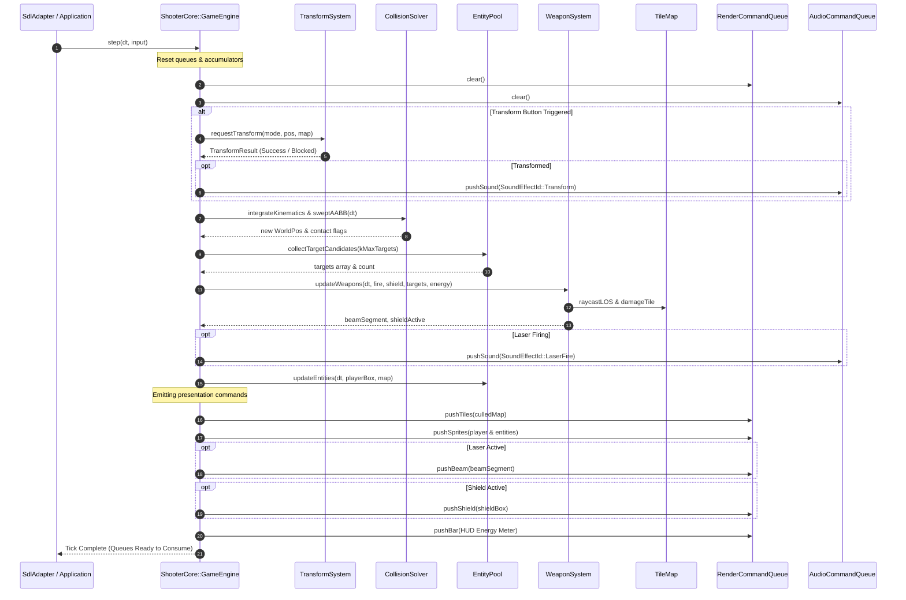
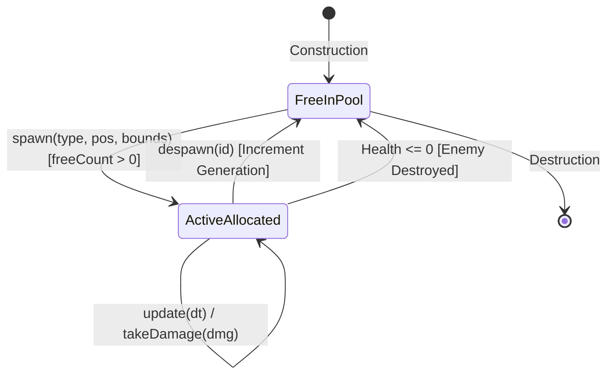

# Phase 5: Command Queues & GameEngine Core Simulation Implementation Plan

## 1. Executive Summary & Scope

Phase 5 completes Tier 1 (`libs/ShooterCore`) of the Shoot'Em-Up Game Engine, integrating the foundational subsystems authoritatively implemented in Phases 1 through 4 into a unified, deterministic, and hardware-decoupled simulation orchestrator. Inspired by Game Arts' 1985 classic **Thexder**, Phase 5 delivers the core engine runtime responsible for stepping physics, animating transformations, updating auto-aiming combat, managing dynamic entity lifecycles, and emitting abstract rendering and audio instructions for Tier 2 presentation adapters.

### Core Objectives & Deliverables
1. **Normalized Input Representation (`EngineInput.h`)**:
   - Zero-dependency, strongly-typed input bitmask capturing 8-way directional navigation and tactical action triggers (`Up`, `Down`, `Left`, `Right`, `Transform`, `Fire`, `Shield`).
   - Bitwise query interface providing branch-free edge and state detection.

2. **Hardware-Decoupled Output Queues (`RenderCommandQueue.h`, `AudioCommandQueue.h`)**:
   - Abstract presentation commands insulating `libs/ShooterCore` completely from graphics and audio hardware (SDL2, OpenGL, Vulkan, Direct3D).
   - Command definitions:
     - `DrawSprite`: Entity rendering with sprite index, orientation, and layer sorting.
     - `DrawTile`: Viewport-culled terrain grid cells.
     - `DrawBeam`: Vector laser graphics with dynamic endpoint and locked-target targeting cues.
     - `DrawBar`: Screen-space HUD meters for energy, shield gauge, and score readouts.
     - `PlaySound` & `PlayMusic`: Audio trigger commands referencing semantic chiptune SFX and music track identifiers.
   - Zero-heap fixed-capacity contiguous ring/array buffers (`CERT ERR55-CPP`).

3. **Zero-Heap Generational Entity Pool (`EntityPool.h`)**:
   - High-performance, contiguous object pool supporting player, enemy units, projectiles, and particle effects up to fixed capacity (`kMaxEntities = 128U`).
   - Generational index handles (`EntityId`: 16-bit index + 16-bit generation) preventing ABA stale references and dangling pointers without dynamic allocation.
   - $O(1)$ allocation and recycling using a pre-allocated stack-based free-list.

4. **High-Level Simulation Orchestrator (`GameEngine.h`, `GameEngine.cpp`)**:
   - Master simulation coordinator executing fixed-timestep updates (`step(DeltaTime dt, EngineInput input)`).
   - Kinematics & clearance integration:
     - **Robot Mode**: Ground walking, friction, jump impulse ($v_{jump} = -320\text{ px/s}$), gravity ($g = 980\text{ px/s}^2$), Swept AABB wall collisions.
     - **Jet Mode**: Omnidirectional 8-way sustained thrust ($a = 400\text{ px/s}^2$), zero gravity, top speed clamping ($v_{max} = 220\text{ px/s}$), and tight 1-tile tunnel navigation.
   - Subsystem coordination:
     - `TransformSystem`: Headroom verification and transformation delay pacing.
     - `WeaponSystem`: Candidate gathering from `EntityPool` and `TileMap`, auto-aim targeting, continuous laser damage, and energy barrier shield defense.
     - `TileMap`: Destructible block erosion and spatial culling.
   - Viewport & camera tracking centered on the player craft with map perimeter clamping.
   - Frame command emission populating `RenderCommandQueue` and `AudioCommandQueue` for presentation consumption.

5. **Safety, Reliability & Compliance (`MISRA C++:2023`, `SEI CERT C++`)**:
   - Zero dynamic heap allocation (`std::vector`, `std::string`, `new`, `std::make_unique`) during active simulation steps (`SEI CERT ERR55-CPP`).
   - Range-verified integer conversions with explicit `static_cast` (`MISRA C++:2023 Rule 7.0.6`, `SEI CERT INT31-C`).
   - Strict Include-What-You-Use (IWYU) adherence and mandatory `std::` `<cstdint>` qualification.
   - All function identifiers strictly under 30 characters.
   - 100% headless automated test coverage under CTest.

---

## 2. Architecture & File Layout

All code developed in Phase 5 resides strictly within `libs/ShooterCore` (Pure C++17, zero external dependencies) and `tests/ShooterCoreTests`.

### 2.1 ASCII Directory & Artifact Layout
```
+-------------------------------------------------------------------------------+
|                       PHASE 5 DIRECTORY & ARTIFACT LAYOUT                     |
|                                                                               |
|   shoot-em-up-engine.git/                                                     |
|   ├── CMakeLists.txt                                                          |
|   ├── cmake/                                                                  |
|   │   ├── CompilerFlags.cmake              <-- Strict flags & hardening       |
|   │   └── GitHooks.cmake                   <-- Automated git hooks            |
|   ├── docs/                                                                   |
|   │   ├── implementation_plan.md           <-- Master architecture roadmap    |
|   │   ├── phase1_plan.md                   <-- Types & Build plan             |
|   │   ├── phase2_plan.md                   <-- TileMap & Collision plan       |
|   │   ├── phase3_plan.md                   <-- TransformSystem plan           |
|   │   ├── phase4_plan.md                   <-- WeaponSystem plan              |
|   │   └── phase5_plan.md                   <-- This document                  |
|   ├── libs/                                                                   |
|   │   └── ShooterCore/                     <-- Tier 1 Pure C++17 Core Engine  |
|   │       ├── CMakeLists.txt               <-- Updated with Phase 5 targets   |
|   │       ├── Types.h                      <-- Extended domain value types    |
|   │       ├── Hitbox.h / .cpp              <-- Spatial AABB geometry          |
|   │       ├── TileMap.h / .cpp             <-- 2D terrain grid & tiles        |
|   │       ├── CollisionSolver.h / .cpp     <-- Swept AABB & Raycast LOS       |
|   │       ├── TransformSystem.h / .cpp     <-- Robot <-> Jet transformation   |
|   │       ├── WeaponSystem.h / .cpp        <-- Auto-aim laser & shield barrier|
|   │       ├── EngineInput.h                <-- Normalized input bitmask [NEW] |
|   │       ├── RenderCommandQueue.h         <-- Decoupled draw commands  [NEW] |
|   │       ├── AudioCommandQueue.h          <-- Decoupled audio commands [NEW] |
|   │       ├── EntityPool.h                 <-- Zero-heap object pool    [NEW] |
|   │       └── GameEngine.h / .cpp          <-- Master simulation core   [NEW] |
|   └── tests/                                                                  |
|       └── ShooterCoreTests/                <-- Headless Automated CTest Suite |
|           ├── CMakeLists.txt               <-- Updated test registrations     |
|           ├── Main.cpp                     <-- Test runner entry point        |
|           ├── TestHarness.h                <-- Assertion macros               |
|           ├── TestEngineInput.cpp          <-- Bitmask & query tests    [NEW] |
|           ├── TestCommandQueues.cpp        <-- Queue buffer tests       [NEW] |
|           ├── TestEntityPool.cpp           <-- Lifecycle & handle tests [NEW] |
|           └── TestGameEngine.cpp           <-- Simulation & step tests  [NEW] |
+-------------------------------------------------------------------------------+
```

### 2.2 Mermaid Architecture & Component Dependency Diagram


---

## 3. Mathematical & Algorithmic Foundation

### 3.1 Normalized Input Bitmask Representation
To eliminate raw primitive integer flags and prevent state corruption, input state is modeled as a strongly-typed 16-bit bitmask `EngineInput`:

$$\text{InputMask} = \sum_{i} \text{Bit}_i$$

| Action | Bit Position | Bitmask Value | Description |
| :--- | :--- | :--- | :--- |
| `None` | - | `0x0000U` | Idle / neutral state |
| `Up` | Bit 0 | `0x0001U` | Upward movement / ladder climb / vertical jet thrust |
| `Down` | Bit 1 | `0x0002U` | Crouch (Robot) / downward jet thrust |
| `Left` | Bit 2 | `0x0004U` | Leftward thrust or horizontal walk |
| `Right` | Bit 3 | `0x0008U` | Rightward thrust or horizontal walk |
| `Jump` | Bit 4 | `0x0010U` | Vertical jump impulse in Robot mode |
| `Transform` | Bit 5 | `0x0020U` | Request Robot $\leftrightarrow$ Jet mode switch |
| `Fire` | Bit 6 | `0x0040U` | Auto-aiming homing laser emission intent |
| `Shield` | Bit 7 | `0x0080U` | Energy barrier deployment intent |

Each button is testable via bitwise AND with zero branches:
$$\text{isPressed}(B) \iff (\text{mask\_} \ \& \ B) \neq 0$$

### 3.2 Generational Bounded Entity Pool Architecture
Dynamic allocation on the simulation hot path (`std::vector::push_back`, `new`, `std::make_unique`) violates `SEI CERT ERR55-CPP` due to heap exhaustion failure (`std::bad_alloc`). Phase 5 employs a static, bounded generational pool:

```
+-------------------------------------------------------------------------------+
|                       GENERATIONAL HANDLE ENCODING                            |
|                                                                               |
|   31                          16 15                           0               |
|   +-----------------------------+-----------------------------+               |
|   |    Generation (16 bits)     |      Slot Index (16 bits)   |               |
|   +-----------------------------+-----------------------------+               |
|                                                                               |
|   • Slot Index [0, 127]: Direct array subscript in O(1) time                  |
|   • Generation [1, 65535]: Validates slot recency to reject stale handles     |
|   • Generation 0: Reserved as Sentinel / Null Handle                          |
+-------------------------------------------------------------------------------+
```

#### Invariant Enforcement & Handle Lifecycle
1. **Handle Validity**: An `EntityId` is valid if and only if:
   $$\text{index} < \text{kCapacity} \quad \land \quad \text{slots}[\text{index}].\text{generation} == \text{id}.\text{generation}() \quad \land \quad \text{slots}[\text{index}].\text{active} == \text{true}$$
2. **Allocation ($O(1)$)**: Pop top index from pre-allocated free-list array `freeIndices_`. Initialize slot, increment generation (wrapping around from `0xFFFF` to `1` to avoid `0`), mark `active = true`, decrement available count.
3. **Deallocation ($O(1)$)**: If handle is valid, mark `active = false`, push index back onto `freeIndices_`, increment slot generation so any outstanding handle immediately becomes invalid.

### 3.3 Player Kinematics & Mode Movement Integrator
The player craft's movement is determined by its current `TransformMode` and processed using fixed-timestep semi-implicit Euler integration with swept collision response:

#### 3.3.1 Robot Mode Kinematics
- **Gravity Acceleration**: $a_y = +980.0\text{ px/s}^2$.
- **Ground Walking**: When grounded (`onGround == true`), pressing `Left` sets $v_x = -100.0\text{ px/s}$; pressing `Right` sets $v_x = +100.0\text{ px/s}$.
- **Ground Friction**: When no horizontal input is active and grounded:
  $$v_x(t + \Delta t) = v_x(t) \cdot \max\left(0, 1.0 - \mu_{\text{ground}} \cdot \Delta t\right), \quad \mu_{\text{ground}} = 12.0\text{ s}^{-1}$$
- **Jump Impulse**: If grounded and `Jump` is triggered, instantaneous vertical impulse is applied:
  $$v_y = -320.0\text{ px/s}, \quad \text{onGround} = \text{false}$$
- **Terminal Fall Velocity**: $v_y = \min(v_y + g \cdot \Delta t, 400.0\text{ px/s})$.

#### 3.3.2 Jet Mode Kinematics
- **Omnidirectional Thrust**: Zero gravity ($g = 0$). Input directions apply acceleration $a_{\text{thrust}} = 400.0\text{ px/s}^2$ along cardinal and diagonal axes:
  $$\mathbf{a}_{\text{input}} = \begin{pmatrix} d_x \\ d_y \end{pmatrix} \cdot a_{\text{thrust}}, \quad d_x, d_y \in \{-1, 0, 1\}$$
- **Atmospheric Drag**: Sustained aerodynamic deceleration when thrust is neutral:
  $$\mathbf{v}(t + \Delta t) = \mathbf{v}(t) \cdot \max\left(0.0, 1.0 - c_{\text{drag}} \cdot \Delta t\right), \quad c_{\text{drag}} = 3.5\text{ s}^{-1}$$
- **Speed Clamping**: Maximum velocity magnitude is strictly bounded:
  $$\|\mathbf{v}\| \le v_{\text{max\_jet}} = 220.0\text{ px/s}$$

### 3.4 Camera Viewport Tracking & Spatial Culling
The game camera tracks the player craft with coordinate smoothing and boundary clamping against the `TileMap` dimensions:

$$\text{cam}_x = \text{clamp}\left(\text{player}_x - \frac{W_{\text{viewport}}}{2}, 0.0, \ W_{\text{map}} - W_{\text{viewport}}\right)$$
$$\text{cam}_y = \text{clamp}\left(\text{player}_y - \frac{H_{\text{viewport}}}{2}, 0.0, \ H_{\text{map}} - H_{\text{viewport}}\right)$$

#### Viewport Tile Culling
Only tiles intersecting the camera's bounding box are emitted into `RenderCommandQueue`:
$$\text{col}_{\text{min}} = \max\left(0, \left\lfloor \frac{\text{cam}_x}{\text{tileSize}} \right\rfloor\right), \quad \text{col}_{\text{max}} = \min\left(C - 1, \left\lceil \frac{\text{cam}_x + W_{\text{viewport}}}{\text{tileSize}} \right\rceil\right)$$
$$\text{row}_{\text{min}} = \max\left(0, \left\lfloor \frac{\text{cam}_y}{\text{tileSize}} \right\rfloor\right), \quad \text{row}_{\text{max}} = \min\left(R - 1, \left\lceil \frac{\text{cam}_y + H_{\text{viewport}}}{\text{tileSize}} \right\rceil\right)$$

This culls out over 95% of off-screen tiles in cavernous labyrinth levels, keeping render command emission strictly under bounded queue capacity.

---

## 4. Visual Diagrams

### 4.1 ASCII Simulation Frame Pipeline
```
+-------------------------------------------------------------------------------+
|                       GAMEENGINE TICK SIMULATION PIPELINE                     |
|                                                                               |
|   1. INPUT INGESTION                                                          |
|      Consume EngineInput bitmask (Up/Down/Left/Right/Transform/Fire/Shield)   |
|         │                                                                     |
|         ▼                                                                     |
|   2. MODE TRANSFORMATION ARBITRATION                                         |
|      If Transform pressed -> Query TransformSystem::canTransform              |
|      Robot -> Jet: Always allowed | Jet -> Robot: Requires 2-tile clearance   |
|         │                                                                     |
|         ▼                                                                     |
|   3. KINEMATICS & SWEPT COLLISION RESOLUTION                                  |
|      Apply mode physics (Robot gravity vs Jet thrust)                         |
|      Execute CollisionSolver::sweptAABB against TileMap walls                 |
|      Resolve contact normals & update player Hitbox                           |
|         │                                                                     |
|         ▼                                                                     |
|   4. TARGET CANDIDATE HARVESTING                                              |
|      Harvest active enemies from EntityPool (<= 32 hostile targets)           |
|      Harvest adjacent destructible blocks from TileMap                        |
|         │                                                                     |
|         ▼                                                                     |
|   5. WEAPON & SHIELD SYSTEMS EXECUTION                                        |
|      Execute WeaponSystem::updateWeapons:                                     |
|      LOS raycasts, auto-aim scoring, continuous beam & destructible damage   |
|      Single-pool energy consumption & shield barrier activation               |
|         │                                                                     |
|         ▼                                                                     |
|   6. DYNAMIC ENTITY SIMULATION                                                |
|      Update patrolling / flying enemies, bullet projectiles, particle sparks  |
|      Check entity <-> player hitbox overlaps & apply damage or shield absorbs |
|         │                                                                     |
|         ▼                                                                     |
|   7. VIEWPORT CAMERA COMPUTATION                                              |
|      Smooth-track player center & clamp to map boundary                       |
|         │                                                                     |
|         ▼                                                                     |
|   8. DECOUPLED COMMAND EMISSION                                               |
|      Emit visible TileMap cells -> RenderCommandQueue                         |
|      Emit active entities & player sprite -> RenderCommandQueue               |
|      Emit laser beam & shield barrier -> RenderCommandQueue                   |
|      Emit HUD energy & shield meters -> RenderCommandQueue                    |
|      Emit sound triggers (Laser SFX, Explode SFX, Transform SFX) -> AudioQueue|
+-------------------------------------------------------------------------------+
```

### 4.2 ASCII Generational Entity Pool Memory Layout
```
+-------------------------------------------------------------------------------+
|                       ENTITY POOL MEMORY ARCHITECTURE                         |
|                                                                               |
|   std::array<EntitySlot, 128> slots_:                                         |
|   Slot 0      Slot 1      Slot 2                  Slot 127                    |
|   +-----------+-----------+-----------+ ... ...   +-----------+               |
|   | Gen: 1    | Gen: 4    | Gen: 1    |           | Gen: 1    |               |
|   | Active: T | Active: F | Active: T |           | Active: F |               |
|   | EntityData| [RECYCLED]| EntityData|           | [UNUSED]  |               |
|   +-----------+-----------+-----------+           +-----------+               |
|         ▲           │                                   ▲                     |
|         │           ▼                                   │                     |
|   Active Entity   Slot 1 is on Free List          Slot 127 is on Free List    |
|                                                                               |
|   std::array<std::uint16_t, 128> freeIndices_:                                |
|   Top -> [ 1, 127, 3, 5, ... ] (freeCount_ = 2)                               |
+-------------------------------------------------------------------------------+
```

### 4.3 Mermaid Simulation Tick Sequence Diagram


### 4.4 Mermaid EntityPool State Diagram


---

## 5. Detailed Component Specifications

### 5.1 Extension to `libs/ShooterCore/Types.h`
The following domain types are added to `Types.h` to model presentation commands and entities:

```cpp
/// @brief Visual sprite identifier for presentation rendering.
enum class SpriteId : std::uint16_t {
    None = 0U,
    PlayerRobotWalk1 = 1U,
    PlayerRobotWalk2 = 2U,
    PlayerRobotJump = 3U,
    PlayerJet = 4U,
    PlayerTransforming = 5U,
    EnemyPatrol = 10U,
    EnemyFlyer = 11U,
    EnemyBoss = 12U,
    SparkParticle = 20U,
    Explosion = 21U
};

/// @brief Sound effect identifier for presentation audio playback.
enum class SoundEffectId : std::uint8_t {
    None = 0U,
    LaserFire = 1U,
    LaserHit = 2U,
    ShieldDeploy = 3U,
    ShieldDeflect = 4U,
    TransformRobot = 5U,
    TransformJet = 6U,
    PlayerDamage = 7U,
    EnemyExplode = 8U,
    BlockCrumble = 9U,
    EnergyWarning = 10U
};

/// @brief Music track identifier for presentation audio stream.
enum class MusicTrackId : std::uint8_t {
    None = 0U,
    MainTheme = 1U,
    Level1Cavern = 2U,
    BossBattle = 3U,
    GameOver = 4U
};

/// @brief Entity classification category.
enum class EntityType : std::uint8_t {
    None = 0U,
    Player = 1U,
    PatrolWalker = 2U,
    HomingFlyer = 3U,
    HostileBullet = 4U,
    Particle = 5U
};

/// @class EntityId
/// @brief Generational handle uniquely referencing an active entity slot.
class EntityId final {
public:
    constexpr EntityId() noexcept = default;

    explicit constexpr EntityId(std::uint16_t idx, std::uint16_t gen) noexcept
        : index_{idx}, generation_{gen} {}

    [[nodiscard]] constexpr std::uint16_t index() const noexcept { return index_; }
    [[nodiscard]] constexpr std::uint16_t generation() const noexcept { return generation_; }
    [[nodiscard]] constexpr bool isValid() const noexcept { return generation_ > 0U; }

    [[nodiscard]] constexpr bool operator==(const EntityId& o) const noexcept {
        return index_ == o.index_ && generation_ == o.generation_;
    }
    [[nodiscard]] constexpr bool operator!=(const EntityId& o) const noexcept {
        return !(*this == o);
    }

private:
    std::uint16_t index_{0U};
    std::uint16_t generation_{0U};
};

/// @struct ColorRgba
/// @brief 32-bit RGBA color representation for vector beams and HUD elements.
struct ColorRgba final {
    std::uint8_t r{255U};
    std::uint8_t g{255U};
    std::uint8_t b{255U};
    std::uint8_t a{255U};
};

/// @struct CameraViewport
/// @brief World extents and position of the current view camera.
struct CameraViewport final {
    WorldPos pos{0.0f, 0.0f};
    float width{320.0f};
    float height{240.0f};
};
```

---

### 5.2 `EngineInput.h` Specification
```cpp
#pragma once

#include <cstdint>

namespace ShooterCore {

/// @class EngineInput
/// @brief Strongly-typed normalized input bitmask for discrete engine actions.
/// @details Strictly zero external dependencies per Tier 1 boundaries.
class EngineInput final {
public:
    static constexpr std::uint16_t kNone      { 0x0000U };
    static constexpr std::uint16_t kUp        { 0x0001U };
    static constexpr std::uint16_t kDown      { 0x0002U };
    static constexpr std::uint16_t kLeft      { 0x0004U };
    static constexpr std::uint16_t kRight     { 0x0008U };
    static constexpr std::uint16_t kJump      { 0x0010U };
    static constexpr std::uint16_t kTransform { 0x0020U };
    static constexpr std::uint16_t kFire      { 0x0040U };
    static constexpr std::uint16_t kShield    { 0x0080U };

    constexpr EngineInput() noexcept = default;

    explicit constexpr EngineInput(std::uint16_t mask) noexcept
        : mask_{mask} {}

    [[nodiscard]] constexpr std::uint16_t raw() const noexcept { return mask_; }

    [[nodiscard]] constexpr bool isUp() const noexcept { return (mask_ & kUp) != 0U; }
    [[nodiscard]] constexpr bool isDown() const noexcept { return (mask_ & kDown) != 0U; }
    [[nodiscard]] constexpr bool isLeft() const noexcept { return (mask_ & kLeft) != 0U; }
    [[nodiscard]] constexpr bool isRight() const noexcept { return (mask_ & kRight) != 0U; }
    [[nodiscard]] constexpr bool isJump() const noexcept { return (mask_ & kJump) != 0U; }
    [[nodiscard]] constexpr bool isTransform() const noexcept { return (mask_ & kTransform) != 0U; }
    [[nodiscard]] constexpr bool isFire() const noexcept { return (mask_ & kFire) != 0U; }
    [[nodiscard]] constexpr bool isShield() const noexcept { return (mask_ & kShield) != 0U; }

    constexpr void setButton(std::uint16_t btn) noexcept { mask_ |= btn; }
    constexpr void clearButton(std::uint16_t btn) noexcept { mask_ &= static_cast<std::uint16_t>(~btn); }
    constexpr void clear() noexcept { mask_ = kNone; }

private:
    std::uint16_t mask_{kNone};
};

} // namespace ShooterCore
```

---

### 5.3 `RenderCommandQueue.h` Specification
```cpp
#pragma once

#include <cstddef>
#include <cstdint>

#include <array>

#include "Hitbox.h"
#include "Types.h"

namespace ShooterCore {

/// @brief Tagged render command type discriminator.
enum class RenderCommandType : std::uint8_t {
    None = 0U,
    DrawSprite = 1U,
    DrawTile = 2U,
    DrawBeam = 3U,
    DrawBar = 4U
};

/// @struct RenderCommand
/// @brief Hardware-independent drawing instruction emitted by GameEngine.
struct RenderCommand final {
    RenderCommandType type{RenderCommandType::None};
    SpriteId sprite{SpriteId::None};
    TileType tileType{TileType::Empty};
    WorldPos pos{0.0f, 0.0f};
    WorldPos endpoint{0.0f, 0.0f}; // For DrawBeam
    float width{0.0f};            // For DrawBar
    float height{0.0f};           // For DrawBar
    float fillPct{0.0f};          // For DrawBar [0.0f, 1.0f]
    ColorRgba color{};
    FacingDirection facing{FacingDirection::Right};
    std::uint8_t layer{0U};
};

/// @class RenderCommandQueue
/// @brief Zero-heap fixed-capacity buffer storing draw calls for Tier 2 adapters.
/// @details Maximum capacity is 2048 commands per frame, guaranteeing zero allocation.
class RenderCommandQueue final {
public:
    static constexpr std::size_t kCapacity{2048U};

    constexpr RenderCommandQueue() noexcept = default;

    [[nodiscard]] constexpr std::size_t count() const noexcept { return count_; }
    [[nodiscard]] constexpr bool isEmpty() const noexcept { return count_ == 0U; }
    [[nodiscard]] constexpr bool isFull() const noexcept { return count_ >= kCapacity; }

    constexpr void clear() noexcept { count_ = 0U; }

    [[nodiscard]] constexpr const RenderCommand& get(std::size_t idx) const noexcept {
        return commands_[idx < kCapacity ? idx : 0U];
    }

    /// @brief Push sprite render command.
    bool pushSprite(SpriteId sprite, WorldPos pos, FacingDirection facing, std::uint8_t layer) noexcept;

    /// @brief Push tile render command.
    bool pushTile(TileType type, WorldPos pos, std::uint8_t layer) noexcept;

    /// @brief Push vector laser beam render command.
    bool pushBeam(WorldPos origin, WorldPos endpoint, ColorRgba color) noexcept;

    /// @brief Push screen-space HUD bar command.
    bool pushBar(WorldPos pos, float width, float height, float pct, ColorRgba color) noexcept;

private:
    std::array<RenderCommand, kCapacity> commands_{};
    std::size_t count_{0U};
};

} // namespace ShooterCore
```

---

### 5.4 `AudioCommandQueue.h` Specification
```cpp
#pragma once

#include <cstddef>
#include <cstdint>

#include <array>

#include "Types.h"

namespace ShooterCore {

/// @brief Tagged audio command discriminator.
enum class AudioCommandType : std::uint8_t {
    None = 0U,
    PlaySound = 1U,
    StopSound = 2U,
    PlayMusic = 3U,
    StopMusic = 4U
};

/// @struct AudioCommand
/// @brief Decoupled audio trigger emitted by GameEngine.
struct AudioCommand final {
    AudioCommandType type{AudioCommandType::None};
    SoundEffectId soundId{SoundEffectId::None};
    MusicTrackId musicId{MusicTrackId::None};
    float volume{1.0f};
    bool loop{false};
};

/// @class AudioCommandQueue
/// @brief Zero-heap fixed-capacity buffer storing audio triggers.
class AudioCommandQueue final {
public:
    static constexpr std::size_t kCapacity{64U};

    constexpr AudioCommandQueue() noexcept = default;

    [[nodiscard]] constexpr std::size_t count() const noexcept { return count_; }
    [[nodiscard]] constexpr bool isEmpty() const noexcept { return count_ == 0U; }
    [[nodiscard]] constexpr bool isFull() const noexcept { return count_ >= kCapacity; }

    constexpr void clear() noexcept { count_ = 0U; }

    [[nodiscard]] constexpr const AudioCommand& get(std::size_t idx) const noexcept {
        return commands_[idx < kCapacity ? idx : 0U];
    }

    /// @brief Push sound effect playback command.
    bool pushSound(SoundEffectId id, float volume = 1.0f) noexcept;

    /// @brief Push music track playback command.
    bool pushMusic(MusicTrackId id, bool loop = true) noexcept;

    /// @brief Push stop music command.
    bool stopMusic() noexcept;

private:
    std::array<AudioCommand, kCapacity> commands_{};
    std::size_t count_{0U};
};

} // namespace ShooterCore
```

---

### 5.5 `EntityPool.h` Specification
```cpp
#pragma once

#include <cstddef>
#include <cstdint>

#include <array>

#include "Hitbox.h"
#include "Types.h"

namespace ShooterCore {

/// @struct Entity
/// @brief Complete state data representation for an active entity.
struct Entity final {
    EntityType type{EntityType::None};
    WorldPos pos{0.0f, 0.0f};
    Velocity vel{0.0f, 0.0f};
    Hitbox bounds{};
    std::uint16_t health{1U};
    FacingDirection facing{FacingDirection::Left};
    float stateTimer{0.0f};
    bool onGround{false};
};

/// @struct EntitySlot
/// @brief Internal pool element tracking state and generation.
struct EntitySlot final {
    Entity data{};
    std::uint16_t generation{1U};
    bool active{false};
};

/// @class EntityPool
/// @brief Zero-heap generational object pool managing active game entities.
class EntityPool final {
public:
    static constexpr std::size_t kCapacity{128U};

    EntityPool() noexcept;

    [[nodiscard]] std::size_t count() const noexcept { return activeCount_; }
    [[nodiscard]] constexpr std::size_t capacity() const noexcept { return kCapacity; }
    [[nodiscard]] bool isFull() const noexcept { return activeCount_ >= kCapacity; }

    /// @brief Clear all active entities and reset free-list.
    void clear() noexcept;

    /// @brief Allocate entity from pool.
    /// @return Generational EntityId handle (valid on success; invalid if full).
    EntityId spawn(EntityType type, WorldPos pos, Hitbox bounds, std::uint16_t health) noexcept;

    /// @brief Release entity back to pool.
    /// @return true if handle was valid and recycled; false otherwise.
    bool despawn(EntityId id) noexcept;

    /// @brief Retrieve mutable pointer to entity data if handle is valid.
    [[nodiscard]] Entity* get(EntityId id) noexcept;

    /// @brief Retrieve const pointer to entity data if handle is valid.
    [[nodiscard]] const Entity* get(EntityId id) const noexcept;

    /// @brief Verify if handle is active and generation matches.
    [[nodiscard]] bool isValid(EntityId id) const noexcept;

    /// @brief Get internal slot reference for direct index iteration.
    [[nodiscard]] const EntitySlot& slot(std::size_t idx) const noexcept {
        return slots_[idx < kCapacity ? idx : 0U];
    }

private:
    std::array<EntitySlot, kCapacity> slots_{};
    std::array<std::uint16_t, kCapacity> freeIndices_{};
    std::size_t freeCount_{kCapacity};
    std::size_t activeCount_{0U};
};

} // namespace ShooterCore
```

---

### 5.6 `GameEngine.h` & `GameEngine.cpp` Specification
```cpp
#pragma once

#include <cstddef>
#include <cstdint>

#include <array>

#include "AudioCommandQueue.h"
#include "CollisionSolver.h"
#include "EngineInput.h"
#include "EntityPool.h"
#include "Hitbox.h"
#include "RenderCommandQueue.h"
#include "TileMap.h"
#include "TransformSystem.h"
#include "Types.h"
#include "WeaponSystem.h"

namespace ShooterCore {

/// @class GameEngine
/// @brief Master simulation engine coordinating physics, combat, transform, and command emission.
/// @details Maintains zero dynamic heap allocations on the simulation path (CERT ERR55-CPP).
class GameEngine final {
public:
    static constexpr float kTileSize{16.0f};
    static constexpr float kGravity{980.0f};
    static constexpr float kJumpSpeed{-320.0f};
    static constexpr float kWalkSpeed{100.0f};
    static constexpr float kJetThrust{400.0f};
    static constexpr float kJetMaxSpeed{220.0f};
    static constexpr float kGroundFriction{12.0f};
    static constexpr float kJetDrag{3.5f};

    GameEngine() noexcept;

    /// @brief Initialize new level simulation.
    void initLevel(const TileMap& map, WorldPos playerSpawn) noexcept;

    /// @brief Master simulation update step.
    /// @param[in] dt Simulation delta time.
    /// @param[in] input Normalized input bitmask.
    void step(DeltaTime dt, EngineInput input) noexcept;

    // State Queries
    [[nodiscard]] WorldPos getPlayerPos() const noexcept { return playerPos_; }
    [[nodiscard]] Velocity getPlayerVel() const noexcept { return playerVel_; }
    [[nodiscard]] Hitbox getPlayerBox() const noexcept { return playerBox_; }
    [[nodiscard]] TransformMode getPlayerMode() const noexcept { return transformSys_.currentMode(); }
    [[nodiscard]] EnergyPoints getPlayerEnergy() const noexcept { return energy_; }
    [[nodiscard]] FacingDirection getPlayerFacing() const noexcept { return playerFacing_; }
    [[nodiscard]] bool isPlayerAlive() const noexcept { return isAlive_; }
    [[nodiscard]] CameraViewport getViewport() const noexcept { return camera_; }

    // Direct Access to Decoupled Output Queues
    [[nodiscard]] const RenderCommandQueue& getRenderQueue() const noexcept { return renderQueue_; }
    [[nodiscard]] const AudioCommandQueue& getAudioQueue() const noexcept { return audioQueue_; }

    // Subsystem Queries for Testing
    [[nodiscard]] const TileMap& getTileMap() const noexcept { return map_; }
    [[nodiscard]] TileMap& getTileMap() noexcept { return map_; }
    [[nodiscard]] const EntityPool& getEntityPool() const noexcept { return entities_; }
    [[nodiscard]] EntityPool& getEntityPool() noexcept { return entities_; }
    [[nodiscard]] const WeaponSystem& getWeaponSystem() const noexcept { return weaponSys_; }
    [[nodiscard]] const TransformSystem& getTransformSystem() const noexcept { return transformSys_; }

    /// @brief Spawn an enemy entity into the simulation.
    EntityId spawnEnemy(EntityType type, WorldPos pos, Hitbox bounds, std::uint16_t hp) noexcept;

private:
    void updateInput(DeltaTime dt, EngineInput input) noexcept;
    void updatePhysics(DeltaTime dt) noexcept;
    void updateWeapons(DeltaTime dt, EngineInput input) noexcept;
    void updateEntities(DeltaTime dt) noexcept;
    void updateCamera() noexcept;
    void emitCommands() noexcept;

    TileMap map_{};
    EntityPool entities_{};
    TransformSystem transformSys_{};
    WeaponSystem weaponSys_{};

    RenderCommandQueue renderQueue_{};
    AudioCommandQueue audioQueue_{};

    WorldPos playerPos_{0.0f, 0.0f};
    Velocity playerVel_{0.0f, 0.0f};
    Hitbox playerBox_{};
    FacingDirection playerFacing_{FacingDirection::Right};
    EnergyPoints energy_{EnergyPoints::kDefaultMax};
    CameraViewport camera_{};
    bool onGround_{false};
    bool isAlive_{true};
};

} // namespace ShooterCore
```

---

## 6. Implementation & Compliance Analysis

### 6.1 MISRA C++:2023 & SEI CERT Compliance Matrix

| Rule / Standard | Requirement | Implementation Enforcement |
| :--- | :--- | :--- |
| **MISRA C++:2023 Rule 7.0.6** | Explicit signed/unsigned conversions | All arithmetic involving grid bounds, indices, and sizes uses explicit `static_cast<std::size_t>` or `static_cast<std::uint16_t>`. Range clamping applied before cast. |
| **SEI CERT INT31-C** | Safe integer conversions | Entity generations increment with explicit overflow checking; bitmask operations operate solely on unsigned `std::uint16_t`. |
| **SEI CERT ERR55-CPP** | Exception safety in `noexcept` | `GameEngine::step`, `EntityPool`, and queues are marked `noexcept`. All dynamic allocations (`std::vector`, `std::string`, `new`) are completely banned; memory is statically pre-allocated via `std::array`. |
| **Project Rule 5** | Concise function names | All function names strictly $< 30$ characters (e.g., `step`, `spawn`, `despawn`, `getRenderQueue`, `initLevel`). |
| **IWYU Policy** | Include-What-You-Use | Headers include only directly used symbols; forward declarations leveraged in headers where applicable. |
| **Standard `<cstdint>`** | Fixed-width types scoped | `std::uint8_t`, `std::uint16_t`, `std::uint32_t`, `std::size_t` from `<cstdint>` and `<cstddef>` explicitly included and scoped with `std::`. |

### 6.2 Include-What-You-Use (IWYU) Policy
Every source and header file strictly follows the canonical grouping order:
1. Associated header (e.g., `#include "GameEngine.h"`)
2. C System / Standard headers (`#include <cstddef>`, `#include <cstdint>`)
3. C++ Standard Library headers (`#include <algorithm>`, `#include <array>`)
4. Third-Party Libraries (None permitted in `libs/ShooterCore`)
5. Project Local Headers (`#include "TileMap.h"`, `#include "Types.h"`)

---

## 7. Step-by-Step Test-Driven Verification Plan

Development follows strict Test-Driven Development (TDD). Each unit test must be written and observed failing before implementing production functionality.

### Step 1: `EngineInput` Unit Tests (`TestEngineInput.cpp`)
- **Focus**: Verify bitmask setting, clearing, raw representation, and semantic query methods.
- **Test Cases**:
  - `TestInputDefaults`: Fresh input defaults to zero / `kNone`.
  - `TestButtonSettingAndClearing`: Setting and clearing individual buttons (`kUp`, `kFire`, `kShield`) reflects in `raw()` and individual query accessors.
  - `TestMultipleSimultaneousButtons`: 8-way directional and multi-action chord combinations operate without bit interference.

### Step 2: `RenderCommandQueue` & `AudioCommandQueue` Tests (`TestCommandQueues.cpp`)
- **Focus**: Verify fixed-capacity ring/array buffers, push operations, data integrity, and bounds enforcement.
- **Test Cases**:
  - `TestRenderQueuePushSprite`: Pushing sprite commands stores values correctly and increments count.
  - `TestRenderQueuePushTileAndBeam`: Pushing tile, vector beam, and HUD bar commands maintains correct tagged types.
  - `TestRenderQueueCapacityClamping`: Pushing beyond `kCapacity` (2048) safely rejects without memory corruption or allocation.
  - `TestAudioQueuePushAndClear`: Pushing sound and music commands and verifying `clear()` resets count to zero.

### Step 3: `EntityPool` Generational Lifecycle Tests (`TestEntityPool.cpp`)
- **Focus**: Verify $O(1)$ allocation, generational handle invalidation, and recycling.
- **Test Cases**:
  - `TestPoolInitialState`: Empty pool has zero active count and full free capacity (128).
  - `TestPoolSpawnAndRecycle`: Allocating an entity yields a valid handle; despawning returns slot to free list and increments generation.
  - `TestPoolStaleHandleRejection`: Accessing a despawned entity via an old handle returns `nullptr` / `isValid == false`.
  - `TestPoolFullCapacity`: Spawning 128 entities succeeds; the 129th spawn fails safely returning invalid handle.

### Step 4: `GameEngine` Kinematics & Simulation Step Tests (`TestGameEngine.cpp`)
- **Focus**: Verify fixed-step physics integration, mode-dependent movement, and transformation arbitration.
- **Test Cases**:
  - `TestRobotWalkingAndGravity`: In Robot mode, gravity accelerates craft downward until solid floor contact; `Left`/`Right` translates position horizontally.
  - `TestRobotJump`: Pressing `Jump` while grounded applies vertical velocity; jumping mid-air is rejected.
  - `TestJetFlightMovement`: In Jet mode, gravity is zero; directional thrust moves craft freely in 8 directions with maximum speed clamping.
  - `TestTransformationInTunnel`: Mode switch from Jet to Robot in a 1-tile tunnel is blocked by `TransformSystem`.

### Step 5: `GameEngine` Combat, Entity Collision & Command Emission Tests (`TestGameEngine.cpp`)
- **Focus**: Verify auto-aim laser firing against active enemies, energy shield deflection, and decoupled command generation.
- **Test Cases**:
  - `TestLaserAutoAimAndDrain`: Pressing `Fire` with hostile enemy in LOS locks beam, damages enemy, and drains player energy pool.
  - `TestShieldBarrierImpact`: Deploying shield barrier reflects incoming enemy contact damage and preserves hull integrity.
  - `TestRenderCommandEmission`: Stepping the engine produces valid `DrawSprite`, `DrawTile`, and HUD `DrawBar` commands in `RenderCommandQueue`.
  - `TestAudioTriggerEmission`: Firing laser, taking damage, and transforming emit respective `SoundEffectId` commands in `AudioCommandQueue`.

---

## 8. Definition of Done

Phase 5 is complete when all of the following criteria are met:
- [ ] All new headers (`EngineInput.h`, `RenderCommandQueue.h`, `AudioCommandQueue.h`, `EntityPool.h`, `GameEngine.h`) and implementations are in `libs/ShooterCore`.
- [ ] All new types in `Types.h` conform to zero-cost, strongly-typed domain value objects.
- [ ] Bounded entity pool executes with $O(1)$ allocation/recycling and generational safety.
- [ ] Render and audio command queues insulate engine simulation completely from hardware APIs.
- [ ] Master `GameEngine::step` simulation runs with zero dynamic heap allocations per tick (`CERT ERR55-CPP`).
- [ ] Headless test suite (`tests/ShooterCoreTests`) passes 100% of unit tests under CTest with zero failures.
- [ ] Code compiles with zero warnings under `/W4` on MSVC and `-Wall -Wextra -pedantic` on GCC/Clang with hardening enabled.
- [ ] Automated verification script `verify_iwyu_cstdint.py` passes on all modified files.
- [ ] All function identifiers are strictly less than 30 characters.

