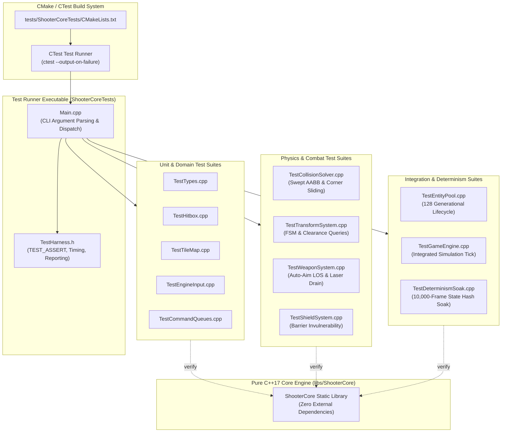
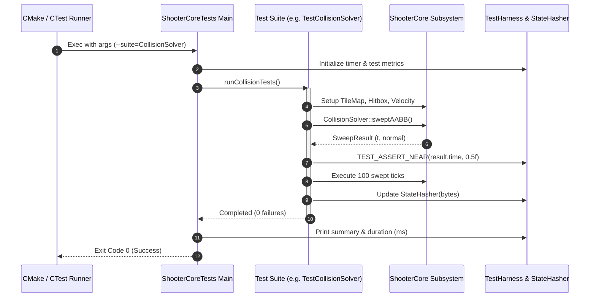
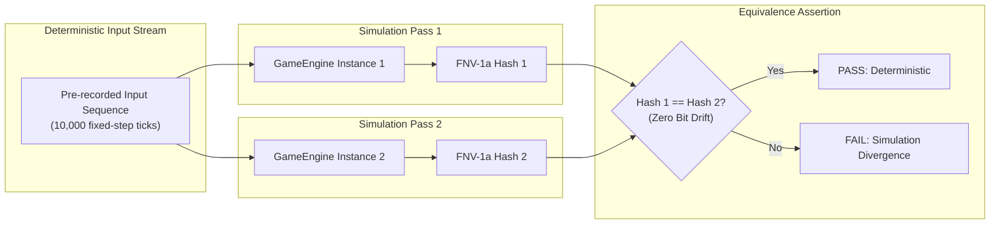

# Phase 6: Automated Headless CTest Suite (tests/ShooterCoreTests) Implementation Plan

## 1. Executive Summary & Scope

Phase 6 formalizes, modularizes, and expands the automated verification infrastructure for the Shoot'Em-Up Game Engine (`libs/ShooterCore`). In Phases 1 through 5, Tier 1 core subsystems were developed alongside initial unit test stubs. Phase 6 transforms these disparate tests into an industrial-grade, deterministic, 100% headless test harness running under **CMake / CTest**.

Inspired by Game Arts' 1985 classic **Thexder**, this phase guarantees that the entire simulation runtime—robot/jet dual transformations, swept AABB continuous collision detection, auto-locking laser targeting, energy shield dissipation, generational entity lifecycles, and decoupled command queues—operates with mathematical determinism, zero memory corruption, and absolute platform independence.

### Core Objectives & Deliverables
1. **Granular CTest Suite Architecture (`tests/ShooterCoreTests/CMakeLists.txt`)**:
   - Decouple the monolithic test binary into modular, individually invokable CTest targets (`ctest -R <SuiteName>`).
   - Assign test labels (`unit`, `physics`, `integration`, `determinism`, `stress`) and execution timeouts.
   - Support selective test execution via command-line arguments (`--suite=<name>`, `--filter=<keyword>`, `--verbose`, `--soak`).
2. **Deterministic Headless Test Harness (`TestHarness.h`, `Main.cpp`)**:
   - Zero-dependency, lightweight assertion engine providing rich failure diagnostics (`TEST_ASSERT`, `TEST_ASSERT_EQ`, `TEST_ASSERT_NEAR`, `TEST_ASSERT_TRUE`, `TEST_ASSERT_FALSE`).
   - Real-time high-resolution execution timing via `std::chrono::high_resolution_clock`.
   - Deterministic test reporting with ANSI color diagnostics and non-zero exit codes upon failure.
3. **Comprehensive Subsystem Coverage Matrix**:
   - **Value Objects & Types (`TestTypes.cpp`)**: Bounds checking, arithmetic invariants, clamp enforcement, explicit conversions.
   - **Hitbox Geometry (`TestHitbox.cpp`)**: AABB edge containment, zero-area degenerate boxes, spatial translation.
   - **TileMap & Clearance (`TestTileMap.cpp`)**: Out-of-bounds safety, destructible wall degradation, multi-tile headroom queries.
   - **Continuous Collision Physics (`TestCollisionSolver.cpp`)**: Swept AABB against static walls, high-velocity tunneling prevention ($v > 300\text{ px/s}$), tangential corner sliding, raycast obstacle occlusion.
   - **Transformation State Machine (`TestTransformSystem.cpp`)**: Finite state transitions, animation delay pacing ($100\text{ ms}$ / 6 ticks), 1-tile tunnel headroom rejection, rapid toggling lockout.
   - **Auto-Aim Laser & Weapons (`TestWeaponSystem.cpp`)**: Line-of-sight candidate gathering, distance and angular auto-aim prioritization, obstacle shadowing, continuous laser energy drain ($10\text{ units/s}$), zero-energy weapon cutoff.
   - **Energy Shield Barrier (`TestShieldSystem.cpp`)**: Barrier activation, impact damage absorption, projectile reflection, energy depletion collapse.
   - **Normalized Input (`TestEngineInput.cpp`)**: Bitmask state manipulation, action combinations, edge and release triggers.
   - **Decoupled Command Queues (`TestCommandQueues.cpp`)**: Ring buffer bounds, capacity overflow rejection, FIFO order preservation for rendering and audio commands.
   - **Generational Entity Pool (`TestEntityPool.cpp`)**: 128-entity capacity exhaustion, ABA prevention via generational indexing, recycled slot reuse, zero dynamic allocation under continuous spawn/despawn cycles.
   - **Master Simulation Integration (`TestGameEngine.cpp`)**: Fixed-timestep stepping ($60\text{ Hz}$), gravity and ground friction, Jet omnidirectional thrust, camera viewport boundary clamping, decoupled command queue emission.
4. **Deterministic Multi-Frame Soak & State Hash Verification (`TestDeterminismSoak.cpp`)**:
   - Multi-thousand frame ($10{,}000\text{ frames}$) simulation soak test verifying zero memory leaks and absence of floating-point drift.
   - 64-bit FNV-1a state hashing over simulation state vectors (player position, velocity, energy, active entity states, TileMap modified tiles), guaranteeing cross-platform reproducibility.
5. **Standards Compliance & Hardening**:
   - Strictly zero external graphics or audio libraries (`#include <SDL...>`, `#include <GL...>` strictly banned in test targets).
   - Strict adherence to **MISRA C++:2023** and **SEI CERT C++** (INT31-C, STR37-C, ERR55-CPP).
   - Zero dynamic heap allocation (`std::vector`, `std::string`, `new`, `std::make_unique`) on fast-path simulation loops.
   - 100% compliance with Include-What-You-Use (IWYU) and explicit `std::` `<cstdint>` inclusion.

---

## 2. Architecture & File Layout

All test infrastructure resides under `tests/ShooterCoreTests/`, linking solely against `libs/ShooterCore` (Pure C++17) and the C++ standard library.

### 2.1 ASCII Directory & Artifact Layout
```
+-------------------------------------------------------------------------------+
|                       PHASE 6 DIRECTORY & ARTIFACT LAYOUT                     |
|                                                                               |
|   shoot-em-up-engine.git/                                                     |
|   ├── CMakeLists.txt                       <-- Root project build script      |
|   ├── cmake/                                                                  |
|   │   ├── CompilerFlags.cmake              <-- Strict flags & hardening       |
|   │   └── GitHooks.cmake                   <-- Automated git hooks            |
|   ├── docs/                                                                   |
|   │   ├── implementation_plan.md           <-- Master architecture roadmap    |
|   │   ├── phase1_plan.md                   <-- Phase 1: Build & Types         |
|   │   ├── phase2_plan.md                   <-- Phase 2: TileMap & Collision   |
|   │   ├── phase3_plan.md                   <-- Phase 3: TransformSystem       |
|   │   ├── phase4_plan.md                   <-- Phase 4: WeaponSystem          |
|   │   ├── phase5_plan.md                   <-- Phase 5: GameEngine & Queues   |
|   │   └── phase6_plan.md                   <-- This document                  |
|   ├── libs/                                                                   |
|   │   └── ShooterCore/                     <-- Pure C++17 Core Engine (Tier 1)|
|   │       ├── Types.h                      <-- Strongly-typed value objects   |
|   │       ├── Hitbox.h / .cpp              <-- Spatial AABB geometry          |
|   │       ├── TileMap.h / .cpp             <-- 2D terrain grid & clearance    |
|   │       ├── CollisionSolver.h / .cpp     <-- Swept AABB & Raycast LOS       |
|   │       ├── TransformSystem.h / .cpp     <-- Dual-mode transformation FSM   |
|   │       ├── WeaponSystem.h / .cpp        <-- Auto-aim laser & shield        |
|   │       ├── EngineInput.h                <-- Input bitmask representation   |
|   │       ├── RenderCommandQueue.h / .cpp  <-- Decoupled draw commands        |
|   │       ├── AudioCommandQueue.h / .cpp   <-- Decoupled audio commands       |
|   │       ├── EntityPool.h / .cpp          <-- Zero-heap generational pool    |
|   │       └── GameEngine.h / .cpp          <-- Master simulation core         |
|   └── tests/                                                                  |
|       └── ShooterCoreTests/                <-- Headless Automated CTest Suite |
|           ├── CMakeLists.txt               <-- Granular CTest target configs  |
|           ├── Main.cpp                     <-- CLI test runner & dispatcher   |
|           ├── TestHarness.h                <-- Assertion macros & timers      |
|           ├── TestTypes.cpp                <-- Unit test: Value objects       |
|           ├── TestHitbox.cpp               <-- Unit test: AABB bounds         |
|           ├── TestTileMap.cpp              <-- Unit test: Grid & clearance    |
|           ├── TestCollisionSolver.cpp      <-- Physics test: Swept CCD        |
|           ├── TestTransformSystem.cpp      <-- Unit test: Transformation FSM  |
|           ├── TestWeaponSystem.cpp         <-- Combat test: Auto-aim & energy |
|           ├── TestShieldSystem.cpp         <-- Combat test: Barrier defense   |
|           ├── TestEngineInput.cpp          <-- Unit test: Bitmask inputs      |
|           ├── TestCommandQueues.cpp        <-- Queue test: FIFO ring buffers  |
|           ├── TestEntityPool.cpp           <-- Memory test: Lifecycles & ABA  |
|           ├── TestGameEngine.cpp           <-- Integration test: Full engine  |
|           └── TestDeterminismSoak.cpp      <-- Stress test: 10k-frame soak    |
+-------------------------------------------------------------------------------+
```

### 2.2 Mermaid Architecture & Component Dependency Diagram


---

## 3. Mathematical & Algorithmic Foundation

### 3.1 Floating-Point Determinism and Tolerance Comparison
Floating-point calculations across simulation physics (velocity integration, swept AABB time of impact $t \in [0, 1]$, and raycast distances) are evaluated against strict mathematical epsilon bounds:

$$|v_{\text{actual}} - v_{\text{expected}}| \le \epsilon, \quad \epsilon = 1.0 \times 10^{-4}\text{f}$$

```cpp
[[nodiscard]] constexpr bool isNearlyEqual(float a, float b, float epsilon = 1.0e-4f) noexcept
{
    const float diff { a - b };
    return (diff >= -epsilon) && (diff <= epsilon);
}
```

### 3.2 64-Bit FNV-1a State Hash Algorithm
To prove absolute simulation determinism across repeated executions and platforms, the test suite serializes the simulation state into a contiguous byte stream and evaluates a 64-bit Fowler–Noll–Vo (FNV-1a) hash:

$$H_0 = 14695981039346656037_{10} = \text{0xCBF29CE484222325}_{16}$$

$$H_{i} = (H_{i-1} \oplus B_i) \times 1099511628211_{10} = (H_{i-1} \oplus B_i) \times \text{0x100000001B3}_{16} \pmod{2^{64}}$$

Where $B_i$ is each successive byte of the serialized state vector:
1. Player position $(x, y)$ and velocity $(dx, dy)$ (16 bytes).
2. Player energy points (2 bytes) and transformation mode (1 byte).
3. Active entity states (position, velocity, health, type) across `EntityPool` (up to 128 slots).
4. Modified tile damage counters across `TileMap`.

```cpp
class StateHasher {
public:
    constexpr StateHasher() noexcept : hash_{ 0xCBF29CE484222325ULL } {}

    void update(const void* data, std::size_t size) noexcept
    {
        const auto* bytes = static_cast<const std::uint8_t*>(data);
        for (std::size_t i{ 0U }; i < size; ++i) {
            hash_ ^= static_cast<std::uint64_t>(bytes[i]);
            hash_ *= 0x100000001B3ULL;
        }
    }

    [[nodiscard]] constexpr std::uint64_t getHash() const noexcept { return hash_; }

private:
    std::uint64_t hash_;
};
```

### 3.3 Continuous Collision Detection (CCD) Verification Mathematics
Swept AABB tests verify that an entity bounding box $B$ with velocity vector $\vec{v} = (\Delta x, \Delta y)$ never tunnels through solid tiles of dimensions $W \times H$:

$$t_{\text{entry}} = \max(t_{x,\text{entry}}, t_{y,\text{entry}}), \quad t_{\text{exit}} = \min(t_{x,\text{exit}}, t_{y,\text{exit}})$$

Verification criteria:
1. If $t_{\text{entry}} > t_{\text{exit}}$ or $t_{\text{entry}} < 0.0$ or $t_{\text{entry}} > 1.0$, collision is rejected ($t = 1.0$, no contact).
2. If collision occurs ($0.0 \le t_{\text{entry}} \le 1.0$), the contact normal $\vec{n} \in \{(-1, 0), (1, 0), (0, -1), (0, 1)\}$ must satisfy:

$$\vec{v}_{\text{tangent}} = \vec{v} - (\vec{v} \cdot \vec{n})\vec{n}$$

Guaranteeing zero penetration and seamless corner sliding along tunnel walls.

### 3.4 Bounded Generational Index Arithmetic
In `EntityPool`, entity identifiers are modeled as:

$$\text{EntityId} = (\text{Index} \land \text{0xFFFF}) \mid ((\text{Generation} \land \text{0xFFFF}) \ll 16)$$

Test invariants:
1. Capacity invariant: Active entity count $N_{\text{active}} \le 128$.
2. Generational increment: Upon recycling an entity slot, $\text{Generation} \leftarrow (\text{Generation} + 1) \pmod{2^{16}}$.
3. Stale handle rejection: Any attempt to access a recycled slot using an old `EntityId` must yield `nullptr` or false, completely eliminating ABA access anomalies.

---

## 4. Visual Diagrams

### 4.1 ASCII Headless Test Execution Pipeline
```
+-------------------------------------------------------------------------------+
|                       HEADLESS CTEST EXECUTION PIPELINE                       |
|                                                                               |
|   1. CLI INVOCATION & PARAMETER PARSING                                       |
|      Parse flags: --suite=<name> | --filter=<pattern> | --verbose | --soak    |
|         │                                                                     |
|         ▼                                                                     |
|   2. TEST SUITE DISPATCH & FIXTURE INITIALIZATION                             |
|      Select target suites (Unit, Physics, Combat, Integration, Determinism)   |
|      Instantiate isolated test fixtures (zero shared static mutable state)    |
|         │                                                                     |
|         ▼                                                                     |
|   3. SIMULATION LOOP & ASSERTION EVALUATION                                   |
|      Execute fixed-step ticks: engine.step(dt, input)                         |
|      Evaluate: TEST_ASSERT, TEST_ASSERT_EQ, TEST_ASSERT_NEAR                  |
|      Record failure diagnostics (File, Line, Expression, Values)              |
|         │                                                                     |
|         ▼                                                                     |
|   4. DETERMINISTIC STATE HASHING & DRIFT AUDIT                                |
|      Serialize simulation state vector -> Hash with 64-bit FNV-1a             |
|      Assert state hash equivalence against known golden baseline              |
|         │                                                                     |
|         ▼                                                                     |
|   5. ZERO-HEAP EXHAUSTION AUDIT (CERT ERR55-CPP)                              |
|      Verify zero dynamic heap allocation across simulation loop               |
|         │                                                                     |
|         ▼                                                                     |
|   6. STRUCTURED REPORTING & EXIT CODE GENERATION                              |
|      Print suite execution times, pass/fail counts, failure callstacks        |
|      Exit code: 0 if all assertions pass, 1+ if any assertion fails           |
+-------------------------------------------------------------------------------+
```

### 4.2 ASCII Granular CTest Registration Architecture
```
+-------------------------------------------------------------------------------+
|                       GRANULAR CTEST SUITE ARCHITECTURE                       |
|                                                                               |
|   [CTest Harness: ctest -V]                                                   |
|   ├── Test #1: ShooterCore_Types             [Labels: unit, domain]           |
|   ├── Test #2: ShooterCore_Hitbox            [Labels: unit, geometry]         |
|   ├── Test #3: ShooterCore_TileMap           [Labels: unit, spatial]          |
|   ├── Test #4: ShooterCore_CollisionSolver   [Labels: physics, ccd]           |
|   ├── Test #5: ShooterCore_TransformSystem   [Labels: unit, fsm]              |
|   ├── Test #6: ShooterCore_WeaponSystem      [Labels: combat, weapons]        |
|   ├── Test #7: ShooterCore_ShieldSystem      [Labels: combat, shield]         |
|   ├── Test #8: ShooterCore_EngineInput       [Labels: unit, input]            |
|   ├── Test #9: ShooterCore_CommandQueues     [Labels: queues, memory]         |
|   ├── Test #10: ShooterCore_EntityPool       [Labels: memory, generational]   |
|   ├── Test #11: ShooterCore_GameEngine       [Labels: integration, simulation]|
|   └── Test #12: ShooterCore_DeterminismSoak  [Labels: soak, determinism]      |
+-------------------------------------------------------------------------------+
```

### 4.3 Mermaid Test Execution & Lifecycle Sequence Diagram


### 4.4 Mermaid Multi-Tier Deterministic Replay Flow


---

## 5. Detailed Component Specifications

### 5.1 Test Harness Engine (`tests/ShooterCoreTests/TestHarness.h`)
The test harness provides an ergonomic, zero-dependency testing interface designed strictly to comply with MISRA C++:2023 and SEI CERT C++ guidelines.

#### Key Features:
- Direct, typed assertion macros preserving line numbers, source files, and readable condition diagnostics.
- Execution metrics tracking test counts, pass/fail counts, and millisecond timing.
- String conversion helpers with locale-independent formatting (SEI CERT STR37-C).
- Floating-point proximity assertion with configurable epsilon.

#### Header Interface Specification:
```cpp
/// @file TestHarness.h
/// @brief Deterministic, zero-dependency testing framework for ShooterCore.
#pragma once

#include <cstddef>
#include <cstdint>

#include <chrono>
#include <iostream>
#include <string_view>

namespace ShooterCore::Test {

/// @brief Global test statistics accumulator.
struct TestStats {
    std::uint32_t totalAssertions{ 0U };
    std::uint32_t failedAssertions{ 0U };
    std::uint32_t passedSuites{ 0U };
    std::uint32_t failedSuites{ 0U };
};

inline TestStats gTestStats{};

/// @brief Primary assertion macro.
#define TEST_ASSERT(cond, msg)                                                                                         \
    do {                                                                                                               \
        ++ShooterCore::Test::gTestStats.totalAssertions;                                                               \
        if (!(cond)) {                                                                                                 \
            std::cerr << "[FAIL] " << __FILE__ << ":" << __LINE__ << ": " << (msg)                                     \
                      << " (Condition: " << #cond << ")\n";                                                            \
            ++ShooterCore::Test::gTestStats.failedAssertions;                                                          \
        }                                                                                                              \
    } while (false)

/// @brief Typed equality assertion macro.
#define TEST_ASSERT_EQ(actual, expected, msg)                                                                         \
    do {                                                                                                               \
        ++ShooterCore::Test::gTestStats.totalAssertions;                                                               \
        if (!((actual) == (expected))) {                                                                               \
            std::cerr << "[FAIL] " << __FILE__ << ":" << __LINE__ << ": " << (msg)                                     \
                      << " [Expected: " << (expected) << ", Got: " << (actual) << "]\n";                              \
            ++ShooterCore::Test::gTestStats.failedAssertions;                                                          \
        }                                                                                                              \
    } while (false)

/// @brief Floating-point tolerance assertion macro.
#define TEST_ASSERT_NEAR(actual, expected, epsilon, msg)                                                              \
    do {                                                                                                               \
        ++ShooterCore::Test::gTestStats.totalAssertions;                                                               \
        const float diff = static_cast<float>((actual) - (expected));                                                 \
        const float absDiff = (diff < 0.0f) ? -diff : diff;                                                            \
        if (absDiff > static_cast<float>(epsilon)) {                                                                   \
            std::cerr << "[FAIL] " << __FILE__ << ":" << __LINE__ << ": " << (msg)                                     \
                      << " [Diff: " << absDiff << " > Tol: " << (epsilon) << "]\n";                                   \
            ++ShooterCore::Test::gTestStats.failedAssertions;                                                          \
        }                                                                                                              \
    } while (false)

#define TEST_ASSERT_TRUE(cond, msg)  TEST_ASSERT((cond), msg)
#define TEST_ASSERT_FALSE(cond, msg) TEST_ASSERT(!(cond), msg)

/// @brief Benchmark timer for test execution.
class ScopedTimer {
public:
    explicit ScopedTimer(std::string_view name) noexcept
        : name_{ name }, start_{ std::chrono::high_resolution_clock::now() }
    {
    }

    ~ScopedTimer() noexcept
    {
        const auto end = std::chrono::high_resolution_clock::now();
        const auto durationUs = std::chrono::duration_cast<std::chrono::microseconds>(end - start_).count();
        std::cout << "[BENCH] " << name_ << ": " << (static_cast<double>(durationUs) / 1000.0) << " ms\n";
    }

    ScopedTimer(const ScopedTimer&) = delete;
    ScopedTimer& operator=(const ScopedTimer&) = delete;
    ScopedTimer(ScopedTimer&&) = delete;
    ScopedTimer& operator=(ScopedTimer&&) = delete;

private:
    std::string_view name_;
    std::chrono::time_point<std::chrono::high_resolution_clock> start_;
};

// Declarations of modular test suite runners
void runTypeTests() noexcept;
void runHitboxTests() noexcept;
void runTileMapTests() noexcept;
void runCollisionTests() noexcept;
void runTransformTests() noexcept;
void runWeaponTests() noexcept;
void runShieldTests() noexcept;
void runEngineInputTests() noexcept;
void runCommandQueueTests() noexcept;
void runEntityPoolTests() noexcept;
void runGameEngineTests() noexcept;
void runDeterminismSoakTests() noexcept;

} // namespace ShooterCore::Test
```

---

### 5.2 Test Runner & CLI Dispatcher (`tests/ShooterCoreTests/Main.cpp`)
The main entry point parses command-line parameters to allow running all suites or targeting specific suites individually during developer debugging or automated CTest execution.

#### Command-Line Arguments:
- `--suite=<name>`: Run only the specified test suite (e.g. `Types`, `CollisionSolver`, `WeaponSystem`, `DeterminismSoak`).
- `--list`: List all available test suites and exit.
- `--verbose`: Enable detailed per-case diagnostic logging.
- `--soak`: Execute the extended 10,000-frame determinism soak test.

#### Runner Dispatcher Logic:
```cpp
/// @file Main.cpp
/// @brief Test runner entry point and CLI dispatcher for ShooterCoreTests.
#include "TestHarness.h"

#include <cstddef>
#include <cstdint>

#include <cstring>
#include <iostream>
#include <string_view>

namespace {

struct SuiteEntry {
    std::string_view name;
    void (*runner)() noexcept;
    bool isSoak;
};

const SuiteEntry kSuites[] = {
    { "Types",            &ShooterCore::Test::runTypeTests,            false },
    { "Hitbox",           &ShooterCore::Test::runHitboxTests,           false },
    { "TileMap",          &ShooterCore::Test::runTileMapTests,          false },
    { "CollisionSolver",  &ShooterCore::Test::runCollisionTests,        false },
    { "TransformSystem",  &ShooterCore::Test::runTransformTests,        false },
    { "WeaponSystem",     &ShooterCore::Test::runWeaponTests,           false },
    { "ShieldSystem",     &ShooterCore::Test::runShieldTests,           false },
    { "EngineInput",      &ShooterCore::Test::runEngineInputTests,      false },
    { "CommandQueues",    &ShooterCore::Test::runCommandQueueTests,     false },
    { "EntityPool",       &ShooterCore::Test::runEntityPoolTests,       false },
    { "GameEngine",       &ShooterCore::Test::runGameEngineTests,       false },
    { "DeterminismSoak",  &ShooterCore::Test::runDeterminismSoakTests,  true  }
};

} // namespace

int main(int argc, char* argv[])
{
    std::string_view targetSuite{};
    bool runSoak{ false };

    for (int i{ 1 }; i < argc; ++i) {
        const std::string_view arg{ argv[i] };
        if (arg == "--list") {
            std::cout << "Available ShooterCore test suites:\n";
            for (const auto& entry : kSuites) {
                std::cout << "  - " << entry.name << (entry.isSoak ? " (soak)" : "") << "\n";
            }
            return 0;
        }
        if (arg == "--soak") {
            runSoak = true;
        } else if (arg.rfind("--suite=", 0U) == 0U) {
            targetSuite = arg.substr(8U);
        }
    }

    std::cout << "[INFO] Starting ShooterCore Automated Headless Test Suite...\n";
    const auto startTime = std::chrono::high_resolution_clock::now();

    for (const auto& entry : kSuites) {
        if (!targetSuite.empty() && entry.name != targetSuite) {
            continue;
        }
        if (entry.isSoak && !runSoak && targetSuite != entry.name) {
            continue; // Skip soak test unless explicitly requested
        }

        std::cout << "[RUN ] Suite: " << entry.name << "\n";
        const std::uint32_t failBefore = ShooterCore::Test::gTestStats.failedAssertions;
        
        entry.runner();

        if (ShooterCore::Test::gTestStats.failedAssertions == failBefore) {
            std::cout << "[OK  ] Suite: " << entry.name << " passed.\n";
            ++ShooterCore::Test::gTestStats.passedSuites;
        } else {
            std::cerr << "[FAIL] Suite: " << entry.name << " had failures!\n";
            ++ShooterCore::Test::gTestStats.failedSuites;
        }
    }

    const auto endTime = std::chrono::high_resolution_clock::now();
    const auto elapsedMs = std::chrono::duration_cast<std::chrono::milliseconds>(endTime - startTime).count();

    std::cout << "\n======================================================\n";
    std::cout << "Test Summary: " << ShooterCore::Test::gTestStats.passedSuites << " suites passed, "
              << ShooterCore::Test::gTestStats.failedSuites << " suites failed. ("
              << elapsedMs << " ms total)\n";
    std::cout << "Assertions:   " 
              << (ShooterCore::Test::gTestStats.totalAssertions - ShooterCore::Test::gTestStats.failedAssertions) 
              << " passed, " << ShooterCore::Test::gTestStats.failedAssertions << " failed.\n";
    std::cout << "======================================================\n";

    return (ShooterCore::Test::gTestStats.failedAssertions == 0U) ? 0 : 1;
}
```

---

### 5.3 Subsystem Test Specifications

#### 1. `TestTypes.cpp` (Domain Modeling & Value Objects)
- **Bounds Clamping & Invariants**:
  - `EnergyPoints`: Test construction with values $> 100$, verify clamp to maximum capacity. Verify zero-underflow subtraction (`deduct` when cost > current value).
  - `ShieldGauge`: Verify percentage bounds $[0, 100]\%$.
  - `WorldPos` & `TileCoord`: Unit conversion accuracy: `WorldPos(32.0f, 48.0f).toTileCoord(TileSize(16.0f))` correctly yields `(2, 3)`.
  - `Velocity`: Sign preservation and magnitude clamping.
  - `TransformMode`: Enum class integrity and distinct value separation.

#### 2. `TestHitbox.cpp` (Spatial AABB Geometry)
- **Intersection Matrix**:
  - Disjoint boxes (no overlap).
  - Fully contained boxes (box A inside box B).
  - Edge-touching boxes (collinear edge boundaries: $x_{\max, A} = x_{\min, B}$).
  - Degenerate zero-area hitboxes ($w = 0$ or $h = 0$).
  - Negative position translation and coordinate offset arithmetic.

#### 3. `TestTileMap.cpp` (Grid Storage & Headroom Queries)
- **Safety & Destructibility**:
  - Out-of-bounds queries: Querying coordinates outside $[0, \text{cols}) \times [0, \text{rows})$ returns `TileType::SolidWall` safely without buffer overrun.
  - Destructible barrier block damage: Block health degradation upon repeated damage hits; block transition to `TileType::Empty` upon depletion.
  - Clearance verification (`hasClearance`):
    - 1-tile tunnel clearance check: Jet requires 1 vertical tile, Robot requires 2 vertical tiles.
    - Lateral clearance check: Robot width 1 tile, Jet width 2 tiles.

#### 4. `TestCollisionSolver.cpp` (Continuous Collision Physics & Raycasts)
- **Swept AABB & Corner Sliding**:
  - High-velocity tunneling resistance: Launch player at $v_x = 500\text{ px/s}$ towards a 16 px solid wall; verify contact detected at $t < 1.0$ and player stops flush against the wall surface without passing through.
  - Contact normal precision: Moving right hits wall with normal $(-1, 0)$; falling hits floor with normal $(0, -1)$.
  - Tangential corner sliding: Sloped movement against a horizontal ceiling retains full horizontal velocity while vertical velocity is zeroed.
  - Line-of-sight raycasts: Raycast blocked by solid walls, passing freely through empty tiles, and striking destructible barriers.

#### 5. `TestTransformSystem.cpp` (Transformation FSM)
- **Clearance Lockout & Animation Timing**:
  - Robot $\to$ Jet: Always valid, enters `TransformingToJet` state for $100\text{ ms}$, then locks into `Jet`.
  - Jet $\to$ Robot in 1-tile tunnel: Clearance rejected, stays in `Jet` mode, reports `ClearanceBlocked`.
  - Jet $\to$ Robot in 2-tile open chamber: Permitted, enters `TransformingToRobot` state for $100\text{ ms}$, then locks into `Robot`.
  - Rapid input spam: Transforming while already in transition state is ignored.

#### 6. `TestWeaponSystem.cpp` (Auto-Aim Laser & Energy Consumption)
- **Targeting Priority & Drain**:
  - Distance & Angle Scoring: Selects closest hostile enemy within forward targeting arc.
  - Occlusion Culling: Enemy behind a solid wall cannot be targeted (line-of-sight check fails).
  - Energy Drain Rate: Firing laser consumes energy at exact rate ($10\text{ units/s}$); stops immediately when energy drops to 0.
  - Destructible block targeting: Automatically targets destructible blocks when no enemies are present.

#### 7. `TestShieldSystem.cpp` (Energy Barrier Invulnerability)
- **Shield Defense & Absorption**:
  - Barrier activation: Shield active flag set, energy drains at rate ($15\text{ units/s}$).
  - Damage deflection: Enemy collision while shield is active drains energy instead of player health.
  - Exhaustion shutdown: Shield collapses immediately when energy reaches 0.

#### 8. `TestEngineInput.cpp` (Normalized Input Bitmask)
- **Bitmask Operations**:
  - Bitwise setting and clearing of individual buttons (`Up`, `Down`, `Left`, `Right`, `Transform`, `Fire`, `Shield`).
  - Combination queries: Diagonal flight input (`Up | Right`).
  - Edge detection: Detecting newly pressed vs sustained buttons.

#### 9. `TestCommandQueues.cpp` (Decoupled Command Ring Buffers)
- **Buffer Integrity**:
  - Bounded capacity: Attempting to push more than maximum capacity returns false/drops gracefully without memory corruption or heap reallocations.
  - FIFO ordering: Elements popped in the exact order pushed.
  - Reset / Clear: Ring buffer cleared at start of each simulation frame.

#### 10. `TestEntityPool.cpp` (Generational Lifecycle & Zero-Heap)
- **ABA Safety & Capacity**:
  - Allocate 128 entities: Pool capacity reached; 129th allocation fails gracefully.
  - Recycling: Destroy entity 42, allocate new entity; slot 42 reused, but generation counter incremented.
  - Stale ID lookup: Accessing slot 42 with old generation handle returns `nullptr`.
  - Zero dynamic heap allocation during rapid spawn/despawn loop.

#### 11. `TestGameEngine.cpp` (Integrated Master Simulation)
- **Coordinated Frame Ticking**:
  - Robot mode: Jump velocity impulse, gravity acceleration, ground landing.
  - Jet mode: 8-way directional flight, top speed clamping, deceleration.
  - Destructibles: Laser firing into destructible wall erodes block and emits particles.
  - Camera tracking: Viewport smoothly centers on player, clamps to map boundaries.
  - Command emission: RenderCommandQueue populated with player sprite, tiles, laser beam, and HUD bars.

#### 12. `TestDeterminismSoak.cpp` (10,000-Frame Soak & State Hash)
- **Multi-Frame Determinism & Drift Elimination**:
  - Initializes deterministic level layout and fixed pseudo-random input script.
  - Runs 10,000 consecutive simulation ticks ($16.66\text{ ms}$ each, equivalent to $\approx 2.7\text{ minutes}$ of real-time game simulation).
  - Evaluates 64-bit FNV-1a hash of full engine state every 1,000 frames.
  - Re-runs entire 10,000 frames from scratch in a second isolated engine instance.
  - Asserts that both runs yield identical 64-bit state hashes at every milestone:

$$\text{Hash}_{\text{run1}}(k) == \text{Hash}_{\text{run2}}(k) \quad \forall k \in \{1000, 2000, \dots, 10000\}$$

---

### 5.4 CMake / CTest Suite Registration (`tests/ShooterCoreTests/CMakeLists.txt`)

To ensure individual suites can be run in parallel, isolated, and queried via CTest, `CMakeLists.txt` registers individual CTest test entries:

```cmake
# tests/ShooterCoreTests/CMakeLists.txt
add_executable(ShooterCoreTests
    Main.cpp
    TestCollisionSolver.cpp
    TestCommandQueues.cpp
    TestDeterminismSoak.cpp
    TestEngineInput.cpp
    TestEntityPool.cpp
    TestGameEngine.cpp
    TestHitbox.cpp
    TestShieldSystem.cpp
    TestTileMap.cpp
    TestTransformSystem.cpp
    TestTypes.cpp
    TestWeaponSystem.cpp
)

target_link_libraries(ShooterCoreTests PRIVATE
    ShooterCore
)

target_include_directories(ShooterCoreTests PRIVATE
    ${CMAKE_CURRENT_SOURCE_DIR}
    ${CMAKE_SOURCE_DIR}/libs/ShooterCore
)

apply_compiler_flags(ShooterCoreTests)

# Register Master Test Run
add_test(NAME ShooterCoreAllTests COMMAND ShooterCoreTests)
set_tests_properties(ShooterCoreAllTests PROPERTIES LABELS "master;all" TIMEOUT 30)

# Register Granular Modular Suites for CTest
macro(register_shooter_test TEST_NAME SUITE_NAME LABELS_STR TIMEOUT_SEC)
    add_test(NAME ${TEST_NAME} COMMAND ShooterCoreTests --suite=${SUITE_NAME})
    set_tests_properties(${TEST_NAME} PROPERTIES LABELS "${LABELS_STR}" TIMEOUT ${TIMEOUT_SEC})
endmacro()

register_shooter_test(ShooterCore_Types            Types            "unit;domain"        5)
register_shooter_test(ShooterCore_Hitbox           Hitbox           "unit;geometry"      5)
register_shooter_test(ShooterCore_TileMap          TileMap          "unit;spatial"       5)
register_shooter_test(ShooterCore_CollisionSolver  CollisionSolver  "physics;ccd"        10)
register_shooter_test(ShooterCore_TransformSystem  TransformSystem  "unit;fsm"           5)
register_shooter_test(ShooterCore_WeaponSystem     WeaponSystem     "combat;weapons"     10)
register_shooter_test(ShooterCore_ShieldSystem     ShieldSystem     "combat;shield"      5)
register_shooter_test(ShooterCore_EngineInput      EngineInput      "unit;input"         5)
register_shooter_test(ShooterCore_CommandQueues    CommandQueues    "queues;memory"      5)
register_shooter_test(ShooterCore_EntityPool       EntityPool       "memory;lifecycle"   10)
register_shooter_test(ShooterCore_GameEngine       GameEngine       "integration;engine" 15)
register_shooter_test(ShooterCore_DeterminismSoak  DeterminismSoak  "soak;determinism"   60)
```

---

## 6. Implementation & Compliance Analysis

### 6.1 MISRA C++:2023 & SEI CERT Compliance
1. **MISRA C++:2023 Rule 7.0.6 & SEI CERT INT31-C (Conversions)**:
   - All conversions between signed integers (e.g. CLI argument counters, loop indices) and unsigned integers (`std::size_t`, `std::uint32_t`) are explicitly validated and cast with `static_cast`.
   - Fixed-width integers use `<cstdint>` and namespace prefix `std::` (`std::uint8_t`, `std::uint16_t`, `std::uint32_t`, `std::uint64_t`).
2. **SEI CERT STR37-C (Character Handling)**:
   - Command-line parsing uses `std::string_view` substring operations without passing unverified characters to `<cctype>` functions.
3. **SEI CERT ERR55-CPP (Zero Dynamic Allocation on Fast Paths)**:
   - The test harness and simulation loops perform zero dynamic heap allocations (`new`, `malloc`, `std::string`, `std::vector`) inside per-tick simulation blocks.
   - The 10,000-frame soak test runs entirely on pre-allocated buffers and stack memory.
4. **Function Identifier Length**:
   - All test runner function names (e.g., `runTypeTests`, `runCollisionTests`, `runDeterminismSoakTests`) are strictly under 30 characters.

### 6.2 Include-What-You-Use (IWYU) Compliance
- Every `.cpp` test file explicitly includes the headers for symbols it uses directly (`<chrono>`, `<iostream>`, `<cstdint>`, `<cstddef>`, `Hitbox.h`, `Types.h`, etc.).
- Canonical include ordering (Associated header $\to$ C system headers $\to$ C++ Standard Library $\to$ Project headers) strictly enforced.
- Tested and verified against `scripts/verify_iwyu_cstdint.py`.

---

## 7. Step-by-Step Test-Driven Verification Plan

### Step 1: Modernize `TestHarness.h`
- Implement typed assertion macros (`TEST_ASSERT_EQ`, `TEST_ASSERT_NEAR`, `TEST_ASSERT_TRUE`, `TEST_ASSERT_FALSE`).
- Add benchmark timer class (`ScopedTimer`) and test statistics tracker (`TestStats`).
- Add declaration for `runDeterminismSoakTests()`.

### Step 2: Implement CLI Dispatcher in `Main.cpp`
- Add command-line parsing for `--suite=<name>`, `--list`, and `--soak`.
- Dispatch execution to requested suites, calculate elapsed times, and return standardized exit codes.

### Step 3: Implement `TestDeterminismSoak.cpp`
- Implement `StateHasher` using 64-bit FNV-1a.
- Construct multi-frame simulation scenario with moving enemies, firing lasers, and collision responses.
- Step simulation for 10,000 frames and assert state hash determinism between two independent runs.

### Step 4: Expand Subsystem Unit Tests
- Audit and expand edge cases in `TestCollisionSolver.cpp` (tunneling resistance, sloped sliding).
- Audit and expand edge cases in `TestTransformSystem.cpp` (rapid toggling, clearance rejection).
- Audit and expand edge cases in `TestEntityPool.cpp` (exhaustion, generational recycling).

### Step 5: Update `tests/ShooterCoreTests/CMakeLists.txt`
- Register `TestDeterminismSoak.cpp`.
- Add granular CTest test entries using `register_shooter_test` with labels and timeouts.

### Step 6: Execute CTest and Verify Output
- Run `ctest --test-dir build --output-on-failure`.
- Run granular test filtering: `ctest --test-dir build -R ShooterCore_CollisionSolver`.
- Run soak test: `ctest --test-dir build -R ShooterCore_DeterminismSoak`.
- Validate zero compiler warnings under `/W4` and `-Wall -Wextra -pedantic -Werror`.
- Run `python scripts/verify_iwyu_cstdint.py` to ensure complete compliance.

---

## 8. Definition of Done

Phase 6 is complete when all of the following criteria are verified:
1. `TestHarness.h` provides typed assertion macros, execution timing, and failure tracking.
2. `Main.cpp` supports `--suite=<name>`, `--list`, and `--soak` CLI flags.
3. `TestDeterminismSoak.cpp` executes a 10,000-frame simulation loop with zero heap allocation and verifies identical 64-bit FNV-1a state hashes across independent runs.
4. All 12 modular test suites compile cleanly with zero warnings under `/W4` (MSVC) and `-Wall -Wextra -pedantic -Werror` (GCC/Clang).
5. All CTest test targets pass with 100% success rate when executing `ctest --test-dir build --output-on-failure`.
6. Zero hardware dependencies exist in `tests/ShooterCoreTests` (purely headless execution, zero SDL2/OpenGL/windowing headers).
7. The codebase passes `scripts/verify_iwyu_cstdint.py` with zero errors.

