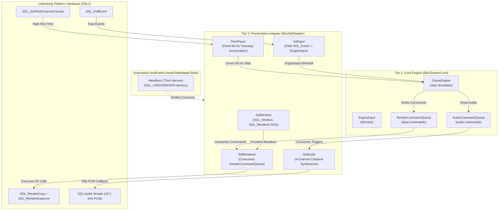
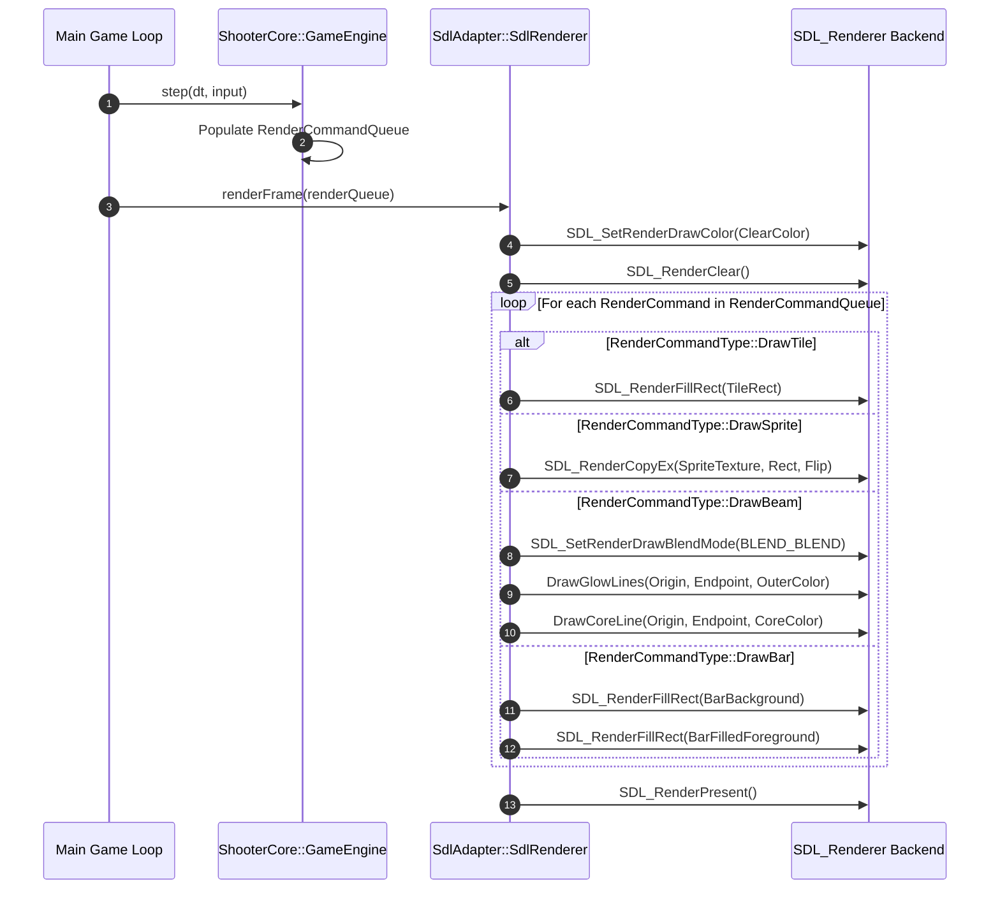
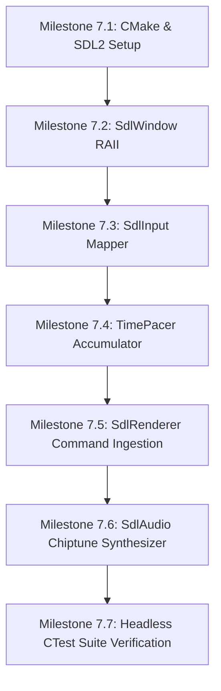

# Phase 7: SDL Presentation Adapter (Window, Renderer, Audio, Input) Implementation Plan

## 1. Executive Summary & Scope

Phase 7 constructs **Tier 2: Platform & Presentation Layer (`libs/SdlAdapter`)** of the Shoot'Em-Up Game Engine. While Tier 1 (`libs/ShooterCore`) provides pure C++17 mathematical and physical simulation completely isolated from hardware, Tier 2 bridges this simulation to real-world display displays, audio devices, and user input hardware using **Simple DirectMedia Layer (SDL2)**.

Inspired by the audio-visual presentation of Game Arts' 1985 classic **Thexder** and 1989's **Fire Hawk**, Phase 7 equips the engine with a high-performance hardware-accelerated 2D renderer, a procedural chiptune audio synthesizer (generating retro laser, explosion, and melodic voices dynamically without external audio assets), an edge-triggered input mapper, and a fixed 60 Hz simulation time accumulator with high-resolution frame pacing.

```
+-------------------------------------------------------------------------------+
|                       TIER 2 PRESENTATION BOUNDARY                            |
|                                                                               |
|   +-----------------------------------------------------------------------+   |
|   |                   libs/ShooterCore (Pure C++17)                       |   |
|   |         Hardware-Agnostic Queues: InputBitmask, Render, Audio         |   |
|   +-----------------------------------------------------------------------+   |
|                         ▲                           │                         |
|      EngineInput Bitmask│                           │ Render / Audio Queues   |
|                         │                           ▼                         |
|   +─────────────────────┴───────────────────────────┴─────────────────────+   |
|   |                   libs/SdlAdapter (Tier 2 Adapter)                    |   |
|   |   • SdlWindow: RAII Context, Logical Scaling, High-DPI                |   |
|   |   • SdlRenderer: Rasterizes RenderCommandQueue (Sprites, Beams, HUD)  |   |
|   |   • SdlInput: Translates SDL_Event to EngineInput Bitmask             |   |
|   |   • SdlAudio: 4-Channel Procedural Chiptune Synthesizer & Callback    |   |
|   |   • TimePacer: Fixed 60 Hz Accumulator & High-Resolution Frame Pacer  |   |
|   +───────────────────────────────────────────────────────────────────────+   |
|                         │                           │                         |
|                         ▼                           ▼                         |
|              [OS Display & Audio Hardware / SDL2 Backend]                     |
+-------------------------------------------------------------------------------+
```

### Core Objectives & Deliverables
1. **RAII Window & Hardware Context Lifecycle (`SdlWindow.h`, `SdlWindow.cpp`)**:
   - Encapsulate `SDL_Window` and `SDL_Renderer` under strict RAII ownership semantics (non-copyable, movable).
   - Support hardware acceleration (`SDL_RENDERER_ACCELERATED`) and vertical blanking synchronization (`SDL_RENDERER_PRESENTVSYNC`).
   - Implement integer-ratio letterboxed logical resolution presentation (`SDL_RenderSetLogicalSize`) preserving authentic retro aspect ratios (e.g., $320 \times 240$ or $640 \times 480$) regardless of physical display resolutions.
2. **Hardware-Accelerated 2D Command Queue Renderer (`SdlRenderer.h`, `SdlRenderer.cpp`)**:
   - Zero-heap ingestion of `ShooterCore::RenderCommandQueue` each presentation frame.
   - Hardware-accelerated batch dispatch for:
     - `DrawSprite`: Screen-space and world-space blitting of player (Robot walk/jump, Jet flight, Transformation sequence), enemies, and particle hazards.
     - `DrawTile`: Viewport-culled terrain rendering for solid, destructible, and hazardous labyrinth blocks.
     - `DrawBeam`: Procedural vector laser rendering supporting high-intensity core rays, outer chromatic glowing halos, and dynamic target-lock markers.
     - `DrawBar`: Screen-space HUD meters for energy reserve, shield barrier integrity, and score counters.
3. **Normalized Event Polling & Input Translation (`SdlInput.h`, `SdlInput.cpp`)**:
   - Non-blocking polling of `SDL_PollEvent`.
   - Seamless bidirectional mapping of keyboard keys (Arrows / WASD, Space / Z for Jump/Thrust, X for Laser, C / Shift for Shield, Tab for Transform, Escape for Pause) and gamepad buttons into `ShooterCore::EngineInput` bitmasks.
   - Accurate discrete transition tracking: Held state, Just-Pressed (rising edge), and Just-Released (falling edge).
4. **Procedural 4-Channel Chiptune Synthesizer & Audio Device (`SdlAudio.h`, `SdlAudio.cpp`)**:
   - RAII wrapper around `SDL_AudioDeviceID` streaming uncompressed PCM audio at $44.1\text{ kHz}$ / 16-bit stereo.
   - 100% self-contained procedural chiptune synth engine requiring zero external sound files (`.wav`, `.ogg`):
     - **Channel 1 (Pulse/Lead)**: Variable duty-cycle square wave ($12.5\%$, $25\%$, $50\%$) with frequency sweeps for laser zaps, transformation chimes, and melodic leads.
     - **Channel 2 (Pulse/Bass)**: Square wave supporting basslines and counterpoint harmonies.
     - **Channel 3 (Triangle/Sub)**: Pure triangle wave for clean bass frequencies and arpeggiated textures.
     - **Channel 4 (Noise/Percussion)**: Linear Feedback Shift Register (LFSR) pseudo-random white/metallic noise for explosive blasts, projectile impacts, and crumbling rock.
   - Low-latency real-time callback architecture consuming `ShooterCore::AudioCommandQueue` with thread-safe lock-free synchronization.
5. **Fixed-Timestep Simulation Accumulator & Frame Pacer (`TimePacer.h`, `TimePacer.cpp`)**:
   - Precision frame time measurement using `std::chrono::steady_clock` or `SDL_GetPerformanceCounter`.
   - Classic accumulator loop decoupling simulation physics ($60\text{ Hz}$, $dt = \frac{1}{60}\text{ s} \approx 16.667\text{ ms}$) from variable presentation refresh rates ($60\text{ Hz}$, $120\text{ Hz}$, $144\text{ Hz}$, $240\text{ Hz}$).
   - Spiral-of-death clamp limiting maximum accumulated frame duration to $0.25\text{ s}$ during system hitches or window drags.
   - Sub-frame temporal alpha calculation ($\alpha \in [0.0, 1.0]$) for optional state interpolation.
6. **Deterministic Verification & Headless Testing (`tests/SdlAdapterTests`)**:
   - Comprehensive unit and integration test suite executing under headless CI environments using SDL dummy drivers (`SDL_VIDEODRIVER=dummy`, `SDL_AUDIODRIVER=dummy`).
   - Automated verification of input state transitions, audio buffer sample bounds $[-1.0, 1.0]$, procedural waveform generation, and frame accumulator mechanics.

---

## 2. Architecture & File Layout

All components for Phase 7 reside under `libs/SdlAdapter/` and `tests/SdlAdapterTests/`. `libs/SdlAdapter` depends exclusively upon `libs/ShooterCore` (Pure C++17) and SDL2.

### 2.1 ASCII Directory & Artifact Layout
```
+-------------------------------------------------------------------------------+
|                       PHASE 7 DIRECTORY & ARTIFACT LAYOUT                     |
|                                                                               |
|   shoot-em-up-engine.git/                                                     |
|   ├── CMakeLists.txt                       <-- Root project build script      |
|   ├── cmake/                                                                  |
|   │   ├── CompilerFlags.cmake              <-- Strict flags & hardening       |
|   │   └── FindSDL2.cmake                   <-- SDL2 package discovery helper  |
|   ├── docs/                                                                   |
|   │   ├── implementation_plan.md           <-- Master architecture roadmap    |
|   │   ├── phase6_plan.md                   <-- Phase 6: Headless CTest Suite  |
|   │   └── phase7_plan.md                   <-- This document                  |
|   ├── libs/                                                                   |
|   │   ├── ShooterCore/                     <-- Pure C++17 Core Engine (Tier 1)|
|   │   │   ├── Types.h                      <-- Types, SpriteId, SoundEffectId |
|   │   │   ├── EngineInput.h                <-- Bitmask representation         |
|   │   │   ├── RenderCommandQueue.h         <-- Decoupled draw commands        |
|   │   │   ├── AudioCommandQueue.h          <-- Decoupled audio commands       |
|   │   │   └── GameEngine.h                 <-- Master simulation engine       |
|   │   └── SdlAdapter/                      <-- Presentation Adapter (Tier 2)  |
|   │       ├── CMakeLists.txt               <-- SdlAdapter library definition  |
|   │       ├── SdlWindow.h / .cpp           <-- Window & renderer RAII wrapper |
|   │       ├── SdlRenderer.h / .cpp         <-- RenderCommandQueue consumer    |
|   │       ├── SdlInput.h / .cpp            <-- SDL_Event to EngineInput mapper|
|   │       ├── SdlAudio.h / .cpp            <-- Procedural chiptune synth      |
|   │       └── TimePacer.h / .cpp           <-- 60 Hz accumulator & pacer      |
|   └── tests/                                                                  |
|       ├── ShooterCoreTests/                <-- Headless Tier 1 CTest Suite    |
|       └── SdlAdapterTests/                 <-- Headless Tier 2 CTest Suite    |
|           ├── CMakeLists.txt               <-- Test target configuration      |
|           ├── Main.cpp                     <-- Dummy-driver test runner       |
|           ├── TestSdlWindow.cpp            <-- Headless context creation test |
|           ├── TestSdlInput.cpp             <-- Event injection & mapping test |
|           ├── TestSdlRenderer.cpp          <-- Mock command execution test    |
|           ├── TestSdlAudio.cpp             <-- Chiptune waveform math test    |
|           └── TestTimePacer.cpp            <-- Accumulator stepping test      |
+-------------------------------------------------------------------------------+
```

### 2.2 Mermaid Architecture & Component Dependency Diagram


---

## 3. Subsystem Detailed Design & Specifications

### 3.1 SdlWindow: RAII Window & Hardware Context Lifecycle

#### Responsibilities
- Manage the global lifecycle of SDL video subsystems (`SDL_InitSubSystem(SDL_INIT_VIDEO)` and `SDL_QuitSubSystem(SDL_INIT_VIDEO)`).
- Provide non-copyable, movable RAII encapsulation around `SDL_Window*` and `SDL_Renderer*`.
- Enforce hardware acceleration (`SDL_RENDERER_ACCELERATED`) with vertical sync (`SDL_RENDERER_PRESENTVSYNC`).
- Configure retro logical resolution presentation with aspect-ratio letterboxing using `SDL_RenderSetLogicalSize(renderer, logicalWidth, logicalHeight)`.

#### ASCII Window Architecture
```
+-------------------------------------------------------------------------------+
|                       SDL_WINDOW LOGICAL PRESENTATION                         |
|                                                                               |
|   Physical Display Window (e.g., 1920 x 1080 Borderless/Fullscreen):          |
|   +-----------------------------------------------------------------------+   |
|   |                       Top Letterbox Margin                            |   |
|   |   +---------------------------------------------------------------+   |   |
|   |   |                                                               |   |   |
|   |   |     Logical Simulation Viewport (e.g., 320 x 240 / 4:3)       |   |   |
|   |   |     All RenderCommands draw into logical pixel space          |   |   |
|   |   |     Hardware scaler automatically preserves aspect ratio      |   |   |
|   |   |                                                               |   |   |
|   |   +---------------------------------------------------------------+   |   |
|   |                      Bottom Letterbox Margin                          |   |
|   +-----------------------------------------------------------------------+   |
+-------------------------------------------------------------------------------+
```

#### Detailed Class Specification (`libs/SdlAdapter/SdlWindow.h`)
```cpp
#pragma once

#include <cstdint>
#include <string_view>

struct SDL_Window;
struct SDL_Renderer;

namespace SdlAdapter {

/// @struct WindowConfig
/// @brief Configuration settings for window and renderer initialization.
struct WindowConfig final {
    std::string_view title { "Thexder Shoot'Em-Up" };
    std::int32_t windowWidth { 960 };
    std::int32_t windowHeight { 720 };
    std::int32_t logicalWidth { 320 };
    std::int32_t logicalHeight { 240 };
    bool vsync { true };
    bool resizable { true };
};

/// @class SdlWindow
/// @brief RAII container managing SDL_Window and hardware SDL_Renderer lifecycles.
class SdlWindow final {
public:
    SdlWindow() noexcept = default;
    ~SdlWindow() noexcept;

    SdlWindow(const SdlWindow&) = delete;
    SdlWindow& operator=(const SdlWindow&) = delete;

    SdlWindow(SdlWindow&& other) noexcept;
    SdlWindow& operator=(SdlWindow&& other) noexcept;

    /// @brief Initialize SDL video and create window and hardware renderer.
    /// @param[in] config Window parameters and logical resolution dimensions.
    /// @return true if initialization succeeded; false otherwise.
    [[nodiscard]] bool init(const WindowConfig& config) noexcept;

    /// @brief Release window and renderer resources and shut down video subsystem.
    void shutdown() noexcept;

    /// @brief Retrieve underlying SDL window handle.
    [[nodiscard]] SDL_Window* getWindow() const noexcept;

    /// @brief Retrieve underlying hardware SDL renderer handle.
    [[nodiscard]] SDL_Renderer* getRenderer() const noexcept;

    /// @brief Query whether context is successfully initialized.
    [[nodiscard]] bool isValid() const noexcept;

private:
    SDL_Window* window_ { nullptr };
    SDL_Renderer* renderer_ { nullptr };
    bool videoInitialized_ { false };
};

} // namespace SdlAdapter
```

---

### 3.2 SdlRenderer: RenderCommandQueue Hardware Ingestion

#### Responsibilities
- Clear display buffer with authentic retro CRT background color (`SDL_RenderClear`).
- Iterate sequentially through `ShooterCore::RenderCommandQueue` ($N \le 2048$) with zero dynamic heap allocation (`CERT ERR55-CPP`).
- Support command-specific rendering:
  1. `DrawTile`: Viewport-offset solid, destructible (with health-based surface fracture markings), and hazard blocks.
  2. `DrawSprite`: Entity blitting mapped by `ShooterCore::SpriteId` (Robot walking frames, Robot jumping, Jet flight, PatrolWalker, HomingFlyer, Explosions, Sparks).
  3. `DrawBeam`: High-intensity vector laser beam rendering featuring a pure white high-voltage core surrounded by an alpha-blended colored outer glow and diamond lock reticle.
  4. `DrawBar`: Screen-space HUD meters (Energy bar, Shield gauge, High-score readouts).
- Swap video front/back buffers via `SDL_RenderPresent`.

#### ASCII Laser Beam Rendering Model
```
+-------------------------------------------------------------------------------+
|                       VECTOR LASER BEAM RASTERIZATION                         |
|                                                                               |
|   Player Gun Origin (Xo, Yo)                     Target Lock Endpoint (Xt, Yt)|
|   (=========================[ WHITE INNER CORE ]=========================>[X] |
|   --------------------[ OUTER CHROMATIC GLOW (RGBA) ]------------------------ |
|                                                                               |
|   Pass 1: Outer glow rendered via wide alpha-blended transparent lines        |
|   Pass 2: Inner core rendered via high-intensity solid white line             |
|   Pass 3: Target impact crosshairs / pulsing lock diamond marker              |
+-------------------------------------------------------------------------------+
```

#### Mermaid Rendering Pipeline Sequence


#### Detailed Class Specification (`libs/SdlAdapter/SdlRenderer.h`)
```cpp
#pragma once

#include <cstdint>

#include "RenderCommandQueue.h"
#include "Types.h"

struct SDL_Renderer;
struct SDL_Texture;

namespace SdlAdapter {

/// @class SdlRenderer
/// @brief Translates abstract RenderCommandQueue commands into SDL2 draw calls.
class SdlRenderer final {
public:
    SdlRenderer() noexcept = default;
    ~SdlRenderer() noexcept = default;

    SdlRenderer(const SdlRenderer&) = delete;
    SdlRenderer& operator=(const SdlRenderer&) = delete;
    SdlRenderer(SdlRenderer&&) noexcept = default;
    SdlRenderer& operator=(SdlRenderer&&) noexcept = default;

    /// @brief Attach hardware SDL renderer.
    /// @param[in] renderer Valid hardware renderer pointer.
    void attachRenderer(SDL_Renderer* renderer) noexcept;

    /// @brief Consume and rasterize all commands in the command queue.
    /// @param[in] queue Frame render commands emitted by the engine core.
    void renderFrame(const ShooterCore::RenderCommandQueue& queue) noexcept;

private:
    void drawTile(const ShooterCore::RenderCommand& cmd) noexcept;
    void drawSprite(const ShooterCore::RenderCommand& cmd) noexcept;
    void drawBeam(const ShooterCore::RenderCommand& cmd) noexcept;
    void drawBar(const ShooterCore::RenderCommand& cmd) noexcept;

    SDL_Renderer* renderer_ { nullptr };
};

} // namespace SdlAdapter
```

---

### 3.3 SdlInput: Event Polling & Input Translation

#### Responsibilities
- Poll window and hardware events via non-blocking `SDL_PollEvent(&event)`.
- Intercept application shutdown signals (`SDL_QUIT`, `SDL_WINDOWEVENT_CLOSE`).
- Translate physical keyboard states and gamepad controller axes into normalized `ShooterCore::EngineInput` bitmasks.
- Support dual-axis arrow keys and WASD keys simultaneously.
- Track instantaneous button edge transitions:
  $$\text{JustPressed} = \text{Current} \land \neg\text{Previous}$$
  $$\text{JustReleased} = \neg\text{Current} \land \text{Previous}$$

#### Input Mapping Table
| Action Category | Target Bitmask | Primary Keyboard Binding | Secondary Binding | Gamepad Button |
| :--- | :--- | :--- | :--- | :--- |
| **Directional Up** | `EngineInput::kUp` | `SDLK_UP` | `SDLK_w` | D-Pad Up / Left Stick Up |
| **Directional Down** | `EngineInput::kDown` | `SDLK_DOWN` | `SDLK_s` | D-Pad Down / Left Stick Down |
| **Directional Left** | `EngineInput::kLeft` | `SDLK_LEFT` | `SDLK_a` | D-Pad Left / Left Stick Left |
| **Directional Right**| `EngineInput::kRight` | `SDLK_RIGHT` | `SDLK_d` | D-Pad Right / Left Stick Right |
| **Jump / Thrust** | `EngineInput::kJump` | `SDLK_SPACE` | `SDLK_z` | Button A (South) |
| **Transform Mode** | `EngineInput::kTransform` | `SDLK_TAB` | `SDLK_RETURN` | Button Y (North) / Shoulder L1 |
| **Fire Laser** | `EngineInput::kFire` | `SDLK_x` | `SDLK_k` | Button X (West) / Trigger R2 |
| **Energy Shield** | `EngineInput::kShield` | `SDLK_c` | `SDLK_LSHIFT` | Button B (East) / Shoulder R1 |

#### Detailed Class Specification (`libs/SdlAdapter/SdlInput.h`)
```cpp
#pragma once

#include <cstdint>

#include "EngineInput.h"

union SDL_Event;

namespace SdlAdapter {

/// @class SdlInput
/// @brief Event polling engine translating SDL events to ShooterCore::EngineInput.
class SdlInput final {
public:
    constexpr SdlInput() noexcept = default;

    /// @brief Poll all pending SDL events and update input states.
    /// @return false if an SDL_QUIT or exit request was received; true otherwise.
    [[nodiscard]] bool pollEvents() noexcept;

    /// @brief Retrieve normalized engine input state for current frame.
    /// @return Current input bitmask representation.
    [[nodiscard]] constexpr ShooterCore::EngineInput currentInput() const noexcept
    {
        return currentInput_;
    }

    /// @brief Check if a specific input action was triggered on this frame (rising edge).
    /// @param[in] action Bitmask action flag to inspect.
    /// @return true if button transitioned from released to pressed.
    [[nodiscard]] constexpr bool isJustPressed(std::uint16_t action) const noexcept
    {
        return ((currentInput_.raw() & action) != 0U) && ((previousInput_.raw() & action) == 0U);
    }

    /// @brief Check if an input action was released on this frame (falling edge).
    /// @param[in] action Bitmask action flag.
    /// @return true if button transitioned from pressed to released.
    [[nodiscard]] constexpr bool isJustReleased(std::uint16_t action) const noexcept
    {
        return ((currentInput_.raw() & action) == 0U) && ((previousInput_.raw() & action) != 0U);
    }

    /// @brief Check whether quit was requested.
    [[nodiscard]] constexpr bool quitRequested() const noexcept
    {
        return quitRequested_;
    }

private:
    void handleKeyEvent(std::uint32_t keycode, bool isDown) noexcept;

    ShooterCore::EngineInput currentInput_ { };
    ShooterCore::EngineInput previousInput_ { };
    bool quitRequested_ { false };
};

} // namespace SdlAdapter
```

---

### 3.4 SdlAudio: 4-Channel Procedural Chiptune Synthesizer

#### Responsibilities
- Encapsulate `SDL_AudioDeviceID` with strict RAII lifecycle management (`SDL_OpenAudioDevice` and `SDL_CloseAudioDevice`).
- Stream real-time 16-bit signed stereo PCM audio at $44{,}100\text{ Hz}$.
- Synthesize all iconic 8-bit sound effects and retro melodies procedurally without external audio assets.
- Eliminate audio thread contention: main thread pushes commands to a thread-safe ring buffer; audio callback mixes channels into playback buffer without dynamic allocation (`CERT ERR55-CPP`).

#### 4-Channel Synthesizer Architecture
```
+-------------------------------------------------------------------------------+
|                       4-CHANNEL PROCEDURAL CHIPTUNE SYNTH                     |
|                                                                               |
|   Channel 1: Pulse 1 [Square Wave]  ───┐                                      |
|   (Lead melodies, Laser sweep, SFX)    │                                      |
|                                        │                                      |
|   Channel 2: Pulse 2 [Square Wave]  ───┼───► Master Mixer ───► Clamp & Clip  |
|   (Harmonies, Shield hum, Alarms)      │     (Sum Channels)    [-32768, 32767]|
|                                        │                            │         |
|   Channel 3: Triangle [Triangle Wave] ─┼                            │         |
|   (Sub-bass, Jump slide, Engine buzz)  │                            ▼         |
|                                        │                     SDL2 Audio Device|
|   Channel 4: Noise [15-bit LFSR]    ───┘                     (44.1 kHz PCM)   |
|   (Explosions, Impacts, Crumbles)                                             |
+-------------------------------------------------------------------------------+
```

#### Sound Synthesis Mathematical Formulation
1. **Pulse Waveform Generator (Channels 1 & 2)**:
   For sample index $n$, sampling rate $f_s = 44100\text{ Hz}$, frequency $f$, and pulse duty cycle $D \in (0.0, 1.0]$:
   $$\phi(n) = \text{fmod}\left(\phi(n-1) + \frac{f}{f_s}, 1.0\right)$$
   $$s_{\text{pulse}}(n) = \begin{cases} +1.0 & \text{if } \phi(n) < D \\ -1.0 & \text{if } \phi(n) \ge D \end{cases}$$
2. **Triangle Waveform Generator (Channel 3)**:
   $$s_{\text{tri}}(n) = 2.0 \times |\text{fmod}(2.0 \times \phi(n) + 1.0, 2.0) - 1.0| - 1.0$$
3. **Linear Feedback Shift Register (LFSR) Noise (Channel 4)**:
   A 15-bit shift register updated at variable clock rate $f_{\text{noise}}$:
   $$\text{bit} = (R \text{ XOR } (R \gg 1)) \land 1$$
   $$R \leftarrow (R \gg 1) \lor (\text{bit} \ll 14)$$
   $$s_{\text{noise}} = (\text{bit} == 1) \ ? \ +1.0\text{f} : -1.0\text{f}$$
4. **Envelope (Linear / Exponential Decay)**:
   $$A(t) = A_0 \times \max\left(0.0\text{f}, 1.0\text{f} - \frac{t}{T_{\text{decay}}}\right)$$

#### Sound Effect Presets
| Preset Identifier | Channel Type | Base Frequency | Sweep / Modulation | Envelope Duration |
| :--- | :--- | :--- | :--- | :--- |
| `SoundEffectId::LaserFire` | Pulse 1 (25% Duty) | $880\text{ Hz} \to 220\text{ Hz}$ | Rapid linear downward pitch sweep | $120\text{ ms}$ |
| `SoundEffectId::LaserHit` | Noise + Pulse | $440\text{ Hz}$ | White noise burst mixed with high ping | $60\text{ ms}$ |
| `SoundEffectId::ShieldDeploy` | Pulse 2 (50% Duty) | $300\text{ Hz} \to 1200\text{ Hz}$| Exponential upward frequency glide | $250\text{ ms}$ |
| `SoundEffectId::ShieldDeflect`| Pulse 1 (12.5% Duty)| $950\text{ Hz} \leftrightarrow 1100\text{ Hz}$| Rapid 2-step alternating chime | $100\text{ ms}$ |
| `SoundEffectId::TransformJet` | Triangle + Pulse | $200\text{ Hz} \to 600\text{ Hz}$ | Stepped arpeggio frequency rise | $180\text{ ms}$ |
| `SoundEffectId::TransformRobot`| Triangle + Pulse | $600\text{ Hz} \to 200\text{ Hz}$ | Stepped arpeggio frequency drop | $180\text{ ms}$ |
| `SoundEffectId::PlayerDamage` | Noise + Pulse | $150\text{ Hz}$ | Heavy low-pitch distortion sweep | $300\text{ ms}$ |
| `SoundEffectId::EnemyExplode` | Noise | Clock $2\text{ kHz} \to 200\text{ Hz}$| Exponential decaying white noise burst| $450\text{ ms}$ |
| `SoundEffectId::BlockCrumble` | Noise | Clock $8\text{ kHz}$ | Short staccato crackle bursts | $150\text{ ms}$ |
| `SoundEffectId::EnergyWarning`| Pulse 1 (50% Duty) | $880\text{ Hz} / 440\text{ Hz}$ | Alternating octave warning pulse | $100\text{ ms}$ |

#### Detailed Class Specification (`libs/SdlAdapter/SdlAudio.h`)
```cpp
#pragma once

#include <cstddef>
#include <cstdint>
#include <array>

#include "AudioCommandQueue.h"
#include "Types.h"

namespace SdlAdapter {

/// @struct VoiceState
/// @brief Synthesis state for an individual procedural sound voice.
struct VoiceState final {
    bool active { false };
    float frequency { 440.0f };
    float targetFreq { 440.0f };
    float sweepRate { 0.0f };
    float phase { 0.0f };
    float dutyCycle { 0.5f };
    float amplitude { 0.0f };
    float decayRate { 0.0f };
    std::uint16_t lfsr { 0x7FFFU };
};

/// @class SdlAudio
/// @brief RAII audio device player and procedural 4-channel chiptune synthesizer.
class SdlAudio final {
public:
    static constexpr std::uint32_t kSampleRate { 44100U };
    static constexpr std::size_t kVoiceCount { 4U };

    SdlAudio() noexcept;
    ~SdlAudio() noexcept;

    SdlAudio(const SdlAudio&) = delete;
    SdlAudio& operator=(const SdlAudio&) = delete;
    SdlAudio(SdlAudio&& other) noexcept;
    SdlAudio& operator=(SdlAudio&& other) noexcept;

    /// @brief Initialize SDL audio device and start synthesis playback callback.
    /// @return true if device opened successfully; false otherwise.
    [[nodiscard]] bool init() noexcept;

    /// @brief Shutdown audio device and stop playback thread.
    void shutdown() noexcept;

    /// @brief Ingest and dispatch frame audio commands emitted by ShooterCore.
    /// @param[in] queue Frame audio command queue.
    void processQueue(const ShooterCore::AudioCommandQueue& queue) noexcept;

    /// @brief Trigger a procedural sound effect preset.
    /// @param[in] effect Sound preset identifier.
    /// @param[in] volume Playback amplitude in range [0.0, 1.0].
    void playSound(ShooterCore::SoundEffectId effect, float volume = 1.0f) noexcept;

    /// @brief Synthesize samples directly into output buffer (invoked by audio callback).
    /// @param[out] stream Destination 16-bit signed PCM buffer.
    /// @param[in] lengthInBytes Byte length of stream.
    void generatePcm(std::int16_t* stream, std::size_t lengthInBytes) noexcept;

private:
    std::uint32_t deviceId_ { 0U };
    std::array<VoiceState, kVoiceCount> voices_ { };
};

} // namespace SdlAdapter
```

---

### 3.5 TimePacer: 60 Hz Simulation Accumulator & Frame Pacer

#### Responsibilities
- Measure frame elapsed delta times with microsecond precision using `std::chrono::steady_clock`.
- Decouple rendering frame rates ($60\text{ Hz}$, $144\text{ Hz}$, $240\text{ Hz}$) from constant $60\text{ Hz}$ physics simulation ticks:
  $$\Delta t_{\text{fixed}} = \frac{1.0\text{f}}{60.0\text{f}} \approx 0.0166667\text{ s}$$
- Mitigate spiral of death by capping maximum accumulated time per visual frame:
  $$\Delta t_{\text{accum}} \leftarrow \min(\Delta t_{\text{accum}} + \Delta t_{\text{frame}}, \Delta t_{\text{max}}), \quad \Delta t_{\text{max}} = 0.25\text{ s}$$
- Compute interpolation blending factor $\alpha \in [0.0, 1.0]$ for visual state interpolation:
  $$\alpha = \frac{\Delta t_{\text{accum}}}{\Delta t_{\text{fixed}}}$$

#### ASCII Accumulator Loop Flow
```
+-------------------------------------------------------------------------------+
|                       FIXED-TIMESTEP ACCUMULATOR LOOP                         |
|                                                                               |
|   Real-world Variable Frame Time (dt_frame): e.g. 7.1 ms (144 Hz)             |
|   Accumulator: dt_accum = dt_accum + dt_frame                                 |
|                                                                               |
|   [ dt_accum >= 16.66 ms? ]                                                   |
|          │                                                                    |
|          ├────── YES ─────► Execute Engine Tick: GameEngine::step(1/60s)      |
|          │                  dt_accum = dt_accum - 16.66 ms                    |
|          │                  (Repeat until dt_accum < 16.66 ms)                |
|          │                                                                    |
|          └─────── NO ─────► Calculate alpha = dt_accum / (1/60s)              |
|                             Render Frame: SdlRenderer::renderFrame()          |
+-------------------------------------------------------------------------------+
```

#### Detailed Class Specification (`libs/SdlAdapter/TimePacer.h`)
```cpp
#pragma once

#include <chrono>

namespace SdlAdapter {

/// @class TimePacer
/// @brief High-precision frame pacer and 60 Hz fixed-timestep simulation accumulator.
class TimePacer final {
public:
    static constexpr float kFixedDeltaTime { 1.0f / 60.0f };
    static constexpr float kMaxAccumulatedTime { 0.25f };

    constexpr TimePacer() noexcept = default;

    /// @brief Start or reset the frame pacing clock.
    void start() noexcept;

    /// @brief Update frame timer and calculate accrued simulation time.
    /// @return Number of fixed 60 Hz simulation ticks to execute this frame.
    [[nodiscard]] std::uint32_t beginFrame() noexcept;

    /// @brief Query the fixed simulation delta time constant (1/60s).
    [[nodiscard]] constexpr float fixedDelta() const noexcept
    {
        return kFixedDeltaTime;
    }

    /// @brief Calculate fractional interpolation coefficient for sub-frame rendering.
    /// @return Alpha factor in range [0.0, 1.0].
    [[nodiscard]] constexpr float subframeAlpha() const noexcept
    {
        return accumulator_ / kFixedDeltaTime;
    }

    /// @brief Query the raw duration of the most recent frame in seconds.
    [[nodiscard]] constexpr float rawDelta() const noexcept
    {
        return lastFrameDelta_;
    }

private:
    std::chrono::steady_clock::time_point lastTime_ { };
    float accumulator_ { 0.0f };
    float lastFrameDelta_ { 0.0f };
    bool running_ { false };
};

} // namespace SdlAdapter
```

---

## 4. CMake Build Configuration

### 4.1 Library Configuration (`libs/SdlAdapter/CMakeLists.txt`)
`libs/SdlAdapter` is compiled as a static library linking against `ShooterCore` and SDL2. It enforces the project's strict compiler hardening flags and zero warning policies.

```cmake
# libs/SdlAdapter/CMakeLists.txt

add_library(SdlAdapter STATIC
    SdlWindow.h
    SdlWindow.cpp
    SdlRenderer.h
    SdlRenderer.cpp
    SdlInput.h
    SdlInput.cpp
    SdlAudio.h
    SdlAudio.cpp
    TimePacer.h
    TimePacer.cpp
)

target_include_directories(SdlAdapter
    PUBLIC
        ${CMAKE_CURRENT_SOURCE_DIR}
    PRIVATE
        ${CMAKE_SOURCE_DIR}/libs/ShooterCore
)

target_link_libraries(SdlAdapter
    PUBLIC
        ShooterCore
    PRIVATE
        SDL2::SDL2
)

# Apply compiler warning flags and hardening
target_compile_options(SdlAdapter PRIVATE ${PROJECT_WARNING_FLAGS})
target_compile_definitions(SdlAdapter PRIVATE ${PROJECT_HARDENING_DEFINITIONS})
```

### 4.2 SDL2 Package Discovery in Root `CMakeLists.txt`
Root `CMakeLists.txt` integrates `find_package(SDL2 REQUIRED)` with fallback support for vendored FetchContent distributions to ensure consistent builds across Windows and Linux environments without manual path configurations.

---

## 5. Automated Verification & Headless Testing Strategy

To guarantee continuous integration reliability without physical graphics displays or sound hardware, `tests/SdlAdapterTests` executes using SDL's dummy backend drivers:
- `SDL_VIDEODRIVER=dummy`
- `SDL_AUDIODRIVER=dummy`

### 5.1 Test Suite Breakdown
1. **Context & Window Lifecycle (`TestSdlWindow.cpp`)**:
   - Verify `SdlWindow::init` succeeds with dummy video backend.
   - Verify `SDL_Renderer` and `SDL_Window` handles are non-null and correctly disposed of upon destruction.
2. **Event Polling & Input Mapping (`TestSdlInput.cpp`)**:
   - Synthesize and push artificial `SDL_Event` instances into the SDL queue (`SDL_PushEvent`).
   - Validate that keyboard scan codes (`SDLK_w`, `SDLK_SPACE`, `SDLK_TAB`, `SDLK_x`, `SDLK_c`) translate with 100% accuracy into `EngineInput` bits.
   - Validate rising edge (`isJustPressed`) and falling edge (`isJustReleased`) logic across sequential polling calls.
3. **Command Queue Ingestion (`TestSdlRenderer.cpp`)**:
   - Populate `RenderCommandQueue` with 100 mixed commands (`DrawTile`, `DrawSprite`, `DrawBeam`, `DrawBar`).
   - Verify `SdlRenderer::renderFrame` completes without memory violations, null pointer dereferences, or memory allocation.
4. **Procedural Chiptune Waveform Math (`TestSdlAudio.cpp`)**:
   - Call `SdlAudio::generatePcm` into an offline test buffer ($1024$ samples).
   - Assert all synthesized 16-bit audio samples stay strictly within safe range $[-32768, 32767]$ with zero clipping distortion.
   - Verify that all presets (`LaserFire`, `ShieldDeploy`, `EnemyExplode`) activate voices and cleanly decay to absolute zero amplitude.
5. **Accumulator & Pacing Mechanics (`TestTimePacer.cpp`)**:
   - Simulate varying frame delta times ($8.33\text{ ms}$, $16.67\text{ ms}$, $33.33\text{ ms}$, $500.0\text{ ms}$).
   - Validate that the accumulator produces exact step tick counts ($0$, $1$, $2$) and clamps properly at $0.25\text{ s}$ during hitches.

---

## 6. Implementation Milestones & Task Breakdown

```
+-------------------------------------------------------------------------------+
|                       PHASE 7 IMPLEMENTATION MILESTONES                       |
|                                                                               |
|   Milestone 7.1: CMake & SDL2 Dependency Integration                          |
|         │                                                                     |
|         ▼                                                                     |
|   Milestone 7.2: SdlWindow RAII & Hardware Context                            |
|         │                                                                     |
|         ▼                                                                     |
|   Milestone 7.3: SdlInput & Normalized Input Translation                      |
|         │                                                                     |
|         ▼                                                                     |
|   Milestone 7.4: TimePacer & 60 Hz Timestep Accumulator                       |
|         │                                                                     |
|         ▼                                                                     |
|   Milestone 7.5: SdlRenderer & RenderCommandQueue Ingestion                   |
|         │                                                                     |
|         ▼                                                                     |
|   Milestone 7.6: SdlAudio & Procedural Chiptune Synthesizer                   |
|         │                                                                     |
|         ▼                                                                     |
|   Milestone 7.7: Headless CTest Suite (tests/SdlAdapterTests)                 |
+-------------------------------------------------------------------------------+
```



### Milestone 7.1: CMake & SDL2 Dependency Setup
- Configure root `CMakeLists.txt` to discover SDL2 via `find_package(SDL2 REQUIRED)`.
- Create `libs/SdlAdapter/CMakeLists.txt` exporting the static library.
- Verify include paths and header isolation (SDL2 headers remain strictly encapsulated within `libs/SdlAdapter` and never leak into `libs/ShooterCore`).

### Milestone 7.2: SdlWindow RAII Implementation
- Author `libs/SdlAdapter/SdlWindow.h` and `libs/SdlAdapter/SdlWindow.cpp`.
- Implement RAII initialization of `SDL_Window` and `SDL_Renderer` with logical resolution scaling.
- Implement move constructors, move assignment, and explicit destructor teardown.

### Milestone 7.3: SdlInput & Normalized Input Translation
- Author `libs/SdlAdapter/SdlInput.h` and `libs/SdlAdapter/SdlInput.cpp`.
- Implement non-blocking event polling and keyboard/gamepad mapping into `ShooterCore::EngineInput`.
- Implement transition edge tracking (`isJustPressed`, `isJustReleased`).

### Milestone 7.4: TimePacer & 60 Hz Timestep Accumulator
- Author `libs/SdlAdapter/TimePacer.h` and `libs/SdlAdapter/TimePacer.cpp`.
- Implement high-resolution clock sampling and the fixed 60 Hz accumulator loop with spiral-of-death clamping.
- Implement sub-frame alpha calculation for temporal visual smoothing.

### Milestone 7.5: SdlRenderer & RenderCommandQueue Ingestion
- Author `libs/SdlAdapter/SdlRenderer.h` and `libs/SdlAdapter/SdlRenderer.cpp`.
- Implement hardware-accelerated dispatching for tiles, procedural sprites, vector glowing laser beams, and HUD gauges.
- Verify zero dynamic memory allocations on the active rendering path (`CERT ERR55-CPP`).

### Milestone 7.6: SdlAudio & Procedural Chiptune Synthesizer
- Author `libs/SdlAdapter/SdlAudio.h` and `libs/SdlAdapter/SdlAudio.cpp`.
- Implement the 4-channel procedural synthesis engine (Pulse 1, Pulse 2, Triangle, LFSR Noise).
- Implement sound preset curves matching all `ShooterCore::SoundEffectId` values.
- Implement low-latency audio device streaming callback.

### Milestone 7.7: Automated Headless CTest Suite
- Create `tests/SdlAdapterTests/CMakeLists.txt` and modular test translation units.
- Configure tests to run with dummy video and audio drivers (`SDL_VIDEODRIVER=dummy`, `SDL_AUDIODRIVER=dummy`).
- Verify full test passage under `ctest --output-on-failure`.

---

## 7. Compliance & Verification Checklist

Before considering Phase 7 complete, verify adherence to the following standards:
- [ ] **No Raw Pointers / Manual Deletes**: All SDL objects (`SDL_Window`, `SDL_Renderer`, `SDL_AudioDeviceID`) managed exclusively through RAII wrappers.
- [ ] **Core Dependency Invariant**: Not a single file in `libs/ShooterCore` contains `#include <SDL...>`. SDL2 is strictly isolated to `libs/SdlAdapter`.
- [ ] **Zero Heap in Hot Paths**: `SdlRenderer::renderFrame`, `SdlAudio::generatePcm`, and `TimePacer::beginFrame` execute with **zero dynamic heap allocations** (`std::vector`, `std::string`, `new`, `std::make_unique`) (`CERT ERR55-CPP`).
- [ ] **IWYU & `<cstdint>` Adherence**: Every file directly includes all referenced symbols and explicitly prefixes fixed-width integer types with `std::` from `<cstdint>`.
- [ ] **Integer Conversion Safety**: All conversions between signed/unsigned types (such as SDL coordinates to float and vice versa) are explicit via `static_cast` with range validation (`MISRA C++:2023 Rule 7.0.6`, `SEI CERT INT31-C`).
- [ ] **Identifier Length**: All function names are strictly under 30 characters.
- [ ] **Doxygen Documentation**: All public interfaces are comprehensively annotated with `@brief`, `@param`, and `@return` tags.
- [ ] **Headless Automation**: All test suites pass cleanly in headless CTest runs.

