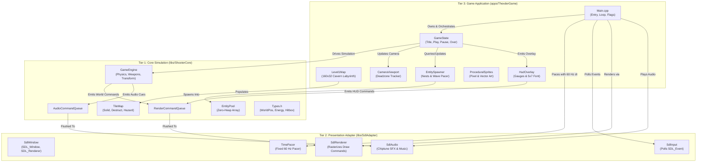
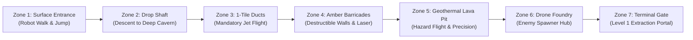
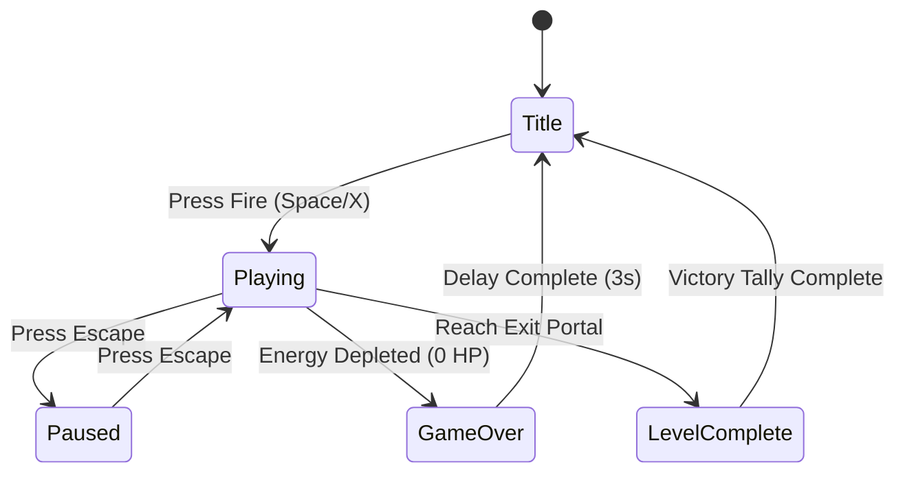
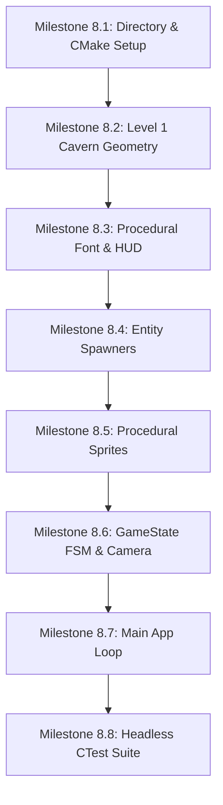

# Phase 8: Thexder Game Executable (Level 1 Map, HUD, Entity Spawners) Implementation Plan

## 1. Executive Summary & Scope

Phase 8 marks the culmination of the Shoot'Em-Up Game Engine architecture. Building directly upon the foundation established in Tier 1 (**`libs/ShooterCore`**, pure C++17 mathematical and physical simulation) and Tier 2 (**`libs/SdlAdapter`**, hardware presentation adapter for SDL2 rendering, audio synthesis, and input polling), Phase 8 implements **Tier 3: Thexder Game Application (`apps/ThexderGame`)**.

Inspired by Game Arts' seminal 1985 classic **Thexder** and 1989's **Fire Hawk**, Phase 8 unites simulation, rendering, chiptune sound synthesis, and real-time input into a fully playable, standalone game executable (`ThexderGame`). The player pilots the advanced hyper-dual-armor craft through the sprawling subterranean labyrinth of Level 1, transforming between a bipedal combat Robot and a high-speed aerodynamic Jet to navigate tight 1-tile tunnels, eradicate hostile automated defense drones, penetrate destructible masonry barriers, and conserve the critical energy pool that powers weapons, shielding, and life-support.

```
+-------------------------------------------------------------------------------+
|                       TIER 3 APPLICATION INTEGRATION                          |
|                                                                               |
|   +───────────────────────────────────────────────────────────────────────+   |
|   |                       apps/ThexderGame (Tier 3)                       |   |
|   |   • Main: SDL Loop, Gflags CLI, Glog, Fixed 60 Hz Pacing              |   |
|   |   • GameState: Title, Playing, Paused, GameOver, LevelComplete FSM    |   |
|   |   • Level1Map: Authentic 160x32 Cavern Labyrinth & 1-Tile Crawlspaces  |   |
|   |   • HudOverlay: Energy / Shield Meters, Score, 5x7 Procedural Font    |   |
|   |   • EntitySpawner: Fixed Nest Generators & Periodic Drone Waves       |   |
|   |   • ProceduralSprites: Zero-Asset Vector & Pixel Retro Graphics       |   |
|   +───────────────────────────────────┬───────────────────────────────────+   |
|                                       │                                       |
|                  ┌────────────────────┴────────────────────┐                  |
|                  ▼                                         ▼                  |
|   +───────────────────────────────+       +───────────────────────────────+   |
|   | libs/ShooterCore (Pure C++17) |       | libs/SdlAdapter (SDL2 Tier 2) |   |
|   | • GameEngine Simulation       |◄─────►| • SdlWindow & SdlRenderer     |   |
|   | • TileMap & Swept Collision   |       | • SdlAudio Chiptune Synth     |   |
|   | • Transform & Weapon Systems  |       | • SdlInput Edge Poller        |   |
|   | • EntityPool (Zero-Heap)      |       | • TimePacer (60 Hz Pacer)     |   |
|   +───────────────────────────────+       +───────────────────────────────+   |
|                                                           │                   |
|                                                           ▼                   |
|                                              [OS Display & Audio Hardware]    |
+-------------------------------------------------------------------------------+
```

### Core Objectives & Deliverables
1. **Authentic Level 1 Cavern Labyrinth (`Level1Map.h`, `Level1Map.cpp`)**:
   - Construct a large-scale subterranean cavern environment ($160 \times 32$ tiles, corresponding to $2560 \times 512$ world units at $16\text{ px/tile}$).
   - Incorporate all environmental tile categories:
     - `SolidWall`: Heavy metallic fortification bulkheads, ceiling stalactites, and structural cavern terraces.
     - `DestructibleWall`: Amber mineral formations and masonry barricades destructible via auto-aim laser beams (revealing energy crystals and shortcuts).
     - `Hazard`: High-voltage thermal lava channels and electrified conduits along cavern floors dealing direct contact damage.
   - Design authentic 1-tile-high ($16\text{ px}$) horizontal crawlspaces engineered specifically to mandate the Jet transformation mechanic (Robot clearance invariant prohibits traversal; transforming to Robot inside 1-tile tunnels is rejected).
   - Zero dynamic heap allocation during runtime map queries and tile damage (`CERT ERR55-CPP`).
2. **Screen-Space HUD Overlay & Procedural Bitmap Font (`HudOverlay.h`, `HudOverlay.cpp`)**:
   - Screen-space status overlay rasterized on top of the world view via `RenderCommandQueue` (layer 20).
   - Dynamic Energy Gauge: Numeric readout ($0\text{--}100$) and color-coded gradient meter (cyan at full, golden-amber when drained, flashing crimson below 20% threshold).
   - Shield Barrier Gauge: Percentage indicator reflecting active barrier invulnerability.
   - Score & High-Score Counters: Deterministic zero-heap 7-digit decimal formatting (e.g., `SCORE: 0014500`, `HI: 0050000`).
   - Current Transformation Form Badge: Dynamic state badge (`ROBOT`, `JET`, `MORPH`).
   - 100% self-contained $5 \times 7$ procedural pixel bitmap font rasterizer generating glyph primitives (`pushBar`, `pushTile`) directly without external TrueType font (`.ttf`) or texture dependencies.
3. **Entity Spawners & Autonomous Drone Wave Pacing (`EntitySpawner.h`, `EntitySpawner.cpp`)**:
   - Subterranean defense generator nests positioned in strategic cavern alcoves.
   - Periodic spawning of:
     - `PatrolWalker`: Ground-based mechanical sentries patrolling cavern terraces and turning at ledges/walls.
     - `HomingFlyer`: Agile aerial drones navigating subterranean shafts and pursuing player coordinates.
   - Strict bounded capacity enforcement: Spawners query `EntityPool::freeCount()` before instantiating drones, guaranteeing zero dynamic allocation and avoiding entity pool starvation (`CERT ERR55-CPP`).
   - Energy replenishment on destruction: Each destroyed enemy awards $+5$ energy points and $+200$ score points, directly emulating Thexder's vital energy-harvesting survival loop.
4. **Procedural Vector & Pixel Sprites (`ProceduralSprites.h`, `ProceduralSprites.cpp`)**:
   - Rich procedural visual definitions for all entities:
     - Player Robot: 2-frame walking cycle, jump pose, chest cockpit, swivel joints.
     - Player Jet: Aerodynamic fuselage, delta wings, twin engine nacelles, and thruster exhaust particle trails.
     - Transformation Sequence: Intermediate morphing frames with servo visual flair.
     - Hostile Drones: Rotating drone rotors, illuminated optical sensor eyes, and mechanical walker limbs.
     - Particle Explosions: Multiphase shockwaves and sparkling debris.
   - Completely standalone: Enables the executable to launch and run out-of-the-box on any host without requiring external assets (`.png`, `.bmp`, `.json`).
5. **Game State Machine & Viewport Camera Tracking (`GameState.h`, `GameState.cpp`)**:
   - Robust Finite State Machine (FSM):
     - `Title`: Animated retro attract mode, title banner, high-score display, and "PRESS FIRE TO START".
     - `Playing`: Active simulation loop coordinating engine, spawners, and HUD.
     - `Paused`: Suspends simulation clock while maintaining display rendering and displaying "PAUSED" overlay.
     - `GameOver`: Dramatic death sequence upon energy depletion, explosive sound cue, and return to Title.
     - `LevelComplete`: Victorious extraction at Level 1 terminal gate, bonus tally, and victory chime.
   - Viewport Camera Controller: Smooth 2D tracking with horizontal and vertical deadzones ($64 \times 48\text{ px}$), viewport bounds clamping to labyrinth boundaries, and world-to-screen coordinate translation.
6. **Main Application Entry Point & Subsystem Lifecycle (`Main.cpp`)**:
   - Command-line flag parsing via `gflags` (`--width`, `--height`, `--vsync`, `--mute`, `--godmode`, `--start_level`).
   - Structured logging via `glog`.
   - Coordinated subsystem startup, fixed 60 Hz simulation accumulator loop via `TimePacer`, input handling via `SdlInput`, rendering via `SdlRenderer`, audio playback via `SdlAudio`, and clean RAII shutdown on `SDL_QUIT`.
7. **Automated Verification & Test Harness (`tests/ThexderGameTests`)**:
   - Comprehensive headless CTest suite validating Level 1 labyrinth geometry, 1-tile crawlspace clearance, HUD number formatting without heap allocations, spawner capacity invariants, and game state transitions.

---

## 2. Architecture & File Layout

All components for Phase 8 reside under `apps/ThexderGame/` and `tests/ThexderGameTests/`. Tier 3 links directly against `libs/ShooterCore` (Tier 1) and `libs/SdlAdapter` (Tier 2).

### 2.1 ASCII Directory & Artifact Layout
```
+-------------------------------------------------------------------------------+
|                       PHASE 8 DIRECTORY & ARTIFACT LAYOUT                     |
|                                                                               |
|   shoot-em-up-engine.git/                                                     |
|   ├── CMakeLists.txt                       <-- Root project build script      |
|   ├── cmake/                                                                  |
|   │   ├── CompilerFlags.cmake              <-- Strict flags & hardening       |
|   │   └── VcpkgDependencies.cmake          <-- Dependencies setup             |
|   ├── docs/                                                                   |
|   │   ├── implementation_plan.md           <-- Master architecture roadmap    |
|   │   ├── phase7_plan.md                   <-- Phase 7: SDL Presentation      |
|   │   └── phase8_plan.md                   <-- This document                  |
|   ├── libs/                                                                   |
|   │   ├── ShooterCore/                     <-- Pure C++17 Core Engine (Tier 1)|
|   │   └── SdlAdapter/                      <-- Presentation Adapter (Tier 2)  |
|   ├── apps/                                                                   |
|   │   └── ThexderGame/                     <-- Standalone Executable (Tier 3) |
|   │       ├── CMakeLists.txt               <-- Executable build definition    |
|   │       ├── Main.cpp                     <-- Application entry & main loop  |
|   │       ├── GameState.h / .cpp           <-- FSM & camera controller        |
|   │       ├── Level1Map.h / .cpp           <-- Cavern map & tunnel geometry   |
|   │       ├── HudOverlay.h / .cpp          <-- Status gauges & 5x7 font       |
|   │       ├── EntitySpawner.h / .cpp       <-- Nests & drone wave pacers      |
|   │       └── ProceduralSprites.h / .cpp   <-- Vector/pixel asset generator   |
|   └── tests/                                                                  |
|       ├── ShooterCoreTests/                <-- Headless Tier 1 CTest Suite    |
|       ├── SdlAdapterTests/                 <-- Headless Tier 2 CTest Suite    |
|       └── ThexderGameTests/                <-- Headless Tier 3 CTest Suite    |
|           ├── CMakeLists.txt               <-- Test target configuration      |
|           ├── Main.cpp                     <-- Test runner entry point        |
|           ├── TestLevel1Map.cpp            <-- Cavern geometry & tunnels test |
|           ├── TestHudOverlay.cpp           <-- HUD zero-heap formatting test  |
|           ├── TestEntitySpawner.cpp        <-- Spawner capacity bounds test   |
|           └── TestGameState.cpp            <-- State machine transitions test |
+-------------------------------------------------------------------------------+
```

### 2.2 Mermaid Architecture & Component Dependency Diagram


---

## 3. Subsystem Detailed Design & Specifications

### 3.1 Level 1 Cavern Labyrinth (`Level1Map.h`, `Level1Map.cpp`)

#### Gameplay Architecture & Geometry
The Level 1 Map represents a massive subterranean military complex carved into cavernous basalt rock, containing:
- **Dimensions**: $160 \text{ columns} \times 32 \text{ rows} = 5120 \text{ tiles}$. At $16\text{ px/tile}$, the world spans $2560\text{ px} \times 512\text{ px}$.
- **Structural Chambers**:
  1. *Zone 1: Surface Entrance & Drop Shaft*: Initial staging ground allowing the player to test Robot walking and jumping, leading to a deep drop shaft.
  2. *Zone 2: Low-Ceiling Ventilation Ducts (1-Tile Tunnels)*: Mandatory Jet flight passages of height $16\text{ px}$ ($1\text{ tile}$). Entering in Robot mode is blocked by the $32\text{ px}$ height; attempting to transform from Jet back to Robot while inside is rejected by the headroom clearance check.
  3. *Zone 3: Amber Mineral Barricades (Destructible Blocks)*: Sealed corridors filled with amber mineral blocks (`DestructibleWall`). The player must fire the homing laser or shoot straight to crumble blocks (3 hits each), carving open passages while monitoring energy depletion.
  4. *Zone 4: Geothermal Lava Conduits (Hazard Zones)*: Dangerous lava pits and energy conduits (`Hazard`). Contact with lava deals severe continuous damage. Jet flight over lava fields requires steady thrust.
  5. *Zone 5: Subterranean Drone Foundry & Nest Hub*: Industrial factory containing enemy generator nests continuously manufacturing patrol sentries and homing flyers.
  6. *Zone 6: Terminal Reactor Core / Level 1 Extraction Gate*: End of the level protected by heavy blast doors and automated turrets.

#### ASCII Level 1 Cavern Cross-Section
```
+-------------------------------------------------------------------------------+
|                       LEVEL 1 CAVERN LABYRINTH SECTION                        |
|                                                                               |
|   Col: 0              20             40             60             80         |
|   Row 0  ##################################################################   |
|          # P (Spawn)    #                 Destructible Barrier            #   |
|          # [Robot Walk] #                 $$$$$$$$$$$$$$$$                #   |
|   Row 8  #-------+      #                 $$  Secret    $$                #   |
|                  | Drop |                 $$  Alcov     $$                #   |
|                  | Shaft|                 $$$$$$$$$$$$$$$$                #   |
|   Row 16         |      |     1-Tile Tunnel (Jet Required)                #   |
|          ########+      +#######################################          #   |
|          #                                                     #          #   |
|   Row 24 #      [ Nest 1 ]                 Lava / Energy Pit   # [Gate]   #   |
|          #      (Spawns Walkers)           ^^^^^^^^^^^^^^^^^   # [Exit]   #   |
|   Row 31 ##################################################################   |
|                                                                               |
|   Legend:                                                                     |
|     # = SolidWall (Metallic/Basalt)    $ = DestructibleWall (Amber Rock)     |
|     ^ = Hazard (Lava / Thermal Energy) P = Player Initial Spawn Position     |
|     - = Structural Terrace / Platform  [Nest] = Enemy Drone Generator Station |
+-------------------------------------------------------------------------------+
```

#### Mermaid Level 1 Zone Flowchart


#### Detailed Class Specification (`Level1Map.h`)
```cpp
#pragma once

#include <cstddef>
#include <cstdint>

#include "TileMap.h"
#include "Types.h"

namespace ThexderGame {

/// @class Level1Map
/// @brief Builder and geometry provider for Thexder Level 1 cavernous labyrinth.
/// @details Populates a discrete 160x32 TileMap with authentic Thexder caverns,
///          1-tile jet passages, destructible barriers, and hazard lava beds.
class Level1Map final {
public:
    static constexpr std::uint32_t kMapWidth { 160U };
    static constexpr std::uint32_t kMapHeight { 32U };
    static constexpr float kTileSize { 16.0f };

    Level1Map() noexcept = default;

    /// @brief Populate the target TileMap with Level 1 layout geometry.
    /// @param[out] outMap Pre-dimensioned tilemap to fill.
    static void build(ShooterCore::TileMap& outMap) noexcept;

    /// @brief Query the designated initial player spawn world coordinates.
    /// @return Continuous world position (bottom-center aligned).
    [[nodiscard]] static constexpr ShooterCore::WorldPos getPlayerSpawn() noexcept
    {
        // Spawns on upper staging platform: col 4, row 5
        return ShooterCore::WorldPos { 4.0f * kTileSize + 8.0f, 6.0f * kTileSize };
    }

    /// @brief Query the level completion exit portal world coordinates.
    /// @return Continuous world position of exit trigger zone.
    [[nodiscard]] static constexpr ShooterCore::WorldPos getExitPortal() noexcept
    {
        // Terminal gate: col 154, row 28
        return ShooterCore::WorldPos { 154.0f * kTileSize, 28.0f * kTileSize };
    }

private:
    static void generatePerimeter(ShooterCore::TileMap& map) noexcept;
    static void generateTunnels(ShooterCore::TileMap& map) noexcept;
    static void generateBarricades(ShooterCore::TileMap& map) noexcept;
    static void generateHazards(ShooterCore::TileMap& map) noexcept;
};

} // namespace ThexderGame
```

---

### 3.2 Screen-Space HUD Overlay & 5x7 Procedural Font (`HudOverlay.h`, `HudOverlay.cpp`)

#### Screen Layout & Retro UI Aesthetics
The HUD overlay is rendered in screen space ($320 \times 240$ logical resolution) on top of the world view. It utilizes authentic retro arcade typography, bar gauges, and warning indicators:
- **Top Status Bar ($y = 0 \text{ to } 16\text{ px}$)**:
  - Top-Left: `ENERGY: [100/100]` bar and numeric readout.
  - Top-Center: `SHIELD: [100%]` barrier indicator.
  - Top-Right: `SCORE: 0014500` and `HI: 0050000`.
- **Bottom Status Bar ($y = 224 \text{ to } 240\text{ px}$)**:
  - Bottom-Left: Form Badge (`[ROBOT]`, `[ JET ]`, `[TRANS]`).
  - Bottom-Center: `LEVEL 1 - CAVERN`.
  - Bottom-Right: Low Energy Flashing Warning (`! LOW ENERGY !` when energy $\le 20$).

#### ASCII HUD Layout Diagram
```
+-------------------------------------------------------------------------------+
|                       LOGICAL SCREEN HUD OVERLAY (320x240)                    |
|                                                                               |
|   (0,0)                                                             (320,0)   |
|   +-----------------------------------------------------------------------+   |
|   | ENERGY [████████████████████] 100    SHIELD [████] 100%   SCORE 0014500|   |
|   |                                                           HI    0050000|   |
|   +-----------------------------------------------------------------------+   |
|   |                                                                       |   |
|   |                                                                       |   |
|   |                      ACTIVE SIMULATION VIEWPORT                       |   |
|   |                     (Camera follows player craft)                     |   |
|   |                                                                       |   |
|   |                                                                       |   |
|   +-----------------------------------------------------------------------+   |
|   | MODE: [ ROBOT ]              LEVEL 1 - CAVERN         ! ENERGY WARNING !|   |
|   +-----------------------------------------------------------------------+   |
|   (0,240)                                                         (320,240)   |
+-------------------------------------------------------------------------------+
```

#### Zero-Heap Procedural 5x7 Bitmap Font
To maintain strict compliance with **SEI CERT ERR55-CPP** (zero dynamic heap allocation on fast paths) and eliminate external font assets, `HudOverlay` incorporates an embedded binary table of ASCII glyphs ($0\text{--}9$, $A\text{--}Z$, and punctuation).
- Each glyph is encoded as 5 columns of 7 bits stored in an array of `std::uint8_t[5]`.
- String formatting for scores and energy levels is written into stack-allocated fixed character buffers (`std::array<char, 32>`).
- Glyph pixels are emitted directly into `ShooterCore::RenderCommandQueue` as tiny $1 \times 1$ or $2 \times 2$ pixel bars (`RenderCommandType::DrawBar`) or aggregated tiles on layer 20.

```
Example 5x7 Matrix for 'A':
Col 0: 0111110 (0x3E)
Col 1: 0001001 (0x09)
Col 2: 0001001 (0x09)
Col 3: 0001001 (0x09)
Col 4: 0111110 (0x3E)
```

#### Detailed Class Specification (`HudOverlay.h`)
```cpp
#pragma once

#include <cstddef>
#include <cstdint>
#include <string_view>

#include "RenderCommandQueue.h"
#include "Types.h"

namespace ThexderGame {

/// @class HudOverlay
/// @brief Formats and renders screen-space player metrics, gauges, and retro text.
/// @details Emits render commands directly to RenderCommandQueue with zero heap allocations (CERT ERR55-CPP).
class HudOverlay final {
public:
    HudOverlay() noexcept = default;

    /// @brief Emit all HUD graphics and text strings into the render command queue.
    /// @param[out] queue Render command queue to receive draw commands.
    /// @param[in] energy Current player energy reserve.
    /// @param[in] shield Current barrier percentage.
    /// @param[in] score Accrued game score points.
    /// @param[in] hiScore Persistent session high score.
    /// @param[in] mode Active mechanical transformation mode.
    /// @param[in] warningTimer Warning flash cycle accumulator.
    void renderHud(ShooterCore::RenderCommandQueue& queue,
                   ShooterCore::EnergyPoints energy,
                   ShooterCore::ShieldGauge shield,
                   std::uint32_t score,
                   std::uint32_t hiScore,
                   ShooterCore::TransformMode mode,
                   float warningTimer) noexcept;

    /// @brief Rasterize a null-terminated ASCII string into the command queue using 5x7 font.
    /// @param[out] queue Render command queue.
    /// @param[in] text Plain text string to draw (alphanumeric and symbols).
    /// @param[in] screenX Screen-space X coordinate.
    /// @param[in] screenY Screen-space Y coordinate.
    /// @param[in] scale Pixel multiplier (1 = 5x7 px, 2 = 10x14 px).
    /// @param[in] color Text foreground RGBA tint.
    static void drawText(ShooterCore::RenderCommandQueue& queue,
                         std::string_view text,
                         float screenX,
                         float screenY,
                         std::uint8_t scale,
                         ShooterCore::ColorRgba color) noexcept;

private:
    static void drawGlyph(ShooterCore::RenderCommandQueue& queue,
                          char c,
                          float x,
                          float y,
                          std::uint8_t scale,
                          ShooterCore::ColorRgba color) noexcept;
};

} // namespace ThexderGame
```

---

### 3.3 Entity Spawners & Drone Wave Pacing (`EntitySpawner.h`, `EntitySpawner.cpp`)

#### Gameplay Dynamics & Thexder Survival Economy
In *Thexder*, the player does not have spare lives. Instead, the craft runs entirely on an energy reserve that depletes during movement, weapon firing, barrier deployment, and sustaining enemy damage. **Destroying enemies is the only way to harvest energy (+5 points per kill)**.

Therefore, the spawner system governs game balance:
1. **Fixed Nest Generators (`GeneratorNest`)**:
   - Fortified installations embedded in cavern walls.
   - Each nest has health ($30\text{ HP}$).
   - While alive, a nest spawns a `PatrolWalker` or `HomingFlyer` every $3.0\text{ seconds}$ if the player is within detection radius ($240\text{ px}$).
   - Once destroyed by laser fire, the nest explodes with heavy sound cues and awards $+1000\text{ points}$, permanently silencing that spawn node.
2. **Periodic Aerial Drone Waves (`AerialWaveSpawner`)**:
   - In open cavern stretches and vertical drop shafts, periodic waves of 2 to 4 `HomingFlyer` drones spawn off-screen ahead of the player.
   - Drones swoop toward the player's last-known position, forcing the player to use auto-aim laser or fly evasively in Jet mode.
3. **Safety & Capacity Enforcement (`CERT ERR55-CPP`)**:
   - The engine's `EntityPool` has a fixed bounded capacity of $64$ active entities.
   - Before attempting to instantiate any drone, `EntitySpawner` explicitly checks `pool.freeCount() > 4U`. If capacity is constrained, spawn requests are cleanly deferred, preventing entity starvation or assertion panics.

#### ASCII Generator Nest Architecture
```
+-------------------------------------------------------------------------------+
|                       GENERATOR NEST SPAWNER MECHANISM                        |
|                                                                               |
|   Cavern Wall                                                                 |
|   ########## [ Generator Nest ] ##########                                    |
|   #          +---------------+           #                                    |
|   #          | HP: 30 / Core |           #                                    |
|   #          +-------┬-------+           #                                    |
|   #                  │ Spawn Timer (3s)  #                                    |
|   #                  ▼                   #                                    |
|   #           [ Patrol Walker ]          #                                    |
|   #         (Emerges onto ledge)         #                                    |
|   #     ◄════════════════════════►       #                                    |
|   ########################################                                    |
|                                                                               |
|   Player Destroys Nest with Laser:                                            |
|     Nest Explodes -> Big Sound -> +1000 Score -> Spawner Permanently Dead     |
+-------------------------------------------------------------------------------+
```

#### Detailed Class Specification (`EntitySpawner.h`)
```cpp
#pragma once

#include <cstddef>
#include <cstdint>
#include <array>

#include "EntityPool.h"
#include "Types.h"

namespace ThexderGame {

/// @struct SpawnerNode
/// @brief Stationary generator nest located in cavern walls.
struct SpawnerNode final {
    ShooterCore::WorldPos pos { 0.0f, 0.0f };
    ShooterCore::EntityType spawnType { ShooterCore::EntityType::PatrolWalker };
    float cooldownSec { 3.0f };
    float timerSec { 0.0f };
    std::uint16_t health { 30U };
    bool destroyed { false };
};

/// @class EntitySpawner
/// @brief Manages stationary generator nests and dynamic drone wave dispatching.
/// @details Strictly zero-heap operation guaranteeing safety bounds on EntityPool.
class EntitySpawner final {
public:
    static constexpr std::size_t kMaxNests { 16U };

    EntitySpawner() noexcept;

    /// @brief Initialize nests at authentic Level 1 cavern locations.
    void initLevel1Nests() noexcept;

    /// @brief Update all spawn timers and emit drones if player is within range.
    /// @param[in] dt Simulation delta time.
    /// @param[in] playerPos World coordinates of player craft.
    /// @param[in,out] pool Object pool receiving spawned entities.
    void updateSpawners(ShooterCore::DeltaTime dt,
                        ShooterCore::WorldPos playerPos,
                        ShooterCore::EntityPool& pool) noexcept;

    /// @brief Damage a generator nest if struck by laser raycast.
    /// @param[in] nestIndex Index of hit nest.
    /// @param[in] dmg Damage magnitude.
    /// @return true if nest was destroyed by this hit; false otherwise.
    bool damageNest(std::size_t nestIndex, ShooterCore::DamageValue dmg) noexcept;

    /// @brief Retrieve total count of active generator nests.
    [[nodiscard]] constexpr std::size_t nestCount() const noexcept
    {
        return nestCount_;
    }

    /// @brief Retrieve reference to specific nest node.
    [[nodiscard]] const SpawnerNode& getNest(std::size_t idx) const noexcept;

private:
    std::array<SpawnerNode, kMaxNests> nests_ { };
    std::size_t nestCount_ { 0U };
    float aerialWaveTimer_ { 0.0f };
};

} // namespace ThexderGame
```

---

### 3.4 Procedural Sprites & Visual Polish (`ProceduralSprites.h`, `ProceduralSprites.cpp`)

To maintain self-containment without loading external sprite sheet image files (`.png`, `.bmp`), `ProceduralSprites` expands the procedural drawing routines initiated in `SdlRenderer`:
1. **Player Robot Form**:
   - Walk Cycle 1: Left leg forward stride, torso armor plating, right arm aiming forward.
   - Walk Cycle 2: Right leg forward stride, head sensor visor illuminated.
   - Jump Pose: Legs retracted upward, retro booster thrusters firing downward.
2. **Player Jet Form**:
   - Streamlined aerodynamic supersonic fuselage ($32\text{ px}$ wide $\times 16\text{ px}$ high).
   - Swept delta wings with navigation wingtip lights.
   - Rear afterburner exhaust emitting procedural yellow/orange spark particles.
3. **Transformation Sequence**:
   - Morphing intermediate frame ($24 \times 24\text{ px}$) displaying folding mechanical limbs and cockpit shift.
4. **Enemies & Nests**:
   - `PatrolWalker`: Mechanical two-legged walker with oscillating scan radar.
   - `HomingFlyer`: Hexagonal assault drone with rotating particle blades.
   - `GeneratorNest`: Heavy reinforced blast hatch with pulsating yellow warning lights.

---

### 3.5 Game State Machine & Viewport Camera (`GameState.h`, `GameState.cpp`)

#### Game State Finite State Machine
The game flow transitions cleanly across five states:
- **`Title`**: Displays Thexder logo, high scores, controls guide ("ARROWS: Move | SPACE: Jump/Thrust | X: Laser | C: Shield | TAB: Transform"), and awaits fire input.
- **`Playing`**: Real-time 60 Hz physics and simulation active.
- **`Paused`**: Freeze frame triggered by Escape key; darkens display and prints "PAUSED".
- **`GameOver`**: Triggered when player energy reaches 0; executes 2-second death explosion sequence, then returns to Title.
- **`LevelComplete`**: Triggered when player reaches terminal gate; tallies remaining energy into bonus score, plays victory jingle, then loops or finishes.

#### Mermaid Game State Diagram


#### Camera Viewport Controller
The logical resolution is $320 \times 240\text{ px}$, whereas Level 1 spans $2560 \times 512\text{ px}$.
The camera controller centers the view on the player craft with:
- **Horizontal Deadzone**: $64\text{ px}$ wide. The camera does not scroll horizontally until the player moves outside this center band.
- **Vertical Deadzone**: $48\text{ px}$ high.
- **Clamping**: The camera position is strictly clamped to $[0, 2560 - 320]$ on X, and $[0, 512 - 240]$ on Y, ensuring the void outside the map is never visible.
- **Coordinate Transformation**: World positions ($x_w, y_w$) are converted to screen coordinates ($x_s, y_s$) via:
  $$x_s = x_w - \text{camX}, \quad y_s = y_w - \text{camY}$$
  HUD elements bypass this offset and are drawn directly in screen coordinates.

---

### 3.6 Application Entry Point & Main Loop (`Main.cpp`)

#### Execution Flow
The main executable initializes all libraries and runs the fixed 60 Hz decoupled game loop:
1. Initialize Google Logging (`google::InitGoogleLogging(argv[0])`) and flags (`gflags::ParseCommandLineFlags`).
2. Instantiate `SdlWindow` with requested logical resolution ($320 \times 240$) and physical window size ($960 \times 720$, 3x scaling).
3. Instantiate `SdlRenderer`, `SdlAudio`, `SdlInput`, and `TimePacer`.
4. Initialize `TileMap`, `Level1Map::build(map)`, and `GameEngine`.
5. Enter main loop:
   - `input.pollEvents()`: Check for quit or key changes.
   - `pacer.beginFrame()`: Calculate fixed ticks to execute.
   - Loop simulation ticks: `engine.step(1/60s, input)`.
   - Update `EntitySpawner`, `GameState`, and `CameraViewport`.
   - Clear renderer: `renderer.clearScreen()`.
   - Dispatch world draw calls with camera offset.
   - Dispatch HUD overlay commands.
   - Present frame: `renderer.present()`.
   - Synchronize audio triggers with `SdlAudio`.
6. Upon loop exit, clean RAII destructors release all hardware contexts cleanly with zero memory leaks.

---

## 4. CMake Build Configuration

### 4.1 Executable Configuration (`apps/ThexderGame/CMakeLists.txt`)
`ThexderGame` links statically against `ShooterCore` and `SdlAdapter`, as well as SDL2, gflags, and glog:

```cmake
# apps/ThexderGame/CMakeLists.txt

add_executable(ThexderGame
    Main.cpp
    GameState.h
    GameState.cpp
    Level1Map.h
    Level1Map.cpp
    HudOverlay.h
    HudOverlay.cpp
    EntitySpawner.h
    EntitySpawner.cpp
    ProceduralSprites.h
    ProceduralSprites.cpp
)

target_include_directories(ThexderGame
    PRIVATE
        ${CMAKE_CURRENT_SOURCE_DIR}
        ${CMAKE_SOURCE_DIR}/libs/ShooterCore
        ${CMAKE_SOURCE_DIR}/libs/SdlAdapter
)

target_link_libraries(ThexderGame
    PRIVATE
        ShooterCore
        SdlAdapter
        SDL2::SDL2
        gflags::gflags
        glog::glog
)

# Apply strict compiler warnings and hardening flags
target_compile_options(ThexderGame PRIVATE ${PROJECT_WARNING_FLAGS})
target_compile_definitions(ThexderGame PRIVATE ${PROJECT_HARDENING_DEFINITIONS})
```

### 4.2 Root `CMakeLists.txt` Integration
In root `CMakeLists.txt`:
```cmake
# Tier 3: Game Application Executable
add_subdirectory(apps/ThexderGame)

# Automated Test Suite for Tier 3
if(BUILD_TESTING)
    add_subdirectory(tests/ThexderGameTests)
endif()
```

---

## 5. Automated Verification & Testing Strategy

To ensure reliability in headless continuous integration (CI) environments where no physical display or audio card exists, `tests/ThexderGameTests` verifies Tier 3 components headlessly:

### 5.1 Test Suite Breakdown
1. **Level 1 Geometry & Clearance (`TestLevel1Map.cpp`)**:
   - Verify map dimensions ($160 \times 32$) and tile bounds.
   - Assert all 1-tile tunnels have exactly 1 tile of vertical clearance between ceiling and floor.
   - Verify player initial spawn point is on a solid terrace with at least 2 clear tiles above it (Robot mode requirement).
   - Verify that all destructible blocks crumble into empty tiles after receiving 3 hits.
   - Verify hazard tiles are placed strictly along floor pits.
2. **HUD Zero-Heap Formatting (`TestHudOverlay.cpp`)**:
   - Call `renderHud` and verify that the number of emitted render commands does not exceed `RenderCommandQueue::kCapacity`.
   - Verify string formatting for energy ($0\text{--}100$) and score ($0\text{--}9999999$) produces valid ASCII characters without dynamic heap allocation (`new`, `malloc`, `std::string`).
   - Validate low-energy flashing logic toggles warning visibility across timer phases.
3. **Entity Spawner Capacity & Lifecycle (`TestEntitySpawner.cpp`)**:
   - Populate `EntityPool` to near-capacity ($60/64$ slots) and verify `EntitySpawner::updateSpawners` does not overflow or crash.
   - Verify generator nests take damage, decrement health, and permanently cease spawning upon reaching zero HP.
   - Verify that destroying a nest awards score and triggers sound queues.
4. **Game State FSM Transitions (`TestGameState.cpp`)**:
   - Verify initial state is `Title`.
   - Verify fire input transitions `Title` $\rightarrow$ `Playing`.
   - Verify Escape key toggles `Playing` $\leftrightarrow$ `Paused`.
   - Verify depleting player energy triggers `Playing` $\rightarrow$ `GameOver`.

---

## 6. Implementation Milestones & Task Breakdown

```
+-------------------------------------------------------------------------------+
|                       PHASE 8 IMPLEMENTATION MILESTONES                       |
|                                                                               |
|   Milestone 8.1: Directory Setup & CMake Targets                              |
|         │                                                                     |
|         ▼                                                                     |
|   Milestone 8.2: Level 1 Cavern Map Geometry & 1-Tile Tunnels                  |
|         │                                                                     |
|         ▼                                                                     |
|   Milestone 8.3: Procedural 5x7 Font & HUD Overlay                            |
|         │                                                                     |
|         ▼                                                                     |
|   Milestone 8.4: Entity Spawners & Drone Wave Pacer                           |
|         │                                                                     |
|         ▼                                                                     |
|   Milestone 8.5: Procedural Sprites & Visual Polish                           |
|         │                                                                     |
|         ▼                                                                     |
|   Milestone 8.6: GameState FSM & Deadzone Camera Tracking                     |
|         │                                                                     |
|         ▼                                                                     |
|   Milestone 8.7: Main Application Loop & Subsystem Integration                |
|         │                                                                     |
|         ▼                                                                     |
|   Milestone 8.8: Automated CTest Suite (tests/ThexderGameTests)               |
+-------------------------------------------------------------------------------+
```



### Milestone 8.1: Directory Structure & CMake Setup
- Create directory structure: `apps/ThexderGame/` and `tests/ThexderGameTests/`.
- Configure `apps/ThexderGame/CMakeLists.txt` and `tests/ThexderGameTests/CMakeLists.txt`.
- Register both targets in root `CMakeLists.txt`.

### Milestone 8.2: Level 1 Cavern Map Geometry & 1-Tile Tunnels
- Author `apps/ThexderGame/Level1Map.h` and `apps/ThexderGame/Level1Map.cpp`.
- Construct the 160x32 cavern labyrinth incorporating solid boundaries, 1-tile crawlspaces, destructible amber walls, and lava hazard zones.
- Validate clearance constraints against `ShooterCore::TransformSystem`.

### Milestone 8.3: Procedural 5x7 Font & HUD Overlay
- Author `apps/ThexderGame/HudOverlay.h` and `apps/ThexderGame/HudOverlay.cpp`.
- Implement zero-heap 5x7 retro bitmap font glyph table.
- Implement energy, shield, score, and state badge screen-space rendering.

### Milestone 8.4: Entity Spawners & Drone Wave Pacer
- Author `apps/ThexderGame/EntitySpawner.h` and `apps/ThexderGame/EntitySpawner.cpp`.
- Implement generator nest stations and periodic flyer waves.
- Enforce bounded capacity checks on `ShooterCore::EntityPool`.

### Milestone 8.5: Procedural Sprites & Visual Polish
- Author `apps/ThexderGame/ProceduralSprites.h` and `apps/ThexderGame/ProceduralSprites.cpp`.
- Refine geometric vector and pixel rendering for Robot walk frames, Jet afterburners, morphing sequences, and drone rotators.

### Milestone 8.6: GameState FSM & Deadzone Camera Tracking
- Author `apps/ThexderGame/GameState.h` and `apps/ThexderGame/GameState.cpp`.
- Implement finite state machine (`Title`, `Playing`, `Paused`, `GameOver`, `LevelComplete`).
- Implement smooth deadzone camera scrolling and world-to-screen coordinate mapping.

### Milestone 8.7: Main Application Loop & Subsystem Integration
- Author `apps/ThexderGame/Main.cpp`.
- Integrate `gflags`, `glog`, `SdlWindow`, `SdlRenderer`, `SdlAudio`, `SdlInput`, and `TimePacer`.
- Execute fixed 60 Hz simulation and decoupled frame rendering.

### Milestone 8.8: Automated CTest Suite Verification
- Author `tests/ThexderGameTests/Main.cpp`, `TestLevel1Map.cpp`, `TestHudOverlay.cpp`, `TestEntitySpawner.cpp`, and `TestGameState.cpp`.
- Verify 100% test passage in headless CI mode under `ctest --output-on-failure`.

---

## 7. Compliance & Verification Checklist

Before considering Phase 8 complete, verify adherence to the following standards:
- [ ] **No Raw Memory Allocations**: No raw `new` or `delete`; all resources managed through RAII wrappers (`CERT MEM51-CPP`).
- [ ] **Zero Dynamic Heap on Fast Paths**: Simulation loop, HUD generation, spawner updates, and sprite drawing execute with **zero heap allocations** (`std::string`, `std::vector`, `new`, `std::make_unique`) (`CERT ERR55-CPP`).
- [ ] **Include-What-You-Use (IWYU) Compliance**: Every header and source file directly includes all referenced types and adheres to canonical sorting groups.
- [ ] **Integer Safety & Explicit Casts**: All integer conversions are explicit via `static_cast` and range-verified (`MISRA C++:2023 Rule 7.0.6`, `SEI CERT INT31-C`).
- [ ] **Explicit `<cstdint>` and `std::` Scoping**: All fixed-width integer types (`std::uint8_t`, `std::uint16_t`, `std::uint32_t`, `std::int32_t`) explicitly include `<cstdint>` and are namespace-scoped.
- [ ] **Header Co-location & Self-Containment**: Every `.h` file resides in the same directory as its corresponding `.cpp` file, starts with `#pragma once`, and compiles cleanly in isolation.
- [ ] **Concise Identifiers**: All function names are strictly under 30 characters.
- [ ] **Full Doxygen Documentation**: Every public class, struct, enum, and method is documented with `@brief`, `@param`, and `@return` annotations.
- [ ] **Headless Automation**: All automated unit tests in `tests/ThexderGameTests` pass cleanly in headless CTest runs.
- [ ] **Compiler Cleanliness**: Zero warnings under `-Wall -Wextra -pedantic` (`-Werror`) and `/W4` on MSVC.

