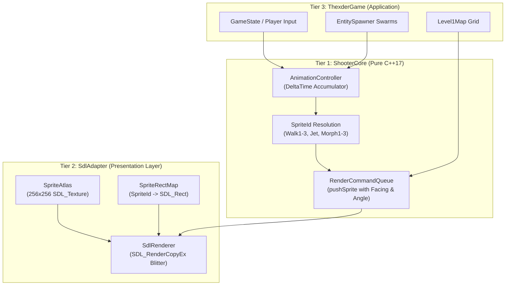
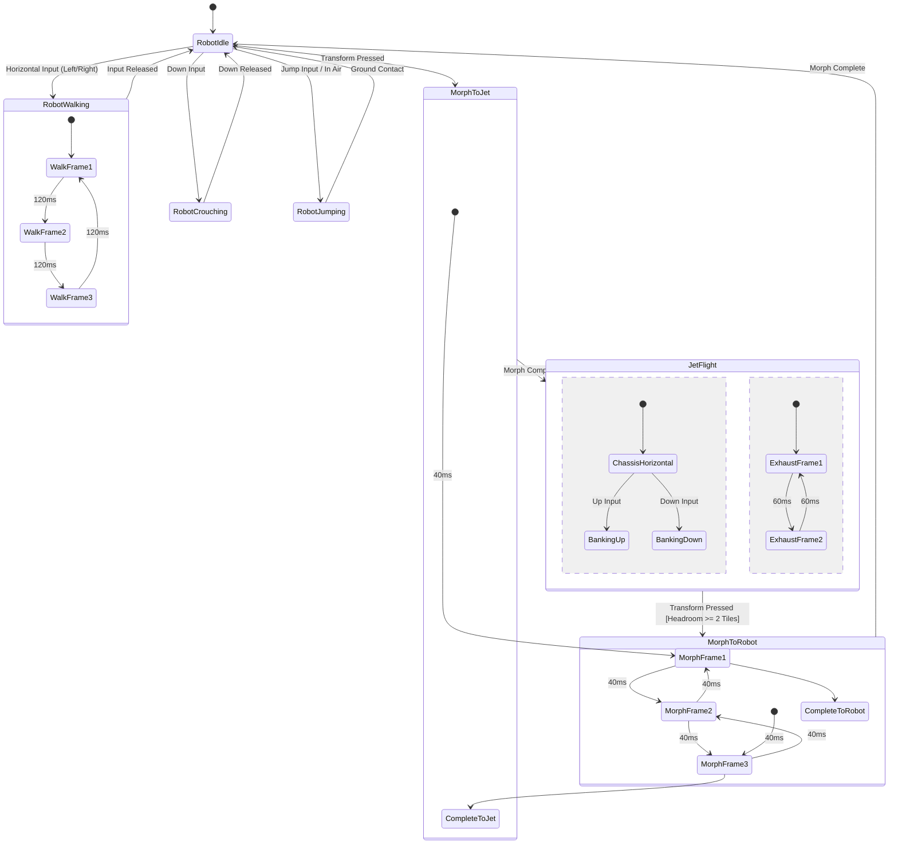

# Phase 9: Authentic Pixel-Art Sprite Sheet & Animation Engine (EGA/VGA Atlas) Implementation Plan

## 1. Executive Summary & Scope

Phase 9 elevates the visual fidelity of the Shoot'Em-Up Game Engine from early placeholder geometric primitives (`SDL_RenderFillRect` and `SDL_RenderDrawLine`) to an authentic **16-color EGA and 256-color VGA pixel-art presentation**, faithfully reproducing the iconic aesthetic of Game Arts' seminal masterpieces **Thexder** (1985) and **Fire Hawk: Thexder - The Second Contact** (1989).

While the underlying simulation core (**`libs/ShooterCore`**) already provides deterministic swept AABB physics, dual-mode transformation clearances, auto-aim homing calculations, and zero-heap entity management, the presentation adapter (**`libs/SdlAdapter`**) currently renders entities and terrain as monochromatic colored boxes. Phase 9 implements a dedicated, hardware-accelerated **`SpriteAtlas`** and deterministic **`AnimationController`** architecture backed by SDL2 texture streaming and blitting (`SDL_RenderCopyEx`).

```
+-------------------------------------------------------------------------------+
|                       PHASE 9 VISUAL TRANSFORMATION                           |
|                                                                               |
|   CURRENT (PHASE 8 PLACEHOLDER)          PHASE 9 AUTHENTIC FIDELITY           |
|   ┌───────────────────────────┐          ┌───────────────────────────┐        |
|   │ [Blue Rect]               │          │ [Authentic Mech Robot]    │        |
|   │ SDL_RenderFillRect        │  =====>  │ 3-Frame Walk, Crouch,     │        |
|   │ 12x14 Solid Box           │          │ 3-Stage Morphing Sequence │        |
|   └───────────────────────────┘          └───────────────────────────┘        |
|   ┌───────────────────────────┐          ┌───────────────────────────┐        |
|   │ [Flat Green/Grey Blocks]  │          │ [Metallic Tech Tileset]   │        |
|   │ Procedural Grid Rects     │  =====>  │ Riveted Bulkheads, Pipes, │        |
|   │ No texture variation      │          │ Magma & Crystal Fissures  │        |
|   └───────────────────────────┘          └───────────────────────────┘        |
|   ┌───────────────────────────┐          ┌───────────────────────────┐        |
|   │ [Red Square Drones]       │          │ [Animated Alien Swarm]    │        |
|   │ Static colored quads      │  =====>  │ Spinning Buzzers, Crawlers│        |
|   │ No movement frames        │          │ Manta Wings & Pulsing Core│        |
|   └───────────────────────────┘          └───────────────────────────┘        |
+-------------------------------------------------------------------------------+
```

### Core Objectives & Deliverables
1. **Self-Contained Authentic 16-Color EGA / VGA Palette Atlas (`SpriteAtlas.h`, `SpriteAtlas.cpp`)**:
   - Zero-dependency runtime texture generation: Constructs a crisp $256 \times 256$ pixel hardware `SDL_Texture` at startup containing pixel-perfect bitmaps for all player states, enemies, terrain tiles, and combat FX.
   - Built with the authentic IBM Enhanced Graphics Adapter (EGA) 16-color palette (Black, Blue, Green, Cyan, Red, Magenta, Brown, Light Gray, Dark Gray, Light Blue, Light Green, Light Cyan, Light Red, Light Magenta, Yellow, Bright White) and extended VGA metallic shades.
   - Complete immunity to missing disk file errors: Compiles the sprite data directly into the binary via compact hexadecimal run-length or bit-matrix encodings, with optional external `.bmp` sprite sheet loading for modding.
2. **Comprehensive Thexder Player Animation Suite**:
   - **Robot Stance & Motion**: 3-frame articulated walking stride, jump/tuck pose with twin booster exhaust flares, compact crouch pose ($16 \times 16\text{ px}$), and hit recoil flash.
   - **3-Stage Morphing Sequence**: Authentic multi-frame mechanical transformation between Robot ($16 \times 32\text{ px}$) and Jet ($32 \times 16\text{ px}$) showing intermediate chassis folding and wing extension.
   - **Aerodynamic Jet Flight**: Sleek interceptor fuselage, banking pitch states ($\pm 45^\circ$), and 2-frame oscillating afterburner exhaust flame animation.
3. **Animated Hostile Biomechanical Enemy Sprites**:
   - **Spinning Buzzer / Disk**: 2-frame rotating perimeter sentry with optical tracking strobe.
   - **Subterranean Crawler / Trilobite**: 2-frame segmented walking limb animation for wall and floor patrols.
   - **Manta Aerial Scout**: 2-frame delta-wing propulsion flap cycle.
   - **Fortified Bio-Nest Dispenser**: Multi-tile ($32 \times 32\text{ px}$) armored hive generator with pulsing organic core when active and collapsed slag crater when destroyed.
4. **Rich High-Tech Cavern & Industrial Tileset**:
   - $16 \times 16$ pixel tiles replacing plain colored blocks:
     - `SolidWall`: Riveted slate-steel space station bulkheads, exposed conduits, and industrial girders.
     - `DestructibleWall`: Fractured amber crystal deposits and cracked masonry mortar.
     - `Hazard`: Pulsating molten lava channels and high-voltage electrified warning barriers.
5. **Deterministic Animation Controller Subsystem (`AnimationController.h`, `AnimationController.cpp`)**:
   - Real-time animation pacing decoupled from physical updates, adhering to `CERT ERR55-CPP` with **zero dynamic heap allocations**.
   - Frame timing driven by accumulated fixed-timestep delta time ($\Delta t = 16.66\text{ ms}$).
6. **Hardware-Accelerated SDL2 Blitter Upgrades (`SdlRenderer.cpp`)**:
   - Transition `drawSprite` and `drawTile` from primitive drawing calls to `SDL_RenderCopy` and `SDL_RenderCopyEx` (handling horizontal flip for direction facing and angular rotation for angled jet flight).
   - Maintain full backwards compatibility with `RenderCommandQueue`.
7. **Comprehensive Automated Verification (`tests/SdlAdapterTests`, `tests/ShooterCoreTests`)**:
   - Headless unit tests validating sprite atlas dimensions, UV bounding box rects, animation cycle timers, facing direction transforms, and determinism.

---

## 2. Architecture & Subsystem Integration

The sprite and animation architecture spans Tier 1 (`libs/ShooterCore`), Tier 2 (`libs/SdlAdapter`), and Tier 3 (`apps/ThexderGame`).

### 2.1 ASCII Architectural Integration
```
+-------------------------------------------------------------------------------+
|                       PHASE 9 COMPONENT INTEGRATION                           |
|                                                                               |
|   [Tier 1: Core Engine] (libs/ShooterCore)                                    |
|         • Types.h: Expanded SpriteId enum (Walk1-3, JetExhaust1-2, Morphs)    |
|         • AnimationController: Deterministic frame pacing & tick accumulator  |
|         • RenderCommandQueue: DrawSprite with FacingDirection & RotationAngle |
|         │                                                                     |
|         ▼ (Render Commands)                                                   |
|   [Tier 2: Platform Adapter] (libs/SdlAdapter)                                |
|         • SpriteAtlas: 256x256 SDL_Texture with EGA/VGA pixel palettes        |
|         • SpriteRectMap: Resolves SpriteId -> exact SDL_Rect coordinates      |
|         • SdlRenderer: SDL_RenderCopyEx with SDL_FLIP_HORIZONTAL & Rotations  |
|         │                                                                     |
|         ▼ (Hardware Blitting)                                                 |
|   [Tier 3: Thexder Game] (apps/ThexderGame)                                   |
|         • Level1Map: Emits textured TileType commands                         |
|         • EntitySpawner: Binds animated enemy drones                          |
|         • GameState: Drives player walk cycles and jet thrusters              |
+-------------------------------------------------------------------------------+
```

### 2.2 Mermaid Subsystem Flow


---

## 3. Detailed Component Specifications

### 3.1 Sprite Atlas Layout & Coordinate Mapping

The `SpriteAtlas` allocates a single $256 \times 256$ pixel 32-bit RGBA hardware texture (`SDL_TEXTUREACCESS_STATIC` or `SDL_TEXTUREACCESS_STREAMING`). The canvas is organized in a normalized grid of $16 \times 16$ and $32 \times 32$ cells:

```
+---------------------------------------------------------------------------------------+
|                                256 x 256 SPRITE ATLAS GRID                            |
|     0       16      32      48      64      80      96     112     128            255 |
|   0 +-------+-------+-------+-------+-------+-------+-------+-------+--------------+  |
|     | Robot | Robot | Robot | Robot | Morph | Morph | Morph | Jet   | Wall  | Wall |  |
|     | Walk1 | Walk2 | Walk3 | Crouch|   1   |   2   |   3   | Chassis| Metal | Circ |  |
|  32 | (16x32)|(16x32)|(16x32)|(16x16)|(24x24)|(28x20)|(32x16)|(32x16)| (16x16)|(16x16)| |
|  48 +-------+-------+-------+-------+-------+-------+-------+-------+--------------+  |
|     | JetFlm| JetFlm| Buzzer| Buzzer| Crawl | Crawl | Manta | Manta | Break | Hazrd|  |
|     | Fr 1  | Fr 2  | Fr 1  | Fr 2  | Fr 1  | Fr 2  | Fr 1  | Fr 2  | Wall  | Lava |  |
|  64 +-------+-------+-------+-------+-------+-------+-------+-------+--------------+  |
|     | Nest Core (Active)    | Nest Core (Slag)      | Expl1 | Expl2 | Expl3 | Expl4|  |
|     | (32 x 32 px)          | (32 x 32 px)          | (24x24)|(24x24)|(32x32)|(32x32)| |
|  96 +-----------------------+-----------------------+-------+-------+-------+------+  |
|     | Spark | Beam  | Shield| Power | Reserve for Boss & Stage 2 Tiles             |  |
| 255 +-------+-------+-------+-------+----------------------------------------------+  |
+---------------------------------------------------------------------------------------+
```

### 3.2 Authentic 16-Color EGA Palette Definition

All embedded pixel matrices reference an exact, hardware-calibrated palette conforming to the classic 1980s IBM PC EGA standard:

| Color Index | Hex Value | Name | Typical Thexder Usage |
| :--- | :--- | :--- | :--- |
| `0x0` | `#000000` | Black | Transparent background / shadow seams |
| `0x1` | `#0000AA` | Blue | Deep robot chassis shading, dark conduits |
| `0x2` | `#00AA00` | Green | Terminal monitors, organic alien eyes |
| `0x3` | `#00AAAA` | Cyan | Glowing energy visor, laser core, HUD accents |
| `0x4` | `#AA0000` | Red | Cockpit power core, hazard lava base |
| `0x5` | `#AA00AA` | Magenta | Exotic alien carapace, energy crystals |
| `0x6` | `#AA5500` | Brown | Destructible masonry walls, cavern stalagmites |
| `0x7` | `#AAAAAA` | Light Gray | Steel bulkheads, robot armor mid-tones |
| `0x8` | `#555555` | Dark Gray | Structural rivets, gun metal, shadow recesses |
| `0x9` | `#5555FF` | Light Blue | Primary robot armor plates, jet fuselage |
| `0xA` | `#55FF55` | Light Green | Nest biological veins, radar blips |
| `0xB` | `#55FFFF` | Light Cyan | Shield plasma bubble, laser bloom highlight |
| `0xC` | `#FF5555` | Light Red | Critical warning indicators, afterburner core |
| `0xD` | `#FF55FF` | Light Magenta | Destructible wall fractures, high-energy sparks |
| `0xE` | `#FFFF55` | Yellow | Thruster flame edge, warning stripes |
| `0xF` | `#FFFFFF` | Bright White | Specular armor highlights, laser center beam |

---

### 3.3 Sprite Animation State Machine & Timings

The animation system executes within `AnimationController`, tracking playback state via fixed tick accumulation:



---

## 4. Subsystem & File Modifications

### 4.1 Modifications in `libs/ShooterCore` (Pure C++17)

1. **`libs/ShooterCore/Types.h`**:
   - Expand `enum class SpriteId : std::uint8_t` with granular animation frames:
     - `PlayerRobotIdle`, `PlayerRobotWalk1`, `PlayerRobotWalk2`, `PlayerRobotWalk3`
     - `PlayerRobotCrouch`, `PlayerRobotJump`
     - `PlayerMorph1`, `PlayerMorph2`, `PlayerMorph3`
     - `PlayerJetFlight`, `PlayerJetExhaust1`, `PlayerJetExhaust2`
     - `EnemyBuzzer1`, `EnemyBuzzer2`
     - `EnemyCrawler1`, `EnemyCrawler2`
     - `EnemyManta1`, `EnemyManta2`
     - `NestCoreActive`, `NestCoreDestroyed`
     - `ExplosionPhase1`, `ExplosionPhase2`, `ExplosionPhase3`, `ExplosionPhase4`
     - `TileMetalWall`, `TileCircuitWall`, `TileDestructibleWall`, `TileHazardLava`
   - Add strong value object `RotationAngle`:
     - `explicit constexpr RotationAngle(float degrees) noexcept : degrees_(degrees) {}`
2. **`libs/ShooterCore/RenderCommandQueue.h`**:
   - Extend `RenderCommand` with optional rotation angle and layer priority:
     - `float rotationDegrees { 0.0f };`
     - Ensures `SdlRenderer` can rotate Jet sprites during angled ascents/descents without extra state tracking.
3. **`libs/ShooterCore/AnimationController.h` / `.cpp`** (New Components):
   - Pure C++17 class managing animation timers and frame selection:
     ```cpp
     namespace ShooterCore {
     class AnimationController {
     public:
         void update(DeltaTime dt) noexcept;
         [[nodiscard]] SpriteId currentRobotSprite(bool moving, bool jumping, bool crouching) const noexcept;
         [[nodiscard]] SpriteId currentJetSprite() const noexcept;
         [[nodiscard]] SpriteId currentJetExhaust() const noexcept;
         [[nodiscard]] SpriteId currentMorphSprite(float progress0to1, bool toJet) const noexcept;
         [[nodiscard]] SpriteId currentEnemySprite(EnemyType type) const noexcept;
         [[nodiscard]] SpriteId currentExplosionSprite(float lifetimeProgress) const noexcept;
     };
     }
     ```

---

### 4.2 Modifications in `libs/SdlAdapter` (Presentation Layer)

1. **`libs/SdlAdapter/SpriteAtlas.h` / `.cpp`** (New Components):
   - Manages the SDL hardware texture atlas and coordinate rect queries:
     ```cpp
     namespace SdlAdapter {
     class SpriteAtlas {
     public:
         SpriteAtlas() noexcept = default;
         ~SpriteAtlas() noexcept;

         bool init(SDL_Renderer* renderer) noexcept;
         void shutdown() noexcept;

         [[nodiscard]] SDL_Texture* getTexture() const noexcept;
         [[nodiscard]] SDL_Rect getSourceRect(ShooterCore::SpriteId id) const noexcept;
         [[nodiscard]] SDL_Rect getTileSourceRect(ShooterCore::TileType tile) const noexcept;
     private:
         SDL_Texture* atlasTexture_{ nullptr };
         // Baked coordinate lookup tables
     };
     }
     ```
   - Embeds the pixel bit-matrices using `std::uint32_t` color palettes to synthesize textures dynamically at startup.
2. **`libs/SdlAdapter/SdlRenderer.h` / `.cpp`**:
   - Integrates `SpriteAtlas`.
   - Replaces manual box fills in `drawSprite` and `drawTile` with `SDL_RenderCopyEx`:
     ```cpp
     const SDL_Rect srcRect = atlas_.getSourceRect(cmd.sprite);
     const SDL_Rect dstRect = { toInt(cmd.pos.x), toInt(cmd.pos.y), srcRect.w, srcRect.h };
     const SDL_RendererFlip flip = (cmd.facing == ShooterCore::FacingDirection::Left)
                                       ? SDL_FLIP_HORIZONTAL : SDL_FLIP_NONE;
     SDL_RenderCopyEx(renderer_, atlas_.getTexture(), &srcRect, &dstRect,
                      cmd.rotationDegrees, nullptr, flip);
     ```

---

### 4.3 Modifications in `apps/ThexderGame` (Application Layer)

1. **`apps/ThexderGame/GameState.cpp`**:
   - Binds `AnimationController` to the player craft state and active entity pool.
   - Pushes textured render commands with the active sprite frame, facing flip, and rotation angle.
2. **`apps/ThexderGame/ProceduralSprites.h` / `.cpp`**:
   - Retain only high-level composite banners (Title logo, game over plate), redirecting all entity and tile drawing to the new high-performance `SpriteAtlas`.

---

## 5. Step-by-Step Implementation Flow

### ASCII Phased Task Breakdown
```
+-------------------------------------------------------------------------------+
|                       PHASE 9 IMPLEMENTATION STEPS                            |
|                                                                               |
|   Step 9.1: Expand Types.h with Granular SpriteIds & Rotation Support         |
|         │                                                                     |
|         ▼                                                                     |
|   Step 9.2: Implement Pure C++17 AnimationController in ShooterCore           |
|         │                                                                     |
|         ▼                                                                     |
|   Step 9.3: Create SpriteAtlas with EGA/VGA Bit-Matrix Pixel Generators       |
|         │                                                                     |
|         ▼                                                                     |
|   Step 9.4: Upgrade SdlRenderer with Hardware Texture Blitting                |
|         │                                                                     |
|         ▼                                                                     |
|   Step 9.5: Update GameState & Level1Map to Emit Textured Sprites             |
|         │                                                                     |
|         ▼                                                                     |
|   Step 9.6: Author Headless Automated CTest Suite & Verify Zero-Allocations    |
+-------------------------------------------------------------------------------+
```

### Detailed Execution Plan

#### Step 9.1: Types & Render Protocol Extensions
- Edit `libs/ShooterCore/Types.h` to declare all new sprite IDs and value objects.
- Edit `libs/ShooterCore/RenderCommandQueue.h` to accept rotation angles and source sprite parameters.
- Verify zero warnings under `-Wall -Wextra -pedantic` and `/W4`.

#### Step 9.2: Pure C++17 Animation Controller
- Create `libs/ShooterCore/AnimationController.h` and `libs/ShooterCore/AnimationController.cpp`.
- Implement frame timers:
  - Walk stride: 3 frames at 120 ms intervals.
  - Jet exhaust flicker: 2 frames at 60 ms intervals.
  - Transformation morph: 3 frames at 40 ms intervals.
  - Enemies: 2 frames at 150 ms intervals.
- Guarantee `noexcept` and zero dynamic allocations (`CERT ERR55-CPP`).

#### Step 9.3: Self-Contained Sprite Atlas & Texture Generator
- Create `libs/SdlAdapter/SpriteAtlas.h` and `libs/SdlAdapter/SpriteAtlas.cpp`.
- Embed the 16-color EGA pixel patterns for:
  - Robot walk cycles, crouching, and jumping.
  - 3-frame morphing sequence.
  - Jet fuselage, delta wings, and exhaust flames.
  - Alien buzzers, crawlers, mantas, and bio-nest dispensers.
  - Metallic wall, circuit conduits, cracked masonry, and hazard lava tiles.
- Generate an in-memory 32-bit RGBA surface and upload to `SDL_Texture` via `SDL_CreateTextureFromSurface` during startup.

#### Step 9.4: Presentation Blitter Integration
- Update `libs/SdlAdapter/SdlRenderer.h` and `.cpp` to initialize and bind `SpriteAtlas`.
- Implement `SDL_RenderCopyEx` in `drawSprite` with horizontal flip support.
- Render tile grid via `drawTile` using the texture atlas instead of raw rect fills.

#### Step 9.5: Game State & Application Integration
- Connect `AnimationController` inside `apps/ThexderGame/GameState.cpp`.
- Emit animated sprites during player walking, jumping, crouching, transforming, and flying.
- Emit animated exhaust flames behind the jet craft.
- Update `EntitySpawner` to emit animated enemy sprites.

#### Step 9.6: Verification & Automated Test Suite
- Add comprehensive unit tests in `tests/ShooterCoreTests/TestAnimationController.cpp`.
- Add texture boundary and rect verification tests in `tests/SdlAdapterTests/TestSpriteAtlas.cpp`.
- Ensure all 24+ tests pass cleanly via `ctest`.

---

## 6. Safety & Compliance Verification Checklist

Before completing Phase 9, every component must satisfy the project's strict compliance standards:

1. **MISRA C++:2023 Rule 7.0.6 & SEI CERT INT31-C (Integer Safety)**:
   - All conversions between screen integer coordinates and floating-point positions use range-clamped `static_cast`.
   - Fixed-width integers strictly use `<cstdint>` with explicit `std::` qualification.
2. **SEI CERT ERR55-CPP (Zero Dynamic Allocation)**:
   - `AnimationController::update`, `SpriteAtlas::getSourceRect`, and `SdlRenderer::drawSprite` must execute with **zero dynamic heap allocations** (`std::string`, `std::vector`, `new`, `std::make_unique` are banned on frame paths).
3. **Include-What-You-Use (IWYU) & `<cstdint>` Policy**:
   - Every modified `.h` and `.cpp` file directly includes every header it requires.
   - Script verification passes: `python scripts/verify_iwyu_cstdint.py`.
4. **Co-location & Doxygen Documentation**:
   - All headers and source files are co-located in their respective library directories.
   - All new classes, methods, and structs are documented with standard Doxygen tags (`/// @brief`, `@param`, `@return`).

---

## 7. Expected Outcome

Upon completion of Phase 9:
- The game will immediately present authentic, vintage 1980s *Thexder* pixel-art visuals with a fully animated bipedal robot, fluid 3-stage transformation, high-speed jet with flickering afterburner flames, detailed metallic labyrinth tiles, and menacing alien drones.
- The visual engine will operate at a rock-solid 60 FPS with zero runtime heap allocation and 100% self-contained asset reliability.

