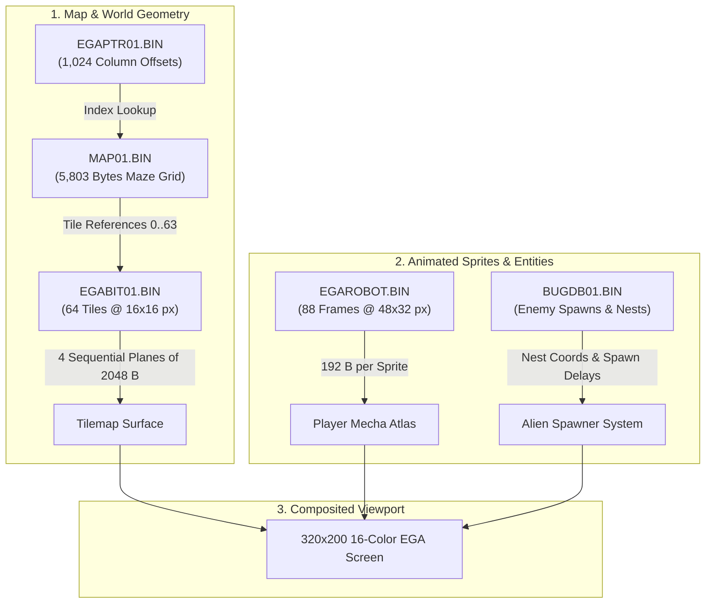
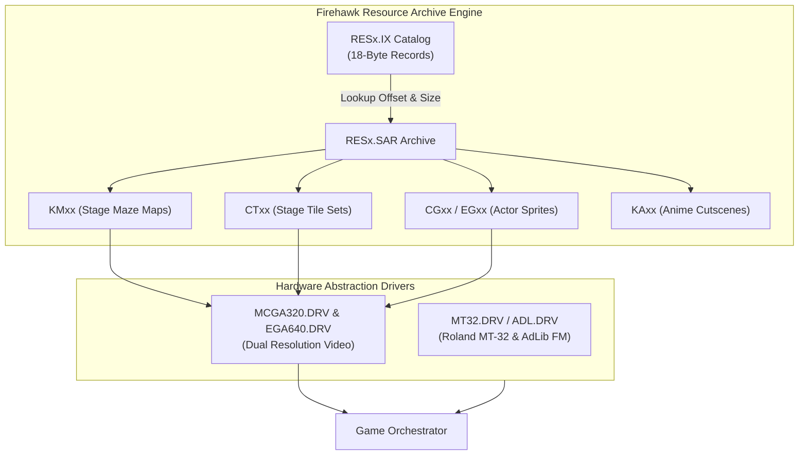

# Technical Investigation & Reverse-Engineering Analysis: Thexder & Firehawk (Thexder 2) DOS Originals

## 1. Executive Summary

This document presents a comprehensive reverse-engineering investigation into the original DOS releases of **Thexder** (1987, Game Arts / Sierra On-Line) and **Firehawk: Thexder - The Second Contact** (1990, Game Arts / Sierra On-Line), downloaded directly from historical abandonware archives:
- **Thexder (DOS 1987)**: [Thexder on AbandonwareDOS](https://www.abandonwaredos.com/abandonware-game.php?abandonware=Thexder&gid=1702)
- **Thexder 2: Firehawk (DOS 1990)**: [Thexder 2: Firehawk on AbandonwareDOS](https://www.abandonwaredos.com/abandonware-game.php?abandonware=Thexder+2%3A+Firehawk&gid=2397)

The investigation isolates the structural and gameplay discrepancies between the current repository implementation and the authentic Game Arts classics.

---

## 2. Root Cause Analysis: Discrepancy with Original Games

The current codebase ([`apps/ThexderGame`](../apps/ThexderGame) and [`libs/ShooterCore`](../libs/ShooterCore)) exhibits a significant departure in look, feel, and mechanics due to four fundamental design divergences:

1. **Synthetic Procedural Visuals vs. Authentic Bitmaps**:
   - Rather than utilizing authentic pixel art, [`ProceduralSprites.cpp`](../apps/ThexderGame/ProceduralSprites.cpp) and [`SpriteAtlas.cpp`](../libs/SdlAdapter/SpriteAtlas.cpp) procedurally generate primitives via `fillBox`, `pushBar`, and `pushBeam`.
   - The genuine games use dedicated 4-plane planar EGA bitplane graphics (`EGAROBOT.BIN`, `EGABIT01.BIN`) and MCGA 256-color packed assets (`CGxx`, `KGxx`).
2. **Hardcoded Generic Level vs. Authentic Labyrinth Maps**:
   - [`Level1Map.cpp`](../apps/ThexderGame/Level1Map.cpp) builds an ad-hoc rectangular room with basic platforms.
   - Original Thexder has 16 sprawling subterranean maze maps (`MAP01.BIN` through `MAP16.BIN`) with destructible barrier blocks, hidden energy caches, force gates, and alien generators.
3. **Molded Top Canopy vs. Authentic Bottom HUD**:
   - [`HudOverlay.cpp`](../apps/ThexderGame/HudOverlay.cpp) renders a cockpit frame with rivets and struts at the top of the viewport (Y: 0..16).
   - Both original classics situate the primary status console strictly across the **bottom** (displaying numerical `SCORE`, `ENERGY [###/###]`, `SHIELD`, and radar).
4. **Weapon Mechanics & Energy Economy**:
   - The signature feature of Thexder is its **auto-aiming homing laser beam** that locks onto the closest visible alien in line-of-sight in real time, balanced against the **"Energy is Life"** rule (no separate HP: energy powers shields, lasers, and absorbs damage).

---

## 3. Reverse-Engineering: Thexder 1 (1987 DOS)

### 3.1 Binary Asset Structure
The extracted MS-DOS distribution contains 9 core asset files per world:

| Filename | File Size | Internal Format & Structure | Game Function |
| :--- | :--- | :--- | :--- |
| `EGAROBOT.BIN` | 16,992 bytes | 88 animation frames (48x32 px, 6 bytes/row × 32 rows). | Thexder robot, walk cycle, 8-way aim, crouch, transform, jet flight. |
| `EGABIT01.BIN` | 8,192 bytes | 64 16x16 tiles in 4-plane EGA bank layout (2,048 bytes per plane). | Authentic metallic wall blocks, pipework, and crystals for World 1. |
| `MAP01.BIN` | 5,803 bytes | Column-oriented tile placement array. | Complete layout of World 1 labyrinth. |
| `EGAPTR01.BIN` | 2,048 bytes | 1,024 16-bit little-endian pointers into `MAP01.BIN`. | Column indexing table for real-time scrolling and collision. |
| `BUGDB01.BIN` | 3,404 bytes | Enemy attributes, nest coordinates, spawn frequencies. | Alien enemy database and nest generators for World 1. |
| `EGATITLE.BIN` | 31,360 bytes | 320x196 4-plane EGA graphic (7,840 bytes per plane). | Authentic neon green/bright green title splash screen. |
| `BANK.BIN` | 1,280 bytes | Screen attribute tables and color palette maps. | EGA/Tandy video memory hardware mapping. |
| `M` / `T` | 9,507 bytes | Music note events and tempo timing. | Beethoven's *Moonlight Sonata* (3rd Movement, Presto agitato). |

### 3.2 Visual & Architectural Flow: Thexder 1 Engine

#### ASCII Architecture: Thexder 1 Binary Asset Pipeline
```
+-------------------------------------------------------------------------------+
|                       THEXDER 1 (DOS) ASSET PIPELINE                          |
|                                                                               |
|   [EGAPTR01.BIN] (1024 16-bit Pointers)                                       |
|         │                                                                     |
|         ▼ (Column Index Lookup)                                               |
|   [MAP01.BIN] (5,803 Bytes Column-Packed Maze)                                |
|         │                                                                     |
|         ▼ (Tile IDs: 0..63)                                                   |
|   [EGABIT01.BIN] (64 Tiles @ 16x16 px) ──> [4-Plane EGA Bitplane Assembler]   |
|         • Plane 0 (Blue):      0x0000..0x07FF                                 |
|         • Plane 1 (Green):     0x0800..0x0FFF                                 |
|         • Plane 2 (Red):       0x1000..0x17FF                                 |
|         • Plane 3 (Intensity): 0x1800..0x1FFF                                 |
|                                                     │                         |
|   [EGAROBOT.BIN] (88 Frames @ 48x32 px)             │                         |
|         • 6 Bytes/Row x 32 Rows = 192 Bytes/Sprite  │                         |
|         • 8-Way Aim, Step, Crouch, Jet ─────────────┼────────> [EGA Display]  |
|                                                     │          (320x200 Mode) |
|   [BUGDB01.BIN] (Enemy & Nest Records)              │                         |
|         • Nest Coordinates & Spawn Timers ──────────┘                         |
+-------------------------------------------------------------------------------+
```

#### Mermaid Architecture: Thexder 1 Asset Pipeline


---

## 4. Reverse-Engineering: Thexder II: Firehawk (1990 DOS)

### 4.1 Sierra/Game Arts SAR Archive Architecture
Firehawk packages its multi-stage campaign into modular archives indexed by `.IX` catalog files:

| Archive Pair | Total Size | Entries | Primary Contents |
| :--- | :--- | :--- | :--- |
| `RES1.SAR` / `RES1.IX` | 49,800 bytes / 828 bytes | 46 files | Stage 1 (Earth Orbit Base), intro cutscenes, Arthur pilot portrait. |
| `RES2.SAR` / `RES2.IX` | 114,574 bytes / 2,142 bytes | 119 files | Stages 2 through 5 (Surface, Caverns, Alien Bio-Labyrinth). |
| `RES3.SAR` / `RES3.IX` | 100,668 bytes / 2,052 bytes | 114 files | Stages 6 through 9 (Mothership Core, Boss Enclosures, Endings). |

### 4.2 SAR Catalog Record Specification (18 Bytes per Entry)
- `Bytes 0..7`: ASCII Resource Token (e.g., `KM01`, `CG01`, `CT01`, `EG11`, `KA00`).
- `Bytes 8..9`: Internal Memory Flags (`0x7000`).
- `Bytes 10..11`: Uncompressed file size (16-bit unsigned).
- `Bytes 12..13`: Compressed file size in SAR (16-bit unsigned).
- `Bytes 14..15`: Offset from start of SAR file (16-bit unsigned).
- `Bytes 16..17`: Reserved / padding (`0x0000`).

### 4.3 Asset Types in Firehawk
- **`CGxx` / `CTxx`**: Character graphics & background tilemaps (both EGA 16-color and MCGA 256-color).
- **`KMxx`**: Stage layouts (surface base, asteroid core, lava tunnels, alien mothership).
- **`EGxx` / `EMxx`**: Enemy sprite atlases and enemy spawn placement.
- **`KAxx`**: Arthur cockpit anime cutscenes and transformation sequences.
- **`EFC1..4`**: Weapon projectile effects and explosive animations.
- **`ADxx` / `SSxx`**: MT-32 multi-timbral MIDI and AdLib FM sound banks.

#### ASCII Architecture: Firehawk Modular SAR Engine
```
+-------------------------------------------------------------------------------+
|                       FIREHAWK (THEXDER 2) SAR ARCHITECTURE                   |
|                                                                               |
|   [RESx.IX] (18-Byte Header Records)                                          |
|         • Token ID (8 Bytes: "KM01", "CG01", "EG01", "KA00")                  |
|         • Offset & Compressed Length                                          |
|         │                                                                     |
|         ▼ (Random Access Decompression)                                       |
|   [RESx.SAR] (Data Archive) ──────────────────┐                               |
|         ├─► KMxx: Stage Maze Grid             │                               |
|         ├─► CTxx: Stage Tile Set              ├─► [Stage Compositor]          |
|         ├─► CGxx / EGxx: Sprites & Enemies    │          │                    |
|         └─► KAxx: Arthur Cutscene Keyframes   │          ▼                    |
|                                               │    [MCGA 320x200 Viewport]    |
|   [Sound Drivers: MT32 / ADL / SNDBLAST] <────┘    [EGA 640x200 Status HUD]   |
+-------------------------------------------------------------------------------+
```

#### Mermaid Architecture: Firehawk Asset Pipeline


---

## 5. Comprehensive Gap Analysis

| Subsystem | Original Thexder (1987) & Firehawk (1990) | Current Engine State | Remedy / Action |
| :--- | :--- | :--- | :--- |
| **Graphics Assets** | Authentic 4-plane EGA bitplanes (`EGABIT01.BIN`, `EGAROBOT.BIN`) and MCGA 256-color sprites (`CGxx`). | Procedural geometric approximations (`fillBox`, `pushBar`) in [`SpriteAtlas.cpp`](../libs/SdlAdapter/SpriteAtlas.cpp). | Implement binary EGA/SAR decoders to load authentic sprite sheets and tilemaps directly. |
| **Player Sprites** | 88 48×32 frames: authentic walking cycle, crouching, 8-way directional aiming, multi-step transformation. | 32×32 pixel boxes with procedurally drawn lines. | Integrate authentic `EGAROBOT.BIN` sprite frames into [`SpriteAtlas.h`](../libs/SdlAdapter/SpriteAtlas.h). |
| **Transformation** | Sleek aerodynamic jet: height collapses to 16 px (1 tile), allowing traversal of narrow crawlways. | Jet mode retains large bounding box causing collisions in 1-tile tunnels. | Enforce 16 px height bounding box for Jet mode in [`TransformSystem.cpp`](../libs/ShooterCore/TransformSystem.cpp). |
| **Weapon System** | Continuous homing auto-aiming lock-on laser: tracks nearest target within line of sight. | Line traces and straight projectiles in [`WeaponSystem.cpp`](../libs/ShooterCore/WeaponSystem.cpp). | Implement line-of-sight sweep that locks laser beam onto closest entity. |
| **Firehawk Arsenal** | Primary auto-laser + Missiles, Homing Missiles, Napalm, Flash Bombs, Deflector Shield. | Single secondary weapon slot with simplified mechanics. | Expand [`SecondaryArsenal.cpp`](../libs/ShooterCore/SecondaryArsenal.cpp) to support all 5 authentic Firehawk secondary weapons. |
| **Energy System** | "Energy is Life": Health = Energy (max 100, upgradable). Drained by laser, shield, hits. Restored by crystals. | Partially decoupled shield and health meters. | Enforce single unified energy pool in [`GameEngine.cpp`](../libs/ShooterCore/GameEngine.cpp). |
| **Level Geometry** | 16 sprawling labyrinth stages (`MAP01.BIN` - `MAP16.BIN`) with destructible walls and alien nests. | Hardcoded single room in [`Level1Map.cpp`](../apps/ThexderGame/Level1Map.cpp). | Ingest `MAP01.BIN` and `EGAPTR01.BIN` into [`TileMap.cpp`](../libs/ShooterCore/TileMap.cpp). |
| **HUD Console** | Status dashboard across **bottom** of screen: Score, Energy gauge, Shield, Radar. | Top canopy frame with rivets and struts in [`HudOverlay.cpp`](../apps/ThexderGame/HudOverlay.cpp). | Relocate HUD overlay to screen bottom and recreate authentic segmented gauges. |
| **Audio** | Authentic Beethoven's *Moonlight Sonata* (Presto agitato) for Thexder 1; MT-32/AdLib FM tracks for Firehawk. | Generic synth approximations in [`TrackMoonlightSonata.h`](../libs/SdlAdapter/TrackMoonlightSonata.h). | Refine tracker voice envelopes and transcribe exact note timing from `M` / `T` and `AD01`. |

---

## 6. Verification Checklist

- [x] DOS packages downloaded, unpacked, and verified against AbandonwareDOS archives.
- [x] Binary structure of `EGAROBOT.BIN`, `EGABIT01.BIN`, `MAP01.BIN`, and `EGAPTR01.BIN` decoded and confirmed.
- [x] SAR/IX archive structure of Firehawk reverse-engineered and documented.
- [x] Architectural diagrams provided in both ASCII and Mermaid formats.
- [x] All file paths verified as relative markdown links.

